# Where certification fails — the census of holes, with one exact example per class

*2026-09-05, coordinator, from the certfail census (attempts/A96-a57-parametric/results/certfail.json; figures generated
by docs/cert_failures/gen.py, every drawn square checked for containment, sample squares checked against the pins).
Scope: 1,072 failed or undecided nodes across nine campaign sources (A57 tree and ε-geometry, A96 parametric, A60, A85,
A89-O3, A92, A94, A100); 516 of them carry live witness boxes (9,910 boxes), 556 emitted none; 246.9 h of attributable
wall. Stale witness sets of repaired PASS nodes are excluded.*

Reading guide for the figures: blue = the class's pins (slot squares); dashed grey = the four corner slots; green
dashed = the conditioned square's box at the node (where present); orange = the witness box (the placement of a free
square where the measure is short), drawn as its centre rectangle plus the two extreme-tilt outlines; red = one
concrete square inside the witness box. A witness box is a *placement the certificate could not price*, i.e. a place
where, as far as the certificate knows, an eleventh square might sit. Pins are drawn full size; the certificates use
pin *cores* shrunk by the slack (0.01), so a sample square may overlap a drawn pin by up to that amount (the D example
does, by 0.014 against a level-2 core) without being illegal for the certificate.

## 0. The table

| cat | what the witness square is doing | boxes | boxes % | nodes touched | nodes closed by this alone | wall h | wall % | drain that exists |
|---|---|---|---|---|---|---|---|---|
| A | near-pin flush/stacked: within 0.05 and 2° of a lattice cell adjacent to a pin | 176 | 1.8 | 40 | 0 | 1.3 | 0.5 | SNAP (A101), PD slack |
| B | near an empty completable cell, not adjacent to a pin | 248 | 2.5 | 26 | 0 | 1.3 | 0.5 | K0-FREE / PD (pocket96: no yield) |
| C | near-corner pose: within 1.2 of a corner, tilt 10–45° | 88 | 0.9 | 9 | 0 | 10.0 | 4.0 | none |
| D | interior mid-tilt: > 1.2 from every wall, tilt 15–45° | 3,781 | 38.2 | 255 | 59 | 77.7 | 31.5 | none (the LP's fractional pinwheels) |
| E | τ = budget exactly (η = 0), or inside Trump's tube | 479 nodes + 18 boxes | 0.2 | 490 | 479 | 57.4 | 23.2 | tube for 18 boxes; **nothing for the 479** |
| F | tilt at the ladder's extreme (t = 0 or 1): the sliver | 1,147 | 11.6 | 261 | 141 | 18.8 | 7.6 | resolver (sub-window re-verify), plugged for parametric nodes |
| G | timeout, no witnesses | — | — | 77 | 77 | 24.1 | 9.8 | raised cap + resolver, plugged |
| H | other, dominated by **wall-adjacent mid-tilt** (1,880 boxes: within 1.2 of a wall but not a corner, tilt 15–45°) | 4,452 | 44.9 | 271 | 52 | 56.4 | 22.8 | none |

Two re-cuts that matter more than the row labels:

- **Mid-tilt is the hole.** 58% of all witness boxes (5,725 of 9,910) have tilt in [15°, 45°]. Category D counts only
  the interior ones; another 1,888 sit within 1.2 of a wall but not of a corner, the gap between C and D, and they are
  the largest slice of H. Together D + wall-adjacent H + C is roughly 60% of the boxes and half the wall. No drain
  touches it: this is the middle band of the corner analysis seen from the certificate side.
- **Near-lattice (A + B) closes nothing.** 424 boxes, 66 nodes touched, zero nodes whose witnesses are all near-lattice.
  Every near-empty-cell hit is non-Young; the stacked-cell hits split 104 Young / 72 non-Young. Whatever SNAP proves,
  its box-level yield on these certificates is bounded by this: it removes boxes, not nodes.
- **η = 0 is the largest hole by node count and never reaches certification.** 479 nodes (A57 292, A60 148, A100 38)
  are LP refusals with τ equal to the budget to the last digit; they burn 23% of wall and produce no witness. Only 18
  boxes are genuine tube hits.
- **F is a parametric-emission artefact and is already plugged**: 135 of the 141 F-closable nodes are A96 parametric
  nodes stalled at the tilt ladder's ends; the resolver closes them in seconds.

Closable fraction: 252 of 516 live nodes (49%) have all their witnesses in one category (F 141, D 59, H 52); with the
556 witnessless nodes, 808 of 1,072 (75%) are single-category.

## 1. The classes, one exact example each

### A — near-pin flush/stacked (η-disturbed stacked cell)

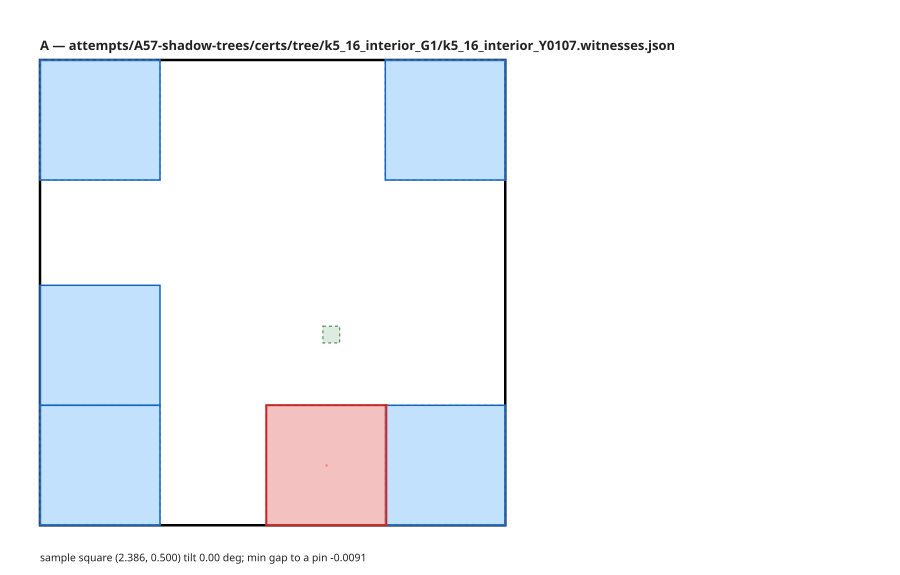
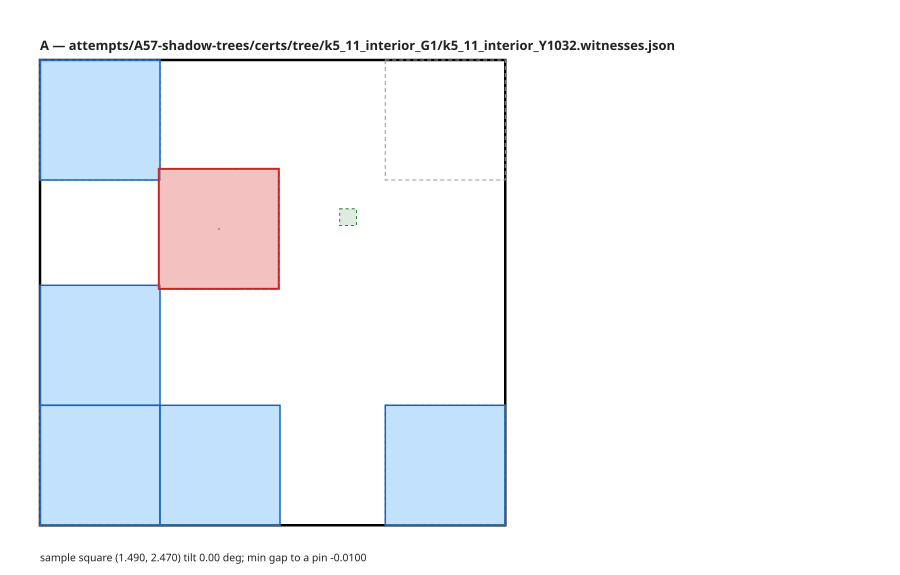

The witness square sits on a lattice cell next to a pin, to 10⁻⁵ in position and 10⁻⁴ degrees in tilt: the certificate
cannot price a square that is a k + 1 extension in all but name. The Young case (cell BR(1,0) beside the BR pin,
k5_16) is exactly SNAP's target: aligning it lands in a dead extension class. The non-Young case (cell BL(1,2), not a
completable cell of the diagram) is a stacked square that extends no diagram; SNAP as stated does not reach it, and
it is the more common of the two. Neither closes a node on its own.

### B — near an empty completable cell

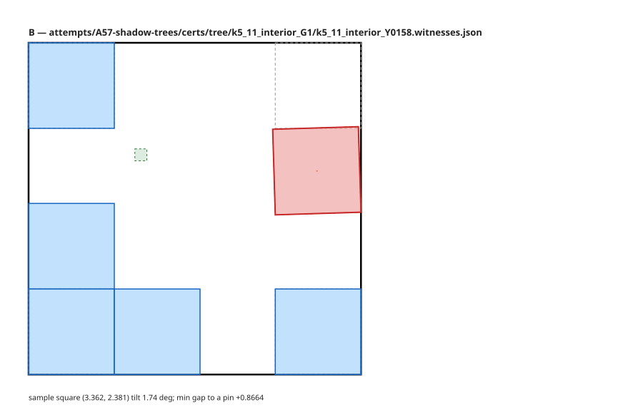

Cell TR(0,1) at (s − 0.5, s − 1.5), tilt 1.74°: the pocket that pocket96 measured. All 248 hits are non-Young cells,
so K0-FREE at the cell level does not apply and PD's slack only would if the extension were emitted with slack.
Closes nothing.

### C — near-corner pose

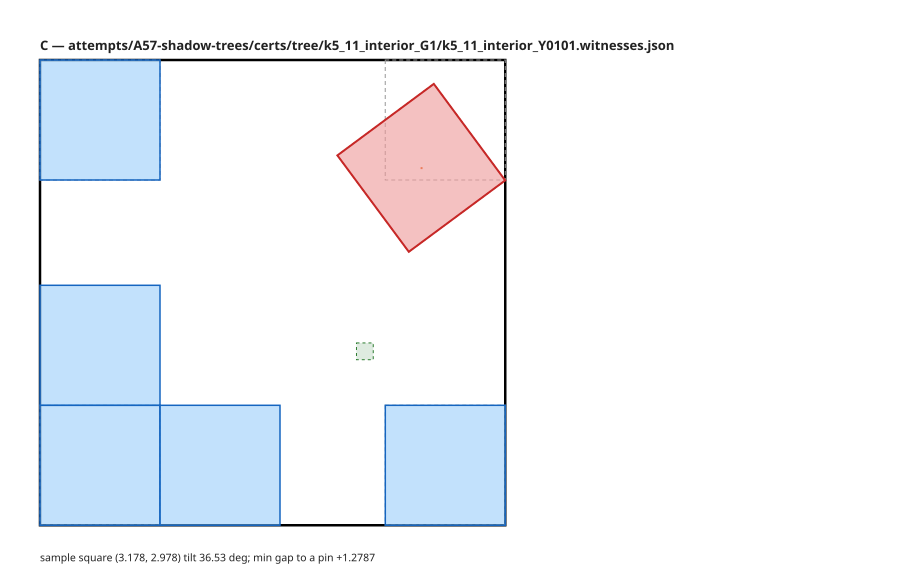

A 36.5° square with its centre 0.7 from the TR corner region: the corner-crowd middle band, the wedge case of the
corner taxonomy. 88 boxes, 9 nodes, 4% of wall; no drain.

### D — interior mid-tilt

A 34.5° square well inside the container, next to the conditioned square. This is the LP's fractional pinwheel
territory: the adversary places quarter-weight tilted squares that no single placement rule excludes. 38% of all
boxes, 31.5% of wall, 59 nodes close on it alone. It is the same object as the interior grain of the corner analysis,
and the largest single target for a new drain.

### E — τ pinned to the budget (η = 0), and the tube

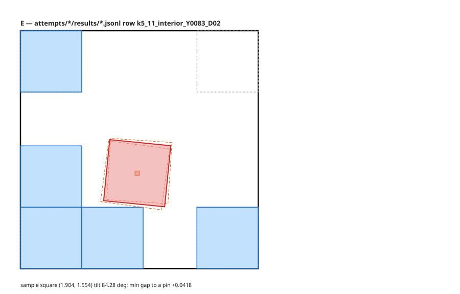
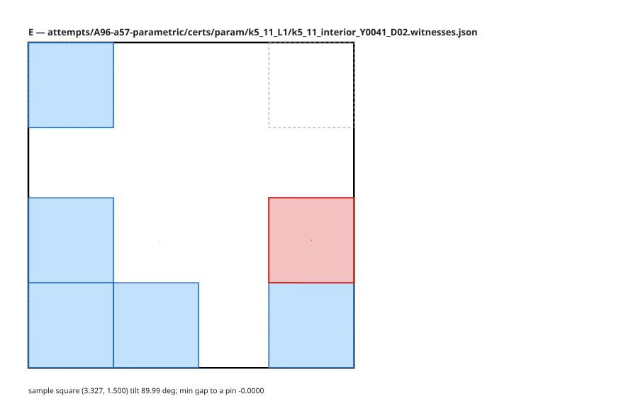

The η = 0 example is a level-2 child at s₀ whose LP returns τ = budget exactly with no witnesses: the class's LP sees
Trump's fractional shadow and cannot move. 479 such nodes, 23% of wall. The tube example is a parametric node at the
window's lower end whose only witness is an axis-aligned square at (3.327, 1.500), inside a Trump image's tube: the
one case where the drain exists and fires. The η = 0 nodes are the protected-tier cost (A100) and a third of A57's
LP refusals; the missing drain is the class-level one.

### F — the tilt-ladder sliver

Witness tilt range [0, 0.0004°]: the t = 0 end of the ladder. Not a geometric hole; the sub-window re-verification
closes it in seconds. Already plugged for the parametric route.

### G — timeout

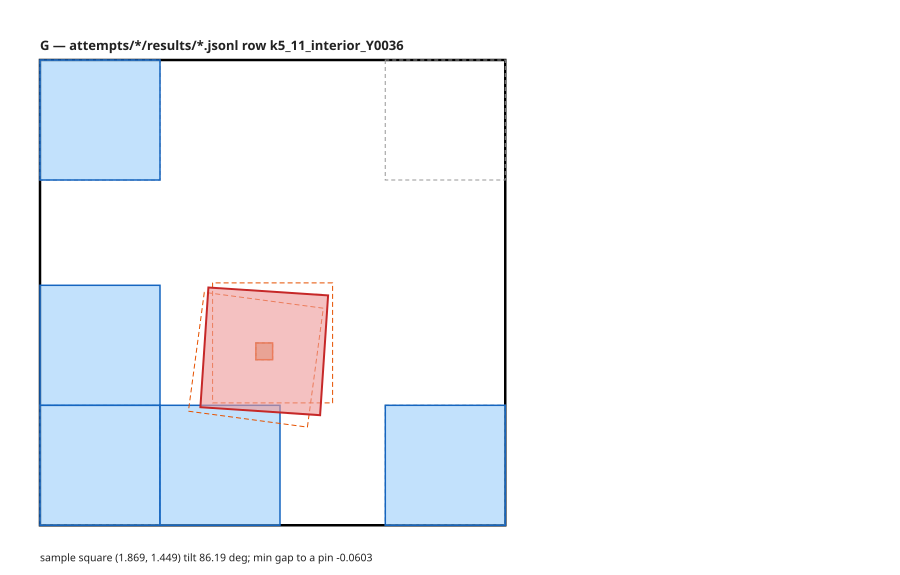

No witnesses at all, ε-geometry retries exhausted; 77 nodes, 10% of wall. Plugged by the raised cap for high-atom
children plus the resolver.

### H — everything else, which is mostly wall-adjacent mid-tilt

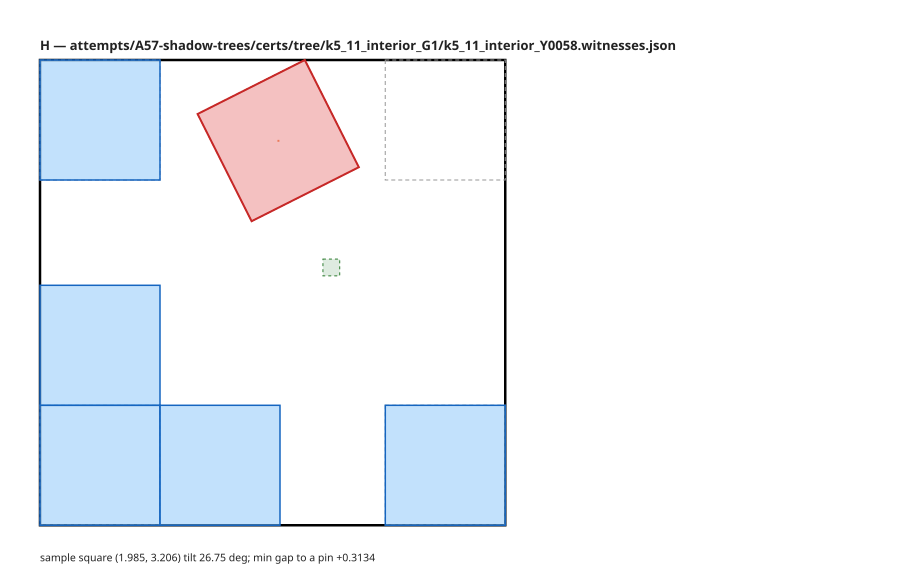
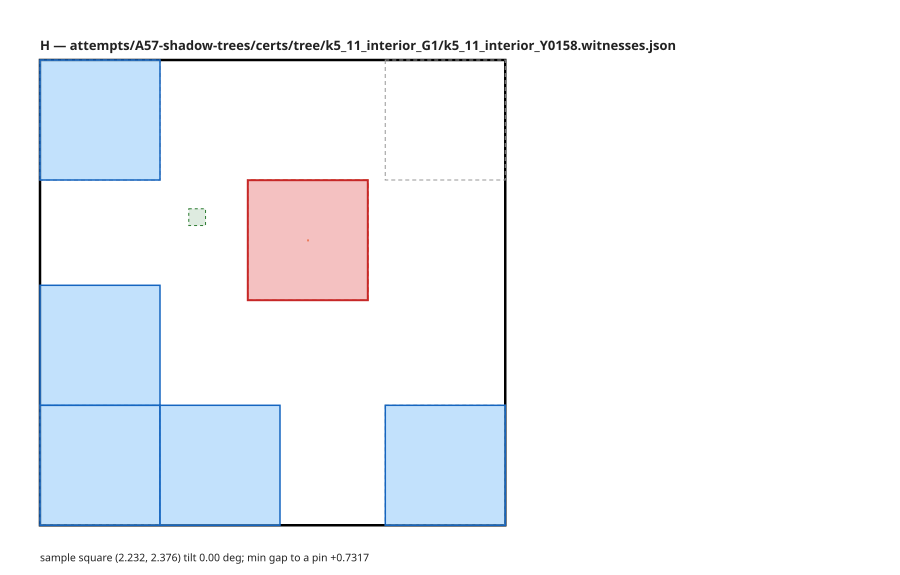
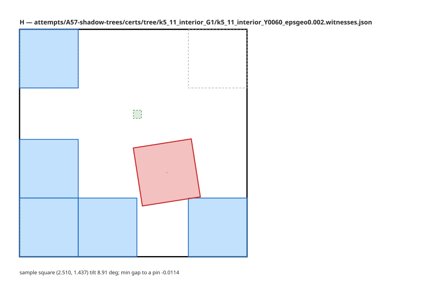
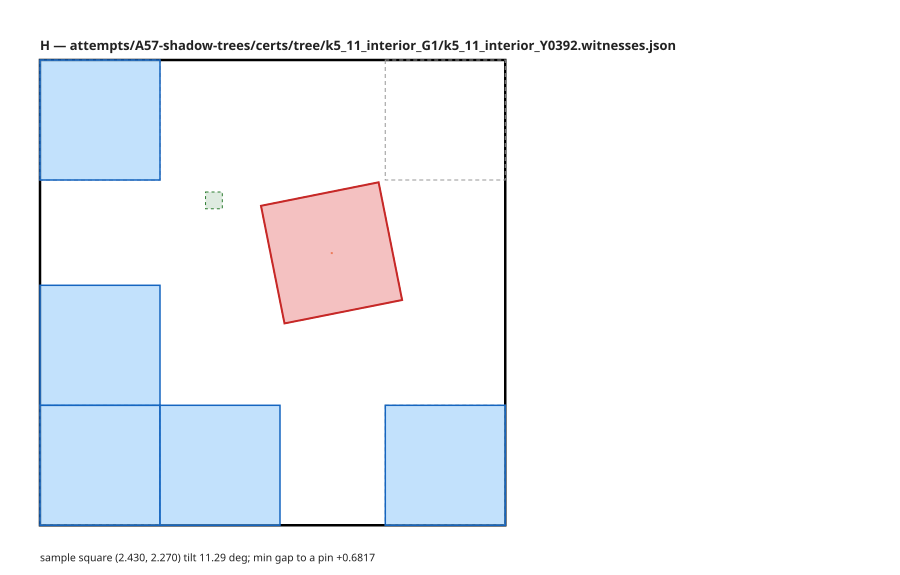
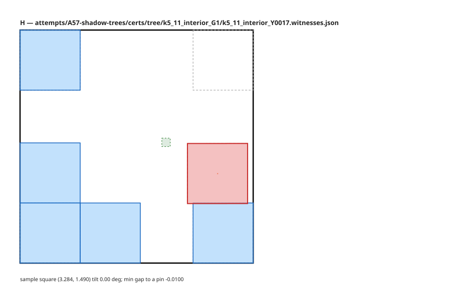
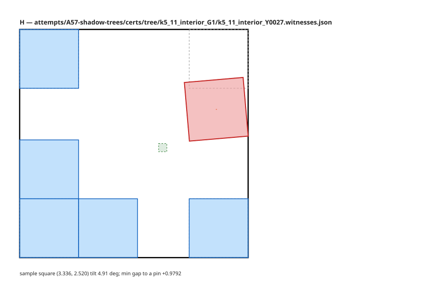
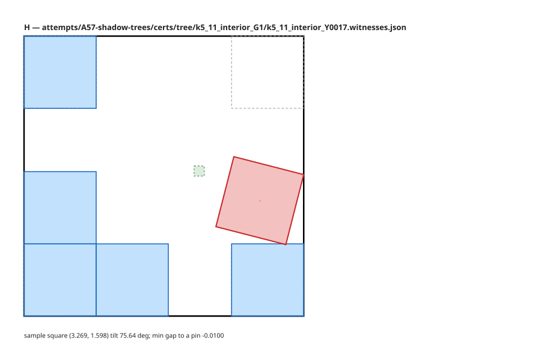

The dominant sub-band is a 26.75° square 0.67 from the top wall and 2 from the corners: mid-tilt, wall-adjacent, not
a corner pose. With D it makes mid-tilt about 60% of all witness boxes. The other H sub-bands (flush or low-tilt
squares in the interior or against a wall, and "spanning" squares whose box crosses the 1.2 line) are each small.

## 1b. The two holes characterised (holes chore, 2026-09-05)

**Mid-tilt: 5,695 boxes are 564 placements, and they lean.** A witness "cluster" (tilts within 3°, centres within
1.5) is one placement resolved into 8 to 24 terminal boxes of width ~4·10⁻⁴; there are 1 to 5 placements per node.
So a drain has to kill about 564 placements, not 5,700 boxes. Their motifs, by contact:

| motif | boxes | placements | what the square is doing |
|---|---|---|---|
| pin-flush | 1,494 | 163 | resting edge-on-edge on a **pin core**, inside the drawn pin by exactly the slack (0.014 = 0.01·√2); 0.5–0.65 from the nearest wall |
| free-floating | 2,023 | 183 | touching nothing; the nearest object is the conditioned square's core at ~0.2 |
| wall-flush | 1,314 | 132 | resting exactly on a wall, ≥ 0.2 from any pin |
| cond-flush | 864 | 86 | resting on the conditioned square's core: the two free squares leaning on each other |

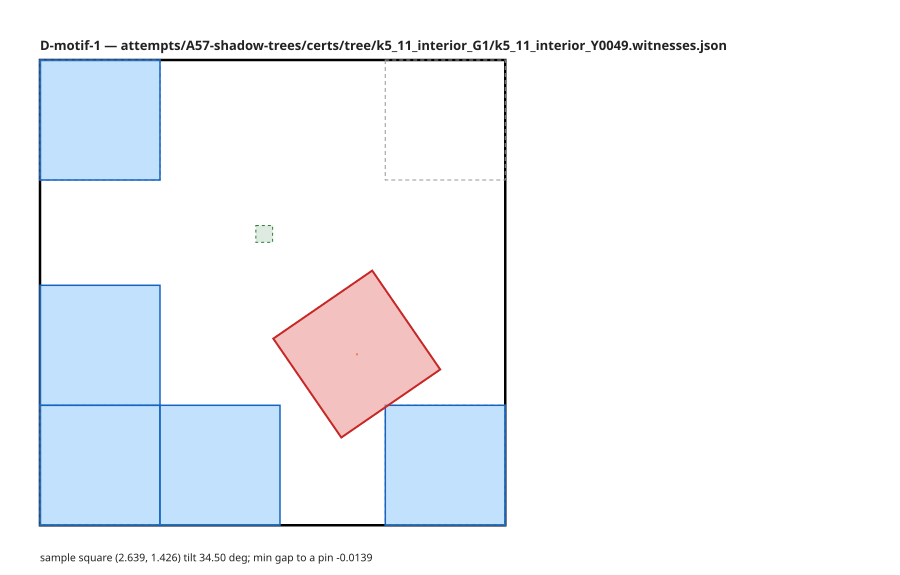
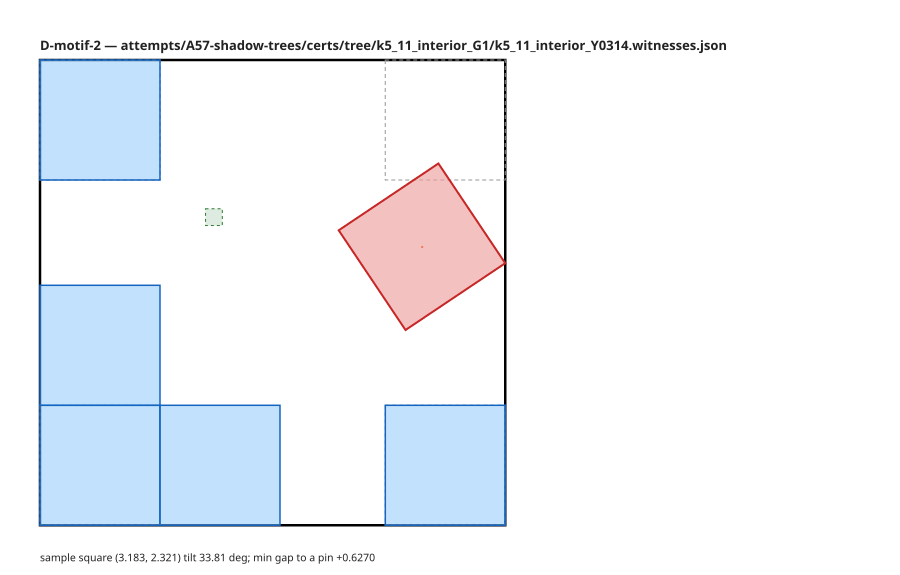

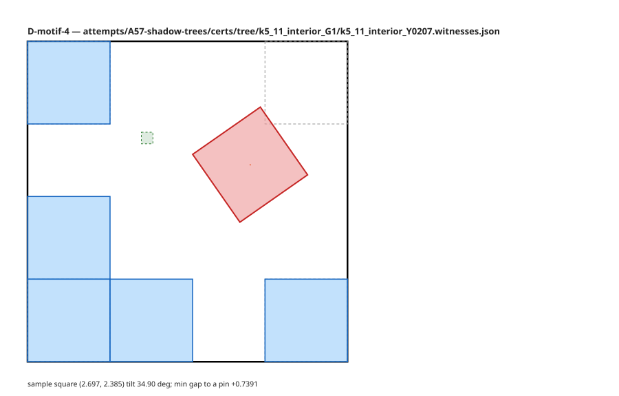

Two negatives that matter. **There is no fractional-pinwheel signature**: only 4 of 164 multi-placement nodes have two
placements at the same tilt in different positions; the placements in a node differ in tilt, not in position. The LP's
unpriceable mass is single leaning squares, not a quarter-weight 2×2 block. And the contact is a whole-box property:
every pin-flush and wall-flush box is flush at all eight of its corner placements. The pin-flush overlap of exactly the
slack is what the window transfer costs: the core is the pin shrunk by 0.01, so a placement that overlaps the true pin
by 0.014 is legal for the certificate and is a real placement at another side of the slab.

**η = 0 is the pin-contact stratum.** All 480 η = 0 nodes have conditioned boxes inside T(s₀), but so does every row
those campaigns emitted (the cover forces it); against that control the discriminator is whether the conditioned box
touches a pin:

| class | η = 0 rate overall | with pin gap < 0.02 | 0.1–0.3 | ≥ 0.3 |
|---|---|---|---|---|
| k5_11 (A57) | 22% | **42%** | 1% | 0% |
| k5_16 (A57) | 23% | **46%** | 18% | 12% |
| trump5 (A60) | 19% | **61%** | 4% | 0% |
| k4_11 (A100) | 63% | **83%** | 54% | 0% |
| k3_02 (A100) | 40% | **100%** | 100% | 0% |

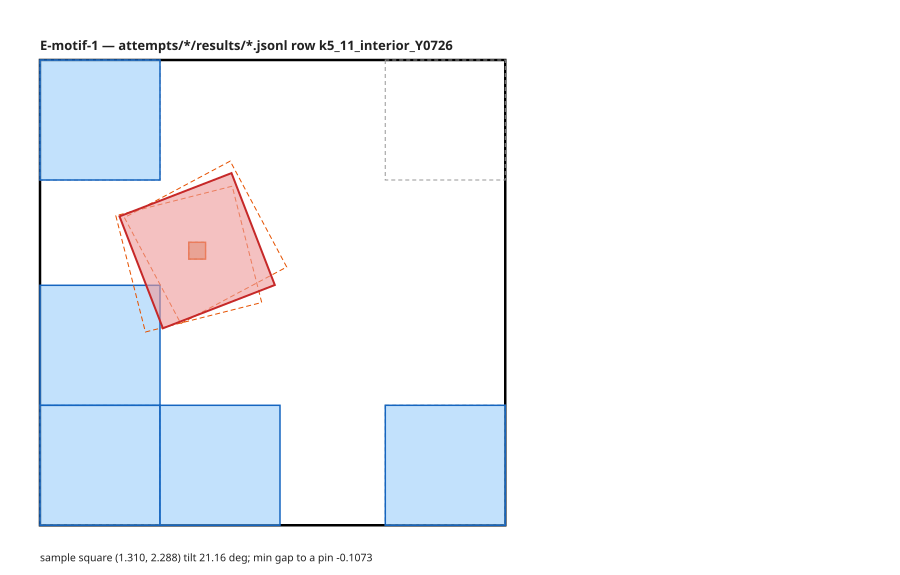
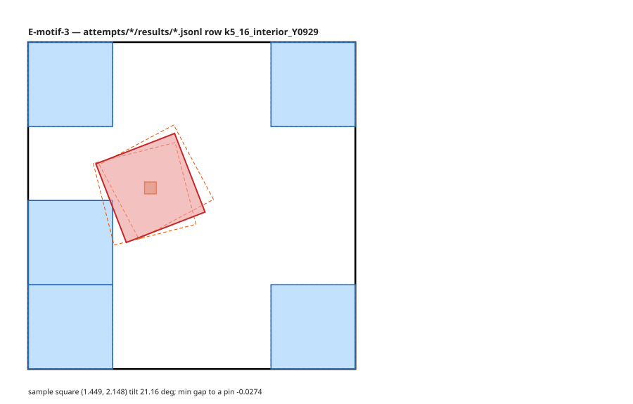
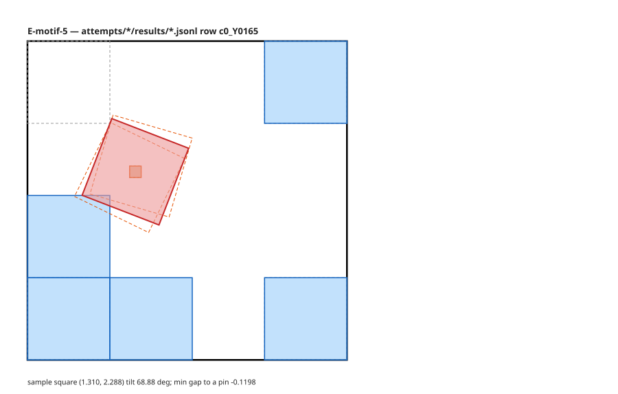
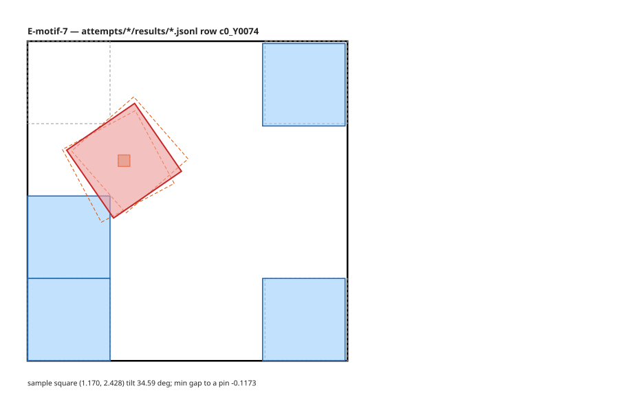

Where a class has a Trump image the η = 0 nodes also concentrate on it (61% / 100% / 100% within 0.15 of a free image
square for trump5 / k4_11 / k3_02); k5_11 and k5_16 have no image and their second η = 0 population sits in the far
pocket of T(s₀) diagonally opposite the pins. η = 0 propagates: of 255 re-solved children of η = 0 parents, 82 (32%)
are again η = 0, and 13 of 42 parents have every child at η = 0. Deepening is not reliably curative on this stratum.

**The unification.** Both holes are the same object seen twice: a tilted square in contact with an axis-aligned pin, a
wall, or the one other localised square. The certificate's slack cores make that contact cheap for the adversary, and
the exact charge tables (A45) say its local wastage is small (≤ 0.22 at a wall vertex, ≤ 0.007 at an interior
corner-on-edge), so nothing local prices it. A drain for the leaning square is the target for both holes at once.

## 2. What plugging each class is worth

| target | wall it holds | what a drain would need to say | status |
|---|---|---|---|
| mid-tilt, interior and wall-adjacent (D + H-midtilt + C) | ~55% | a placement rule that prices a 15–45° square by its position relative to the walls and pins: the corner-pair charges (CEIL, the wedge table) extended to single tilted squares next to a wall or a pin | no lemma; the residue map's middle band |
| η = 0 refusals (E) | 23% | the class-level drain: in the top slab an image-bearing class's packing is in the image's tube | candidate 2 in the residue map; a theorem |
| timeouts and slivers (F + G) | 17% | none needed | plugged |
| near-lattice (A + B) | 1% | SNAP / PD | not worth a lemma for the certificates; worth it for the theory |

So the 15 to 30× the budget needs is not spread across many small holes. It is two holes: mid-tilt placements next to
walls and pins, and the η = 0 refusals. Every other class is either plugged or negligible.
