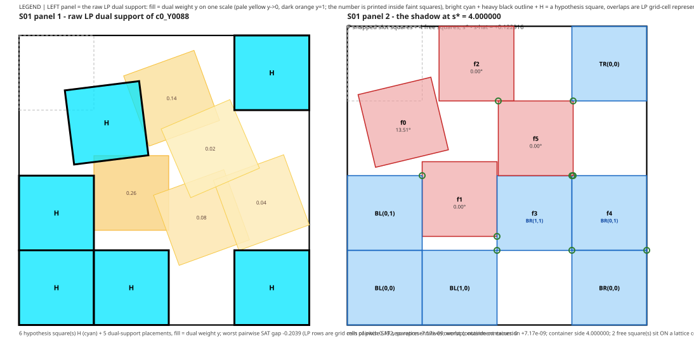
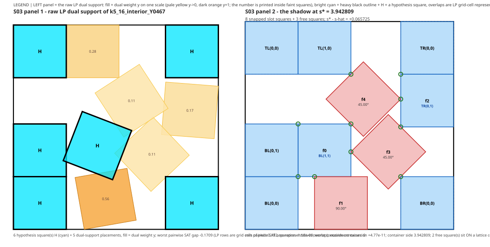
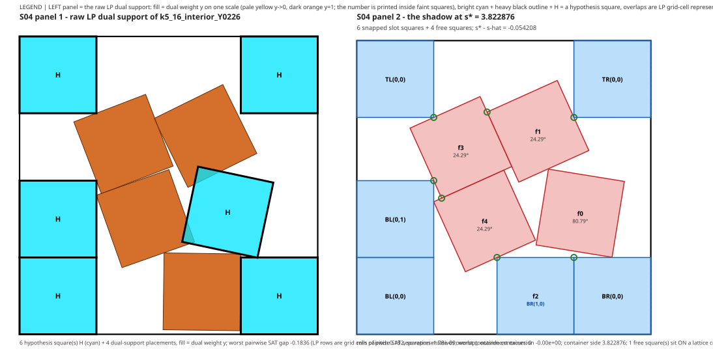
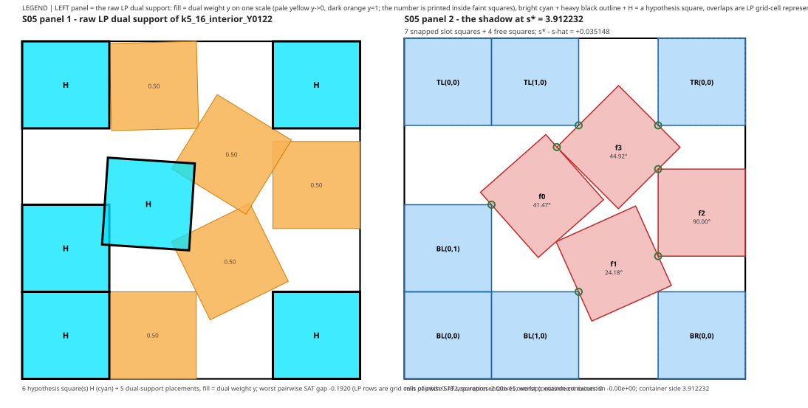
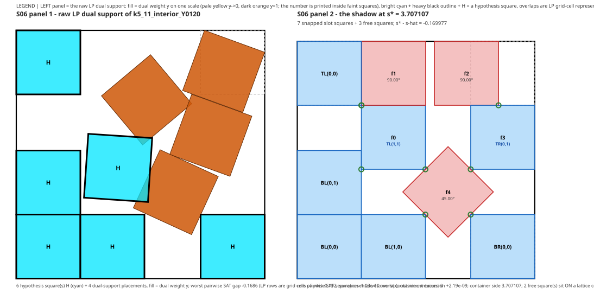
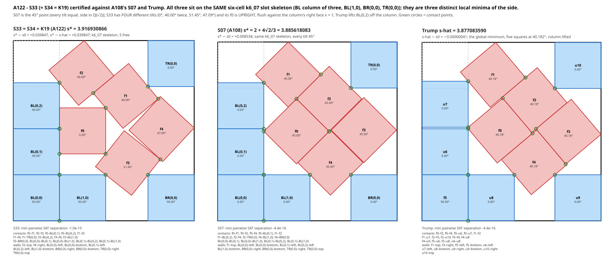
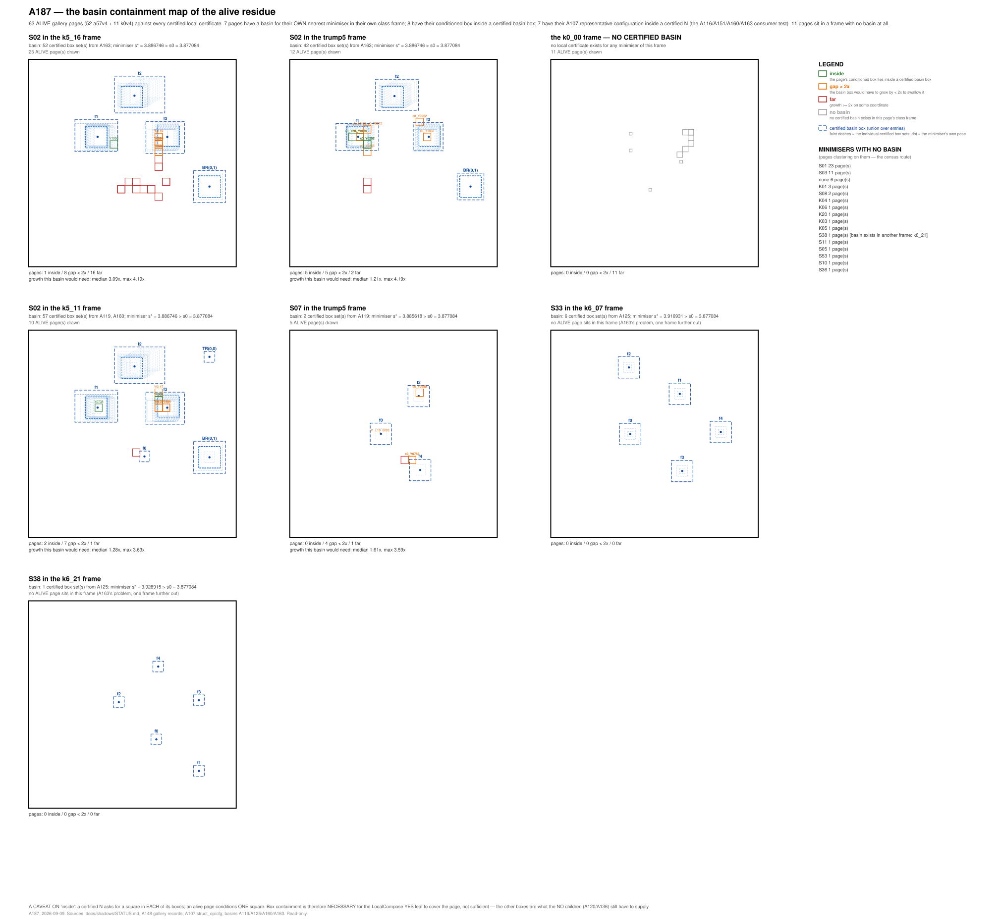
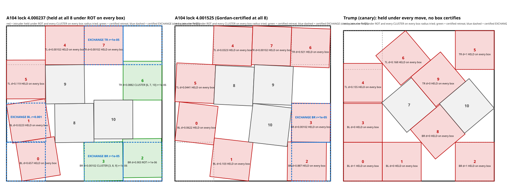

# The residue ledger — everything still standing between us and s(11) = ŝ, as of 2026-09-08 07:05

Companion to `residue_map.md` (the narrative, kept as a log) and `shadows.md` (the gallery). This file is the
**exhaustive list** of what is not yet killed, organised by node family, with a picture for each family, its current
status, the technique that applies, and the n-general lemma it instantiates. Read the pictures first; each section
says what a drain from the PI would change.

Frozen facts: ŝ = 3.877083590022814 (Trump), s0 = 969271/250000 = ŝ + 4·10⁻⁷, window W = [3.82, s0]. Second-best known
packing: S07 at 2 + 4√2/3 = 3.885618 (known_results 26a). Every k ≥ 5 class is dead at the fixed side s0; the proof
needs every class dead on W, and only Trump's class alive there with Trump unique.

**Totals and time estimates live in `budget.md` (the one fixed home; updated on every landed measurement). This file
lists what is left; that file prices it.**

**Pictures, current set (2026-09-08).** The per-node galleries are the live pictures of the residue: `docs/shadows/k0v4/` (the eleven converged-alive k0 cells, README + review_k0v4.csv) and `docs/shadows/a57v4/` (the sixty most expensive alive A57/A60 nodes, README + review_a57v4.csv), both in A148's three-panel form — GEOMETRY (certified feasible-centre region in green, undecided as grey stipple, pockets hatched, guard lines, lane tags with witnessed meeters drawn), the LP SUPPORT after the exact-core re-solve, and the NEAREST PACKING with s0 overlaid — drawn from the records of 14:20 on 2026-09-08 (A149's re-solves and A156's tree run since then are not in them; the next regeneration follows tonight's digest). The figures embedded below are the family pictures (A107's S-gallery, the exact minima, the drains, the locks) and are unchanged.

## 0. The one-table version

| layer | family | what is left | count | technique now | needs |
|---|---|---|---|---|---|
| A57 window trees (k5_11, k5_16) | all families | **work-owing population 406 after the night of 2026-09-08 (was 632; 607 before the day's geometry)** — S01 room and S02 pinwheel still dominate the alive set | 406 (142 ALIVE un-re-solved + FAILs + queued children) | exact pin cores certified 28.6 % of the alive nodes re-solved; geometry (exact core, clip, polygon, slot-lane) kills 26 % of fresh children before any LP | the queue (2,184 LP jobs); the polygon/guard-line v3/v4 clauses for the FAIL population |
| | S02 the k7 pinwheel | boxes whose support is the 3.8867 pinwheel | 252 (184 + 68), carries the deep tree | tight core (in), deeper levels terminate (f₄ = 0) | grain kill (§6) or just time |
| | S03–S06, S08–S53 | 45 smaller shadows, mostly level 1 | ~250 | as S01/S02 by type | PI review of the gallery |
| | fractional | no integral support at all | 264 (151 + 113) | tree only | the genuine tail |
| Window stragglers | **NONE — closed** | — | 0 classes; scoreboard **52/52 full-window** — A146 closed k5_13 (the last row) with the original A56 certificate in 58 slabs of 10⁻³; A114 had closed k5_02, k5_03, k5_12, k6_07, k6_23, k6_27 the same way | — | **0** |
| Protected tier | trump5 cover/slackcore | residual tree ending in certified basins (Trump's, and now S07/S33/S38's local certificates: A116/A119/A122, A125 running on S33) | 325 alive nodes in A107's input (S01 196, S07 18, S02 12 …) | A60 route, paused | S01 crowd rows; the basins as YES leaves |
| | the other 15 protected classes | conditioning trees per exact stratum | 3,500–4,200 CPU-h priced (A100) | A84/A100 model | same levers as A57 |
| k0_00 | the frame residue | 12 converged-alive cells (τ = budget, minmass 1) after A115's warm re-solves; theory: the selected minimiser on W (DRAIN-SEL, A128) | 12 cells; tree priced ~12,000 CPU-h after A115 | exchange move (A128) and the non-rigid field (A130) proved on boxes; the three window holds are mode accumulations at the flush stratum, not locks, and cost DRAIN-SEL nothing | a semi-algebraic tree leaf at flush stacks, or the two-meeter cover |
| Lean | TopLevel axioms + the local-certificate axiom | `stratum_kill`, `trump_residual`, `a22_exact_structure`; `sat_selection` in Local.lean | 3 (`sat_selection` is a theorem, A126) | replay of certificates + the above; LocalDead S07/S02 in the kernel and the YES/NO composition proved (A126); CertCover closing via t = tan(θ/2) re-emission (A133 running) | the above |

---

## 1. The A57 window trees (k5_11 = BL[2,1] + TL[1] + BR[1]; k5_16 = corners4 + BL[1,1])

**What a node is.** One conditioned square with a centre box and a tilt bin; the five class pins fixed; the other five
squares free and seen only through the LP. Levels halve each box coordinate. Alive-at-LP means τ = budget exactly.

**Where it stands (paused 2026-09-06 00:45, A96 PAUSED.md).** Window fraction k5_11 0.978, k5_16 0.991. Open boxes
before the tight core: k5_11 L1 158 / L2 122 / L3 10 / L4 4; k5_16 L1 213 / L2 9. The tight core (T5′) removes 70 of
them (20/32/7/11 by level) with the certificate unchanged. Level-4 descent measured 0 of 30: the tree terminates.
**Schedule if simply resumed: 13.3 wall-days at 5 workers** (19.6 without T5′; 27 at the 95% upper bound on the tail).
**Tilt trimming (PI, 2026-09-06; A96 `155a3c5b`, measured, not deployed):** certify dead every tilt sub-interval of a
box for which the whole centre box lies inside one pin's octagon (Minkowski sum of the pin core and the reflected
square) — T5 with a tilt-range parameter, no new verifier. On 2,222 boxes: 159 boxes' surviving bin is empty (51 L1, 86 L2, 10 L3, 12 of 14 at
L4), of which **70 are exactly T5′'s kills (trimming subsumes the tight core) and 89 are new** (31 L1, 54 L2, 3 L3,
1 of the 3 post-T5′ L4 boxes); 155 more are partially trimmed; positive control 618/618. **Schedule 13.3 → 10–11
wall-days at 5 workers** (the credible saving is levels 2–3; the L4 rate rests on three boxes; ALIVE kills also remove
their subtrees, which the direct figure does not count, so 10–11 is a conservative upper bound). Deployment shape:
node = trimmed child (ordinary certificate) + k excluded tilt intervals (T5 with a range, "T5″"); not yet deployed. The value is the outright kills, not the core enlargement (median
a_tight gain 1.000). Lemma TC (tilt coherence) is exact to machine epsilon as a support-function identity but as a
kill test is 4.8× weaker than the octagon interval test (33 vs 159) because it discards direction; it stays as the
O(1) pre-screen. **Live (A123's night shift, `ad55f884`, 296 level-1 children over seven hours on three shards): T5″ touched 6.4% of
children, matching the offline 6.6%, but fully emptied only 1.0% (3 of 296) against the 3.7% the projection assumed —
15 of the 16 trimmed bins came out ALIVE-at-LP, and 12 of 16 trims bite at the tilt extremes. **Corrected by A124 (`97aa4e9c`): the offline projection was right and the night's §4 mislabelled it — 159 EMPTIED (9.1 %) and 9.5 % more TRIMMED; out of sample the night's level-1 children match it (EMPTIED 1.46 % vs 2.97 %, Fisher p 0.35), the "collapse" was a level-mix artefact. The re-check is NOT a lever: by the campaign's own kill rule the night's "11 kills" are 1 strict kill and the day's 21 are 2, the rest knife-edge at |η| ≤ 10⁻⁹ — the alive population is genuinely alive-at-LP. Y0381: `LPModel` never sets an LP time limit, so `h.run()` can spin; the per-node process wall is the guard.**
Soundness clean across all 296 (max core half-side 0.398, every bin inside [0, 90], no stored verdict contradicted).
One shard hangs deterministically on `k5_16_interior_Y0381` (diagnosis in A124); trim records are never persisted
(must-fix before a full resume).

**Two geometric leaks found by the PI reading the LP-support drawings (2026-09-07).** (1) **Pin-clip (A131,
`32d63560`).** Most of a tilt bin is unrealisable at most centres of a box next to a pin (Y0036 vs bl10: only a top
sliver under the clockwise lean survives). Clipping the centre box to the exactly pin-feasible region per tilt sub-bin
(four sinusoids in θ, rational in t = tan(θ/2), no epsilon) strictly dominates T5′ and T5″ (all 674 logic kills and
all 159 T5″ empties reproduced, plus 21 more needing two pins jointly). The decisive number: of the 607 unclosed nodes
(414 ALIVE + 193 FAIL), **132 clip to EMPTY**, 112 of them by the trim already deployed — they are open only because
T5′/T5″ run as pre-filters on newly emitted children, never on stored nodes; a pure-geometry backlog sweep collected all 132 in 4 s of CPU (A131 `43da8a3f`: one replayable clip certificate each, independent checker 132/132, 1.58M samples 0 hits; 20 need the two-pin clip, T5″ alone cannot empty them; eps_geo must never be chained after a clip — the row-shrink re-imposes exactly the shell the clip removed). On ten alive nodes the LP on the clipped box moved five from η ≈ 0 to η ≤ −0.5, two
certified dead through the frozen verifier (Y0036_D02, Y0186_D00_D00), three cert-FAIL with real holes (resolver
path); on the other five only the columns collapse (support 1041 → 5). The re-check's kills, by contrast, are LP
verdicts: recheck96 never certifies. (2) **The axis-aligned core leaks (A132 `7d5e9070`: over all 506 alive nodes of A57 and A60, 22.3 % of the dual-support columns carrying 0.357 τ of weight, and 20.5 % of the full pools, are excluded by the polygon core but pass the axis-aligned cores; the T5⁗ logic kill fires on 64 nodes, 37 new; all three LP pairs that converged in both arms kill, τ 5.0 → 4.0 / 4.5 / 4.0; a quarter of the excluded weight is the PINS' — the stored pin core half-side 0.49 against the exact 0.49293 — and Y1038's kill lives entirely in that slop; A135 `b65073e7`: the frozen verifiers take the core half-side VERBATIM and never see the box, so exact cores are certifiable today — 3 of 3 in-vitro kills certified, two under the frozen verifier with exact pin cores alone, one through the new `verify_case_v3.py` polycores clause; the next chore is re-emitting the 414 alive nodes with exact pin cores, ≈ 28 CPU-h, no verifier or Lean change).** In each of the four alive
level-3 nodes, two of the 5–8 weight-1 support columns overlap the hypothesis square at every pose of the box (SAT gap
−0.005 to −0.029) yet clear the axis-aligned core K(a) by +0.003 to +0.045: a 75°-tilted square protrudes ~0.21 beyond
K(a) along each diagonal. The polygon core K′(B) = ⋂ over poses of the square (certified vertex-wise by pinguard's
interval formula) prunes those columns, strengthens the certificate hypothesis, and kills against pin cores; it needs a
v3 verifier clause and one Lean lemma. Both leaks are the same lesson: *use the exact pose set, not its axis-aligned shadow*, and both apply to every conditioning tree (protected tier, k0). **(3) The slot lane kill (A141 `1f9de0ef`, after the PI's Y0460 reading):** with the polygon core of H and the exact pin cores as obstacles, a usable slot (its extension class dead on the closed window — every listed k6 extension is) that no free square can reach (LANE_K′ = 0) while H can (M = 1) is singly met, the near-simple meeter snaps to the slot, and the packing lands in a dead k6 class. Final (A141 `c0578941`, all 1,693 records): **188 distinct A57 nodes (96 k5_11 + 92 k5_16) and 56 trump5 nodes killed**, 194 level-1 and 50 level-2, one slot each (k5_11: BR(0,1) 45, TR(0,0) 27, TL(1,0) 23; k5_16: BL(1,0) 54, TL(1,0) 38; trump5: BR(0,1) 45, TL(0,0) 11), 200,000 poses per kill with 0 free, 294 certificates all passing an independent checker; **243 of the 244 are new beyond the clip kills** (the two leaves are disjoint: a clip empties the box, a lane kill says a usable slot is singly met). Sound for A57's composition (A118-O1 only forbids the broader slack-pin reuse). Folded in by the night shift; priced in the morning digest. Y0460 itself is NOT among them: its BR(0,1) keeps 34,000 free poses and the cover cannot certify LANE ≤ 1. **(4) The impossible-weight gate (A145 `b250191b`, after the PI's Y0241 reading):** Y0241 is certified dead (τ 5.000 → 3.250 under exact cores + K′, verify_case_v3 PASS; the frozen verifier fails the same measure with 32 holes); over 18 re-solves ranked by the share of support weight impossible under the hypothesis, 10 LP kills and 9 certificates (3 under the frozen verifier with only the half-side changed); the share is a THRESHOLD predictor — 4 of 5 killed above 0.60, 0 of 7 moved below 0.45 — so the exact-core re-emission runs in descending order of it (98 survivors above 0.60 ≈ 9 CPU-h; the 118 below 0.30 are de-prioritised). **(5) Guard-line rows (A144 `093cc105`, after the PI's Y0147 reading):** chords of a packing's squares along any line sum to ≤ s; on Y0147 the PI's line carries a pin, H (minimum chord exactly 1 over the box) and two of the LP's own free columns for 4.0055 > s0, a violation of 0.128 the `st4` reading could not express; 86 of the 448 survivors violate some guard line offline (43 s, no LP). As an LP row it is active on 2 of 20 re-solves (Y0147 → η −0.12, Y0101) and unemittable under the frozen chain, so it needs a v4 clause (spec written, Lean shape 2 theorems + 1 checker, no new axiom). The by-product mattered more: on those 20 nodes the EXACT CORES alone kill 15, the deployed cores 0 of 6 — the drop is the cores, which is what the night's re-emission runs on.

**(6) The cover-number leaf — MEASURED AND CLOSED, ZERO kills (A153 `attempts/A153-cover-number`, after the PI's
Y1117 reading of A148's v4 pages).** *Lemma CN*: two interior-disjoint unit squares have centres at Euclidean distance
≥ 1, because each contains the open disk of radius 1/2 about its centre and closer centres put their midpoint in both
interiors. So the centres a node has still to place are a 1-separated subset of A148's certified OUTER feasible-centre
region `F_out = GREEN ∪ UNDECIDED`, and *Leaf CN* follows: if `F_out` is covered by `k` sets of diameter < 1 then at most
`k` more squares fit, so `k < budget` is a kill with **no LP**. Pieces are axis-aligned squares of side `d` with the
exact rational test `2d² < 1` (on A148's 194² grid, a 35 × 35 block of cells: side `6784897/9700000 = 0.699473918`, the
PI's side-0.7 squares); `F_out` is a union of grid cells, so "the pieces cover `F_out`" is a finite integer check, and
each kill would carry a certificate (grid + obstacle polygons + rational pieces + a 10⁴-pose sample line) replayed by
an independent checker (`code/check153.py`, its own SAT, five mutation tests). The Lean cost is **one structure, one
decidable `check`, and the two theorems `centre_sep` / `cover_bound` — no new axiom** (the analytic input REGION-OUTER
is the one A148's white region already carries). **Result over 322 nodes** — the 60 alive A57/A60 nodes A148 drew, the
11 k0_00 residue cells, and all 251 ALIVE A57 nodes of `PAUSED.md` v3 — **is zero kills**: the exact minimum cover
(branch and bound, optimum proved on 197 of the 322, greedy meeting the independent-set bound) runs from `budget + 0`
(one node, `k5_11_interior_Y1104_D01`) to `budget + 12`, median **+4**; on k0 it is 18–22 against budget 10, so one
conditioned square can never make it bite. And the failure is structural, not a slack in the covering relaxation: on
**322 of 322** nodes `F_out` already contains ≥ budget points pairwise ≥ 1 apart, a *floor* under every cover number at
any pitch and any piece shape. Re-pricing the 18 tightest nodes at 4× resolution (pitch 0.01 × 72 tilts) removes 13–25 %
of the `F_out` area and at most **one** piece; `Y1104_D01` stays at cover = 5 = budget at 1×, 4× and 16×. The
tilt-coherent refinement (*Lemma TC*: same-tilt interior-disjoint squares need ‖Δ‖_∞ ≥ 1 in the `t`-frame, so pieces may
be squares of side < 1 there, `d(1+δ) < 1` over a tilt bin of half-width δ — sound only on a common-tilt branch of the
region tree) roughly halves the count and still kills nothing over any node's whole tilt window; its one hit,
`k5_16_interior_Y0083` at exactly `t ≡ 0 (mod 90°)` with 4 < 5, dies at a tilt bin of half-width 0.1°. Y1117 itself, the
node that prompted this: green 0.993 + undecided 0.756 = 1.749 of area, **cover number exactly 8** against budget 5,
tilt-coherent 6 at every tilt of H's window and 7 window-robust, floors 6 and 5. Keep the number on the pages — it is
the disk bound's combinatorial twin and 2–4 pieces tighter (Y1117: disk 10, cover 8) — but do not queue the leaf.

**What the alive nodes are** (A107, LP dual support drawn directly — the PI's rule):

### 1a. Family S01 — "room at side 4" (k5_11 238, k5_16 178, trump5 196)

The support minimises to side exactly 4.000 in 62 combinatorial variants: a slot left empty or singly met. Every such
configuration teleports into a higher-k class that is dead on W. **The LP does not know the teleport lemma.** Technique tried:
SLOT-CROWD incidence rows at the node level — **A109 (2026-09-06, `7daabe6f`): 0 of 18 genuinely-alive nodes killed at
every depth the window licenses, 18 of 18 at the unlicensed depth 0.3, and 0 of 10 LP-dead nodes certified** (the
multiplicity runs fail on 5–32 exact holes at r = 1 already). Two exact facts behind the zero: (i) on a window ending
at side s, SLOT-SLIDE's depth margin and the dilation pad cancel exactly, so the only licensed row is "two non-pin
squares MEET the open slot" (depth 0), and the fourth slot of k5_11 carries no hypothesis above 3.877; (ii) 94% of
the supports do violate SLOT-CROWD, but the rows re-price rather than forbid — the slot boxes are 0.877 apart while a
45° square spans 1.414, so one placement meets two or three slots at once and the incidence budget pays for it
(c = 6.2 vs B = 4.4). Depth breaks the multiplicity and only depth; the prize if a lemma ever licenses depth 0.3 on
this window is the entire remainder (+12.7 wall-days). Until then this family dies by splitting, which the measured
tail says terminates. Side finding: 28 of the 46 sampled "alive" nodes were not genuinely alive (τ < budget, LP
unconverged at the time limit) — a longer LP time on unconverged alive nodes is a cheap re-check when A57 resumes.
**A118 (`405b6522`), the lane-count leaf** (a usable cell that at most one non-pin square can reach, given walls, pin
cores and the conditioned core, is dead by teleport): sound, 0.37 s per cell, reproduces 25 kills the trees paid ~850 s
each for, and finds **13 new** — 1 A57 box, 12 k0 cells conditional on k1_00 — worth 0.05 wall-days. The lane that
stays open is always the same one: 1,323 cells reach LANE ≤ 1 and are saved only because the node's own conditioned
square is allowed to be the second meeter. Corner cells dominate the fires (two walls behind them); BL(1,1), the cell
the crowd LPs leaned on, fires once in 3,580 nodes. Deploy at emission as a pre-screen, never as a re-solve. The
reversed leaf (branch on the two meeters, the complement free) is sound but does not terminate: 26–14,099 pair-children
per node at a 9% per-child kill rate, 2–500 CPU-h to kill one node against 850 s for its own LP — k0_route's C3
("K0-BLOCKED has no finite case list") reproduced at the pinned classes; its value is the free branch. Also from
A118: the octagon PAIR inequality is strictly stronger than Lemma TC (fires at centre distance < 1 vs ~0.7) and
subsumes the TC-leaf obligation; the usable-slot table gains BR(1,0), TL(1,0) for k5_16 and BR(0,1), BL(0,2) for
trump5 after A114's closures; A109-O1 discharged.
Generalises as: *crowding rows need certified depth; depth needs the extension classes dead ABOVE the target side.*

### 1b. Family S02 — the k7 pinwheel (k5_11 184, k5_16 68, trump5 12; carries the deep tree)

Seven slot squares (BL L-shape 3, BR stacked 2, TL 1, TR 1) + three load-bearing squares at one tilt 48.435° + one
strut/rattler; s* = 3.886746 = s0 + 0.0097 (certified endpoint). Binding contact: f1 on the top wall (Fritz-John 0.87);
the mirror pair f0/f2 next; f3 idle, flat direction blocked at second order. **No open box contains it** (A106): boxes
are alive because the relaxed core cannot see 0.0097 of slack. Techniques: the tight core (in); the tree terminates at
level 4 by pin clashes; or the grain kill of §6. **A111 (2026-09-06, `4c6ace6e`), load-path branching measured:** sound
on 146 of the 286 shadow-explained nodes; ≈ 35 kills at a 2/3 certify rate (n = 3), worth about one wall-day; two
nodes killed end to end. The chain YES kill certifies only for r < s* − s0, i.e. level-4 box widths, because the
fixed-tilt bound is exactly s* − r. The octagon and TC tests kill nothing between load-path boxes at s0 (genuine room:
side-blind rules cannot make a side statement) but fire constantly between a node's own bin and a load-path box — the
**free pair kill**, 113 of 264 S02 nodes at level 1 rising to 200 of 264 at level 4, 19 of 19 S07 nodes from level 2,
confirmed on 57,840 sampled pose pairs. The NO side is a convergence-time problem (dead-unconverged at 80 s, converged
dead at 900 s), 8 of 22 nodes had every NO child LP-dead, certificates 14 PASS / 4 FAIL, fixed-side only until
verify_param supports NO-families. The S07 branch is unsound at level 1 (Trump sits inside the YES region at A57's
level-1 tilt half-width) and usable from level 2. **A112 (`e6690215`), the region tree measured:** on 17 S02-explained
level-2/3 nodes the tree terminates in 77 nodes / 56 LPs / 51 minutes against the old tree's projected 671 nodes and
54 hours for the same region, and kills 9 of 17 — 6 of them already dead by the T5″ root trim, so the tree's own
score is **3 of 11 non-trivial regions**: one free at the root by Lemma TC (bin against pin, a rule A57 does not
apply at emission), two by a certified three-node tree (root, YES, NO; two certificates each; 27–54× less wall than
the old tree on the boxes it kills). Containment checks hold with zero failures. **The branching order is a
tie-break, not a lever**: all four orders land within 73–77 nodes and kill the same set. The two-stage protocol
priced: 2.26× cheaper than a flat 900 s cap. All ten free pair kills are Lemma TC, four of them between boxes the
tree itself introduced — the second conditioned square the tree exists to produce — and none are core–core; the
chain kill never fired at tree depth (its controls are clean; the trees reached only r = 0.0125). On the k0 cells:
0 kills under every order, every LP at η = 0 exactly — removing a support placement from a k0 cell does not move τ,
so branching on corners does not by itself supply the missing logic kills. Corrections of record: η does not predict
the certificate (PASS ∈ [−1.0, −0.25], FAIL ∈ [−0.71, −0.16]); the k0 YES shortcut "a square in a slot box ⇒ k ≥ 1"
is unsound as box containment (A53 stratifies by grid-locked squares) and was never taken. Integration: a resumable
`--region-tree` option in A96's scheduler for nodes alive twice or unconverged at 900 s, falling through to the split
on a wall cap. Certificate accounting: **A117 (`6f160858`) delivered verify_param_v2** (NO-families in the 4-D verifier; 30/30
byte-identical to v1 without NO-families; Lean lemma `nofamExemptIV_sound` proved, axioms unchanged; v1 never
edited) **and Lemma TC as a leaf** (170/170 stored fires reproduced, 1.7 million sampled pairs, 0 counterexamples;
Lean statement frozen as a Prop, the separating-axis step [C]). What v2 buys is window VALIDITY, not wall: 16 of 48
NO certificates re-verified over the window, none of the fixed-side passes became a window FAIL, but the 4-D pass
costs 10× the four fixed sides it replaces (a NO certificate is tiny at a fixed side precisely because the NO-family
exempts most of the container). And the blocker moved to the YES side: a branch box enters the YES certificate as a
core that the parametric core-affine form refuses, so certificate-based region-tree kills stay s0-only; the one
window-valid claim today is the free TC kill of `k5_11_interior_Y0041_D02`, whose boxes are s-independent. **A151 (`PENDING`, 2026-09-08):** with the exact pin core S02 is the best-yielding family on the stubborn ALIVE population (36.8% = 21 of 57, against 25.9% overall and S01's 25.5%) but only marginally — every S02 kill lands within 0.25 budget units of the threshold and 29.8% fall in the LOST-KILL/TOO-TIGHT band against S01's 5.2%, while the survivors sit at τ = 5.000000 exactly — and an ASYMMETRIC N giving f1 ten times A116's cell volume (x ±0.40, y ±0.25, θ ∈ [8.435°, 88.435°]; 72,138 leaves; 10⁵ drawn → 2,959 tested → 0 hits) raises the consumer count from 72 to 96 of the 184 k5_11-frame S02 nodes (42 still alive), every growth refusal being a wall cap with no real partial packing found inside any grown N. Generalises as: *a class-boundary shadow — a dead class's minimiser
sitting on a live class's box; the basin/grain lemma is the transfer.*

**(7) The pinwheel's two extra directions, and why its basin is a UNION (A160
`attempts/A160-s02-f0-slide`, after the PI's f0-slide reading and the coordinator's common-tilt
reading):** `f0` is an exact one-parameter rattler slide of length 0.298419 along its own body axis at
the fixed tilt 48.4351° (rails `BL(1,0)`/`f3`, stops `BR(0,1)`/`f1`; `f3` by contrast is the shadow's
most load-bearing square, Δs\* 0.1190, and `BR(0,0)` is a second rattler at 0.5357), and the
common-tilt chain certifies a 60–80° shared-tilt range in cheap links with every refusal labelled —
but adding `f0` as a required box costs 96/42 → 15/8 and caps the tree, the chain's own ceiling is the
tilt SPREAD of a node's support (63/27 at half-width 1.25°, 124/53 at 10°), and the coordinate that
actually binds is `f2`'s and `f3`'s tilt INDEPENDENTLY (14 and 10 of the 20 alive nodes outside
A151-B), which slices certify with zero failures in 348 s at `f1`'s base box yet a **LIVE-LOW
witness** refutes together with A151-B's grown `f1` — so the growth directions trade off, the basin is
a DISJUNCTION of differently shaped certified boxes, and that union reaches **114 of 184 in-N nodes,
50 alive**.

**(8) The pinwheel in the OTHER TWO FRAMES (A163 `attempts/A163-s02-other-frames`, after the PI's
reading of `docs/shadows/a57v4/k5_16_interior_Y1110.svg`):** S02's seven slot squares contain all
three classes' pin sets, so the same absolute configuration is an S02 shadow in k5_16 (pins
corners4 + `BL(0,1)`, `BL(1,0)` dropped) and in trump5 (pins `BL(0,0) BL(1,0) BL(0,1) BR(0,0)
TR(0,0)`, `TL(0,0)` dropped) with `L` unchanged (`f1 f2 f3` + `BR(0,1)`, `f0`/`BR(0,0)` the
rattlers), and re-running A160's 53 box sets **plus A151-B itself — which `N_boxes160.json` does
not contain, as the k5_11 control here shows by reproducing A160's 114/50 only once it is added** —
in those pins gives **k5_16 52 of 54 CERTIFIED with both refusals WALL CAPS and zero witnesses**
but **trump5 only 42 of 54, with 9 LIVE-LOW WITNESSES re-verified from scratch** (real partial
packings of the nine squares of `L ∪ P` at sides 3.8200–3.8771 ≤ s₀, worst pair gap 4e−16), because
trump5 does not pin `TL(0,0)` and every object leaning into that corner — A151-B included, refuted
in 6.8 s — is geometrically false there; the consumer counts go from **0/0 to 38 of 68 in-N and 21
alive in k5_16** (`Y1110` among them, inside A151-B and the h = 10° chain link, both carrying
checked exact t-certificates here) and from **0/0 to 3 of 12 in trump5**, with **all 94 certified
box sets re-emitted through A133's generator and verified by its independent checker (94 VALID, 0
errors, sha256 recorded, the `certificate` block in A136's `CITE_ASYM` shape — the artefact A160's
union lacked)** — so a basin is a statement about a HYPOTHESIS and
transporting it to another class is a re-run whose survival is decided by which of the shadow's own
squares the new class pins.

### 1c. Families S03–S06 (PI-read) and S08–S53
 
 
S03: f0/f1/f2 essentially simple (SNAP → higher k). S04: f0 teleports to BR(0,1). S05: the S07 pinwheel inverted. S06:
the optimal five-square packing (2 + 1/√2) with a unit band = the s(10) optimum 3 + 1/√2, a ten-square shadow (the LP
found room for ten and only fractional room for the eleventh). S08–S53: 1–17 nodes each, mostly level 1, the gallery
has each drawn. With crowd rows out (1a), all of these die by splitting; the measured tail says that terminates.

### 1c′. The PI's first pass over the gallery (review.csv, validated by A121 `4a3b0078`)
83 rows, 219 items, 1,487 (node, cut) rows: **9 node kills, none new** (all A118's lane-count kills; corner cells take
all nine). All 18 `r` readings exactly right; of 64 `ns` items 6 are genuine uncrowded near-snaps, 24 sit on their cell
already (the gallery under-count, fixed in the v2 re-render), 28 are flush along a wall (A101's population), and the
cell names are the identity fit over 784 relabellings. The `st4` token (four flush squares on one wall ⇒ side ≥ 4) is
sound and kills S50/S52/S53 as configurations, not nodes. S34 is the same minimum as S33 (A122: ds 6·10⁻¹⁵), S35 is
not (tilt 6.9° apart), S09 is not S05, S21 is a related near-Trump packing rather than S07. Seven grain rows have
Fritz-John residuals above 10⁻³: nnls fits, not certified load paths. **The structural fact**: 81 of 83 right panels are
rearrangements of their node's support, not snaps (two are tilt-only: S02, S07) — a reading is a pointer to a cell,
never a fact about the node, and a node kill needs the lane test, which the node's own conditioned square blocks in
every close case (6 misses at LANE ≤ 1, M = 1: S37/S38 TL(0,0), S40 BR(0,1), S42 TL(1,0)).

### 1d. The fractional tail (k5_11 151, k5_16 113)
No integral component in the dual support; 303 of 306 top out at four disjoint placements of the five needed. Nothing
to draw. These are what the tree is for, and they are mostly level 1 (110 + 106), i.e. cheap.

---

**The slot-lane leaf does not refine (A152, 2026-09-08; conditional on the slack-form extension kill).** The PI's
proposal to count a square as meeting a usable slot only when it meets the cell shrunk by the `δ = 10⁻²` pin
tolerance — so that a grazer does not block the snap — fails in all three places it could bite, and the measurement
is worth banking because it closes a line rather than opening one. The step "every other square misses the shrunk
cell ⟹ some admissible translate is free" is FALSE (four pairwise-disjoint unit squares entering the cell through
its four faces by `h/2` miss the shrunk cell and jointly block every translate; machine-checked, and realised on 6
corpus cells where the shrunk-cell leaf fires and no translate does); the sound form — the leaf at a fixed
admissible translate `C + t` — is structurally vacuous at a *completable* slot, because such a slot has both
predecessor cells occupied by a wall or a pin, so the admissible translates all point away from the backed sides
and towards the open faces where the grazers are; and over 71 % of the alive A57 + A60 population (1 226 of 1 713
records, 6 170 of 8 694 cells) it certifies 90 kill cells, **all 90 already A141's**, while losing 5.9 % of A141's
own kills once the pin obstacles are honestly shrunk to the slack family's `½ − h`. Underneath all of it sits an
unmet prerequisite that A118-O1 already named and that A152 has now measured on the objects: the twelve k6
extension classes are certified dead on the closed window with pin cores of tolerance **3.08e-8** — exact pins —
so no slot-lane kill, A141's or A152's, is valid for the `δ = 10⁻²` slack-pin family until those certificates are
re-solved with `a = ½ − h` and re-verified over the window (one core per class for the A60 lane, all six for A57;
**1–15 / 2–30 CPU-h**, with k6_20/21/27/29 at τ = 4.60–4.72 against budget 5 the ones at risk of not re-solving).
That re-certification is worth pricing on its own account — it is what makes A141's existing 244 kills usable for
T23's broader slack statement — but not for the sake of this refinement.

**The 196 UNDECIDED usable-slot cells are not a reservoir of kills either (A157, 2026-09-08; exact-pin form, class-S composition, A118-O1 stands):** re-screening all 179 distinct A57/A60 cells that A141 left `UNDECIDED, lane_lb = 0, M ≤ 1` at **400,000** poses instead of 8,000 realises a free pose on **86** of them (11 with an explicit interior-disjoint pair) — including both cells of the PI's example `c0_Y0076`, `TL(0,0)` at clearance 1.1026·10⁻² and `BL(0,2)` at 5.2398·10⁻³ — so `LANE_K′ + M ≥ 2` and no kill is available there, while on the 93 that survive the screen A141's own certifying cover re-run at `depth0 = 21, max_open = 4,000` gave **0 kills, 1 near-miss and 24 non-closures over 25 cells (all 16 of the `M = 0` cells, the only ones where a kill was structurally reachable, among them)**, the frontier roughly doubling per depth level rather than emptying (`attempts/A157-undecided-slots/notes/method.md`).

**The near-simple slot box splits the node but only one half ever closes (A158, 2026-09-08; exact-pin form, A118-O1 stands, and the A57 nodes' `δ = 10⁻²` slack pins additionally owe the A152 caveat):** **1,238 of the 1,693 alive A57/A60 records (73 %)** keep `τ ≥ budget` on a *dual* square sitting in some usable slot's near-simple box `S(0.10, 10°)`, and forbidding that box as a `caselp` `NoFam` is cheap (a 20–70 s A135 exact-core re-solve) and sometimes decisive — on `c0_Y0076 TL(0,0)` it takes `τ` from 5.000000 to 4.000000 (`η = 1`; control with no `NoFam` gives `τ = 5.000000`; certificate `no_c0_Y0076__TL0_0__r0.1_tt10.json`, **PASS on the frozen `verify_case.py` sha `521cb01f…` in 1.0 s**), so that node PROVABLY puts a square within 0.10 of the exact slot centre at tilt within 10° of axis-aligned — but the YES half never closes: on 139 of 141 measured cells a free second meeter clearing every pin core, `K'(H)` **and** `K'(S)` is REALISED at 400,000 draws already at `r = 0` for any `tt ≥ 0.31°`, and on the two cells where the cover was bought each closes only one half (`k5_11_interior_Y1110 TR(0,0)`: `LANE_K'(C|S) = 0` certified but `M = 1`; `k5_16_interior_Y1014 TL(1,0)`: `M = 0` certified but `LANE = 1`), so `1 + LANE + M = 2` and **0 of 141 cells kill the YES child**. The obstruction is arithmetic and lives in the TILT variable alone, hence independent of `r`: `caselp` exempts a row only if its tilt is `EPS_TH = 0.3°` inside a `t`-interval, so an `S` narrow enough for the YES child exempts not one LP row, while the NO child needs `tt ∈ (1.5°, 2°]` and `r ∈ (0.02, 0.03]`. And the PI's *geometry* is not refuted, only the `K'`-based leaf: `pair158.py` finds **no** realised interior-disjoint (pose-in-`S`, free-second-meeter) pair at 600,000 draws per cell, max gap negative everywhere, because `K'(S)` is the intersection over the whole box — the repair (partition `S`, leaf per piece, A141's `lane_corner_split` shape) needs ~1.5·10⁶ pieces, ≈ 400 CPU-h per cell (`attempts/A158-slot-split/notes/method.md`, `notes/leaf.md`). **A158b then ran the YES child the right way — as an LP node** (`pins + H + the slot box S`, `budget = 11 − #cores = 4`, A135 exact cores on all 7 boxes with `cores_pairwise_disjoint` re-run over all of them, `S` an ordinary second core in the frozen schema) **and it lands exactly back on the knife edge: all 12 sub-cases (6 cells × 2 tilt pieces) converge at `τ = 4.000000 = budget`, `η = 0`** — the slot square removes exactly ONE unit of dual packing *and* exactly ONE unit of budget, the same 1 the NO child removes from `τ` alone, so on the 730 of 1,238 records whose dual weight in `S` is exactly 1 **the split is structurally neutral and no amount of compute changes it**. The PI's mutual clip (A131 pin-clip with each box's own inscribed axis core in the pin's role) does bite — `H`'s box keeps 0.5003 of its area on `c0_Y0787` with `K'(H)` up ×1.126, 0.6273 on `k5_11_interior_Y0147` with `K'(H)` up ×1.066, two whole tilt sub-bins of `S` emptied on two cells — and the *clamp* of `S` to `[1/2, s0−1/2]` that the LP framing forces fattens `K'(S)` from 0.566 to 0.736 at a corner slot, enough that **`k5_11_interior_Y1110 TR(0,0)` certifies `LANE_K'(C | S, H_clipped) = 0` on both tilt pieces (36/35 leaves, 0 open, ~36 s) — the first empty conditional lane cover obtained anywhere** — but its `M` half then discharges **zero** leaves (0/5,001 open at depth 40; 0/40,001 at depth 42) because `box_misses_cell` needs `x0 ≥ 1 + hmax = 1.686` against an `H` sitting at frame `[1.374, 1.519]²` and so can never fire on an interior `H`: **the conditional lane leaf is only deployable where `H` is near enough to a wall or a pin for the container / misses-cell prunes to bite** (`attempts/A158-slot-split/notes/addendum_b.md`).

**A161 (2026-09-08), the CHORD-LIMITED LANE.** A144's chord row on a guard line inside a slot's wall row of pins caps at `beta = floor(s0 - SUM_j minchord(B_j, l))` the number of free squares that cross the line through opposite sides, A141's lane cover with an added exact `band` prune bounds the rest by `LANE_out`, and SLOT-CROWD's `>= 2` is contradicted by `beta + LANE_out + M <= 1` — which kills **105 alive nodes (74 k5_16, 26 trump5, 5 other)** on wall-adjacent usable slots, the PI's `k5_16_interior_Y0842 / BL(1,0)` among them, with 98 certificates all passing an independent checker (`attempts/A161-chord-lane/`, `notes/leaf.md`); k5_11 contributes zero because both of its wall-adjacent usable slots sit on a wall carrying only ONE pin chord, so `beta = 2` there. **Measured against the full dead set the collector `docs/shadows/status_gallery.py` builds STATUS.md from (44 sources, 4,994 kills, 3,173 nodes dead), 27 of those 105 are genuinely NEW dead nodes — 23 trump5 and 4 k5_16, `k5_16_interior_Y0842` among them; the rest were already dead, 62 of them in A57's own tree jsonl since A149/A156's re-solves. A141's leaf re-run with the same exact separating-axis test but WITHOUT the chord row flips 105 `M` values to 0 and kills nothing, so the chord row is what does the work.**

**A167 (2026-09-09), the CONDITIONAL chord-limited lane, POPULATION PASS.** Splitting the conditioned square's box and scoring each piece with its OWN guard line, its own chord row (`minchord` is monotone under box inclusion, so the piece's chord is longer and its `beta` smaller) and its own fattened core — `n(b) = beta + LANE_out(b)` where the piece misses the cell, else `min(beta, LANE_band(b)) + LANE_out(b) + 1`, with the band cover run over the slab `|v| <= 1/2` that every band pose lives in — closes **15 of the 416 alive `NO-LINE`/`M = 1` wall-adjacent cells that A161's unconditional form could not touch (11 of them still NEW dead nodes when re-checked against a fresh collect: 7 trump5, 4 k5_16, all level 1), 15/15 certificates passing an independent checker**; but **285 of the 416 cells are NO-GO — at every one of the ~106 swept offsets the sample exhibits a free square meeting the cell alongside `H`, and on 49 of the 60 escalated cells that pair is verified EXACTLY in rational arithmetic (two interior-disjoint unit squares, both inside the container, both meeting `int C`, both clear of the five pins, one a legal `H` pose), which retires those cells for the whole lane-leaf family** — so the wall-lane line is now measured rather than merely unfinished, and the PI's `c0_Y0169 / TL(0,0)` is one of the no-goes, not a budget failure (`attempts/A167-condlane-pass/`, `notes/leaf.md`).

**A170 (2026-09-09) — the `make_certificate` stock-core reversion does NOT touch this row.** A166's emission bug (`caselp.make_certificate` rebuilds the hypothesis with `Hyp.from_json`, which reverts A135's certified EXACT cores to the STOCK ones, so an exact-core LP's certificate under-exempts by 1.4-15 % of the core half-side and every LP-dropped placement in that annulus becomes a hole) was audited empirically against every one of the 3,378 certificates on disk: every A57/A60 exact-core lane -- A137's night re-emission, A149's `__exall` and `__exH` arms, A156's day shift, A145, A140, A135 itself -- writes **exact cores, 698 of 698**, because they all route through A135's `emit135.make_cert` rather than `caselp.make_certificate`; re-certifying all 118 of their FAILing certificates with the cores enlarged returns **NO-CHANGE on 118 of 118**, so those FAILs are real and the row's exact-core kill rate (46/161 = 28.6 %) stands unaltered. The bug reaches only A150, A165 and A166, which call the A57 driver directly; the repair there is 25 certificates / 8 distinct nodes, 3 of them new (A165's `l1_104` spread tuples, that leaf going from 1-of-4 to 4-of-4 certified). A further 34 certificates flip FAIL -> PASS as a free UPGRADE on genuinely stock-core lanes -- all of them A59/A60 zero-atom VACUITY certificates, whose whole content is 'every admissible square is exempt', so A59's residual ladder around Trump's packing now certifies at 8-14 % less exemption parameter at every rung while its certified `hw` envelope stays put. 59 recoveries over 409 re-certifications, 59/59 independently re-checked, 2.35 CPU-h of verifier and no LP solved; the shadow board is unchanged (`status_gallery.py` 5,332 -> 5,344 kills, 0 new distinct pages) (`attempts/A170-certfix/notes/{audit,recovered,fix}.md`).

## 2. The window stragglers — **CLOSED. A56 scoreboard 52/52 full-window** (A146, 2026-09-07 night; the rows below are the history)

Every one of the 52 stratum rows now carries a 4-D PASS over the whole window [191/50, 969271/250000]:
4 M1 + 28 TRANSFERRED + 20 TRANSFERRED-resolved, no OPEN row and no partial row.

| class | window status | note | next |
|---|---|---|---|
| k6_23 | **FULL** (A114: resolver on the same certificate closed the 8.4·10⁻⁵ sliver in 0.17 CPU-h) | | done |
| k6_07 | **FULL** (A114: 16-piece slab grid + bisection, 2.3 CPU-h) — **the BL(0,2)/S07 slot is now a full-window kill** | | done |
| k6_27 | **FULL** (A114: resolver-first showed the 4-D failure was s-axis starvation; 14-slab sweep, 0.55 CPU-h) — **the last whole-window k6 class** | | done |
| k5_05, k5_14, k6_21, k5_10 | FULL (A61 pass 5) | folded into the scoreboard | done |
| k5_03 | PARTIAL: [3.82, 3.823345] banked (5.9%) | resolver closes every recorded witness cell but bulk slabs fail: genuinely thin | slab sweep of the rest, ~5 CPU-h (A114 continuing) |
| k5_02 | PARTIAL: [3.82, 3.820223] banked (0.4%) | same | slab sweep, cost projected first (cap 8 CPU-h) |
| k5_12 | OPEN | the gate was never the issue: both LP stages unconverged, certify FAILs at depth 56 and witness feedback drives τ to exactly the budget — no certifiable measure at ε_geo 0.003 with this column pool | slab sweep, projected first |
| k5_13 | **FULL** (A146: 58 slabs of 10⁻³ on the ORIGINAL A56 parametric certificate, 58/58 PASS, 0 bisections, 1.5 CPU-h, C2 triple-PASS) — **the last open window row** | its A56 whole-window FAIL was an over-width slab (0.057084 vs a measured width_max of 0.002, 28×), 0 holes; the A61 re-solve route is dead for this node on its own numbers — dτ/dε = 119–132 vs 57–90 on every converted row, so ε_geo 0.003 costs 0.34–0.38 of a 0.38 slack and the 900 s stage B lands on τ = 6.000000 exactly. The ~40 CPU-h A61 lost to the A124 LP hang here was spent on a route that could not have converted | done |
| k5_02, k5_03, k5_12 | **FULL** (A114 `ee0c18d5`: slab sweeps sized by the slab-width law with the ORIGINAL s0 certificates, 12.5 CPU-h; every earlier bulk FAIL was an over-width slab, never node hardness; k5_12's dead LP route was never needed) | | done |

**k6 and up: nothing open.** Method lessons banked (A114 notes L1–L5): grid a band rather than bisect from the top
(k6_07 as one slab timed out at 1,800 s and both halves failed; as 16 pieces every slab passed at ~190 s); A56's
witness files are truncated and are diagnostics, not gap lists — every closure rests on complete slab PASSes; measured
cost per 10⁻³ of side at depth 48: k6_27 11 s, k6_07 65 s, k5_03 340 s.

Techniques that apply (from this week): (1) SLOT-CROWD rows at the root add budget 2e per usable slot, exactly the
few tenths these are short — but A109's node-level result (the multiplicity runs fail on exact holes even for small
boxes) and A94's own root failure make this unlikely to certify; try only after the resolver; (2) A96's resolver re-verifies the same certificate on the 4-D witness cells (closed 20/20
in A100) instead of re-solving the LP; (3) bisection of the side window for the two fragments. The tight core does not
apply (no boxes).

---

## 3. The protected tier (Trump's 16 sub-skeletons)

Trump's skeleton carries at least four exact local minima now: Trump (ŝ), S07 (2 + 4√2/3), S33 = S34 = K19 (3.91693,
smooth interior critical point, all eleven squares load-bearing), S35 (3.91742, distinct), plus S38 (3.92891, degree 9)
on k6_21 (known_results 26d). All are separate basins: S07's crest toward Trump is +0.0011, S33's +0.038. The local certificate applies to S33 and S38 with no Trump cut out to r = 0.2 and 0.68. **Certified (A125 `395549fe`, docs/proofs/local_certificate_s33.md): S33 at (0.2, 10°) and (0.05, 20°) with all five free squares and no cut (Trump never enters N), S38 at (0.1, 10°); six rational certificates valid under A119's checker (602k leaves, 10.7M multipliers), every N sampled ≥ 10⁴ → 0 hits; limiter = the tilt-cell count at ρ = 20°, r ≥ 0.1 (zero witnesses, just the cap). Consumer: exactly one alive node (trump5's c0_Y0335) — the sixth pin BL(0,2), which k6_07 has and trump5 lacks, is the binding body for 1,065 of the 1,421 alive supports, so the neighbourhood prunes only nodes already localised onto k6_07's skeleton; the lever is promoting BL(0,2) from pin to free box (the mirror of A116-G2), or ρ = 40°. The protected-tier row does not move.**

trump5 (BL[2,1] + BR[1] + TR[1]) contains Trump, so its kill is a residual tree ending in Trump's basin (rBasin =
3/2000, A63). A60's cover ran at 0.781 kill rate; paused. Its 325 alive nodes are, by A107: S01 196 (room), S07 18
(the exact 45° packing above — needs k6_07's band to make BL(0,2) a usable slot), S02 12, S03 16, S05 7, others small.
The other 15 protected classes are priced at 3,500–4,200 CPU-h by A100's pilots (k4_11, k3_02 end to end; η law exact
on 54/54 cover nodes; parametric route carries to protected classes; the resister branch at level 2 killed 1 of 16).
Everything that kills S01/S02 in A57 kills the same families here. Generalises as: *the class containing the optimum
needs a basin certificate; every other class needs only crowd rows and a tree.*

**[M] A187 (2026-09-09) — the basin containment map: the residue is NOT basin-shaped, and the missing minimisers are
S01 and S03, not S02.** The PI asked whether the whole solution set can be turned into a basin — every alive node dying
by containment in a certified local certificate instead of by measure. A187 measured all **63 ALIVE gallery pages**
(52 `a57v4` + 11 `k0v4`, `docs/shadows/STATUS.md`) against **every certified basin that exists**: S02 in `k5_11` (57 box
sets, A119 + A160), `k5_16` (52, A163) and `trump5` (42, A163); S07 in `trump5` (2, A119); S33 in `k6_07` (6, A125);
S38 in `k6_21` (1, A125) — `attempts/A187-basin-map/{results/basin_map187.json, notes/basin_map.md}`. **[M] Only 7 of
the 63 pages (11 %) minimise to a configuration that has a certified basin in their own class frame** — six S02 pages
and one S07 page — and **7 of 63 (the same 11 %, a different 7)** pass the A116/A151/A160/A163 consumer test, i.e. have
their A107 representative configuration inside a certified N; all seven of those are `k5_11` / `k5_16` pages inside the
S02 basin, and only three of them are S02 pages themselves (`k5_16` Y0054 / Y0380 / Y1110 — Y1110 reproduces A163's
consumer slack 0.01311 exactly, the attempt's control). **[M] 8 of 63 pages have their conditioned box inside a
certified basin box and 32 of 63 (51 %) are within a 2× growth of one**, but that fit is usually against the *wrong*
minimiser's basin: it is a coincidence of position, not of family. **[F] The ranked cluster is S01 (23 pages, s\* = 4.0,
no basin anywhere), S03 (11, 3.942809, no basin), `none` (6 — no A107 family at all), then S02 (6, the only family whose
basin exists in every frame its pages live in).** **[F] The whole `k0_00` lane (11 pages) cannot be tested at all: it has
no class pins, so no local certificate of the `CLASS_PINS` form applies, and its six K-family minimisers (K01 ×3, K03,
K04, K05, K06, K20) have no basin.** **[F] S38 does have a basin — in `k6_21` — while its one alive page is `trump5`:
A163's frame problem again, one family further out.** **[S] The caveat that decides the route: a certified N asks for a
square in EACH of its boxes, while an alive page conditions ONE (62 of 63 pages have exactly one conditioned box), so
box containment is *necessary* for the LocalCompose YES leaf to cover a page, never sufficient — the other boxes are
what the NO children (A120/A136) still have to supply. **The answer to the PI's question is therefore: not with the
basins that exist.** Turning the residue into a union of basins needs (i) a local certificate for **S01** — one family
would cover 23 of the 63 pages, more than trebling the basin-covered residue — and then **S03** (11 more); (ii)
re-framing S38 into `trump5` and S33 into the frames its pages live in, the cheap A163-style move; (iii) growth of the
S02 basin by a **median 1.28× in `k5_11`, 1.21× in `trump5` and 3.09× in `k5_16`** (max 4.19×) to swallow the pages
already nearest it — A151/A160 report every refusal at the current radii as a WALL CAP, compute-limited rather than
geometry-limited, so this is a compute question, not a theorem question. The 56 pages with no basin for their own
minimiser, and above all the 11 `k0_00` cells, are the **drain-census** route's population, not the basin route's.

---

## 4. k0_00 — the frame residue

Proved chain: K0-FREE/teleport (Lean) → K0-BLOCKED residue → NOCRIT-SEL (every intruder anchored under translation) →
Lemma ROT (every intruder HELD under translation and rotation at the weighted-Ψ minimiser) → residue RES-LOCK: a
K0-BLOCKED packing in W with every intruder locked. **Conjecture LOCK-FREE⁺(< 4): none exists.** Evidence: 0 of 12
corpus packings and 0 of 443 descent endpoints below 4 are fully held; the closing iteration (follow the contact
manifold) frees a corner every time below 4; the first fully-held packing is at 4.000237; even the ε-grid is
LOCK-FREE. What a lock is made of: 3.3 square–square rows + 1 wall row per intruder, so the proof is a supply count
(the crowd arms cannot furnish three square rows to all eight corner members at side < 4), not a wall budget. The
one-wall lemma is false (two held walls below 4 exist: the mixed hook pair, closed form 2 + (2−s)/c + tan(θ/2)). The
tree alternative: 9,300–21,700 CPU-h (A99). **A113 (2026-09-06, `6409396b`): where that cost sits.** Measured on the
cell's own box, only 1.4% / 4.6% / 18% of the projected cost is within η = 0.05 / 0.1 / 0.2 of the k ≥ 1 manifold, and
the five alive level-1 cells sit at η 0.23–0.37 — but that is the wrong object: the tree conditions on an interior
square, and Trump's interior squares are the tilted ones (its cells sit at η = 0.366). On the right object, the LP's
dual support, the PI's hypothesis holds exactly: cells the LP kills have supports with ≤ 1 simple placement matching
only S01 (room); the un-killable cells (0 of 26 with position distance ≤ 0.05 ever killed; the six most resistant,
τ up to 10.5, all at distance ≤ 0.02, and τ climbs under row generation so more LP time cannot kill them) have
supports that are 2–6-slot partial skeletons of near-critical shadows — one alive cell matches S38 (trump5 boundary,
3.9289) slot for slot, an A85 FAIL matches S07 at Jaccard 0.83. Position distance predicts τ (Spearman −0.44 inside
every tilt bin), tilt distance predicts nothing, LP wall is flat in η. Consequence: a *re-branching* rule — branch a
cell on the slot its support keeps occupying, readable only after the LP — the k0 face of A112's dual-guided
branching, with the YES side handled by K0-FREE/teleport plus crowd rows (licensed at depth 0 at fixed s0, since
every k ≥ 1 class is dead there) and the NO side by the LP without its support. Also: the k0 tree has zero logic
kills (it never branches on corners), and A107's gallery missed the 264 k0 LP jsons through a glob bug. **Fixed
(A107 Part II, `87ed93bb`): 217 alive k0 cells, 30 shadow values explain 161, 56 have no integral support.** The
dominant one is **K01, "room at side 4.000", 84 cells** — the k0 twin of S01; below it the k0 spectrum reproduces the
A57 one down to K06 = the k7 pinwheel at 3.886745 reached independently from k0. One correction to the A113 reading
above: a slot-set match is not a packing match — A113's S38 "exact" cell minimises to 3.914 (K04), and its S07 cell
to 4.000 (K01) — so the un-killable k0 cells are mostly room, not near-critical grains. Since a k0 packing with a
singly-met corner is K0-FREE (teleport, Lean), K01's configurations are dead by theorem and the tree's LP does not
know it; unlike A94's slot rows, the four corner cells are far apart so a square meets at most one — no multiplicity
re-pricing. **A115 (`f37487d3`): corner rows at the node level do not kill either** — 36 cells × 3 depths, 108 LPs,
one attributable certified kill (a level-3 cell), zero of the genuinely alive cells. The failure mode is new, not
A109's: the crowd certificate charges the SECOND meeter of each corner, and the K01 supports have none — every corner
of all 84 supports is met, by a single DEEP meeter (depth ≥ 0.30 in 296 of 486 incidences), never empty; that is the
K0-FREE teleport hypothesis exactly, and no crowd-weighted row can price it. Worse, at depth 0 every Trump image
realises nine corner incidences against a guaranteed budget of eight (its tangent squares count), so the root crowd
LP can never pass at depth 0, and at depths 0.05–0.1 the measured incidence rate c ≥ B in 100 of 101 runs — no
weight e can kill. **The cheap control beats the mechanism (A115 T4, `71a5b20b`): a plain 240 s warm re-solve from each cell's
stored rows and atoms, no rows added, certifies 10 of the 55 open k0 cells reached — 7 of A99's plain level-1 cells,
two of them never run before — for 5.1 CPU-h, removing 300–700 CPU-h from A99's frontier.** The stored node results
were simply row-generation-incomplete. Four cells are CONVERGED-alive (τ = budget, minmass 1, converged): no LP time
kills them, they need a different hypothesis — the two-meeter cover (A118 T4) is the candidate. **Continued (A115 T5, `e7a53299`): 17 of the 216 level-1 root cells are now certified dead (16 new), plus 6 level-2, 1
level-3 and 4 A85 nodes, for 15.4 CPU-h in all — 770–1,780 CPU-h off A99's frontier, a 48–111× return; the PI's 14
`i` readings from the gallery review certified 14 of 14, seven of them level-1 cells no queue would have reached.**
Seven cells are converged-alive (τ = budget, minmass 1, converged; one is a Trump-image cell that must be alive): no
LP time kills them; they are the two-meeter-cover candidates. 34 never-run level-1 cells and most open level-2/3
cells remain; the pass continues. **Complete (A115 T6, `0d4c79fd`, 2026-09-07): 22 of the 216 level-1 cells, 13 level-2, 2
level-3 and 10 A85/A99 nodes certified for 29.8 CPU-h in all — 1,023–2,372 CPU-h off the frontier; the last five kills
all came from the 900 s continuation on cells whose 240 s certificate had failed (71 such candidates remain unrun).
Twelve cells are converged-alive: l1_071/104/124/148/153/158/159, l2_p114_001, l2_p65_101/111, l2_p74_001, s3_far.**

**The coupled-move experiment (A128, `c91ce1a4`, `docs/proofs/drain_sel.md`, after the external review).** Target
restated as DRAIN-SEL(W): the weighted-Ψ minimiser at each side in W, not every packing below 4, has an intruder with
a menu move admissible; uniqueness stays with Trump's basin. Box-lemmas proved: a rigid cluster screw and its Gordan
dual on a neighbourhood, the exchange on a box for all packings, and the two-wall coupling (exact only in the hook
family, not a box leaf). Measured on the twelve converged-alive supports as near-packings, the K01–K06 supports, the two
fully-held boundary packings and Trump as canary, on boxes of radius 10⁻³ down to 10⁻⁶, 35 exact interval
certificates each re-sampled 10⁴ → 10⁴ → 0: the cluster screw certifies nothing that a single square does not at any
radius; **the exchange is the only coupled move that works where every single-square move fails** (nine corners,
five at 10⁻³ including the 4.000237 lock's 9° pair and K01's TL); the supply count is vacuous by planarity. Held under
the whole menu on every box: the 4.001525 lock (above 4), K03, K06 (the S02 pinwheel support), l1_124, and Trump. Below
4 every hold is a **flush re-fit with margin ≈ 0** — the flush population of A98/A101/A121 seen from the box side — so
the missing move is not a screw but a non-rigid column-straightening with row-slide, or a depth-2 exchange with
margin. Not composed; the k0 budget row is unchanged. **The flush follow-up (A130, `cd87ec6d`, drain_sel.md §7):** the
non-rigid FIELD (one screw per square, flush kinks charged exactly, Lemma BOX-FIELD-W) is the move A128 named — it
certifies the 4.001525 lock at all eight intruders on the 10⁻⁴ box, where every rigid move had failed. The three window
holds (K03, K06, l1_124) survive it for two exact reasons: the deep meeter's retreat at a slot-like-square-plus-flush
corner is an exact slide that an interval-certified fixed field sees only on pieces where every flush partner leans
the same way (Lemma MODE: a mode accumulation at the flush stratum, not a lock), and every re-fit's flush blocker is a
wedged interior grain. Trump is first-order ISOLATED (weak cone {0}) at all nine subjects. What it costs: nothing for
DRAIN-SEL(W) — the three holds are k ≥ 1 packings above ŝ, not K0-BLOCKED packings in W, and Lemma SLOT-GRAZER (F′)
puts the flush-type corners in a slab of width 2.4·10⁻³·ρ/10⁻³ below ŝ only — but a tree leaf at a flush stack must be
semi-algebraic (mode contractor + parametric shells + stratum), not a box leaf, and the field leaf is silent at 0.1-
wide root cells. New lemmas [T]: FLUSH-SLIDE, SLOT-GRAZER, TWO-INTRUDER, ISOLATED, KINK, SHELL-SCALE. **The residue gallery v3 (A140 `73eaf5e2`, docs/shadows/k0v3/, twelve pages + review_k0v3.csv + README):** the polygon core measured on k0 for the first time — column exclusion fires on all twelve cells (K′ up to 1.47× the axis core's area on the 15° windows), nothing against the container, and only s3_far carries more than one conditioned square (a k0 level-2 cell refines the same box); in vitro under K′ eight of twelve drop below budget and s3_far converges at 6 of 7, LP-dead; the exact axis core alone, certifiable under the frozen verifier, recovers half to all of the excluded weight on nine — and with it **s3_far is CERTIFIED DEAD under the frozen verifier** (A140 `476f9108`: exact cores as the row filter, τ 6 of 7 converged, certificate 6.983 < 7, PASS in 4 s; no verifier change), three more are kill candidates below budget but unconverged (l1_148, l2_p65_101, l2_p65_111); **the converged-alive k0 residue is eleven cells**. On the pages, 117 of the 139 impossible columns are dropped by the exact axis core alone, 22 only by K′. Five of twelve carry a two-meeter cover on TR(0,0), three of them never measured before. The two levers cover the residue exactly: no cell is in neither. **The PI's reading of s3_far (2026-09-07 evening):** the polygon cores of h2 and h3 leave 0.978 to the right wall, 0.07 of pocket and a 0.18 pinch, so TR is reachable only by h2 — a singly-met corner, K0-FREE, the cell dead outright; A118's lane test missed it with axis-aligned cores; A141 is certifying it and running the K′ lane test on every corner of every open k0 cell. **A141 (`polycore lane`, 2026-09-07): the reading is right about the lane and wrong about the count — with the certified K′ the TR corner of `s3_far` admits NO free square at all (`LANE_K′ = 0`, a 69-leaf finite cover, 235,168 sampled corner-meeting poses all overlapping a core, 0 free), but h3 reaches TR as well as h2 (38 % of its box's poses, with an explicit disjoint h2 partner), so `M = 2` and TR is a near-miss, not a teleport kill — and the cell dies anyway, unconditionally, because h0 and h1 share ONE certified rational point once h0's box is clipped to the container (A140's `depth_poly(K′(h0), K′(h1)) = −0.0128` becomes `+0.0435`), i.e. by `shared_point_same_square`, not by K0-FREE; over the whole open k0 pool the same leaf kills 26 further distinct level-1 cells, 9 level-2 and 3 level-3 records (46 certified (cell, corner) kills, 49 certificates, all re-checked by an independent checker), leaving 11 of the 12 converged-alive cells alive.** **The corner-first trees (A143 `2d594e0d`, A150 `d993979b`):** rooting the k0 tree on the BL intruder is sound (K0-FREE or every corner met; D4 quotients the labels) and the pair geometry at one corner kills 82 % of pair cells, but the LP with one or two conditioned squares at one corner gains no slack; conditioning on all FOUR corner intruders (budget 7) does — median η −1.0, 7 of 13 converged kills, 4 certified, Trump's cell alive as it must be — yet the band is not narrow (206 of 216 cells admit a second meeter, the whole zone) and the product of four bands is priced out (≥ 4·10⁵ CPU-h). What survives is the mechanism, **(R6)**: the widened corner boxes are 1.83 > √2 apart, so no square meets two, and a K0-BLOCKED packing has at least 8 of its 11 squares meeting a corner box — one counting row valid for every packing on the k0 residue (A154 testing it on the eleven cells and on trump5's non-simple corners). **A155 (`4712cb37`) closed the tree question:** the K0-WIDEN pad is a 2 % effect on the band (202 of 216 cells at a fixed side against 206 at the whole-window pad) and 4 % on the product; the PI's geometry is right at pose level (two-crowd occupancy per cell has median 0.0125 at pad zero against 0.16 at the full pad, and 90 of 216 cells hold no witnessed two-crowd) but a level-1 box cover cannot see it, refining it explodes the product, and a slab-wise family pays the whole-window cost per slab (≥ 5·10⁶ CPU-h). The corner-first k0 tree is dead as a tree; four-corner conditioning survives only as LP slack and as the R6 row. **A154 (`6b734d1b`) closed the row too:** (R6) is A115's d0 row verbatim, already measured; it kills none of the eleven, none of 20 near-misses or 20 random cells, and none of trump5's TL nodes, and the slack goes UP under it in every run, because the widened corner boxes cover 28 % of the container where a covering measure is cheapest anyway; Lemma ID's row adds nothing; the row is licensed nowhere in the protected tier. The corner-first line is closed; what it leaves is the measured fact that four conditioned corner squares (budget 7) buy a unit of LP slack, usable only where a node already carries them. **A159 (2026-09-08) closes the 44 k0 NEAR-MISS corners as well:** A141's two-crowd witnesses are all exact (28 of 28 at 60 dps, container-frame — the PI's `l1_124` reading and A141's record were never in conflict, they were measured against the unwidened cell and the K0-WIDEN box, which differ by exactly `W0 = 0.0255100742`), a direct joint search raises the realised count to 30 of 44 so no lane leaf can ever fire there (Lemma A159-1), and on the other 14 the joint split closed 0 of 9 box classes with every open piece carrying a *certified* `lane_ub ≥ 1` and the frontier growing with depth — while the reading itself survives at the unwidened cell on 35 of 44 corners, 16 of them exactly tangent (`J = 0` to 10⁻⁹), which is an s0-only statement (`attempts/A159-k0-nearmiss-joint`). Generalises as: *for any n, below the grid side ⌈√n⌉ every blocked packing
has an unlocked intruder — the drain theorem; the hook/chain formulas are one-wall tools with 4 → ⌈√n⌉.*

---

**A143 (2026-09-07, corner-first root, `attempts/A143-corner-first-k0`):** canonicalising on the BL corner meeter instead of an interior square is a sound independent cover of the same K0-BLOCKED hypothesis (216 level-1 cells, /2 by the BL stabiliser, over the K0-WIDEN zone; proved plus 22,078 sampled poses with 0 misses, and 12,000 realised BL 2-crowds with 0 violations in the doubly-met form) but is not a cheaper tree — its single-intruder level-1 geometry kills 0 of 216 (the K′ lane leaf cannot fire when the conditioned square is itself a meeter of the corner tested, with A118 or with A141's polygon cores), its doubly-met form empties 81.9 % of 11,772 pair cells for 90 CPU-s but shows η ≈ −0.08 at budget 9 against A115's interior level-1 median of −0.729 at the same LP time, and Trump's own lineage in it can never die by K0-FREE (Δ_λẑ has ≥ 2 widened meeters at every corner; descended 3 levels, no kill), so its terminal mechanism is the (D) tube leaf — while two of the twelve converged-alive interior cells (`l2_p74_001`, `s3_far_BL389484_TR018470`) have no surviving BL pair in their LP support at all, which is the corner-crowd cut this row wants.

**A166 (2026-09-08, the nearest-corner SUB-TREE, `attempts/A166-nearest-corner-subtree`):** hanging the corner crowd under an interior node instead of rooting on it is the last live form of the corner-first line, and it is now measured. The nearest corner (by `|z_H − p_c|` from the conditioned box's centre) is **`TR` for all eleven converged-alive cells and for 117 of the 119 remaining open k0_00 cells** — A38's level-1 cover lives in the D4 fundamental triangle, so there is ONE sub-tree, not one per node, and it is rooted at exactly the corner A141/A159 found at NEAR-MISS. Conditioning on `H` is worth a great deal geometrically: **99–191 of the 216 corner cover cells cannot hold a meeter DISTINCT from `H` at all** (their squares would have to overlap `H`'s), which cuts A143's corner-first pair root from 4 244 live pair cells to **0–371 per cell for 3–95 CPU-s**, a 91–100 % cut, and A161's exact `box_misses_cell_exact` upgrades A141/A148's sampled `TR: M 0?` to a **certified `M = 0` on 66 of the 119** (refuting it on the 53 near-miss ones) while also certifying, `H`-independently, that **16 of A143's 216 corner cover cells hold no corner-meeting pose at all** — which A155's reach clip cannot see, and which removes 1,118 of the 4,244 live pair cells at the window pad (26 %) and 970 of 3,646 at pad 0 for free, so A143/A150/A155's censuses should be read as 3,126 / 2,676. But the sub-tree needs TWO branches, not the one the brief asked for, and the canary says why: `l1_153` is exactly Trump `g4`'s interior tilted square `sq9` (pose distance 0.0000), and `g4`'s two widened `TR` meeters are the corner slot square `sq5` **and `sq9 = H` itself** — K0-BLOCKED says the corner box has two DISTINCT meeters, not that either differs from the conditioned square, so every node whose `B_H` can reach the corner box owes a DEGENERATE child at budget `11 − 2 = 9`, and enumerating only the budget-8 children would have certified a kill of a realised family. **The free lunch — an empty budget-8 branch AND a certified `M = 0`, i.e. a (C) leaf with no LP and no certificate — is available on ZERO of the 119 open cells, provably: the budget-8 branch empties only for `d ≤ 1.9319` (measured on all 11 + 41 staged cells) and the degenerate branch disappears only for `d ≥ 2.0127`, so the two live on either side of the gap (1.9319, 2.0127)** (`H` can reach the widened corner box exactly on `d ∈ [1.5715, 2.0573]`, and the smallest `d` with a certified miss already keeps 25 pair cells). What survives is one strictly stronger statement on the four cells nearest the corner (`l1_124`, `l1_153`, `l1_158`, `l1_159`): *if either `TR` meeter is not `H`, the node is contradictory* — the five TR near-misses pinned from the K0-BLOCKED side rather than the lane side. The LP confirms A158b's exact-1 accounting once more: the 3-box node at budget 8 sits between A143's one corner (`η ≈ −0.04`) and A150's four (`median η = −1.0`), and the degenerate budget-9 child returns `τ = 9.000000`, `η = 0` on every cell measured — but three cores DO reach A150's slack when two of them are not at the same corner as `H`: `l2_p65_101` has a **converged budget-8 kill at `τ = 7.000000`, `η = −1.000000` in 118–134 s, CERTIFIED on the frozen `verify_case.py`** — and getting it certified uncovered a bug in shared machinery that changes other attempts' scoreboards: **`caselp.make_certificate` rebuilds the hypothesis with `Hyp.from_json`, which reverts A135's EXACT cores to the STOCK ones**, so every certificate emitted for an exact-core node exempts a smaller core than the LP row filter used and every placement in the annulus between the two is a guaranteed hole (here all 32 holes are the single placement `(3.35109, 1.49, 0°)`, depth +0.0296 against the exact core and −1e−6 against the stock one, `exact_mass = 0`, unmoved by 5 separation rounds, by scales 1.005–1.14 and by denominators 1e6/1e9/1e12); carrying the exact cores — sound, since A135's `exact_a` certifies `K(B) ⊆ Q(p)` for every pose in `B` — gives PASS on 15 of 15 certificates here **and turns 5 of 5 of A150's previously-FAILing certificates into PASSes, so A150's four-corner root is 7 converged kills / 7 CERTIFIED, not 4**; the direction of the bug means old PASSes stay sound and only FAILs were spurious, and the 127 `kill-candidate (cert FAIL)` records of the open k0_00 pool are now candidates for free certification (`attempts/A166-nearest-corner-subtree/notes/certificate_bug.md`, `code/{certfix166,certaudit166}.py`). Priced at 0.5 CPU-h of geometry for the whole pool (worth running, for the 66 certified `M = 0` corners and the free 26 % cover cut alone) and ≈ 8 400 nodes / 560 CPU-h of level-1 LP (41-cell sample: survivors median 25, mean 70.5), 6 000–8 000 at depth 2, against `docs/budget.md`'s 12 000 — no saving. Unlike A155's slab route the window transfer costs nothing new: every stage is stated at the full K0-WIDEN pad, so a fixed-side `verify_case` PASS carries the whole window by Lemma B.0 + K0-WIDEN alone. Two corrections to inherited code, both worth propagating: `exactcore.cores_pairwise_disjoint` compares only the `x`/`y` axes and is **not** a sound interior-disjointness test for TILTED cores (A150's four-corner gate and A158b's seven-box gate both used it), and A141's `box_misses_cell` cannot fire on any conditioned box whose square clears the corner box along one of its OWN edge normals — which is every `H` at `d ≈ 2.0–2.6`, i.e. exactly the population A161's exact test decides.

**A165 (2026-09-08, the PI's CASCADE on `l1_104` as an explicit case tree, `attempts/A165-cascade-l1_104`):** the cascade is sound at every step, the Trump-image canary `l1_153` survives it, and it does not close the cell — but it fixes the corner count and hands back a cheap new leaf. **(i) `M(c) = 0` at all four corners of `l1_104`, certified:** A161's exact full-SAT `box_misses_cell_exact` over `H`'s parameter box proves no pose of the conditioned square meets a widened corner box (A141's coarser cell-normal test proves it only at BL/BR/TL), so `11 = 8 corner meeters + H + exactly 2 free squares` and every corner crowd is two **FREE** squares — the fact that licenses corner-pair branching at all, and the fact that makes the cascade cell-specific, since the same test returns `M(TR) = 1` on `l1_153`, whose `H` **is** a TR meeter (that is why the canary lives). One line in `polylane.cond_can_meet`; re-run it corpus-wide. **(ii) The four-wall chord-row product, new:** A144's row read on each wall strip with the two corner crowds that wall can see is a sound predicate on the EDGES of the four-corner cycle, so the survivor count is a transfer-matrix contraction (A150 §4's bookkeeping) and the product is never enumerated. On `l1_104` at split depth 8 (cover boxes TR **82** against TL 238, BL 248, BR 191 — `H`'s polygon core sits on the TR diagonal and removes two thirds of that approach, which is the PI's premise, measured; cases after the always-overlap and shared-point prunes 500 / 7 050 / 8 194 / 3 879) the top row kills **4.09 %** of (TR,TL) case pairs and the other three walls 0.30–0.52 %, leaving **1.058·10¹⁴ of 1.120·10¹⁴** four-tuples. The PI's step (b) is exactly right as a bound on 37 % of the branching — on **185 of the 500** TR cases both meeter boxes carry a certified chord ≥ 1 on the best top-wall line, so `rhs = s0 − 2 = 1.8771` and **β = 1**, at most ONE more square fully crosses the top strip (over all 500 cases the top rhs runs 1.6740 / 1.9396 / 2.7963 min/median/max, 0 row kills); and the PI's picture of the pair is right too — **434 of the 500** cases are one meeter up the right wall past `H` plus one along the top wall, 66 are two top-wall meeters and none is diagonal — and the chain still breaks at step (c), because by **Lemma (TOP)** (`c_y ≤ s0 − h`, `h ≥ 1/2`: nothing lies entirely beyond a guard line within 1 of a wall; at `y_L = s0 − 1 − w` the exception needs tilt within 1.4809° of an axis) a corner's second meeter must CROSS the line but its chord there can be arbitrarily small. **The missing lemma is a charge on a SHALLOW corner meeter — large cell footprint, small chord — and A164 has now measured that the area charge is not it** (`|U|` on `l1_104` 0.19–0.20 at 3 boxes against `B0` = 4.0318, first firing at 9–10 boxes). **(iii) Stacked cores buy nothing; spread cores buy a unit, now measured on one cell:** `{H}` + BOTH TR meeter boxes at budget 8 gives **τ = 8.000000 exactly, η = 0.0000 on 3 of 3** — no better than the root — while `{H}` + ONE meeter box at each of the four corners at budget 6 gives **τ = 5.000000, η = −1.0000 on 4 of 4**, one PASS under the frozen verifier, with the canary's own real four-tuple **alive at η = +0.7348**. The spread hypothesis is a genuine COVER of K0-BLOCKED, so its price is the product of the cover sizes, and A165's coarseness ladder reproduces A150's crossover on a single cell: at `a ≈ 0.048` (product 3 072) and `a ≈ 0.083` (product 49 152) the LP gives η **+1.0 … +3.0** and kills nothing; it decides only at `a ≈ 0.30`, where the product is **9.24·10⁸ ⇒ ≥ 10⁷ CPU-h** against `docs/budget.md`'s 9 400–12 000 k0 row. So the corner-first line stays closed and the cascade adds no route; what it adds is the certified `M(c) = 0` upgrade, the wall-row product as a 5 % pre-filter wherever a product cover is counted, Lemma (TOP), and the rule *spend a node's conditioning budget on cores that are pairwise far apart, never on a second core at a corner that already has one*. Independent checker C1–C9 ALL_OK.

**A169 (2026-09-09, the SIDEBAND and REQUIREMENT lemmas, `docs/proofs/sideband.md`, `attempts/A169-sideband-lemma`):** what a corner met by two crowd squares forces, for any n.  SIDEBAND (a) is [T] with the sharp constant c (the box side: 1 unit, 1 + w widened) -- never both centres in [c, inf)^2 -- and [F] with constant 1 at the widened box (two 45-deg diamonds at (1.01, 1.72)/(1.72, 1.01)); "the other lies outside the band" is [F] (both centres can share the band x < 1) and the true form is DISTINCT CELLS of the 2x2 grid at c, from the l-inf centre separation >= 1/sqrt2 (Lemma A1, Lean `linf_sep`, `distinct_cells`, `not_both_ne`).  REQUIREMENT is Theorem B [T]: a second meeter exists iff one of four one-parameter support inequalities holds (NE/W/S/P); a PRESSED first meeter is lonely for the unit box at every tilt, the slide threshold is exactly tan(theta/2) up to theta* = 56.76 deg (the atlas v2 d* values were pitch artefacts), and for the widened box the pressed square admits a partner iff theta < 17.35 deg or > 72.65 deg.  The k0 consequence is three rows for A168: the cell/pair prune R1, the band/outside split R2 (six cell pairs; band meeter priced by A144's chord row, NE meeter confined to the quarter-disc of radius 1/sqrt2 at the box corner), and the LONELY NO-family R3 -- every square of a K0-BLOCKED packing is in a non-lonely pose at every corner, a box test that is a quartic in tan(zeta/2) and removes 54-74 % of the widened meeter poses at every tilt.  Lean: A1, A2, (a) proved; Theorem B stated [C] with clause (P) proved.

**A183 (2026-09-09, the k0 cascade re-normalised TOP-DOWN with parent seeding after the 15:46 crash, `attempts/A168-cascade-fable` notes §A183; A181 interrupted, resumed):** every child's inherited roles are seeded with the parent's fixed-point pieces (A176's bounding-box re-merge had let children settle looser than their parents); `vol1 ≤ parent` on every recorded node of both cells [M]. The coordinator's lever nsub 8 / refine 3 on each 4/2 survivor (sound: a subset of the 4/2 fixed point) mostly buys pose volume: l1_104 S1 28 → 28 ALIVE (vol1 D −18 %), S2 111 → 64 ALIVE / 47 DEAD (ancestor 20, EmptyBox 23 — 4 only at 8/3 —, inheritance 4; vol1 −16/−20/−17 %), S3 partial 47 of 12,381 (37 ALIVE / 10 EmptyBox; 300 s a node, ~17 CPU-days for the layer: a campaign); l1_153 6 → 6, 1 → 1, S3 21 of 119 all ALIVE. The frozen v1 verifier takes ONE square core per packed square, so the surviving pieces enter the LP only as a square grown inside K′(role) (`lp183.py`: +0/0.9/2.7 % on root/D0/S1, τ = 8.000 converged, ALIVE); a per-piece list is not expressible and a union-of-cores exemption would be unsound; the polygon needs a v4 `poly_cores` clause (exact SAT over Q's axes and the polygon's edge normals). Verdict: both cells ALIVE; the residue is the S3 layer: 7,235 open nodes under 64 live S2 parents (5,135 closed by the S2 kills; l1_104) and 97 open S3 (l1_153); next lever = the S2 kills' closure plus the piece-level coexistence cut at every S3 node before any LP.

**A182 (2026-09-09, the forced-first ASSIGNMENT of `c0_Y1033` resumed after the 15:46 crash, `attempts/A180-forced-first-assignment` (successor A182, brief in `attempts/A182-assignment-resume`)):** the PI's global construction is now run to a verdict on the named trump5 page, resumably (every multibox node journaled as it completes, finished branches memoised, the journal committed after every branch). **`c0_Y1033` is ALIVE under the assignment search [M]** — not one assignment node dies. The forced sequence, each premise verified by the test that establishes it: at the root BL(1,1) has ONE option, {new,new} (H excluded by A161's exact miss test; the Lemma-A1 cell-pair split of the one-free hull leaves one alive pair after refinement), so **F1+F2 are instantiated at BL(1,1)**; BR(0,1) then has 6 options (H+F1, H+F2, F1+F2, F1+new, F2+new, new+new) and is branched; under branch 1 (BR(0,1)=H+F1) **TR(0,1) is forced to H+F1** (H+new 0/24 and F1+new 0/48 refinement combos alive, H+F1 2/2; F2 excluded by the exact miss test); TL(0,0) (the forced corner) then has 5 options and is branched, F2+new first and the two-new Lemma-A2 split last; BL(0,2) 3 options, TR(1,0) 6–10. Under branch 1/1/1 every complete assignment is ALIVE: 23 leaves, of which 8 at budget 0 (all five free squares named, the multibox pair leaf the only test), 14 with the page's LP quota (4) spent, 3 [P] because a role hull carries no exact core, and **one ALIVE(LP)** (5 pins + H + F1..F3, budget 2, τ ≥ 2). 584 multibox nodes, 3.0 CPU-h at nsub 4 / refine 2 with the 8/3 re-pass on every tree node (base: H kept 0.271 → 0.209); chord rows never kill (min rhs 0.877 at the root); the lane prune fired once (lane 0 at TR(1,0) under TL(0,0)=F3+F4@SW+SE: no unnamed square can meet it there). Three of the six BR(0,1) branches and three of the five TL(0,0) branches are unexplored at the 3 CPU-h deadline — the verdict stands on the alive leaves. Page `docs/residue_map/c0_Y1033_forced.svg` (35 panels, premise tests printed). The a57v4 pass (`results/assign182.jsonl`, shard still running, resumable): the seven k5_11 pages reached so far are UNDECIDED at the ROOT option table (> 300 nodes / 1,200 s per page: 120 refinement combos and 63 cell-pair splits on `Y1104` before any cell was decided). Reading: the assignment is sound and sharper than A178 (global count, mutual clips, tightening to every assigned cell), but A171's clip does not separate assignments at this granularity — an alive complete assignment is a failure to kill, not a witness (`notes/assignment.md` §5) — and the LP on the role hulls is refused where a hull has no exact core (the F_i hulls are unions of meeter windows). A178 is closed: 34/34 pages ALIVE under the per-cell pass, superseded by this construction.

**[T]/[M] A186 (2026-09-09 evening) — the contact census of a fully boxed assignment (c0_Y1033's eight budget-0
leaves), the PI's question "can we turn an assignment set into a contact graph?"** Answered in
`docs/proofs/contact_census.md`: Theorem CC — on a boxed node the minimal side is attained and the minimiser is a
Fritz-John point of every consistent selection WITH THE BOX ROWS (a piece face is a wall of the hypothesis; L1′/L6′
hold with faces and pins as ground); the node is dead iff every such stuck configuration has side > s0; the boxes
determine the candidate graph (Lemma CAND, interval separation over the pieces), the loadable faces and the finite
selection menu, and NOT which subgraph bears the load — that is solved, never counted (T1(d): flexible supports are
legitimate), by Theorem LOCAL transported to piece bodies (Theorem CC-LP: the leaf LP's dual is the contact graph).
Measured on the eight leaves (four geometries): candidate graphs 20–24 edges, H's only pin contact P4, F2..F5 on the
left/top walls; the selection tree at 2.5 ms a node closed 8.4·10⁴ leaves on the first node in 555 s with no
exact-feasible point and no unresolved leaf but is CAPPED at 2.1·10⁵ nodes (its lowest closed leaves are 45° root cells
at s0 + 10⁻⁴: the coarse relaxation, not a near-packing); the elastic exact LP over the tilts found NO disjoint
configuration of the hull boxes in 52 starts, least overlap 0.0615 at s0 in the upright column P2 | F2 | F3 above
BL(0,1) (three unit heights in 2.877; A182's chord rows let the four top-left squares dodge one line at a time, the LP
says they cannot dodge together). **Verdict: all eight [P] — no witness, not certified dead; the next lever is a
certified column row for the crowd P2 | F2 | F3 (| F4 | F5) over the pieces (CC-5).** Page
`docs/residue_map/c0_Y1033_contacts.svg`; `attempts/A186-contact-census/{notes/census.md, results/}`.

**[T]/[C] A189 (2026-09-09 night) — the NO-ROOM leaf, turned into a tool and run over every recorded assignment node (`attempts/A189-noroom`, page `residue_map/noroom_c0_Y1033.svg`).** PI's reading of A182's STEP 34 panel — *"I only see 10 squares placed. How does this admit an 11th square anywhere?"* — is a leaf, and it is now stated for any n and run as a pass. **Lemma 1 (pocket counting bound) [T]:** at a node with `k` boxed roles, bisect the free unit square's (centre, tilt) space against the k cores with multibox's exact dead test (the free square is deliberately NOT a Node role — it has no K' of its own); every dropped piece is certified "every pose here meets some core", so every free pose's centre lies in the open residue. Cover the residue's centres by axis-aligned pockets `P_j` with non-empty interior; a square whose centre lies in `P_j` MEETS `int(P_j)`, so `#free ≤ Σ_j LANE(P_j)` with A141/A161's exact lane cover, and the node is DEAD as soon as that sum is `< n − k`. `k = n − 1`: DEAD iff every pocket has LANE = 0. `k = n − 2`: DEAD iff the pockets sum to ≤ 1 — A161's pair test (two open boxes that do not always overlap) is exactly what turns an undischarged cover into LANE = 1, so the two-free case comes free. Pockets with LANE undecided count as unbounded, so the bound only helps when every pocket is decided. **Lemma 2 (container partition with multiplicity) [T]:** on a uniform grid of side `w`, a unit square at tilt θ contains the concentric axis-aligned square of side `1/(|cos|+|sin|) ≥ 1/√2`, an interval of length `L` meets ≥ `⌈L/w⌉` column interiors, and every (met column, met row) cell interior is met — so every free square meets **at least** `N(w) = ⌈(1/√2)/w⌉²` cells and `m ≤ ⌊Σ_i LANE(C_i) / N(w)⌋`. (The brief's "a single square meets at most 4 cells of side < 1" is the same observation with the inequality reversed — a tilted unit square meets up to 9 half-grid cells; it is the AT-LEAST direction, `N(1/2) = 4`, that divides the bound down.) **Measured [M]:** the STEP 34 kill reproduces as a regression in **47 s** (bisect depth 13, 0.99962 of the root centre×tilt volume certified dropped, ONE pocket of area 0.0995, LANE = 0 in 2.5 s) against the coordinator's exploratory depth-20 run. Over the 33 recorded `branch` nodes of A182's fourteen journals with `8 ≤ k ≤ 10`: **5 kills, all at `k = 10` and all on `c0_Y1033`** (19 tested), **0 at `k = 9`** (8 tested) and **0 at `k = 8`** (6 tested) by the NO-ROOM leaf, plus 2 nodes of `k5_11_interior_Y0672` that die at normalise by A171's pair leaf (`EmptyBox`, recorded under its own leaf name and never counted as NO-ROOM). **The obstruction is the same one A182 hit from the other side: an `F_i` role carried as a whole meeter window has an EMPTY K'** (no point lies in every pose; A178's runtime patch gives it the sound "clips nothing" semantics), so a node with two or three such roles drops 95 % of the free square's volume and still leaves pockets of total area 0.8–2.1 — far too big for LANE = 0, and the pass declines the lane cover there as a budget decision, never as a verdict. **On A183's alive S3 nodes of `l1_104` (4 boxed roles, 7 free) the counting bound never bites**, exactly as the arithmetic predicts: a 4×4 grid on `s ≈ 3.877` gives `w ≈ 0.969`, `N = 1` and a bound of 16 ≥ 7 even if every cell decided, while the half-grid that would give `N = 4` needs LANE on 64 cells. **NO PAGE IS RETIRED, and the reason is structural, not budgetary:** killing a branch node kills its whole subtree (A182's tree is a case tree, so a descendant's hypothesis implies its ancestor's — no box monotonicity needed), but `c0_Y1033`'s five dead nodes cover only **4 of its 30 alive/undecided leaves**, and A182's search of every one of the six pages with journaled branch nodes stopped on node budget, so unexplored branches remain unexamined leaves. The leaf's natural home is therefore INSIDE the assignment search, at every node before branching or LP (a 47-second test against A182's 850-second node), not as a post-hoc pass over what the search happened to record.

**[T]/[M] A194 (2026-09-10 night) — DESCENT: how much a non-simple corner hurts, and how a higher-k kill becomes a
lower-k kill (`docs/proofs/descent.md`, `descent_grains.md`, `descent_examples.md`, `residue_map/descent.svg`; the PI's
diagnosis of 00:45).** Lemma CH [T]: a corner met at depths d₁ ≥ d₂ converts RIGIDLY to a simple corner at side cost
exactly d₂ (μ(Q + (t,t)) = μ(Q) + t; any corner, every packing, the opposite corner's pins kept), seals the box
(0, c_b − d₁)² (waste ≥ (c_b − d₁)²), has its meeters in distinct cells and non-lonely (A2, Theorem B), and its band
meeter carries a unit chord on every wall-parallel line within γ(θ) ≥ 0.2071 of its centre line — nothing is forced
individually, the hurt is the TRADE-OFF deep-crowd-obstacle vs shallow-crowd-waste-and-cheap-conversion.  **Theorem D1
(conversion descent) is the whole content of 'k+1 dead ⇒ k' and its yield is s_T − m**: 0 at the window top while the
extensions are certified only to s0 (A109's measured zero, explained), ≤ 0.0097 / 0.0085 / 0.037 for trump5's TL(0,0) /
BL(0,2) / the rest after certifying k6_23 / k6_07 / k6_21 up to their own minima (S02 ⊃ k6_23, S07, S38), and **exactly 0
at a k0 corner at every side, forever** (k1_00's minimum is ŝ); Trump refutes the stronger claim (TL crowd (0.194,
0.181) at the widened box).  **Theorem D2 (basin descent) is the lever**: a local certificate descends to the class
lacking pin p as the SAME selection tree with p dropped (A163's step), the lonely clip on every body meeting p's widened
box, and a partner lane at surviving leaves; [M] on A163's nine trump5 witnesses (the 9-square partial packings that
refused 9 of the pinwheel's 54 box sets in trump5) **f1 is the ONLY TL meeter and is LONELY in 9 of 9** (margins −0.13
to −0.30 on Theorem B's best clause, 0 partners in 2·10⁵ draws) — every witness dies by a clip; the re-run of the nine
clipped box sets [C] is what takes trump5's pinwheel basin from 42/54 toward 54/54.  On the k0 residue: **l1_104's LP
support at τ = 10 is a k3-skeleton configuration** — the exact slot squares at BR, TL, TR (weight 1 each) plus grazers of
depth ≤ 0.026 (TL's three grazers LONELY), i.e. three k1 POCKETS bought with the K0-WIDEN pad (at pad 0 the slot square is
lonely, Cor. B1, and the support loses weight ≥ 3; at pad w it keeps them) — plus one genuine BL crowd (d₁, d₂) =
(0.628, 0.548); no grain basin exists for its K04 family, so D2 has nothing to descend, while **l1_159 (K06 = the pinwheel
reached from k0) needs only the pin-free descent of S02's 54 sets, ≈ 1 CPU-h**.  On c0_Y1033: CH-L is A186's CC-5 row —
pins BL(0,0), BL(0,1) (chord 1 each on x = g ∈ (0,1)) + the TL band meeter on the left wall (chord ≥ 1 within γ of its
centre line) leave 0.877 for everything else on that line, so the upright column P2 | F2 | F3 dies whenever the TL
meeter hugs the left wall; emission = one fixed guard line per centre-slab of height ≤ 2γ (v5 `guardlines`).  Theorem D3:
kills are constant along grain moves inside a certified box (the move is the coordinate); the exchange completion
costs the chain difference, and a non-simple corner is harmless to the kill unless its crowd is LOAD-BEARING (Trump's
sq6 is; the pinwheel's TL(0,0) is wedged, unloaded).  What is missing, priced (`descent_grains.md` §5): basins for the
S01 line / S03 / S08 families (34 of the 52 alive A57/A60 pages have no basin in any frame) 1–3 CPU-h each to a first
box set, the pin-free descents ≈ 1 CPU-h per grain, and NOT the extension classes above s0 (2–30 CPU-h per class for a
licensed depth ≤ 0.05).

**[M]/[S] A193 (2026-09-10 night) — the two unpriced high-k classes, corners4 (k4_13) and k4_05, under the k0
toolkit (`attempts/A193-highk-probes`, pages `residue_map/probe193_corners4.svg`, `probe193_k4_05.svg`).** The PI's
question was whether the tools that moved c0_Y1033 (multibox clips, Theorem FC meeters, A182's assignment search,
the no-room leaf, the windows + guard-line LP under v5) move these two, or whether they are theory-limited. **Both
are theory-limited, for named reasons, and the toolkit's kill count is 0 on both.** [T] Frames: corners4's eight
completable slots all extend to k5_16, which is open on the window, so Theorem FC forces NOTHING on the window and
all eight slots only at s0 (Lemma CC4); k4_05 has three window-forced cells (BR(0,1) → k5_15, BR(1,0) → k5_13,
TL(1,0) → k5_12, all FULL) and two s0-only (BL(1,0) → k5_11, TR(0,0) → k5_16). [M] Roots: the pins-only LP with ten
guard lines is alive on corners4 (τ 7.195 > 7, 0 lines active — A65's wall) and READS 6.965 < 7 on k4_05 — A55's
number, twice — but the v5 certificate fails with its 58 holes AT the k5_11 pose (1.49, 0.50, 0°) and the witness
re-solve lands at 7.189: Lemma K1 (aliveness descends containment) measured — the open superclasses' pin images
sit inside every LP the anonymous-meeter form can state. [M] At s0 with every forced cell instantiated, A182's search
reaches complete assignments at ≈ 500 nodes (corners4, 5.0 s per node, depth 8) and ≈ 180 (k4_05, 6.8 s, depth 5);
the meeters localise (hulls 0.1–0.7, cores on 2–3 of them), the no-room leaf is UNDECIDED at all 9 leaves
(residues 5.9 / 6.8: the centre block never pockets), no chord row is negative, 0 of 10 guard lines is ever
active, and the windows + guard-line LP returns **τ = 11.000 exactly at all three corners4 leaves with a
HALF-INTEGRAL support** (fourteen placements at weight 1/2, no near-packing decomposition — the fractional-tilted
phantom of `corners4_empty.md` surviving inside the assignment) and **10.77–10.86 unconverged at the three k4_05
leaves, every certificate FAILING with its holes in the windows of the K1 images and the re-solves crossing 11
(10.930, 11.100)**. [S] Obstructions: corners4 needs a TWO-square row (the two FC meeters of one slot cannot both
be half-present; Lemma A1's ℓ∞ separation reaches the LP only as a partner-existence cut) — a pair clause, or the
bounded MEET clip (pieces ∩ bbox of ∩_i (B_i ⊕ −Q_θ) per sub-bin, 2.4× smaller for the four-slot roles) as the
geometric half; k4_05 needs the δ-resister split at its two open slots (YES = slack-pin k5_11 / k5_16 nodes, the
P-list's item 7; NO = a NoFam at the slot, which the v4/v5 windows clause does not yet carry). The PI's conjecture
("comparably") is false here because c0_Y1033 has no open superclass and cored roles at its leaves; these have K1
mass and a half-integral phantom. Nothing in the residue count moves; `budget.md` §D item 12 carries the prices.

**[T]/[C]/[M] A191 (2026-09-10 night) — the combined cascade leaf on the S2 layer of `l1_104`: 17 of the 64 alive S2 nodes are DEAD, every kill certified by the FROZEN verifier (`attempts/A191-combined-cascade`: `notes/cascade191.md`, `notes/price191.md`, `figs/steps_l1_104_S2.svg`, `results/run191_l1_104_S2.jsonl`, `certs/*_v1.frozen.certify.json`).** The leaf at a node, in the order it runs: (a) the corner NO-ROOM leaf on every not-yet-placed corner — K0-BLOCKED gives two DISTINCT interior-disjoint meeters of each open widened box, no unit square meets two widened boxes (R6), and every role provably misses the cell (A161 exact) so both meeters are FREE; A141's prefix-code cover of the meeter window with the roles as obstacles plus A118's pair test gives LANE(cell), and LANE ≤ 1 is A189's Lemma 1 with the pocket = the widened box and `m = 2`; (b) the v1-style LP — A135 exact cores on the roles' UNION boxes (uncounted squares, the frozen bridge), A144's guard-line columns on the 8 lines of largest offline violation, budget `n − m = 8`, A190's certificate — which CONVERGES; (c) A185's windows LP (budget 11, every role windowed + cored) with the same lines, as the diagnostic. **[T] The brief's anonymous corner windows cannot change the LP:** a window without a core has the row (V2) `μ(Q) ≥ 1` on its poses not meeting another window's attached core; with every core attached `E_i = E_0`, and `f = 11 − 9 − 0 = 2 > 0` keeps the free clause (V1), a superset of every window row — so (V2) is implied, τ and `b₄ = 11` are unchanged, and the anonymous meeters are consumed by the geometry leaf (a), where the √2 rule makes them distinct. **[M] The sweep (64 nodes, 01:17–04:21, two BelowNormal processes, cap 300 s):** **17 DEAD (27 %)** — root/D0/S7, S12, S13; D1/S8; D3/S9; D4/S10; D52/S4, S7, S8; D53/S5; D54/S12, S13, S14; D55/S5; D58/S7; D6/S15; D7/S13 — every one by the exact-core LP CONVERGED at **τ = 7.000 < 8**, `verify_case_v5` PASS, and since NO guard line carried density on any S2 node (0 of 64 in both LPs) each v5 certificate is a v1 certificate verbatim: **all 17 re-verified PASS under the frozen `verify_case.py` (A143, sha `521cb01f…`)** — [C] under the frozen chain, conditional as every cascade kill is on K0-BLOCKED (K0-O1) and on the node's case (the roles' squares have poses in the recorded pieces, hence contain the exact cores of their union boxes [T]). **26 nodes (41 %) converged ALIVE at τ = 8.000 = budget exactly** (no slack — A183.5's finding on root/D0/S1 holds on the layer), **19 (30 %) are LP-dead UNCONVERGED kill candidates** (τ 7.19–7.58 at the ~240 s cap, minmass ≈ 0.5), 2 at 8.000 unconverged; τ is quantised on the layer, {7.000 ×20, 7.2–7.6 ×16, 8.000 ×28}. **[F] What kills is the cascade, the LP is its witness:** the dead nodes are those whose A183 fixed point COLLAPSED H — kept(H) ≤ 0.022 on 14 of the 17 (6·10⁻⁷ on root/D0/S12), 0.07/0.21/0.23 on the other three, against 0.02–0.50 on the survivors — the polygon + lonely clip pins the three squares, the exact core of the union box is then nearly the unit square (`a` 0.47–0.50), and the LP finds no room for eight more; the guard lines added nothing (rhs* = s − three chords leaves no violated line on any support), the corner lanes are None at BR/TL/BL on 64 of 64 (330–433 open boxes at depth 10; 0 kills, 29 s per node), and the windows LP sits at τ 9.6–10.6 unconverged (converged on 3, all already dead). **root/D0/S1 is NOT the first k0 kill:** its v1-style LP converges at τ = 8.000 = budget in 136 s (ALIVE); its windows LP is at 10.03 unconverged (A185: 10.000 at caps 300 / 1100 / 1526 s). **Cost per S2 node:** geometry 29 s, v1 LP 162 s (converged ones ≈ 100 s), windows diagnostic 101 s, certificate 46 s per kill, wall 305 s mean / 663 s max; the layer 5.4 CPU-h (2.9 the v1 LP, 1.8 the diagnostic, 0.5 geometry, 0.25 certificates). **Canary `l1_153`** (1 alive S2 node, root/D25/S=H): v1 LP τ = 9.000 = budget converged (ALIVE), lanes None, 263 s — the construction transfers; the cell has nothing for it to kill at S2. **S3 (coarse, parent-seeded, 4/2; partial at 04:45):** the first cover box B0 dies at 4/2 by EmptyBox(B) on 4 of 4 parents tried (60 s each); the first interior child (root/D0/S0/B95) dies by the exact-core LP (v5 PASS, 279 s); the sample and the fine-record LP sample continue in `results/run191_l1_104_S3coarse.jsonl` / `run191_l1_104_S3.jsonl`. **The price** (`notes/price191.md`, `budget.md` §D item 13): the S2 layer of a cell is 5.4 CPU-h and kills 27 % (+30 % candidates at a larger cap); what the cell costs is set by the S3+ fan-out (112 children per surviving S2 node) against the deep kill rate, which tonight is sampled at S3 and ASSUMED below it — the table gives the CPU-h per cell for the measured, 0.90 and 0.99 deep rates. **S3 addendum (05:30) [M]/[C]: 22 of 23 S3 nodes tried are DEAD -- coarse parent-seeded children of the S2 survivors 14 of 15 (the corner-nearest B0 by EmptyBox(B) at 4/2 on 6 of 6 parents, 37-75 s; the interior children by the exact-core LP at budget 7 CONVERGED at tau = 6.000 on 8, 1 undecided at cap 240 s) and A183's fine 8/3 records 8 of 8 (the same LP, tau = 6.000); every LP kill PASS under v5 AND under the FROZEN verifier (`certs/*_B*_v1.frozen.certify.json`) -- the LP value drops by exactly one unit per pinned square (8 -> 7 at S2 on the collapsed nodes, 7 -> 6 at S3 on every node tried), so with four cores the S3 layer is where l1_104 closes: 5,432 A168-alive S3 children under the 47 S2 survivors at 249 s each = **376 CPU-h = 23 instance-hours at 16 vCPU** for the whole layer (the sample is 23 nodes biased to the root/D0 and root/D1 chains; `notes/price191.md` gives the 0.9x / 0.99 / 1.00 scenarios and the S4 residue).  Audit (`code/audit191.py`, `results/audit191.json`): every kill certificate's cores are pairwise interior-disjoint (exact SAT) and bound to their union boxes by v5's own `point_in_all_poses` check; frozen PASS on all.**

**[S]/[M] A196 (2026-09-10 midday) — `k5_16_interior_Y0491` under the PI's reading ("forcing a double meet on TR(0,1) + the top and bottom chord limits ... blow the wastage budget"): ALIVE at the node the reading defines; the wastage premise fails (`attempts/A196-y0491`: `notes/y0491.md`, `results/node_*.json`, `rows_*.json`, `waste_*.json`, `lp_*.json`; `docs/residue_map/y0491_cascade.svg`).** [T] Theorem FC at TR(0,1) (k6_30 FULL) gives two distinct non-pin meeters of B⁺; [S] A161's exact test says H may meet it, geo178b's pair test at 4/2 leaves H-meets alive and 2 of 6 Lemma A1 cell pairs, and both two-free cases die at unit propagation (every BL(1,0) candidate misses by the exact test and the 'new' meeter node re-normalised from the case hulls is EmptyBox(F2)) — so **TR(0,1) forces H to be a meeter with one free square F1** (56 propagation nodes, 705 s; no other cell forces: BL(1,0) has 2 {new,new} options, BR(0,1) 4). The sharp 8/3 fixed point localises F1 to x [2.14, 2.48] × y [2.56, 3.38] (kept 0.096, K′ 9 vertices; H kept 0.656; invariant PASS; meet clip drops nothing); A189's no-room leaf is UNDECIDED (residue 3.77, k = 7). [S] Chord rows on 92 pin-band lines with the v5 open-chord primitive per piece: **0 negative**; the top band's tightest line y = 2.937 carries P2 + P4 + F1 0.682 → rhs 1.195 (β = 1), the right band x = 2.937 P3 + P4 + H 0.581 → 1.296, x = 1/2 the page's own 0.877 (β = 0), bottom unchanged — the double meet costs 0.68 of chord on top and leaves room for one unit chord there. [M] **Certified |U| = 1.021 = 25 % of s0² − 11 = 4.032** (A164 raster on the 7 K′ + 93 pose boxes; W strip 0.46 = the P1–P2 wall pocket, E strip 0.56 = the P3–P4 gap H narrows; nothing in the top/bottom bands or the interior; base pins + H alone 0.79): no geometric kill, Z = 118 rects as nofams. [M] The exact-core LP (7 cores incl. F1's a = 0.044, the zone, 8 guard rows at budget 4) reads **τ = 4.135 > 4 at 900 s, unconverged**, one line active, support the S01 room phantom (the right-wall square between P3 and P4 at weight 1 = the slack-pin K1 mass, the top-wall square 0.60, the bottom-wall square split 0.46/0.54 across 82°/0°, fractional 28–66° mass in the block x 1.3–2.0, y 2.2–2.5); the windows + guard-line LP 9.67 < 11 unconverged, no certificate (never converges, as A191 measured). No certificate emitted; step 6's pass over the other alive k5_16 pages was not run (Y0491 did not die). The lever the reading leaves: the BL(1,0) branch (two {new,new} options → k = 9, budget 2, where A189's leaf and the LP at budget 2 both bite) — not more wastage, which would have to quadruple at k = 7.

**[T]/[M]/[F] A197 (2026-09-10 midday) — the FORCED-CELL PAIR TEST done properly, and the PI's "trivially dead" reading REFUTED BY WITNESSES (`attempts/A197-slot-pair-pass`, page `residue_map/slotpair197.svg`).** The PI's reading of 10:45 was that `k5_16_interior_Y0054` is trivially dead because `BL(1,0)` cannot be doubly met, "and that's true of most of this class: the H box is in front of a slot, so the two slot simple units can't be doubly met". **[F] It is false, and the counterexample is explicit.** First, the diagnosis of why A178's per-cell pass retired nobody: its `H-meets` branch (`geo178b.slot_pair_test`) restricted H's CENTRE to the cell's meeter window and never asked H to MEET the widened box — on a `k5_16` page that restriction is a NO-OP, H's record box already lies inside the window — so the branch was ONE node with no Lemma A1 split at all, run at `nsub 4 / refine 2`, under caps (`max_cells 6`, `max_pairs 40`) that declared ALIVE on exhaustion (3 of Y0054's 6 cells were `hull too wide: ALIVE untested`). Y0054's `BL(1,0)` record is NOT empty: its `two-free` branch already dies (0 of 1 cell pair) and ONLY that unsplit `H-meets` node keeps the cell alive. A197 rebuilds the test — `pair197.meet_cover` (an exact A161 separating-axis cover of the poses whose square actually meets `B_p+`, applied to every meeter role), `H-meets` split over ORDERED Lemma A1 cell pairs `(cell_H ≠ cell_B)` on a grid of side 0.70 < 1/√2, `two-free` over unordered pairs, caps raised to 24 cells / 400 pairs, `nsub 8 / refine 4` on every pair node, A169's lonely clip at forced corners, and a witness sampler. **[M] The meet constraint bites and still does not kill:** on Y0054 it shrinks H from `y ∈ [1.5193, 1.6590]` to `[1.5193, 1.5542]`, and iterated to a FIXED POINT (`exp197`, four 26 s passes at 8/4) the `H-meets` branch of `BL(1,0)` is ALIVE with `kept(B) = 0.0957`. **[T] Because the cell really is doubly met** (`results/witness_Y0054_BL10.json`): put H at the SW corner of its own record box at its extreme tilt, `(1.938542, 1.519271, 82.3719°)`, and a free square on the bottom wall at `(1.5, 0.5, 0°)`. H's bottom edge dips below `y = 1.0255101` for `x ∈ (1.858, 2.041)` — an interior sliver of area **0.00228** inside `B_p+ = (1, 2.04045) × (0, 1.02551)` — while the free square's top edge sits at `y = 1`, just under the dip: the H∣B separating-axis gap is **+0.006518**, all 21 pairs of the seven squares are interior-disjoint (min gap 0, tangencies only), both squares meet `B_p+`, and their centres are 1.0193 apart in ℓ∞ against Lemma A1's 0.7071. **[M] The pass COMPLETED: all 44 alive `a57v4` pages (Y0491 left to A196), 82 forced cells at a cell budget of 2, 6.7 CPU-h, `results/slotpair197.jsonl`) — 1 page retired.** The single kill is `c0_Y0076` at `TL(0,0)`, and not by a pair leaf at all: the ONE-FREE node is `EmptyBox(B_TL00)` in **30 s**, i.e. not even ONE free square can meet the widened corner box under A169's lonely clip, so the two Theorem FC demands certainly do not exist (`certs/sp197_c0_Y0076.json`; A198's `fastprop` kills the same page at `BL(0,2)` independently). On the other 81 cells a pair survives, and the sampler EXHIBITS a real admissible configuration on **45 of them**. The `H-meets` branch is genuinely VACUOUS on 23 cells (H's box lies outside the meeter window) and all-`EmptyBox` on 4 more, and `two-free` dies on 18 — but never both at the same cell except on `c0_Y0076`. Six pages hit the 900 s wall. So the pattern is the opposite of the PI's reading: an H box *in front of* a slot is exactly the H that CAN reach it, at its extreme tilt, while a free square tucks under the dip. **[S] What the concurrent A198 pass shows is the missing half:** A198 retires 6 pages (`k5_11_interior_Y1110` at `TR(0,0)`, `c0_Y0076/Y0169/Y0171/Y0257/Y0258` at `BL(0,2)`) with the SAME theorem by running A178's cascade ROUNDS first — the forced-slot roles tighten H's hull before the pair test — which A197's driver skipped to buy wall for population coverage. The lever is therefore the composition: A197's meet cover and Lemma A1 split ON TOP OF the cascade's tightened hull, not either alone. Read-across for every n: a "cannot be doubly met" claim is only worth what the MEET constraint is worth, and a pair test that never states it is testing a strictly weaker thing; and the cheapest refutation of such a claim is a sampled witness, which costs seconds on an already-normalised node.

**[T]/[M]/[C] A198 (2026-09-10 afternoon) — FASTPROP, the PI's cheap exact propagation over a page node, run over every alive a57v4 page (`attempts/A198-fastprop`: `code/fastprop.py`, `notes/fastprop.md`, `results/fastprop198.jsonl`, `certs/fp198_<nid>.json`, pages `docs/residue_map/fastprop_<nid>.svg`).** The PI's design on `k5_16_interior_Y0054` (11:30): "two meeters for BL(1,0); only one per relative quadrant; both top quadrants dead by collision with H; the bottom chord row forbids one in each bottom quadrant; so H MUST be a meeter; pull H down and start checking from there" — i.e. propagate with cheap exact tests before any bisection or LP. The engine [T] (`notes/fastprop.md`, Theorem COUNT stated for any n): a grid of closed cells of side 0.575 < 1/√2 over the centre range (Lemma A1: one centre per cell); per (cell, forced slot) the cell ∩ meeter window bisected (4 tilt sub-bins, depth 5) with the container clip, multibox's exact dead test against every role's K', A161's exact miss test and — at corner slots only — A173's lonely clip: the surviving pieces are where a free meeter with its centre in the cell can be; joint sets (one square meeting several slots) seeded from the single-slot survivors and bisected two levels further with every miss test; the OPTION TABLE = {(cell, set of slots met jointly, exact min open chords on 14 guard lines, hull)} for the free squares and for H (and any instantiated role); an exact cover search asks whether H + the n − #pins − #H free squares can give every forced slot its two distinct non-pin meeters (Theorem FC) with pairwise-distinct cells, A1-compatible hulls and chord rows ≤ s. Infeasible ⇒ DEAD; infeasible with H barred from a slot ⇒ H is forced there and clipped to the pieces not provably missing the forced slots (empty ⇒ DEAD); a slot with one alive free cell and H reaching forces H and INSTANTIATES the free meeter as a role at that cell, a slot H misses with two alive cells instantiates both; the node is re-normalised (multibox; EmptyBox ⇒ DEAD) and the round repeats to a fixed point. Where the count leaves options, A178's `slot_pair_test` at nsub 8 / refine 4 on the most constrained slot, with the PINS only as fixed roles. **Y0054 [M]: ALIVE.** Round 1 reproduces the PI's chain exactly — BL(1,0) keeps 3 alive cells (5, 10, 15, all at the bottom wall, 1.3–7.7 % of a cell's volume), H reaches BL(1,0) and BR(1,0), the count is feasible with H free but INFEASIBLE with H barred from BL(1,0) (27 search nodes), so **H is forced at BL(1,0)** and pulled down (y₁ 1.659 → 1.554, the hull of the 64 pieces whose bottom edge can dip under y = 1.0255) — and then nothing else moves: the count stays feasible with the witness cover {H@11→BL(1,0); free@5→BL(1,0)+BR(1,0); @21→BR(1,0); @18→BR(0,1)+TL(1,0); @22→BR(0,1)+TR(0,1)+TR(1,0); @14→TL(1,0)+TR(0,1)+TR(1,0)}, the pair test at BL(1,0) (8/4, 62 s) is alive, and A197's witness (`attempts/A197-slot-pair-pass/results/witness_Y0054_BL10.json`) realises the BL(1,0) pair itself: H at the SW corner of its box at 82.37° dips 0.00228 of area under y = 1.0255 while a free axis square sits on the floor at (1.5, 0.5) — SAT gap 0.0065. **[F] on this page the PI's "BL(1,0) can't be doubly met" is false at s0; what the cheap propagation proves is only "H is a meeter of BL(1,0)".** The reason the joint count does not bite is geometric [M]: a single axis-aligned square tucked diagonally below-left of the TR pin (centre ≈ (2.38, 2.38)) meets FOUR widened boxes — TL(1,0), TR(1,0), TR(0,1), BR(0,1) — so 12 incidences are covered by 5 free squares with room to spare; the count with adjacency is a 2-per-square bound only where the pins' cores cut the corner-hugging poses. **The pass [M] (44 pages, 2 BelowNormal processes, 600 s wall; k5_16_interior_Y0491 left to A196): 2 DEAD, 42 ALIVE; median 325 s per page including the pair test (propagation alone 39–544 s, median 222 s; the options build 60–140 s of it), 5 trump5 pages hit the wall in the figure/pair-test stage and were re-run.** `c0_Y0076` DEAD by A1/FC in 122 s: BL(0,2)'s meeter window has NO surviving cell at all (H's K' — a 0.14 × 0.14 × 11° box at (1.1–1.24, 2.36–2.50) — reaches x = 1.077 at y = 3.057 and, with the BL(0,1) pin below and the wall to the left, every pose meeting (0, 1.0255) × (2, 3.055) meets K'(H) or a pin at every pose of theirs), so the second non-pin meeter Theorem FC demands cannot exist; `check198.py` (200,000 sampled poses, one-sided) finds no refuting pose, closest miss gap −0.059. `k5_16_interior_Y0191` DEAD by EmptyBox(H) in 120 s: BL(1,0) keeps ONE alive free cell (15: a sliver x ∈ [2.302, 2.377], y ∈ [0.5, 0.506], tilt < 3.6°, 3.6·10⁻⁵ of the cell) with H reaching, so both meeters are forced — H and a free square instantiated in that sliver — and the three-role node {pins, H, F1} loses every pose of H (H's box (1.66–1.80, 1.38–1.52, 74–82°) hangs over the sliver's square). **Five pair-test rows were WITHDRAWN and the pages revived** (`c0_Y0169`, `c0_Y0171`, `c0_Y0257`, `c0_Y0258`, `k5_11_interior_Y1110`, 12:00–12:40): the fallback had passed the instantiated free-meeter roles to `slot_pair_test` as fixed distinct squares, and an instantiated meeter can BE the meeter the pair test instantiates — a double count, unsound (caught on `c0_Y0169`: B_BL02 died against F1's K'); the corrected fallback passes the pins only (a relaxation), and all five re-run ALIVE. What forced clips did land [M]: H forced at BL(1,0) on 8 k5_16 pages, at BL(1,0)+BR(1,0) on 2, at TR(0,0) on 3 k5_11 pages, at TL(0,0) on `slack0.02_c0_Y0272`, at BL(0,2)+TL(0,0) on `c0_Y0169`/`c0_Y0171` — every one a sound narrowing of the page's H box that the LP could reuse; the pair test (38 slots, 53–435 s) killed nothing once the double count was removed. Reading: the PI's diagnosis holds on the ARCHITECTURE (the cheap tests find the forced meeter in 0.01 s once the option table exists, and the option table costs 1–2 minutes of exact geometry, not hours), but on k5_16 the count is not the limitation — a corner-hugging square serving four slots is — and the pages that die are the ones where H sits in FRONT of a slot whose only remaining meeter cell is a sliver (`Y0191`) or none (`c0_Y0076`), exactly the PI's "H box in front of a slot" mechanism, realised on 2 of 44 pages.

**[T]/[M] A202 (2026-09-10 evening) — FAST30, the PI's CLOSED-FORM geometric kill layer inside 30 s, the page drawn before anything exact (`attempts/A202-fast30`, `notes/fast30.md`, pages `residue_map/fast30_<nid>.svg`).** Stage 0 tests 2,400 centre-rect × tilt-bin pieces per page by necessary conditions in closed form — pin discs (radius 1/2 about a core), walls at w_min/2, Lemma CN against every alive piece of H, the relative-tilt separating-axis bound (|d·a| ≥ 1/2 + w(θ_F − θ_H)/2 on some axis of F or H), the open-chord row, the reach disc and A161's exact miss — refines the survivors three levels, and runs A200's union caps, Theorem FC, the count (with an A1 / CN / M pair table) and the H forcing on them; then stage 1 is A200's exact table on the surviving cells. **[M] 8–28 s a pad; Y0044's cell 16 comes out exactly as the PI read it (alive only at x ≥ 2.659 = 1.659 + 1 and above P3's disc) and BL(1,0)'s refined union (diam 0.9055 < 1) forces H there in closed form.** Kills over the 40 alive k5_16 / k5_11 pages: stage 0 alone retires `k5_11_interior_Y1110` at the window pad (FC at TR(0,0): H provably misses the corner box and ONE cell survives — CN against H's hull kills the two cells multibox's K′ test keeps) and reproduces A200's pad-0 kill of Y0054; stage 1 retires `k5_11_Y0275` (the unmodified quick200 gives the same trace in 49 s — A200 had not run k5_11), `k5_16_Y0191`, `k5_16_Y0275` (EmptyBox(H) after H is forced at two slots and F1 instantiated) and `k5_16_Y0842` (FC at BL(1,0), H provably misses, CN cap 1 — the Y0054 mechanism, valid on the window here). 34 pages alive at both stages. **[T] Soundness:** every rule fuzzed against an exact SAT (0 refutations); every killed page's stage-0 cell kills checked by a 4,000-pose sampler with H sampled over its box (0 admissible meeter poses in any dead cell); one artefact caught before it shipped (tilt intervals of joint option rows intersected as sets — Y0044 "died" by the count until the intersection was done on intervals). **What the closed form cannot see [M]:** sliver-shaped alive regions (boxes × bins give Y0054's BL(1,0) union a diameter of 0.94 where the exact pieces give 0.885), the K′-growth cascade after a forced clip, lonely clips at corners, SEAL, and the instantiation of a unique anonymous meeter — all stage 1's. The exact miss X is 70 % of stage 0's wall; the next factor of 3 is a closed-form corner test in its place.

**[T]/[M] A203 (2026-09-10 evening) — the fast count as a CSP on PIECES (`attempts/A203-csp-consistency`, `notes/csp_consistency.md`, pages `residue_map/csp203_<nid>.svg`).** The PI's readings on Y0839 (clip H on the tight BR / TR meeter options and settle the mutual clip) and Y0191 (a slot's meeter pair over MEETING pieces): rule S = the separating-axis bound with the tilt bins on a piece pair (Lemma PC), H-consistency (a row with no piece compatible with any alive H piece is dead), the mutual clip (an H unit compatible with no row of a slot a free square must meet is dead), the settle refinement of near-dead rows, and the count carrying the H-mask (a cover needs a COMMON H piece) with piece-compatible pairs. **[M]** On Y0839 the count's witness row (cell 10, BL+BR01+BR10) dies by the settle in 315 ms — the coordinator's grid conclusion (78 meeting poses, none disjoint from any H pose) in closed form — and H is forced at BR(0,1); over the 39 pages A202 left alive: median 23 s a pad, 296 rows dead, 4,606 H units clipped, H forced on 10 more pads, and **k5_16_interior_Y0842 retired at the window pad by stage 0 alone** (the F kills leave BL(1,0) a CN cap 1 with H provably missing). **[T]** rule S fuzzed (0 refutations), kills audited by pose sampling; the audit caught one artefact before it shipped (a hull-only node excluded every (free row, H row) pair vacuously — Y0054 'died' at g1, refuted, fixed). What the closed form does not settle: an option PAIR at piece resolution (Y0191's 14 | 18) — a pair settle is next; verdicts `[C: closed-form trace]`, no verifier clause.

**[T] A197 addendum — the pair at `Y0054 / BL(1,0)` EXISTS ONLY BECAUSE OF THE K0-WIDEN PAD, which is why A200's zero-pad kill and this witness are both right.** A200 retires `k5_16_interior_Y0054` with "FC at BL(1,0) [propagation; zero pad]". Measured exactly (A161's separating-axis test on H's whole record box): H **cannot** meet the UNWIDENED cell `(1, 2) x (0, 1)` at any pose — the smallest vertical pad at which it can is **0.001158**, and K0-WIDEN supplies `pi_0 = 0.0255101`, twenty-two times more. So the PI's reading is TRUE of the plain slot box and FALSE of the widened box `B_p+` that Theorem FC actually states; a kill at the plain box is s0-only (`residue_ledger` §4's A155/A159 pad phenomenon, third sighting), while the witness is a witness against the window-valid form. Whoever states a "cannot be doubly met" leaf must say which box it is about, and Theorem FC's own box admits this pair.

**[T]/[M] A205 (2026-09-10 night) — the CLIP TREE on the geometric survivors: branch on a forced slot's remaining meeter rows, instantiate, A204's cascade + A203's rule S at every node (`attempts/A205-clip-tree`, `notes/clip_tree.md`, pages `residue_map/campaigns/A205-cliptree/cliptree205_<nid>.svg`).** The PI's reading of Y0202 (20:35: it dies "if/when clip cascades try to run on the BR01 meeters"): A204 clips only FORCED meeters, so the tree BRANCHES — Lemma CT: with no named candidate at the slot the unordered PAIRS of rows (Lemma A1 cells, rule-S compatible pieces), with one the rows singly, with two the rows singly when the count needs an anonymous meeter there (bar-anon); each branch a node with the rows as pinned roles, A204's fixed point + the rule-S clip between roles + Lemma HC rows + the pair-table count; a node DEAD iff every branch is. **[M] k5_16_interior_Y0839 retired at the window pad in 526 s** (its three BR(0,1) rows each die by FC at BL(1,0) in one round: the pinned meeter's K' empties BL(1,0)'s table and H provably misses it) and **k5_11_interior_Y0308 at the window pad in 203 s** (A204 had it at pad 0 only); **k5_16_interior_Y0027 (365 s) and k5_16_interior_Y0054 (312 s) likewise at the window pad**; on Y0202 the extended tree (wall 3,600 s) closes 6 of 19 branches soundly (the pair leaf in 36–53 s once the BR(0,1) meeters and one more row are instantiated, FC on two more) — 8 further leaves were WITHDRAWN on 2026-09-11 (branches taken on an option table that predated a same-round FC instantiation duplicated that meeter: the Y0491 artefact, its g1 row retracted, fix 707bb812) — and leaves three FULLY NAMED nodes (pins + H + four roles + one anonymous square, the roles at 0.2–3 % of their seeds) for the LP and two branches behind the wall; the other k5_11 pages ALIVE at the brief's 900 s wall with 1–5 kills each and 2–6 undecided branches. Then **k5_16_interior_Y0491 (319 s, re-run with the fix: the cascade's own refresh round) and k5_16_interior_Y0565 (397 s)** — six window-pad kills in 24 pages. Every kill `[C: library clip trace]`, audited by pose sampling (0 refutations); the shard continues over the 32 queued pages.

**[T]/[M] A206 (2026-09-11 afternoon) — Rule NS, the NAMED-OR-ANONYMOUS split at the clip tree's fully named leaves (`attempts/A206-named-split`, `notes/named_split.md`, pages `residue_map/campaigns/A206-namedsplit/namedsplit206_<nid>.svg`).** The PI's reading of k5_11 Y0672's leaf R.2.3.1 (12:20: H counted as TR(0,0)'s second meeter by a 0.02 corner reach; "there should be an F4 core, and once that tries to cascade the clip, it will probably die"): a name resting on a sliver of a role's reach is a disjunction A205 counted instead of splitting. Rule NS [T]: at a fully named node a SOFT pair (slot p, role r not hypothesised at p) is split into [r meets p] (r named at p: the exact reach clip every round) and [r misses p] (r's rows containing p leave the option table, so Theorem FC / A205's rule must find two other meeters; MISS-CLIP drops the pieces all of whose poses meet the box) — the branches cover r's pose, DEAD iff both DEAD; the sliver first. **[M] Y0672 R.2.3.1 DEAD in 339 s**: on the fresh table H's TR(0,0) reach is 1.5 % of its volume, bar-anon forces the anonymous meeter, F4 at cell 24 kills F2 in the fixed point at round 1 — the PI's prediction; in the whole tree the split fires at the same node and both branches die (EmptyBox r2), R.1 and R.2 of the page closed. **[M] Two page kills at the window pad by the whole tree at 3,600 s: k5_11_interior_Y0985 (2,121 s, 6 kills) and k5_11_interior_Y1104 (2,401 s, 6 kills)** — no split needed, A205's 900 s wall was the limit. A205's fully named leaves: Y0230 R.2.1.2s and Y0380 R.1.1s DEAD by two splits each (the sliver's meets branch dies by REACH / COUNT, the miss branch's forced meeter by EmptyBox), four sharp leaves (Y0083, Y0865, Y0202 R.1.2s / R.3.1.1s) die in their own refresh cascade, five keep sharp leaves with every name HARD (the LP's input). Every kill `[C: library clip trace]`, audited by sampling inside the parent's pieces with the exact meets test (0 refutations). 21 runs, 9.3 CPU-h; the queues continue over the pad-0 leaves and the remaining wall-cut pages.

**[T]/[M] A210 (2026-09-12 noon) — Lemma CORNER-COVER and rule CC, the closed-form corner-slot rule (`attempts/A210-corner-cover`, `notes/corner_cover.md`, pages `residue_map/campaigns/A210-cornercover/cornercover210_<nid>.svg`, rows `results/cornercover210.jsonl` / `cornercover210_leaves.jsonl`).**  The PI's reading of A209's Y0202-style leaf (01:20: a square pushed into a corner covers the opposite corner under all rotations, so the corner slot can have no second meeter — determinable long before 2,226 s of wall) and of the frame (01:50: state it in the PACKING's frame and pad the CONTACT REGION, not the box).  **[T] Lemma CORNER-COVER**: for a unit square at distances d1, d2 from the two walls of an unpinned corner, tilt theta, the corner slot's unit cell minus the square is EXACTLY three wedges — W0 = {c u + s v < c s + c d1 + s d2} and the two wall wedges {v < d2 + s(u - s - d1)/c}, {u < d1 + c(v - c - d2)/s} — and the fourth halfplane never meets the cell because 2h - 1 - cs = -(1-c)(1-s) <= 0; **Corollary CC0** (the PI's sentence, sharp): a square touching both walls contains the cell's inner corner for EVERY tilt ((2h-1)^2 >= 0 in one coordinate, 2(1-h)^2(1-2h^2) <= 1/4 in the other, equality only at 0 / 90 deg); **CC1** bounds the wedges by three rectangles of the cell computable from (theta0, theta1, D1, D2) alone (c s/(1+c), c s/(1+s): no division by sin theta); **CC'** transfers it to the page with NO pad on the slot box — the second meeter's centre lies within lambda/sqrt2 of the wedges grown by lambda - 1 = 0.004 on the G1 slab and by NOTHING at pad 0, so there is no inner-corner margin disc and the window statement is the pad-0 statement.  **[M]** At a page ROOT the rule is silent (H is a mid-container box: 0 kills, 33 ms a pad on k5_11_interior_Y0202 at pad 0); at A209's NAMED tree nodes it is the PI's lever: over the 22 k5killer209 certificates, 15 (node, corner slot) kills — 9 reproducing A209's own kills instantly, 4 INTERNAL nodes (their whole subtrees), and **2 nodes A209 left ALIVE: k5_11_interior_Y0738 R.1.1.2.1.2s at pad 0 (the PI's own leaf: F4 is a corner square at TR, F3 is the branch's other instantiated meeter of TR(0,0) and its centre box is 0.9195 from the band against the 1/sqrt2 it needs — a 0.21 margin, in 1.3 s for all 22 pages instead of 2,226 s for that node) and k5_11_interior_Y0130 R.3.1.2 at the G1 pad** (all 40 pose classes of F1 at the TR corner leave no second non-pin meeter at all).  **[T]** fuzzed before use: 89,240 sampled cell points against random pushed-in squares (0 refutations of the covered region) and 42,262 centres that hold a band point (0 killed wrongly).  What CC cannot do: nothing at tilts near 45 deg (the band is the whole cell), nothing at offset cells, and nothing when the second meeter genuinely sits in the wall band — those cells must die by the other stage-0 rules.  Verdicts `[C: closed-form trace; Lemma CORNER-COVER]`, no verifier clause.

**[T]/[M] A211 (2026-09-12 evening) — the COARSE tree (`attempts/A211-coarse-tree`, `notes/coarse_tree.md`, pages `residue_map/campaigns/A211-coarsetree/coarsetree211_<nid>.svg`, rows `results/coarsetree211.jsonl`, ledger `results/superseded_by_coarsetree_A211.jsonl`).**  The PI (18:20): the more coarse the better, the leaf kills are what we want to reach.  A209's trees were wall-limited at 10-20 exact internal nodes an hour.  **[T]** Internal nodes are SUPERSETS: pieces re-binned to <= 96 grid units of the role's hull (S1), a prefix of A204's clip chain — refine 1, <= 2 mutual passes, no lonely clip (S2), reach bisected 2 / 1 levels with roles clipped in place (S3), one round then A205's branching rule under Lemma CT's fresh-table proviso (S4); every test is monotone in the pose set, so a coarse DEAD is a DEAD and a coarse ALIVE means branch further.  At every FULLY NAMED leaf the rules run cheapest first — rule CC (A210), A208 no-room + the pocket CN bound (pockets branched at k = 9, Lemma POCKET), A207 basin clip, A206 Rule NS on slivers, and ONLY THEN the exact nsub 4 / refine 2 cascade with the lonely clip and the sharp round (S5); pad 0 first, a pad-0 kill s0-only WINDOW-PENDING (S6); every kill audited by sampling (S7).  **[M]** Y0202 at pad 0: the first four nodes cost 36 / 16 / 33 / 27 s against A209's 296 / 277 / 291 / 57 s with the same kill (R.1.1.1 by EmptyBox); The whole wall-1,200 s run: 13 nodes, depth 5, 5 DEAD / 8 undecided (ALIVE at the wall); per node R 36 / R.1 16 / R.1.1 33 / R.1.1.1 EmptyBox 27 / R.1.1.2 63 + no-room 8 (A189's pair leaf on the role boxes, k = 10) / R.1.1.3 EmptyBox 15 / R.1.1.4 80 / R.1.1.4.1 90 / R.1.1.4.1.1 37 then **DEAD by rule CC (F4 a corner square at TR, the hypothesised second meeter of TR(0,0) cannot reach the wall band) at depth 5** / R.1.1.4.1.2r1 EmptyBox 6 / R.1.1.4.2 74 / R.1.1.4.2.1 91 s -- the fully named leaves were reached at depths 3 and 5 (A209's zero run reached depth 4 in 3,718 s), the leaf rules that fired: no-room (EmptyBox on the boxes) at d3, rule CC at d5, Rule NS three times (F2 at BL(1,1) 0.21, F2 at TL(1,0) 0.21); the exact cascade never ran.  One price found and fixed before the launch: A189's no-room at the k = 10 leaves came back UNDECIDED at its 300 s cap three times on one path (665 s of the 1,274 s) -- now capped at 120 s and run once per k along a path (an NS child adds no role).  Population: the 19 alive gallery pages (pad 0 then g1, wall 1,800 s a pad) then the 303-node k5 frontier deepest first, priced after 20 nodes, stop at a 200 CPU-h projection.

**[T]/[M] A212 (2026-09-14) — the TRUMP5 tree (`attempts/A212-trump5-tree`, `notes/trump5_tree.md`, pages `residue_map/campaigns/A212-trump5tree/trump5tree212_<nid>.svg`, rows `results/trump5tree212.jsonl`, ledger `results/superseded_by_trump5tree_A212.jsonl`).**  The PI (00:40): every node has to be killed in every direction that is not Trump; a node that is a parent of Trump is never killed, only split.  **[T]** A211's coarse tree on the trump5 population at PAD 0 ONLY (lam = 1, s0-only — the currency of A60's own certificates) with (1) the GATE: an exact-rational injective assignment of the node's named squares to a D4 image of z-hat embedded at s0 (pins, pieces, named slots, NS misses; margins in favour of containment) — a gated node is never submitted to a kill rule, only to the branching levers (rows, pockets, Rule NS, the aligned split); skipping proves nothing, so soundness never depends on the gate; (2) Lemma TUBE-LEAF: all eleven squares named with every piece inside (r_c − 2(s0 − ŝ), r_θ) of the image ⇒ every packing at s0 in the node lies within the radii (the (D) leaf of k0_route §4.2), and by Theorem T1 on the scale-ray tube `certs/tube_scale_T5.71e-2_window.json` every window packing whose dilate satisfies the node is the image at ŝ — verdict TRUMP-TUBE, a uniqueness leaf, NOT a kill; (3) the ALIGNED split: Lemma ROLE-SPLIT cut at the tube wall (two cuts per coordinate).  **[M]** The gate is FALSE on the whole alive trump5 population: no c0_* H box holds a square of any D4 image, f1_L10_0003's ladder box misses square 9 by 0.009, A60's `trump_realized` is False on every alive record — the Trump-containing residue was isolated by A60's ladder and discharged by A60/A83.  So the campaign is A211's pad-0 tree on 13 gallery pages + 136 frontier nodes with the gate as a safety net: c0_Y1033 at 900 s ALIVE at the wall (10 nodes, depth 4, EmptyBox 2 / REACH 1 / CC 1, pockets at k = 9, 17 gate checks in 0.024 s); f1_L10_0003 DEAD at pad 0 in 193 s.  Launcher running (3 slots, 1,800 s, STOP at 150 CPU-h); the tube path exercised on a synthetic Trump-containing page (LOG).

**[T]/[F] A218 (2026-09-14 night) — the PI's torque line as a COUNT (`docs/proofs/k0_count.md`).**  A217 left
"four doubly-met open corners need 8 meeters + ≥ 4 along-wall holders = 12 > 11" as the surviving form of Lemma
TORQUE.  A218: [T] Lemma PUSH — two meeters of the open unit corner box push each other OUT (every separating normal
has a positive frame component, and a positive component along any wall the pushed square touches; from Lemma B0 /
B0′), and [T] Lemma HOLD (G1) — a meeter pressed by its partner has a holder square pushing it toward the corner
along its wall.  [F] The count itself does not close k0_00: G2 ("a holder serves ≤ 2 meeters") has true bound four,
holders are meeters of the adjacent corner in 1,986 of 6,351 loaded holder relations, a force-balanced four-crowd
with NINE squares exists (`rand_0_0569|t20`, side 4.11, a compression ring through the eight meeters, only the tilt
bound loaded), and 61 of the 70 doubly-met corners at the genuine k0 FJ points are rattler crowds (both meeters
unloaded).  C4 (0/883) stands as measured; its mechanism is the drain (a forced four-crowd wants to settle a corner:
the CROWD pull is exactly HOLD's missing holder, the HELD torque is the aligning one).  **This row is unchanged.**
Lean: `Statements/Open/K0Count.lean` (`lemma_PUSH`, axiom, audited).

**[T]/[M]/[C] A219 (2026-09-14 night) — the PI's wall-torque limitations, exact (`docs/proofs/wall_torque.md`).**  [T] CEIL
(s(n) ≤ ⌈√n⌉; `Fits 11 4` in Lean), TWO-CONTACT (a loaded tilted wall square, tilt ∉ {0, 45, 90}°, needs ≥ 2 further loaded
contacts: two forces must be collinear through the touching vertex) and ONE-TILTED (two flat meeters of an open corner box overlap,
so every doubly-met open corner has a tilted meeter) — n-general, Lean axiom files built and audited.  [F] L2 as stated fails on flat
squares and 45° diamonds.  [M] Lemma RING (no loaded four-crowd balances by walls and meeters alone) holds on 193 / 193 of A217's
four-crowd witnesses: the free FJ LP is infeasible; the deficit is an anti-aligning torque on the tilted meeters or a force along
the wall toward the corner / into the wall; one added holder never balances 11 squares.  [M] Addendum 2b: the ring's square 6 is a
two-force strut and its rotation a first-order zero mode of the loaded core, but the side RISES at second order (v₂ = +0.381) and
the mode is blocked by a caged rattler in the 11-square configuration; Theorem SO (second-order exclusion, selection form) excludes
11 of 182 stationary CROWD four-crowds and 29 more as not FJ under another selection, no HELD one.  [C] RING as a structure census:
2.6·10¹¹ structures, 2.3·10⁶ CPU-days (232 CPU-days even without interior holders) — not a route; and it would exclude loaded
four-crowds only, the rattler crowds stay with H1 (DF-O4, OPEN).  **This row is unchanged.**

**[T]/[F]/[M]/[C] A222 (2026-09-14 night) — RING SWAP and the perimeter sweep, exact (`docs/proofs/ring_swap.md`).**  [T] Lemma
SWAP (Lean theorem; teleport is |X| = 1), Lemma STEP and Lemma CELLS: a packing exchanges at the same side into one containing a
family Π of disjoint cells iff |M(Π)| ≤ |Π| (K0-FREE = |Π| = 1, FC = pins + a cell in a complete packing).  [F] The PI's count does
not close: an exposed cell needs one remaining meeter (a teleport), the 8 window cells are met by ≥ 9 of the 11 squares whenever every
corner is doubly met, and counting closes only for n ≤ 4; it gives that ≥ 1 centre square meets an exposed cell.  [T]/[C] Lemma
RAISE(0 → k) = an under-met family with a corner; with k1-a it empties k0_00 (Lean `no_packing_of_raise`); it is load-free, so rattler
crowds are covered; VALUE needs RAISE(0 → 1) + k1_00's tree, UNIQUENESS reduces to SWAP-RIGIDITY of Trump (no different re-packing of
any |Y| ≤ 3 subset found, 201 tested).  [M] RAISE holds on all 4,534 A217 witnesses at their own sides (trivial at S ≥ 4; below 4
every witness has a corner met by ≤ 1); the ring swaps at once at side 4.11.  **This row is unchanged**: the obligation is RAISE(0 → 1)
for every k0 packing of the window, geometric, untested below side 3.89.

**[T]/[F]/[M]/[C] A223 (2026-09-14 night) — TWO GRAINS, the CLICK and FOUR-WALL, exact (`docs/proofs/two_grains.md`).**  [T] Lemma FLUSH: a flush packing of n unit squares has side ≥ ⌈√n⌉ (n = 11: 4).  [T] Theorem FOUR-WALL, conditional: CLICK-DOWN (every teleport-stuck packing has a flush packing at a side no larger than its own) ⇒ every teleport-stuck packing has side ≥ 4 > ŝ, none in the window, RAISE(0 → 1) follows; but [T] CLICK-DOWN ⟺ STUCK-4 ("no teleport-stuck packing below 4") — the conjecture is the kill, the click its proposed mechanism.  [M] The click is real on the ring (4.1099 → 4.000 monotone with all 15 contact axes kept, the lean 4|6 sliding) and on all 193 four-crowds (never blocked; the free variant reaches 4.000 from every one, never above its start) — all at sides ≥ 4.0014, where the conjecture is vacuous.  [F] "the chain formula decreases toward alignment" (Λ rises from 45° to alignment); [F] TWO-GRAIN's exclusion clause as geometry (12 / 193 one-grain four-crowds, crowd-held), [C] at free FJ points.  [C] SEAM consistent with n = 5, 10, 11, 19.  **This row is unchanged**: the obligation is now STUCK-4 (stronger than RAISE(0 → 1)), geometric, load-free, with no test object below side 4.

**[M]/[F]/[T]/[C] A226 (2026-09-15 night) — ONE-FLUSH: the survey, the refutations, the exact obligation (`docs/proofs/one_flush.md`).**  [M] Every record packing below ⌈√n⌉ (21, n = 5 … 55, re-verified by exact SAT from Ellsworth's coordinates) has ≥ 3 flush corners, 20 have four; Trump is the only one with a doubly-met corner (TR: the offset ceiling square, depth 0.156, and the 40.18° square, depth 0.168).  [F] "no non-trivial optimum has four flush corners": n = 5 and n = 10 are proved optimal with four.  [T]+[M] Proposition CROWD-ABOVE: a record with a corner domino (flush corner square + flush along-wall neighbour) at every corner yields, at EVERY larger side, a packing with all four corner boxes doubly met — verified below ⌈√n⌉ for n = 26, 28, 29, 37, 40, 50, 51, 55 — so the all-packings STUCK(n) (A223's CLICK-DOWN ⟺ STUCK-4 at n = 11) and any Theorem PERIMETER (four crowds ⇒ side ≥ f(n) > s(n)) are false in general, a doubly-met corner costs only O(ε) area / chord / side, and no local charge can prove ONE-FLUSH.  [T] The surviving conjecture is about the OPTIMUM — ONE-FLUSH(n): every optimal packing at side < ⌈√n⌉ has a singly-met corner ⟺ UNCROWD(n): every four-crowd improves to a smaller side; Lean `one_flush` (n-general axiom), `optimal_not_stuck`, `no_optimal_of_kill` (theorems).  [M] At n = 11 the crowd ring at S = 3.90–3.99 holds one further square, not three: no four-crowd below 4 from this family (A217: none below 4.0014).  **This row is unchanged**: the obligation is ONE-FLUSH(11) on [3.82, ŝ] — a statement about minimisers whose proof must be an improvement argument (the drain / sweep / click made a theorem) or the trees; the four-crowds that exist above the record are rattler crowds that un-crowd by the reverse move.

**[T]/[M]/[F]/[C] A231 (2026-09-15 morning) — REALIGN: how a grain re-aligns once a corner is settled (`docs/proofs/realign.md`).**  [T] Lemma WALL-EXCESS: a wall's touchers have disjoint chords 1/max(cos θ_i, sin θ_i) ≥ 1 at height 1/√2 (WALL-F), Σ ≤ s, excess zero only flush; sealed pockets between consecutive touchers are waste, exactly tan(φ)/2 at common tilt (the PI's Σ sin θ cos θ overcounts, the projection sum is not a budget).  [M] On 792 corner-swapped cases (the 193 four-crowds' 686 swappable corners, the 30 window-over-met crowds' 74, A226's eight CROWD-ABOVE crowds' 32 at n = 26 … 55) the fixed-tilt SHRINK with the settled square pinned lowers the side strictly on 783 and the full click on the rest; the grain in contact with S is EMPTY on 566/792 — the swap consumes the corner's grain — and otherwise the whole opposite chain, whose anchored move never blocks (0/1,437 paths), is flush-side 206 / kink-side 11 / unloaded 9, and continues to 4.000.  [F] "each non-flush corner's grain can be drained" (it is consumed), "kink-side ⟹ tilts near 45°" (kinks at 40.18°, crossings anywhere), and the area horn: four kink-side corner grains waste ≤ 3 < s(n)² − n for every record n ≥ 10, all-diamond sealed walls waste 2⌊s/√2⌋ − 1 = 3 < 4.03 at n = 11.  [T] Lean `fourcrowd_dead_of_step_kill`: STEP (a corner swap exists) + k1-a excludes every four-crowd on [3.82, ŝ) with no re-alignment — RAISE(0 → 1) exactly as A222 left it; `one_flush_of_realign`: REALIGN + STEP ⟹ ONE-FLUSH(n).  **This row is unchanged**: the obligation is STEP(11) on the window (no four-crowd below 4.0014 is known; CORNER-SWAP fails at 86/772 corners of the witnesses but holds at ≥ 1 corner on all 193) plus k1-a; REALIGN is the mechanism for general n, [C] as a theorem.

**[T]/[M]/[F]/[C] A232 (2026-09-15 evening) — the SWAP LEAF: proving STEP on a cell by certificate (`docs/proofs/swap_leaf.md`).**  [T] Lemma SWAP-LEAF: a cell carrying an injection `ι` naming the exchanged roles `X`, `|X|` unit squares at FIXED poses inside every container of the window, pairwise interior-disjoint, one of them the corner slot, and one exact MISS certificate per (square, role outside `X`), is EMPTY at every side at which no packing has a settled corner — Lemma CELLS (`cells_swap`) plus k1-a, Lean `swap_leaf_dead` (a theorem, std axioms, no new axiom).  `|X| = 1` is K0-FREE, `|X| = 2` is the PI's STEP; no LP, no load, rattler crowds covered.  New stdlib verifier `verify_swap232.py` (`swap-leaf-certificate-v1`), which re-derives the pull-back (K0-WIDEN backwards) and the corner frame itself; the frozen verifiers are untouched.  [T] **Lemma X-FORCED**: an UNBOXED role must be in `X` (its reach is the whole container), so `|X| ≥ u` = the number of unboxed roles; [T] **Lemma SPLIT-INVARIANCE**: A185's split never boxes an unboxed role, so `u` and the demand are invariant under any number of split rounds — only CONDITIONING lowers `|X|`.  [M]/[F] The eleven converged-alive k0v4 cells box ONE of the eleven squares (A115's conditioned `H`, budget 10), so `u = 10` and `|X| = 10` at every corner of every cell: the leaf asks for a ten-square packing of `[0, 3.82]²` (`s(10)` = 3.70711, slack 0.113) with one member at the corner slot, all avoiding `H`'s reach set (area 1.64–1.82, in the middle of the container); the search places 6–7 (9 with no obstacle at all) and one round of A185's split, 16 children per cell, raises nothing.  The controls (n = 5, no k1-a claim) produce and PASS `|X| = 1`, `2` and `5` certificates end to end and refuse 7 corruptions — an `|X| = 2` control cannot exist at n = 11 inside the window because a passing leaf there IS the theorem.  **This row is unchanged**: STEP is not certifiable cell-wise from the k0 ROOT cells, the obligation remains RAISE(0 → 1) exactly as A222/A231 left it, and the leaf's place is INSIDE the k0 cascade — at `k0_route.md` §4.2's crowd root `H_B` (eight boxed roles) `u = 3` and `|X| = 5`, a cheap LP-free leaf rule beside the LP leaves, not a way past the §8 price of 3 200–7 000 CPU-h.

## 5. Lean / TCB

TopLevel roster: K0-O1 + chain replays + ShellKill (Crowd, CrowdZone, Slide, PinnedSlide, Ceil, Composition);
teleport_packing, T5 (core_meet_same_square, unchanged by T5′), N1, M1, T11. Remaining axioms: `stratum_kill` (the
replay of every class certificate on W), `trump_residual` (the protected tier + basin), `a22_exact_structure`
(Trump's exact data). Every leaf above has a Lean shape written (noroom.md §8, lockfree.md §7, slot_crowds.md).
**Local.lean (A119, `71d18eba`)**: the local certificate's constituent lemmas and three generated leaf kills build
with no sorries and one project axiom, `sat_selection` (separating axis for open interiors; the closed form is
proved). Not yet in Lean: `LocalDead` for a concrete neighbourhood (the cover is checked in Python) and its
composition with the YES/NO branches — both are A126's deliverable (running, after the external review).
**A126 landed (2026-09-07, known_results 16b):** `sat_selection` is a THEOREM (`SatInterior.sat_selection_thm`, no
limit argument: λ = (M/B+1)/2 written down); `LocalDead` for S07 (0.1, 40°) and S02 (0.2, 10°) is derived in the
kernel from the certificates through a reflected checker (`LocalCert.localDead_of_cert`, soundness proved) run by
`native_decide` (19 s and 67 s); the region-tree step `LocalCompose.node_dead_of_yes_no` and
`classKilledAt_of_yes_no` are proved, and Y0230's four NO certificates replay (156–872 s each, 11× the frozen
verifier). Remaining: (a) one named hypothesis `CertCover` on the certificate's window [3.82, 3.897084] whose only
residue is a certified rational cos/sin interval kernel — cheaper: re-emit certificates in t = tan(θ/2), where cos and
sin are rational (a generator change); (b) **F-COVER, a systemic bug in A120's certificate files**: the NO zone is
rounded OUTWARD (tilt to 2⁻²⁰, centre to 9 decimals), so ZONE ⊄ BOX by ~10⁻⁷ on all 22 PASSing NO certificates and the
YES ∪ NO = H tautology fails at that level — nothing in the LP or measure is wrong; fix = one rounding direction and
re-certification far below those certificates' resolution (queued with the A120 resume); (c) `Local.Box` cannot carry a
tilt cell leaving [0°, 90°] (S02's BR(0,1) box keeps the inside part, sound, marked; fix = a list of t-intervals). **A133 (`4a7e5821`):** all ten local certificates re-emitted in t = tan(θ/2) and SHARPER (S07 2,302 → 2,140 leaves, S02 32,570 → 16,406; certified minimum 3.877108 vs 3.877092), independent checker 569,449/569,449 rows with no early return; `LocalCertT.lean`: twelve theorems with roster propext / Classical.choice / Quot.sound — exact endpoint enclosures of cos/sin on a t-cell, the w-bounds that retire the π kernel, a decidable Bernstein positivity certificate, and (C1) the cell cover. Remaining for a hypothesis-free `localDead_s07_t`: (C2) selection cover, (C3) Lemma RELAX, (C4) the variable map — all three now THEOREMS (A134 `99bbdd66`, `LocalCertT2.lean`, 36 theorems, standard axioms only, no missing library lemma); what stands between them and `localDead_s07_t` is ~1,000 lines of reflected plumbing — tree walk, row builder, index map, leaf replay (A138 `aed1f864`: `localDead_of_certOk` — LocalDead from two decidable checks). **CLOSED (A139 `414507cc`): `localDead_s07_t` and `localDead_s02_t` are theorems — LocalDead of the S07 (0.1, 40°) and S02 (0.2, 10°) neighbourhoods at s0 from the certificate data alone, roster propext / Classical.choice / Quot.sound + `native_decide` + `check_3_82`; build 571 s / 6,707 s.** One catch found: A134's certificates exclude selections with the exact w-range while the Lean enclosure is coarser, so they had to be re-emitted with the Lean-side exclusion (+37 % leaves on S07, +2 % on S02); the permanent fix is the exact w-range as a decidable enclosure in LocalCertT2. Closing a NODE in Lean still needs the per-node YES bridge and the NO certificates with ZONE ⊆ BOX (A136). The F-COVER rounding lives in A112's `caselp.make_certificate` (nofams clause), not A120's runner; fix = round the NO zone inward and run the ZONE ⊆ BOX test at emission on the written rationals. **Done (A136 `7bc5965c`): all 22 NO certificates re-written with the inward rounding satisfy ZONE ⊆ BOX and re-certify 22/22 under the frozen verifier (one trap: a bound that IS an exact geometric fact, 1/2 or s0 − 1/2, must be written exactly — rounding it made every BR(0,1) certificate fail); the resume closed 15 of the 35 in-N nodes (A120 had 4), 54 of 60 certifications PASS at rounds 6 with none refused, and results/closures136.jsonl carries each closure as a filled-in `LocalCompose` instantiation with the NO certificates' hashes — a Lean replay away.**
**A136 resume (2026-09-09, after the reboot; `results/closures136.jsonl` 24 CLOSED → 29).** Three things were learned about what actually stands between a converged LP and a Lean-replayable closure on this line, and none of them is the LP. (i) **The certificates on this lane carry STOCK cores.** A170's audit (`attempts/A170-certfix/results/scan170.json`) classifies all 122 A136 certificates `kind: stock` / `exact_lane: false`, exact core up to **1.0787×** the carried one, because A136 certifies through `caselp.make_certificate`, the entry point that `Hyp.from_json`s the hypothesis and discards A135's exact cores — and A170 re-certified none of them. Of this attempt's **72 ALIVE NO children, 56 are LP-alive** (the LP found no kill; no certifier budget touches those) while **16 were alive only because the certificate did not land** — 14 CAP and 2 FAIL with the LP already converged at η ∈ [−0.444, −0.116] — and **six of those sixteen were the sole survivor of their node**. Carrying A170's exact cores in (ENLARGE only, guarded by A135's exact vertex test) recovered **4 of 16 and closed three nodes** (`Y0441`, `Y0691`, `k5_16_interior_Y0941`) with **no LP re-solved**, and the failure taxonomy is the transferable part: *N witness boxes, k HOLES* is a **coverage** failure that a wider core cannot fix, whereas *total mass ≥ budget: certificate proves nothing* is a **measure** failure and is precisely what wider cores inside the witness-feedback loop repair — `Y0941/NO3` had ended its stock-core loop at `total 5.025000 ≥ 5` and, with cores 2.26 % wider, **PASSed at round 0 in 7.1 s** at `total = 2492839/500000`. **So on a stock-core lane a cert CAP or FAIL is not evidence about the node until it has been re-certified with the cores the LP was entitled to use**; verifier DEPTH is not the lever (a depth-64 sweep recovered 0 of 6 and turned one "0 HOLES" verdict into 4 real holes). Y0941 carried an ALIVE gallery page: `docs/shadows` a57v4 is now **52 alive / 8 dead**. (ii) **The last NO-COMPLETE node is closed.** `k5_11_interior_Y0274`'s YES leaf was A160 union entry 34, which `entry151.A160_NO_CERTIFICATE` recorded as having no artefact at all, and A160's own consumer test puts Y0274 inside *only* that slice union — so nothing could be cited instead and the certificate was emitted here, through A160's `gent160` (= A133's t-generator) with its write targets re-pointed, its bodies asserted float-for-float equal to `N_boxes160.json` entry 34, and independently checked (**VALID, 0 errors, exact certified minimum above s₀ by 3.788·10⁻⁵**) — **89 s of compute for the object a whole class of nodes was blocked on**. `no_complete136.jsonl` is now empty. (iii) **Choosing the YES leaf by largest certified margin is wrong.** On A163's k5_16 frame the `h = 1.25°` chain link (margin 8.12·10⁻⁵, the largest available) left **12 of 12** NO children ALIVE with the LP converging to η = 0 at τ = 5 — the cover proves nothing — while the `h = 10°` link (margin 7.45·10⁻⁶, 11× smaller, but a 20°-wide shared-tilt window against 2.5°) certified 3 of 4 children of `Y0941` and closed it. The margin measures how far the certificate's own tree got; what the NO side needs is the **widest** citeable `N`, and the two are anti-correlated. The remaining survivors are honest ones: 56 LP-alive children plus four sole survivors that report real holes under the wider cores.

**A177 (2026-09-09 evening; `closures136.jsonl` 29 → 30).** A136's owed queues were finished under its own three findings, and the split between what they bought is the point. **One closure, `k5_11_interior_Y1140_D06`, and it was bought entirely by the rule that a resource event is never a verdict.** A136 had recorded the node `OPEN` with children `[ALIVE, CAP-GATE, CAP-GATE, CAP-GATE]`: `NO0`'s certification hit the 2600 s wall and `NO1`–`NO3` were never tested at all, the node deadline having passed — four verdicts carrying zero evidence. Re-run under a fresh `--out_suffix` (both `noside120` caches are keyed by node id and would otherwise serve the CAP-GATE record straight back) with A170's exact cores **inside** the witness-feedback loop, **all four NO children certify dead** under the frozen `verify_case.py` with ZONE ⊆ BOX on the written rationals — `NO0` in 532 s against the 2600 s the stock-core loop had burned. **The other half is a clean negative that is worth as much.** A163's entry rule was made computable as *the widest citeable `N`* (`min tilt width over the free bodies`, then log-volume, margin only as a tie-break) and applied to all 20 remaining a163 rows: **every completed one is `OPEN` (15) or `SKIP-UNSOUND` (4) and not one closed** (the 20th, `Y0973`, is owed: its `NO0` CAPped at the 2600 s certification wall with the LP at η = −0.293, a resource event, and its re-run on a doubled wall is queued as `queue177_h10b.json`).** The `h = 10°` link kills three of four children on `Y0054`, `Y0380` and `Y0422` and none on `Y0183`; the 10× wider `a151B` slice moves `Y1104` and `Y0854` from zero dead children to one and moves `Y0486`, `Y0570`, `Y0559` and `Y0985` not at all; the node that can cite only a 2.5° window (`Y0871`) dies nowhere. Crucially **every surviving child is a converged LP at η = 0, τ = 5** — not a CAP, not a cert FAIL — so on the k5_16 frame the binding constraint is the **cover's width**, not the certifier and not the choice of entry, and A136's `Y0941` (3 of 4 children, closed on the `h = 10°` link) is the exception on that frame rather than the pattern. `c0_Y1132`'s `A1_pins_match` refusal was tested rather than assumed and is refused on its next-widest citeable set too: the refusal is a property of the node's pins. Gallery unchanged at a57v4 **52 alive / 8 dead** — the one closure is a depth-6 child with no page of its own.

**The obstruction on the h10 lane is ONE box, and it is the PIN box — which is why no entry rule could ever have moved it.** Six of the eight completed `h = 10°` rows came back with the *identical* shape, `[DEAD-CERT, DEAD-CERT, DEAD-CERT, ALIVE]` (`Y0054`, `Y0380`, `Y0422`, `Y0452`, `Y0791`, `Y0803` — 18 of 24 children certified dead), and on every one of them the survivor is the same child: `NO3`, whose cover box is **`BR(0,1)`**, the pin box, not one of the three free bodies `f1, f2, f3` (the cover `['f1','f2','f3','BR(0,1)']` is byte-identical across the queue). Five of the six survivors report a cert `FAIL` whose own witness-feedback re-solve is printed in the report: round 0 at `tau = 4.88…4.91` unconverged with `total = 4.98525 < 5`, then round 1 **converged at `tau = 5.000000` exactly, at the budget**, `total = 5.02500`, after enlarging 12 cores by up to 1.11×. The sixth (`Y0422/NO3`) reaches the same place directly (`eta = 0, tau = 5`, converged, 1787 s of LP). **So `total ≥ budget` splits again, decidably, from the report the certifier already writes: a last round that CONVERGES at `tau = budget` means the child is LP-alive and no measure certificate exists — more rounds, more depth and wider cores are all provably wasted; only a re-solve that converges strictly below the budget leaves room for the lever A136 §7 identified.** And the reason the widest-`N` rule bought nothing is now structural rather than empirical: the rule optimises the *free bodies*, because those are what a certified `N` names, while **no choice of `N` widens a pin box** — the pin cell is fixed by the node's own skeleton. Eight nodes of this queue are therefore one shared lemma about `BR(0,1)` away from closing, and the levers that remain are a re-split of the pin box (the A57 depth-2 move: splitting a box refines the same disjunction, so every sub-child keeps the budget) or a geometric kill of it — `BR(0,1)` is a wall-adjacent pin cell, the exact shape A161's chord-limited lane already kills on this frame — and **not** a wider `N`, a deeper verifier, more rounds or exact cores, all four of which are now measured to move it not at all.

`ParamNoFam.lean` (A117) proves the NO-family verifier's exemption clause.

---

## 6. Bottom-up: grains, and how to expand a kill in phase space by more than 0.004 (PI question, 2026-09-06 02:00)

The 0.004 is a ball: side is Lipschitz in the poses, S07 is 0.0085 above s0, so a ball of radius ~0.004 around S07 is
certifiably above s0, and a level-1 box is 0.14 wide. Balls are the wrong shape. **The right shape is the grain**: the
set of configurations sharing S07's load-bearing contact graph G. Inside a grain the side is a closed-form function of
the tilts alone (A108: 3s = 6 + 8·(√2/2) for S07; A105's chain/hook formulas in general), because the load path is a
wall-to-wall chain and a chain's length depends only on its members' tilts and contact types. So:

* **Grain minimum.** For a load-bearing structure G, s_min(G) = min over the grain of the chain length — an algebraic
  minimisation in the tilts (for S02: the curve `pinwheel_tilt_curve.svg`, minimum 3.886746 at 48.435°; for S07:
  exactly 45°, 3.885618). If s_min(G) > s0, **the entire grain is dead**, whatever the rattlers do and wherever the
  free squares sit — not a ball, a semi-algebraic region of phase space with diameter of order 0.1–1.
* **Grain boundaries.** The PI's observation: rotating the pinwheel changes many contacts, but s_min is continuous
  across every boundary except the one where the tilted square's corner drops into the gap between BL(0,2) and
  BL(0,1) — i.e. the boundary into Trump's grain. Contact changes that keep the same load path keep the same chain
  formula; only a change of the load path can lower s_min. So grains form an adjacency graph labelled by s_min, and
  **a kill floods along it**: every grain connected to a dead grain by boundaries that do not change the load path is
  dead by the same formula. The live component is Trump's grain and nothing else.
* **What is proved.** Chain length as a tilt function for axis-aligned columns (CHAIN-AX [T]); the hook formulas
  (HOOK-α/β/βα [T]); the exact grain minima for S02 and S07 [T]; the tilt sweep [M].
* **What is missing — the box-to-grain map.** A box's configurations need not have the load path at all (fewer
  contacts, flexible). The bottom-up theorem that closes this is Morse-style: the side over a box attains its minimum
  either at a local minimum, which IS a grain with a known s_min, or on the box boundary, where the flow leaves the
  box (A106 measured: always the boundary). So "min side over the union of boxes that flow into each other ≥ min over
  the grains they reach" — and the grains a class can reach are finite (A107 found 53 values across 1,566 nodes).
  The certificate would be: (i) the list of grains of the class with s_min > s0 exactly (algebra, per grain),
  (ii) a proof that no other local minimum exists in the class's phase space below s0 — which is the class kill
  itself, circular unless (iii) the flow from every box is certified to stay above s0, i.e. a Lyapunov-type bound.
  The honest status: (i) is in hand for the top grains; (ii)/(iii) is the theorem. A110 (Fable) is briefed on it:
  state GRAIN-FLOOD exactly, prove the load-path continuity across boundaries, and give the box-to-grain certificate
  or the exact obstruction.
* **Cheap instance to try first.** S07's grain around trump5: enumerate the contact changes as the common tilt runs
  from 45° down to 41.6° (the crest) and up to 60°, verify s_min(θ) ≥ 3.8856 across every boundary except the Trump
  one, and count which of the 18 S07 nodes' supports lie inside the swept grain family. If all 18 do, the grain kill
  is 18 nodes for one algebraic certificate.

Generalises as: *the bottom-up side of the search is a flood over the grain adjacency graph; the top-down tree only
has to reach grains, not points.*

### 6.1 A110's verdict (2026-09-06, `docs/proofs/grain_flood.md`, `411cc79d`)

**GRAIN-FLOOD as stated is true and empty.** A packing at side ≤ s0 makes the global minimum over the class's compact
phase space a local minimum ≤ s0, so "every local minimum ≤ s0 lies in Trump's grain" is the class kill itself. Both
certificate shapes reduce to it: the only quantity monotone along a flow from a box is the side, which is the node's
own bound; and the grains reachable from a box are the selection census (≈ 8⁴⁵ separating-axis choices for five free
squares), which is what the tree prunes by localising — the existential-filter law again. The obstruction, drawn:
node c0_Y0324's box holds its LP support's rattler (tilt 53–64°) and no load-bearing S07-family square at any tilt;
the nearest is 0.21 away against a half-width of 0.07.

**What is proved and n-general.** Lemma GRAIN-LP: at fixed tilts and a fixed separating-axis selection, the side
minimum is an LP whose dual is a balanced force system, i.e. a load path — the same object as the leaf certificate's
dual. Lemma INHERIT: the chain formula survives every unloaded contact change. Theorem CONT: s_min is continuous in
the tilts; the PI's dichotomy is about which rows are loaded, not about continuity. GRAIN-ROW: a conflict row on the
support's cells, sound, kills the support pattern, not the node (yield open).

**The menu.** Trump, S07 and S02 are three kink minima of one family of chain formulas in the common tilt θ, with
u = cos θ + sin θ: the ladder Λ(θ) = 2 + 4u/(u² + 1) (minimum 2 + 4√2/3 at 45° only; = 4 at 0° and 90°, the grid), the
column chain Y(θ), the diagonal chain D(θ) = 2 + (2 + cos θ)/u, and the gap chain F_T(θ) = 2 + (2 + sin θ)/u = D(90° − θ).
S07 = Λ crossing Y at 45°. S02 = the triple point sin θ cos θ = 2 sin θ − 1 of Λ with D, θ* = 48.43512°, s* = Λ(θ*) =
3.886746029. **S07's Trump boundary** is at sin θ cos θ = 2 cos θ − 1, θ = 41.56488°, where f0's vertex reaches
BL(0,1)'s corner and the basis changes to F_T; the crest there is exactly S02's value 3.886746029, and F_T then falls to
ŝ. **Corollary TRUMP-GAP: ŝ = 2 + (2 + sin θ_T)/(cos θ_T + sin θ_T) at Trump's tilt, to 40 digits.** So on the S07
sweep exactly two load-path changes matter: 45° (both formulas ≥ 2 + 4√2/3, the flood crosses) and 41.565° (the
formula drops toward ŝ, the flood stops). Sweeps with all eleven squares free confirm each formula to 10⁻⁷ with one
loaded set per side while thirteen contacts flicker unloaded. S02's family never touches Trump's grain.

**T4 counts.** S07 family: 0 of 19 supports inside it (the six f1 nodes match Trump's grain at 39–41°, the canary;
the cover nodes draw the skeleton at 21–44° or 58–69°). S02 family: 56 of 267 (37 level 1 + 19 level 2 of A57; none of
the 14 deep nodes, none of A60's or A61's). Price of the sound consumer: two one-variable inequalities per family —
but it kills support patterns, not nodes, so the tree price is unchanged.

**What this leaves of the idea.** The grain menu is real, exact, and three-for-three on the known minima; it is the
right language for the paper's "why Trump" and for higher n (the same four chain formulas with ⌈√n⌉ in place of 4).
As a kill it needs the localisation the tree provides; the honest form is GRAIN-ROW inside the node LP, priced next.

### 6.2 The local certificate (A116, 2026-09-07, `74a34f96`, `docs/proofs/local_certificate.md`)

**Theorem LOCAL, proved and measured.** Around a known minimum with load-bearing squares L and class pins P, the
selection tree over the near pairs (COVER: separating axes per pair, ≤ 8^k leaves, impossible ones by interval) has
leaves whose minimum side is the chain formula (LEAF: LP duality = balanced force system); the neighbourhood N is
dead iff every possible leaf's minimum over every tilt cell exceeds s0; nothing about the other squares is assumed
(DROP). **Certified radii, 20× A111's: S02 dead at (r, ρ) = (0.2, 10°) and (0.05, 20°) in k5_11's frame; S07 dead at
(0.1, 40°) and (0.2, 10°) in trump5's frame with the single cut F_T(θ) > s0 (θ > θ_T + 6·10⁻⁵°).** Every N confirmed by
10⁴ samples, Trump outside. A111's r < s* − s0 law was the dropped ambiguous rows letting the LP escape into the box
rows; none of (i)–(iii) remains. The PI's stability-radius route is confirmed pair by pair
(`attempts/A116-local-selection-tree/notes/stability_table.md`): S07's chain contacts are forced to 0.18–0.23, f4 against
BR(0,0) to 0.254 at fixed tilt — the PI's 0.25 — and the limiter is f0 against BL(0,1), whose vertex sits 0.057 below
the corner: the Trump boundary. **Limiter at r = 0.3**: a genuine rearrangement of L ∪ P that the dropped squares
would block (S02: BR(0,1) leaves its slot, f3 climbs onto it, 3.8733; S07: the ladder shears, 3.856) — adding the
blockers as boxes extends it (A119). **Consumer: 72 of 184 k5_11 and 23 of 68 k5_16 S02-explained alive nodes have their
support inside a certified N**, 4–445 s per N shared by every node inside it; the NO side is what remains. Precision
from A96's replay (`ef646f0f`): of A112's 17 stalled nodes only 4 lie inside a certified N and 2 close outright (YES
free, NO already dead), so the overlap with the current stall set is thin; the value is in pointing the region tree at
the ~70 other in-N alive nodes, which is running offline. YES kills by the local certificate are tagged, not counted
with frozen-verifier kills, until A119's rational/Lean form lands. **A119 (`e07f8808`, `71d18eba`) made it exact: five certificates (S02 at (0.2, 10°), (0.1, 10°), (0.05, 20°); S07 at
(0.2, 10°), (0.1, 40°)) with 53,094 dead leaves and 769,440 rational multipliers, all VALID under an independent
dyadic-interval checker that imports no numpy and rebuilds every relaxation row itself (1,072 s); `Local.lean` builds
with 0 sorries and exactly one project axiom, Lemma SAT for interiors (`sat_selection`), the closed-square form being
already proved in CaseSat.** Two corrections to A116: (i) three of its four "capped" ρ ≥ 20° cells are ALIVE — a
checked packing of L ∪ P below s0 exists inside N (S07 (0.2, 20°): the ladder shears at 65°, 3.8734; S07 (0.2, 40°):
3.8696; S02 (0.2, 40°): 3.8767) — A116's own witness files already contained it under a `capped` label; (ii) the
blocking squares as boxes do NOT extend the radius (six free bodies, 16–23 near pairs; only S02 (0.1, 5°) closes),
though they do lift the closed part's minimum, so the certified radii stand as listed. Tilt-cell sharing implemented
(99.4–100% census hits; the LP is the whole cost). Consumer unchanged at 95 of 252. Open: `LocalDead` for a concrete N
inside Lean (the recorded cover is checked outside), the interior-SAT axiom. **Deployed as the YES leaf (A120,
`9fa13dfe`)**: 9 of the 35 in-N alive A57 nodes processed at the 15 CPU-h cap; **4 closed outright** (YES by the local
certificate, all four NO children by the frozen verifier; all level 1, removing 83 descendant nodes ≈ 0.05 wall-days),
5 with NO children still open (17 children, two distinct structures); the finding is certifier shortfall, not
survivors — 31 of 36 NO children are clearly below budget at the LP but at a 0.3% certificate margin only rounds-6
certification passes (690–2,470 s), so A112's one-round default was the limiter; the timeout protocol saved 2.74× on
the LP. Controls: A112's two kills and 35 certificates replayed byte-identically; covering check 3 × 10⁵ tested, 0
hits; YES and NO sides asserted on the same boxes in the same frame for all 35. The remaining 26 continue.

### 6.3 Leaf WASTE — the uncoverable area, Lemma ID with the corner box removed (A164, 2026-09-08)

A89's Lemma ID charges a SHALLOW corner (1 − δ)² against the wastage budget E(m) = m² − 11 ≤ B₀ =
s₀² − 11 = 4.031780343056 and dies there ("area alone never kills four shallow corners"). A164
removed the corner from the statement. For a node whose hypothesis boxes carry cores K_j ⊆ every
pose of the box (A135 exact for a pin, A132 polycore K′ for a conditioned square), let U be the set
of container points that NO admissible square can contain — admissible for a FREE square = inside
the container and interior-disjoint from every core, while a hypothesis square's own cover is the
union of its poses over its box. Then **Leaf WASTE [T]: |U| ≤ m² − 11, so |U| > m² − 11 is an
LP-free kill** (one line: each of the eleven squares lies in its own coverable set and the interiors
are disjoint, so 11 ≤ m² − |U|; `attempts/A164-wastage-area/notes/leaf.md` §1). Lemma ID is exactly
the case where U is certified by a HYPOTHESIS (shallowness) instead of by GEOMETRY, and the charged
region need no longer be a corner box or even connected — areas of subsets of U simply add. The
window is covered by inflating only the COVER square to λ_max = s₀/3.81794 while admissibility stays
at side 1 (a λ-admissible square contains the concentric unit one), so one s₀-frame raster kills the
whole slab. **[M] Measured on all 71 alive gallery nodes (11 pin-free k0v4 cells + 60 a57v4 pages),
pitch 0.01 × 36 tilt bins with margin-guarded Lipschitz certificates: NO KILL, and not close** —
|U|/B₀ has min 0.00 %, median 18.56 %, max 42.18 %; means 3.18 % (k0, 0 pins), 19.47 % (A57, 5
pins), 21.20 % (A60); refined at pitch 0.005 × 90 bins the two extremes reach 47.05 % of B₀
(`f1_L10_0003`, |U| = 1.8969, window-sound 1.8084) and 35.37 % (`k5_11_interior_Y0738`, 1.4261).
Controls: 7.1 M poses drawn, 1 223 887 certified admissible by an independent SAT pass, 976 134
carried through the containment test, 0 hits; an independent checker (own SAT, own dense sweep, no
code shared with the dilation) confirmed five masks cell by cell, 4.6–7.1 M meeting poses each, 0
admissible meeters. **[F] The corner column is ZERO on every one of the 71 nodes**: no corner unit
box is ever certified unreachable, so **Lemma ID's charged region is empty on the whole alive
population — not small, empty**, and 64–100 % of the certified waste sits in the four WALL STRIPS.
**[F] On the PI's cell `l1_104` all 0.129 units of waste lie in the EAST strip — the wedge between
K′(H) and x = s₀ that A148 already flags as the node's one sub-unit pocket (H → wall x = s, 0.828):
the LOCATION of the reading is right, the COUNT is not.** "Only one square's centre can sit near the
right wall" is false unconditionally — the outer admissible-centre mask admits seven 1-separated
centres in x ≥ s₀ − ½ and eight in x ≥ s₀ − 1 — and the counting hypothesis that would give it,
K0-FREE′ (every corner doubly met, eight squares corner-committed), is vacuous as an AREA row: a
corner-committed square's centre is within √2/2 of its box and covers √2/2 further, so the four
corner reach-envelopes already leave only 0.0166 of the container uncovered on `l1_104` (max 0.248
over the eleven cells) against the 2 + B₀ = 6.03 the row needs. Wastage is therefore a LOCATION
diagnostic, not a kill: the counted version needs A141's lane counts / A153's cover number, because
B₀ = 4.03 out of 15.03 is too large a fraction of the container for a 1–2 unit sliver to reach. |U|
scales with the box count (0.128 at 1 box, 0.793 at 6, 1.701 at 7), which puts the first fire at
9–10 boxes — a node with 1–2 free squares left, where the LP is cheap anyway.

**[T] A171 (2026-09-09) — the multi-box clipping rule is now CODE, not an instruction.** Two
consecutive multi-box readings of `l1_104` (A165, A168) drew and solved boxes that had never been
clipped, so `attempts/A171-multibox-invariant/code/multibox.py` makes it an API: `Node(boxes)`,
`normalise(s, nsub=4, refine=2)` (container clip — every pose inside `[0,s]²` per tilt sub-bin, the
sacrificed wall slivers recorded with their area — then mutual clip of every box against every other
box's `K′` to a fixed point, `K′` (A132) and the exact axis core (A135) rebuilt after each pass,
`EmptyBox` = the pair-leaf kill), `assert_invariant()` (exact rational `K-CONTAINER`, `K-DISJOINT`,
`POSE-CONTAINER`, `POSE-CONTAINER-STRICT`, `CLIP-FIXPOINT`), plus `chord_rows` (A144), `lane`
(A141 + A161's exact miss test), `misses_cell` and an A148-style `figure` that prints the verdict on
the page; `chord_rows`/`lane` REFUSE an un-normalised node. **[F] A168's own S2 node `BR139/TRH-25`
(H, B1, D as recorded) fails the invariant as recorded** — D's centre rect exceeds `s − w_max/2` by
0.087938 (47.1 % of its poses leave the container), B1's by 0.003405, and the mutual clip still
removes area from D; 63.3 % of H's poses meet `K′(B1)` and 60.5 % of D's meet `K′(H)`. After
`normalise` every check passes with kept fractions **H 0.4408, B1 0.9428, D 0.0882** — i.e. **91 % of
D's box and 56 % of H's were never possible**, which is the size of the error the two cascades were
building on. The residual "pose still meets another core" is a reported diagnostic, not zero — 0.205
node-wide at `nsub` 4 / `refine` 3, falling monotonically in both (H 0.556 → 0.409 → 0.341 → 0.283 at
`refine` 0/2/3/4): a rectangle × tilt-interval piece can only be clipped by axis slabs, so
refinement, not clipping, is what drives it down. Tests: overlapping `K′` ⇒ a box is emptied;
container straddle ⇒ outside poses removed (kept 0.297); the A168 node before/after; 10 random 2–6
box nodes, 99 996 sampled poses, 0 violations — 11.3 s total.

**[T] A172 (2026-09-09) — `K′(B)` is the intersection of the PER-PIECE cores, not the core of their hull.** A171 rebuilt `K′(B)` from `union_box()` — the axis-box × tilt hull of the surviving pieces — and a hull FORGETS a clip that removes different slabs in different tilt sub-bins, so `K′` barely grew on the side opposite the clip and the cascade (a bigger `K′(B)` clips the other boxes harder) barely bit. `K′(B)` is now the EXACT rational intersection of the per-piece `K′` (A132 `polycore.build` on each piece's own outward-rounded box, Sutherland–Hodgman in `Fraction`s, simplification that only ever DELETES a vertex — inward, never outward), with **every vertex re-certified by `polycore.vertex_ok` against EVERY piece**: that certification, not the construction, is the proof, since a point inside every pose of every piece is inside every surviving pose and `Q(c,θ)` is convex. The exact axis core follows A135's pattern about the intersection's centroid (closed-form largest inscribed square, corners certified per piece), and the union-hull `K′` stays as `MBox.union_pc()` — the automatic fallback if a rounding will not certify, and the diagnostic the test measures against. **[F] On A168's S2 node `BR139/TRH-25` at `nsub` 4 / `refine` 3 this is worth a quarter of the surviving box:** on the SAME pieces the union hull gives `K′` areas H 0.658006 / B1 0.798164 / D 0.740065 where the per-piece intersection gives **H 0.709336 / B1 0.799343 / D 0.774356**, and running the whole fixed point on the per-piece `K′` takes the kept fractions from **H 0.4408 → 0.3584 and D 0.0882 → 0.0722** (B1 unmoved at 0.9428) with `K′` areas H 0.7308 / D 0.7937, the same 2 passes, all five invariant checks still passing and `lane(TR unit cell) = 0` in 33 discharged leaves instead of 38. Cost: the S2 node's `normalise` goes 2.1 s → 13.1 s, the A171 test suite 11.3 s → 53.7 s. The lesson generalises to every n: a hypothesis carried as (tilt sub-bin × centre rect) PIECES must have every derived object built from the pieces — the hull is only ever a fallback, and the vertex certification is what lets a fast, sloppy search be trusted.

**[T] A173 (2026-09-09) — Theorem B is a CLIP, not just a kill: A169 row R3 applied per piece.** A169's Theorem B says a corner-meeter pose admitting **no second meeter** of the widened corner box (a *lonely* pose) cannot occur in a K0-BLOCKED packing. A168 used it only as a whole-role kill (`resume168.lonely_role`: the role dies only if *every* pose is lonely), so lonely poses inside a surviving role were never removed, `K′` never grew from them, and the cascade to the other roles was lost entirely. `multibox.lonely_clip` (in A171's library, wired into `normalise(corners={"D": ("TR", 1+w)})` at **every pass, before the mutual clip**) removes them per piece: a whole tilt sub-bin when the criterion certifies the piece lonely, otherwise the four axis slabs by A131's certifying `_bisect_boundary`, with `EmptyBox` — A168's R3 kill — recovered as the limiting case. Soundness is the same contract as the container and mutual clips: the box test is a *sufficient* condition for lonely, so only certified slabs go; clause (P) is exact (A131's rational clip against the pressed square) and the three support clauses inherit A168's **[S]** grid-plus-Lipschitz grade, no better. The port is verdict-identical to `resume168.lonely_box` on 500 random corner boxes, and A171's test case (f) re-checks 3 070 sampled poses of the removed centres against an independent, pointwise implementation of §3 — 0 violations. **[F] Measured on all 146 ALIVE S1/S2 nodes of A168's `tree_l1_104` / `tree_l1_153` (`attempts/A173-lonely-clip/results/table173.md`), the granularity is worth 13 more dead nodes and about half of what is left.** 42 of the 146 are already dead to A171/A172's clipping alone, before Theorem B is applied at all. Of the 104 that survive it, the lonely clip **kills 13** (S1 3/32, S2 10/72) — twelve by emptying D, and one (`l1_104 root/D53/S7`) by emptying **S**, which is the cascade doing the killing rather than the clip — and shrinks D on the rest by a mean relative **0.364 (S1) / 0.515 (S2)** of its surviving fraction, median 0.226 / 0.522, with 10 S1 and 31 S2 nodes losing more than three quarters. `K′(D)` grows on average **0.7169 → 0.7680** (S1) and **0.7058 → 0.7656** (S2), and that growth reaches the other boxes on 17 nodes (H's kept fraction moves on 5 S1 and 12 S2). The whole sweep is 845 s in one BelowNormal process. Read-across for every n: **a NO-family is a clip before it is a kill** — stating it as "this role dies if all of it is impossible" throws away every node where most of it is, and the discarded part is exactly what would have driven the cascade.

**[T] A173 also fixed a live UNSOUNDNESS in A171's library, found by a flickering test.** `Bin.radii` memoised its exact per-edge radius bounds under `id(obs)`; `normalise` compiles a fresh obstacle per box per pass and drops the previous pass's, CPython hands the freed address straight back, and a `Bin` that outlived the old obstacle then answered the NEW obstacle with the OLD one's bounds — wrong bounds inside the exact dead test, in either direction. It fired nondeterministically (two aliases in test case (a) alone), which is why `a2.invariant_after` passed at `2b7172c3` and failed on the next run. `Obstacle` now carries a monotone `uid`, the cache is keyed on it, and case (a3) rebuilds an obstacle at a recycled address and demands the fresh radii. The speed the accidental hits had been stealing is taken back legitimately by `MBox.obstacle()`, which caches the compiled obstacle under the exact rational CONTENT of `K′`. **Every A171/A172 number produced before this fix was computed with a cache that could return another polygon's bounds** — A173's own measurement was re-run from scratch, and anything else quoting `normalise` output should be re-checked rather than trusted.
