# The residue ledger — everything still standing between us and s(11) = ŝ, as of 2026-09-06 02:00

Companion to `residue_map.md` (the narrative, kept as a log) and `shadows.md` (the gallery). This file is the
**exhaustive list** of what is not yet killed, organised by node family, with a picture for each family, its current
status, the technique that applies, and the n-general lemma it instantiates. Read the pictures first; each section
says what a drain from the PI would change.

Frozen facts: ŝ = 3.877083590022814 (Trump), s0 = 969271/250000 = ŝ + 4·10⁻⁷, window W = [3.82, s0]. Second-best known
packing: S07 at 2 + 4√2/3 = 3.885618 (known_results 26a). Every k ≥ 5 class is dead at the fixed side s0; the proof
needs every class dead on W, and only Trump's class alive there with Trump unique.

**Totals and time estimates live in `budget.md` (the one fixed home; updated on every landed measurement). This file
lists what is left; that file prices it.**

## 0. The one-table version

| layer | family | what is left | count | technique now | needs |
|---|---|---|---|---|---|
| A57 window trees (k5_11, k5_16) | S01 "room at side 4" | boxes whose LP support leaves a slot empty/singly met | ~420 alive-at-LP (k5_11 238 + k5_16 178) | crowd rows tried (A109): 0 kills at licensed depth | splitting (tree terminates); or a depth lemma above s0 |
| | S02 the k7 pinwheel | boxes whose support is the 3.8867 pinwheel | 252 (184 + 68), carries the deep tree | tight core (in), deeper levels terminate (f₄ = 0) | grain kill (§6) or just time |
| | S03–S06, S08–S53 | 45 smaller shadows, mostly level 1 | ~250 | as S01/S02 by type | PI review of the gallery |
| | fractional | no integral support at all | 264 (151 + 113) | tree only | the genuine tail |
| Window stragglers | k5_02, k5_03, k5_12 (k5_13 running), k6_27 | whole-window certificate margin | 4–5 classes (A61 converted k5_05, k5_14, k6_21 overnight) | A61 re-solve + certify | resolver on the 4-D witnesses; gate 0.02 for k5_12 |
| | k6_07 band, k6_23 sliver | partial windows | 2 fragments | bisection + resolver | hours |
| Protected tier | trump5 cover/slackcore | residual tree ending in Trump's basin | 325 alive nodes in A107's input (S01 196, S07 18, S02 12 …) | A60 route, paused | S01 crowd rows; k6_07 window for the S07 slot |
| | the other 15 protected classes | conditioning trees per exact stratum | 3,500–4,200 CPU-h priced (A100) | A84/A100 model | same levers as A57 |
| k0_00 | the frame residue | K0-BLOCKED packings in W with every intruder locked | conjecturally empty (LOCK-FREE⁺) | tree priced 9,300–21,700 CPU-h (A99) | one theorem: LOCK-FREE⁺(< 4) |
| Lean | TopLevel axioms | `stratum_kill`, `trump_residual`, `a22_exact_structure` | 3 | replay of certificates + the above | the above |

---

## 1. The A57 window trees (k5_11 = BL[2,1] + TL[1] + BR[1]; k5_16 = corners4 + BL[1,1])

**What a node is.** One conditioned square with a centre box and a tilt bin; the five class pins fixed; the other five
squares free and seen only through the LP. Levels halve each box coordinate. Alive-at-LP means τ = budget exactly.

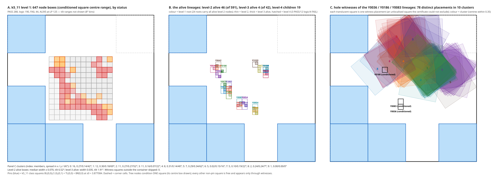

**Where it stands (paused 2026-09-06 00:45, A96 PAUSED.md).** Window fraction k5_11 0.978, k5_16 0.991. Open boxes
before the tight core: k5_11 L1 158 / L2 122 / L3 10 / L4 4; k5_16 L1 213 / L2 9. The tight core (T5′) removes 70 of
them (20/32/7/11 by level) with the certificate unchanged. Level-4 descent measured 0 of 30: the tree terminates.
**Schedule if simply resumed: 13.3 wall-days at 5 workers** (19.6 without T5′; 27 at the 95% upper bound on the tail).
**Tilt trimming (PI, 2026-09-06; A96 `155a3c5b`, measured, not deployed):** certify dead every tilt sub-interval of a
box for which the whole centre box lies inside one pin's octagon (Minkowski sum of the pin core and the reflected
square) — T5 with a tilt-range parameter, no new verifier. On 2,222 boxes: 159 boxes' surviving bin is empty (51 L1, 86 L2, 10 L3, 12 of 14 at
L4), of which **70 are exactly T5′'s kills (trimming subsumes the tight core) and 89 are new** (31 L1, 54 L2, 3 L3,
1 of the 3 post-T5′ L4 boxes); 155 more are partially trimmed; positive control 618/618. **Schedule 13.3 → 10–11
wall-days at 5 workers** (the credible saving is levels 2–3; the L4 rate rests on three boxes; ALIVE kills also remove
their subtrees, which the direct figure does not count, so 10–11 is a conservative upper bound). Deployment shape:
node = trimmed child (ordinary certificate) + k excluded tilt intervals (T5 with a range, "T5″"); not yet deployed. The value is the outright kills, not the core enlargement (median
a_tight gain 1.000). Lemma TC (tilt coherence) is exact to machine epsilon as a support-function identity but as a
kill test is 4.8× weaker than the octagon interval test (33 vs 159) because it discards direction; it stays as the
O(1) pre-screen. LP re-solves on trimmed bins and the schedule effect pending.

**What the alive nodes are** (A107, LP dual support drawn directly — the PI's rule):

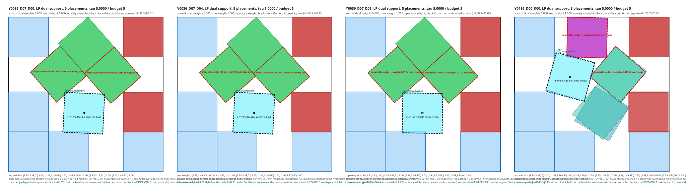

### 1a. Family S01 — "room at side 4" (k5_11 238, k5_16 178, trump5 196)
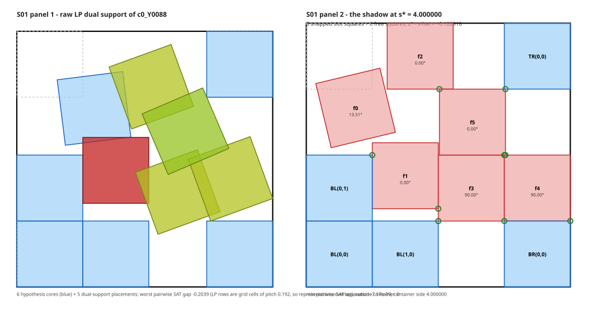
The support minimises to side exactly 4.000 in 62 combinatorial variants: a slot left empty or singly met. Every such
configuration teleports into a higher-k class that is dead on W. **The LP does not know the teleport lemma.** Technique tried:
SLOT-CROWD incidence rows at the node level — **A109 (2026-09-06, `7daabe6f`): 0 of 18 genuinely-alive nodes killed at
every depth the window licenses, 18 of 18 at the unlicensed depth 0.3, and 0 of 10 LP-dead nodes certified** (the
multiplicity runs fail on 5–32 exact holes at r = 1 already). Two exact facts behind the zero: (i) on a window ending
at side s, SLOT-SLIDE's depth margin and the dilation pad cancel exactly, so the only licensed row is "two non-pin
squares MEET the open slot" (depth 0), and the fourth slot of k5_11 carries no hypothesis above 3.877; (ii) 94% of
the supports do violate SLOT-CROWD, but the rows re-price rather than forbid — the slot boxes are 0.877 apart while a
45° square spans 1.414, so one placement meets two or three slots at once and the incidence budget pays for it
(c = 6.2 vs B = 4.4). Depth breaks the multiplicity and only depth; the prize if a lemma ever licenses depth 0.3 on
this window is the entire remainder (+12.7 wall-days). Until then this family dies by splitting, which the measured
tail says terminates. Side finding: 28 of the 46 sampled "alive" nodes were not genuinely alive (τ < budget, LP
unconverged at the time limit) — a longer LP time on unconverged alive nodes is a cheap re-check when A57 resumes.
Generalises as: *crowding rows need certified depth; depth needs the extension classes dead ABOVE the target side.*

### 1b. Family S02 — the k7 pinwheel (k5_11 184, k5_16 68, trump5 12; carries the deep tree)
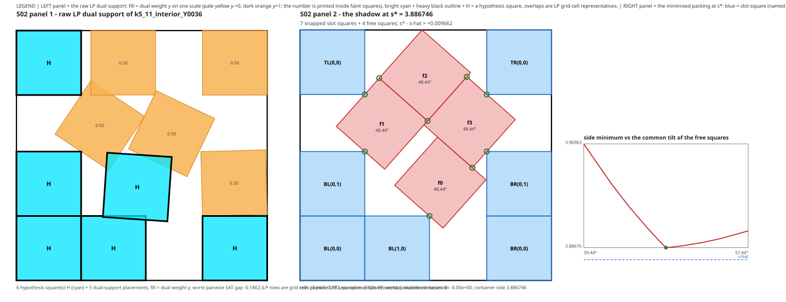
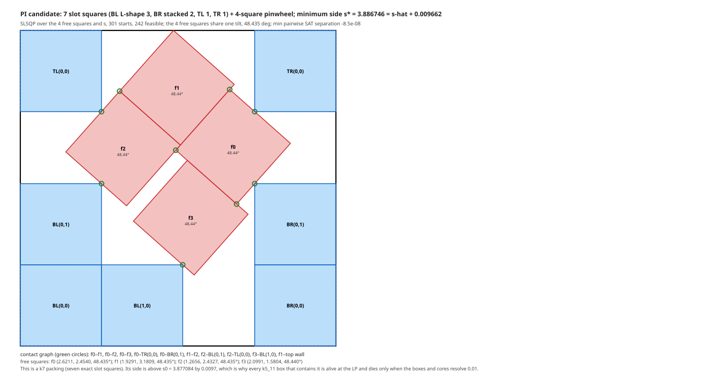
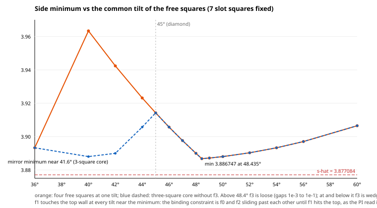
Seven slot squares (BL L-shape 3, BR stacked 2, TL 1, TR 1) + three load-bearing squares at one tilt 48.435° + one
strut/rattler; s* = 3.886746 = s0 + 0.0097 (certified endpoint). Binding contact: f1 on the top wall (Fritz-John 0.87);
the mirror pair f0/f2 next; f3 idle, flat direction blocked at second order. **No open box contains it** (A106): boxes
are alive because the relaxed core cannot see 0.0097 of slack. Techniques: the tight core (in); the tree terminates at
level 4 by pin clashes; or the grain kill of §6. **A111 (2026-09-06, `4c6ace6e`), load-path branching measured:** sound
on 146 of the 286 shadow-explained nodes; ≈ 35 kills at a 2/3 certify rate (n = 3), worth about one wall-day; two
nodes killed end to end. The chain YES kill certifies only for r < s* − s0, i.e. level-4 box widths, because the
fixed-tilt bound is exactly s* − r. The octagon and TC tests kill nothing between load-path boxes at s0 (genuine room:
side-blind rules cannot make a side statement) but fire constantly between a node's own bin and a load-path box — the
**free pair kill**, 113 of 264 S02 nodes at level 1 rising to 200 of 264 at level 4, 19 of 19 S07 nodes from level 2,
confirmed on 57,840 sampled pose pairs. The NO side is a convergence-time problem (dead-unconverged at 80 s, converged
dead at 900 s), 8 of 22 nodes had every NO child LP-dead, certificates 14 PASS / 4 FAIL, fixed-side only until
verify_param supports NO-families. The S07 branch is unsound at level 1 (Trump sits inside the YES region at A57's
level-1 tilt half-width) and usable from level 2. A112 is running the region tree with three branching orders. Generalises as: *a class-boundary shadow — a dead class's minimiser
sitting on a live class's box; the basin/grain lemma is the transfer.*

### 1c. Families S03–S06 (PI-read) and S08–S53
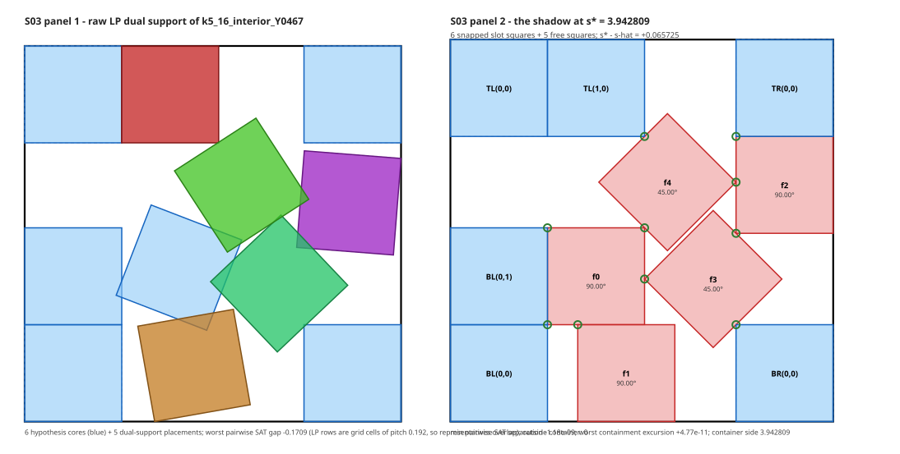 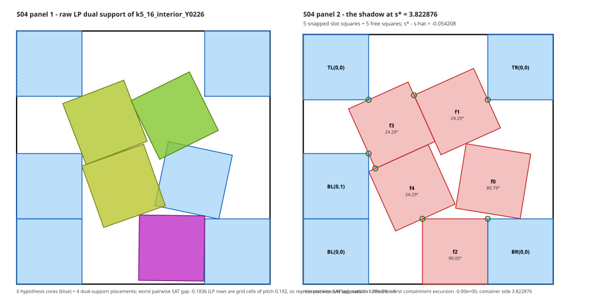
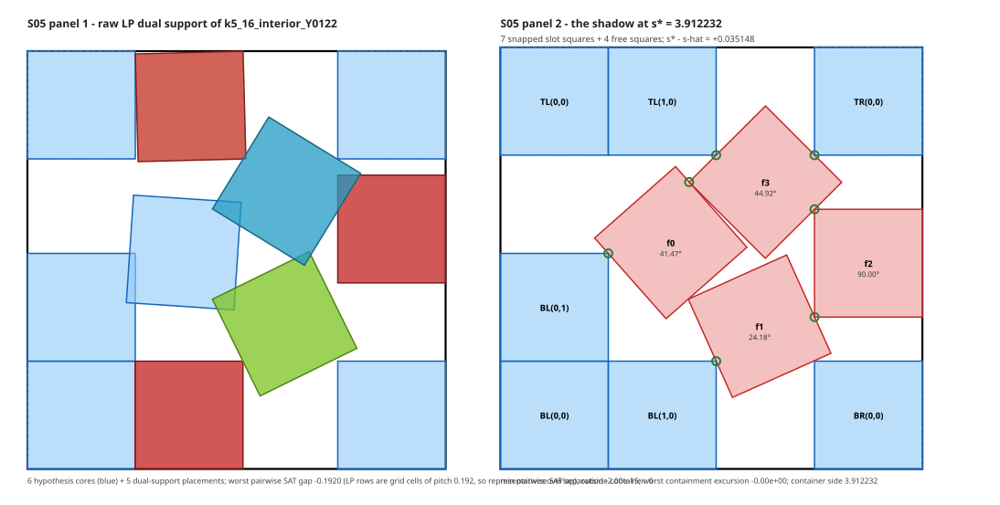 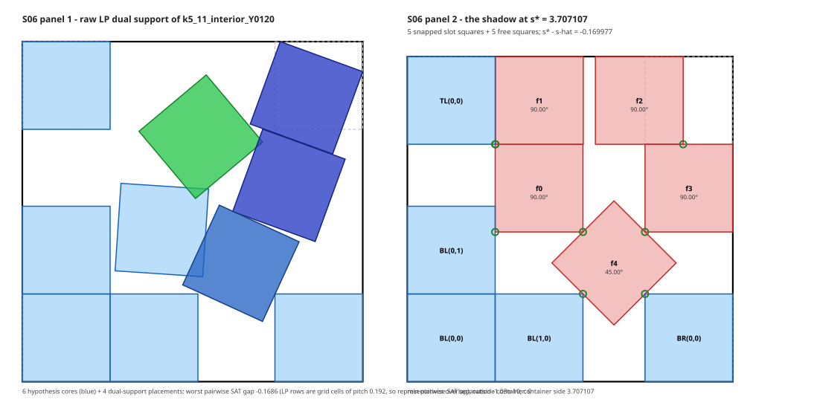
S03: f0/f1/f2 essentially simple (SNAP → higher k). S04: f0 teleports to BR(0,1). S05: the S07 pinwheel inverted. S06:
the optimal five-square packing (2 + 1/√2) with a unit band = the s(10) optimum 3 + 1/√2, a ten-square shadow (the LP
found room for ten and only fractional room for the eleventh). S08–S53: 1–17 nodes each, mostly level 1, the gallery
has each drawn. With crowd rows out (1a), all of these die by splitting; the measured tail says that terminates.

### 1d. The fractional tail (k5_11 151, k5_16 113)
No integral component in the dual support; 303 of 306 top out at four disjoint placements of the five needed. Nothing
to draw. These are what the tree is for, and they are mostly level 1 (110 + 106), i.e. cheap.

---

## 2. The window stragglers (A56 scoreboard; A61 pass 5 ran 01:00–08:00 on 2026-09-06)

| class | window status | why | next |
|---|---|---|---|
| k5_05 | **CONVERTED by A61 (PASS, margin 0.698)** | | scoreboard update |
| k5_14 | **CONVERTED by A61 (PASS, margin 0.016)** | | scoreboard update |
| k5_10 | converted by A61 (PASS, margin 0.016) | | scoreboard update |
| k6_21 | **CONVERTED by A61 (PASS, margin 0.014)** | | scoreboard update |
| k5_02, k5_03 | open, whole W | post-shrink gate-fail: budget − τ = 0.000 at ε_geo 0.003 (no margin at all) | resolver on the 4-D witnesses; bisection |
| k5_12 | open, whole W | gate-fail by a hair: budget − τ = 0.0265 < the 0.03 gate | lower the gate to 0.02 and certify (cheapest item on the list) |
| k5_13 | A61 running (τ 5.62 vs 6 at iteration 6) | | wait |
| k6_27 | open, whole W | fixed-s re-certification failed, no base certificate produced | resolver; else bisection |
| k6_07 | certified [3.82, 3.827068] + s0; open (3.827068, s0] | 50 ms-wide band | bisection + resolver; **this band is the S07 slot for trump5 crowd rows** |
| k6_23 | certified [3.82, 3.877] + s0; open (3.877, s0) | 8.4·10⁻⁵ sliver | resolver |

**k6 and up: one whole-window class left (k6_27) plus the two fragments.** k5 (outside A57): k5_02, k5_03, k5_12
open, k5_13 in progress.

Techniques that apply (from this week): (1) SLOT-CROWD rows at the root add budget 2e per usable slot, exactly the
few tenths these are short — but A109's node-level result (the multiplicity runs fail on exact holes even for small
boxes) and A94's own root failure make this unlikely to certify; try only after the resolver; (2) A96's resolver re-verifies the same certificate on the 4-D witness cells (closed 20/20
in A100) instead of re-solving the LP; (3) bisection of the side window for the two fragments. The tight core does not
apply (no boxes).

---

## 3. The protected tier (Trump's 16 sub-skeletons)

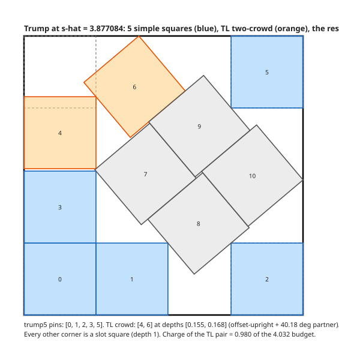
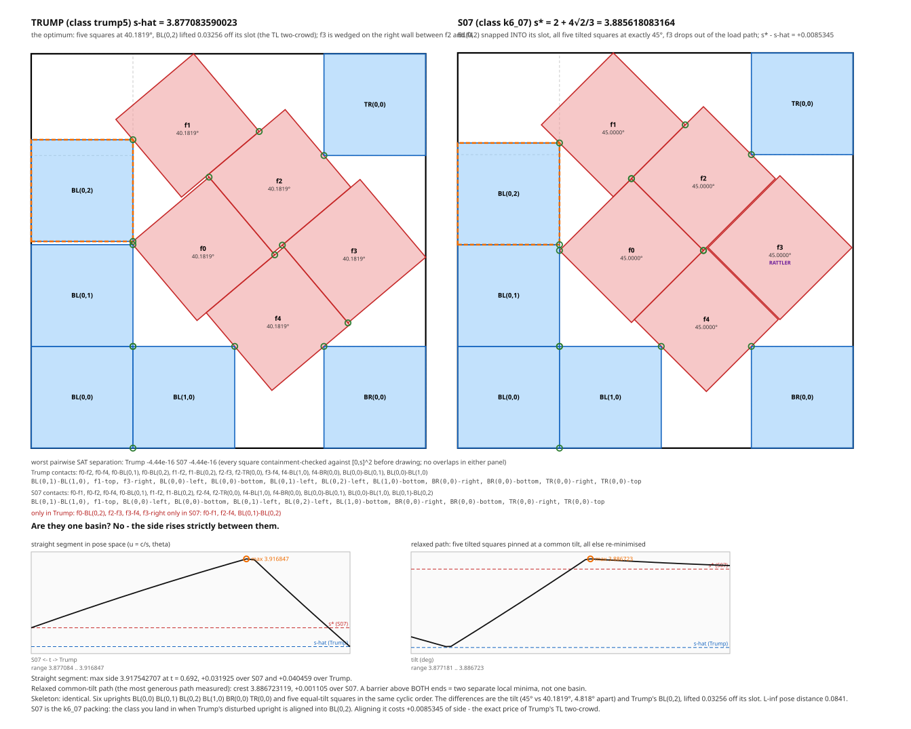

trump5 (BL[2,1] + BR[1] + TR[1]) contains Trump, so its kill is a residual tree ending in Trump's basin (rBasin =
3/2000, A63). A60's cover ran at 0.781 kill rate; paused. Its 325 alive nodes are, by A107: S01 196 (room), S07 18
(the exact 45° packing above — needs k6_07's band to make BL(0,2) a usable slot), S02 12, S03 16, S05 7, others small.
The other 15 protected classes are priced at 3,500–4,200 CPU-h by A100's pilots (k4_11, k3_02 end to end; η law exact
on 54/54 cover nodes; parametric route carries to protected classes; the resister branch at level 2 killed 1 of 16).
Everything that kills S01/S02 in A57 kills the same families here. Generalises as: *the class containing the optimum
needs a basin certificate; every other class needs only crowd rows and a tree.*

---

## 4. k0_00 — the frame residue

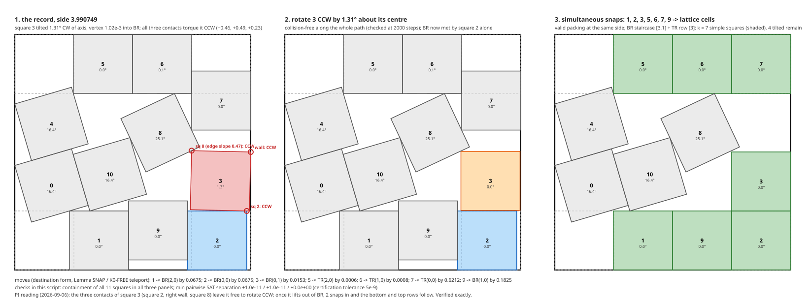
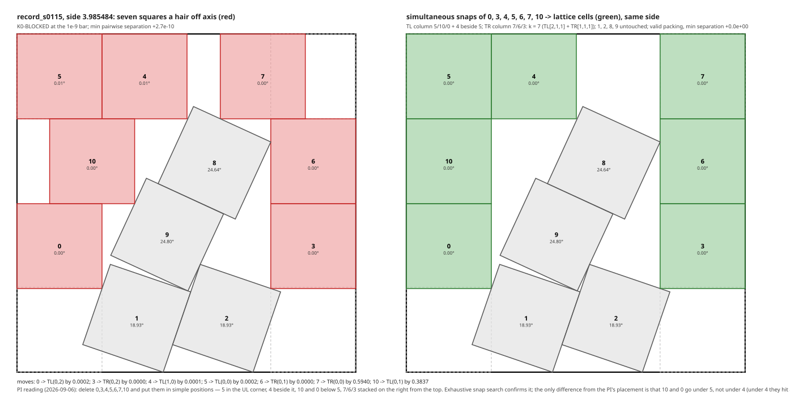
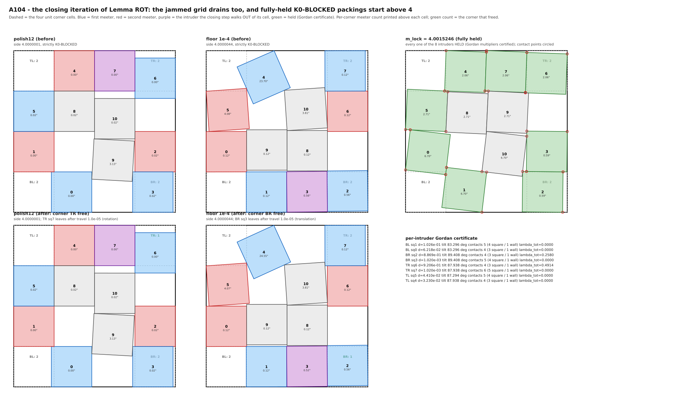
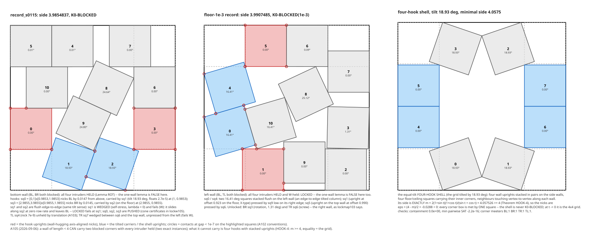

Proved chain: K0-FREE/teleport (Lean) → K0-BLOCKED residue → NOCRIT-SEL (every intruder anchored under translation) →
Lemma ROT (every intruder HELD under translation and rotation at the weighted-Ψ minimiser) → residue RES-LOCK: a
K0-BLOCKED packing in W with every intruder locked. **Conjecture LOCK-FREE⁺(< 4): none exists.** Evidence: 0 of 12
corpus packings and 0 of 443 descent endpoints below 4 are fully held; the closing iteration (follow the contact
manifold) frees a corner every time below 4; the first fully-held packing is at 4.000237; even the ε-grid is
LOCK-FREE. What a lock is made of: 3.3 square–square rows + 1 wall row per intruder, so the proof is a supply count
(the crowd arms cannot furnish three square rows to all eight corner members at side < 4), not a wall budget. The
one-wall lemma is false (two held walls below 4 exist: the mixed hook pair, closed form 2 + (2−s)/c + tan(θ/2)). The
tree alternative: 9,300–21,700 CPU-h (A99). **A113 (2026-09-06, `6409396b`): where that cost sits.** Measured on the
cell's own box, only 1.4% / 4.6% / 18% of the projected cost is within η = 0.05 / 0.1 / 0.2 of the k ≥ 1 manifold, and
the five alive level-1 cells sit at η 0.23–0.37 — but that is the wrong object: the tree conditions on an interior
square, and Trump's interior squares are the tilted ones (its cells sit at η = 0.366). On the right object, the LP's
dual support, the PI's hypothesis holds exactly: cells the LP kills have supports with ≤ 1 simple placement matching
only S01 (room); the un-killable cells (0 of 26 with position distance ≤ 0.05 ever killed; the six most resistant,
τ up to 10.5, all at distance ≤ 0.02, and τ climbs under row generation so more LP time cannot kill them) have
supports that are 2–6-slot partial skeletons of near-critical shadows — one alive cell matches S38 (trump5 boundary,
3.9289) slot for slot, an A85 FAIL matches S07 at Jaccard 0.83. Position distance predicts τ (Spearman −0.44 inside
every tilt bin), tilt distance predicts nothing, LP wall is flat in η. Consequence: a *re-branching* rule — branch a
cell on the slot its support keeps occupying, readable only after the LP — the k0 face of A112's dual-guided
branching, with the YES side handled by K0-FREE/teleport plus crowd rows (licensed at depth 0 at fixed s0, since
every k ≥ 1 class is dead there) and the NO side by the LP without its support. Also: the k0 tree has zero logic
kills (it never branches on corners), and A107's gallery missed the 264 k0 LP jsons through a glob bug; fixing it
adds ~146 alive k0 nodes to the shadow map. Generalises as: *for any n, below the grid side ⌈√n⌉ every blocked packing
has an unlocked intruder — the drain theorem; the hook/chain formulas are one-wall tools with 4 → ⌈√n⌉.*

---

## 5. Lean / TCB

TopLevel roster: K0-O1 + chain replays + ShellKill (Crowd, CrowdZone, Slide, PinnedSlide, Ceil, Composition);
teleport_packing, T5 (core_meet_same_square, unchanged by T5′), N1, M1, T11. Remaining axioms: `stratum_kill` (the
replay of every class certificate on W), `trump_residual` (the protected tier + basin), `a22_exact_structure`
(Trump's exact data). Every leaf above has a Lean shape written (noroom.md §8, lockfree.md §7, slot_crowds.md).

---

## 6. Bottom-up: grains, and how to expand a kill in phase space by more than 0.004 (PI question, 2026-09-06 02:00)

The 0.004 is a ball: side is Lipschitz in the poses, S07 is 0.0085 above s0, so a ball of radius ~0.004 around S07 is
certifiably above s0, and a level-1 box is 0.14 wide. Balls are the wrong shape. **The right shape is the grain**: the
set of configurations sharing S07's load-bearing contact graph G. Inside a grain the side is a closed-form function of
the tilts alone (A108: 3s = 6 + 8·(√2/2) for S07; A105's chain/hook formulas in general), because the load path is a
wall-to-wall chain and a chain's length depends only on its members' tilts and contact types. So:

* **Grain minimum.** For a load-bearing structure G, s_min(G) = min over the grain of the chain length — an algebraic
  minimisation in the tilts (for S02: the curve `pinwheel_tilt_curve.svg`, minimum 3.886746 at 48.435°; for S07:
  exactly 45°, 3.885618). If s_min(G) > s0, **the entire grain is dead**, whatever the rattlers do and wherever the
  free squares sit — not a ball, a semi-algebraic region of phase space with diameter of order 0.1–1.
* **Grain boundaries.** The PI's observation: rotating the pinwheel changes many contacts, but s_min is continuous
  across every boundary except the one where the tilted square's corner drops into the gap between BL(0,2) and
  BL(0,1) — i.e. the boundary into Trump's grain. Contact changes that keep the same load path keep the same chain
  formula; only a change of the load path can lower s_min. So grains form an adjacency graph labelled by s_min, and
  **a kill floods along it**: every grain connected to a dead grain by boundaries that do not change the load path is
  dead by the same formula. The live component is Trump's grain and nothing else.
* **What is proved.** Chain length as a tilt function for axis-aligned columns (CHAIN-AX [T]); the hook formulas
  (HOOK-α/β/βα [T]); the exact grain minima for S02 and S07 [T]; the tilt sweep [M].
* **What is missing — the box-to-grain map.** A box's configurations need not have the load path at all (fewer
  contacts, flexible). The bottom-up theorem that closes this is Morse-style: the side over a box attains its minimum
  either at a local minimum, which IS a grain with a known s_min, or on the box boundary, where the flow leaves the
  box (A106 measured: always the boundary). So "min side over the union of boxes that flow into each other ≥ min over
  the grains they reach" — and the grains a class can reach are finite (A107 found 53 values across 1,566 nodes).
  The certificate would be: (i) the list of grains of the class with s_min > s0 exactly (algebra, per grain),
  (ii) a proof that no other local minimum exists in the class's phase space below s0 — which is the class kill
  itself, circular unless (iii) the flow from every box is certified to stay above s0, i.e. a Lyapunov-type bound.
  The honest status: (i) is in hand for the top grains; (ii)/(iii) is the theorem. A110 (Fable) is briefed on it:
  state GRAIN-FLOOD exactly, prove the load-path continuity across boundaries, and give the box-to-grain certificate
  or the exact obstruction.
* **Cheap instance to try first.** S07's grain around trump5: enumerate the contact changes as the common tilt runs
  from 45° down to 41.6° (the crest) and up to 60°, verify s_min(θ) ≥ 3.8856 across every boundary except the Trump
  one, and count which of the 18 S07 nodes' supports lie inside the swept grain family. If all 18 do, the grain kill
  is 18 nodes for one algebraic certificate.

Generalises as: *the bottom-up side of the search is a flood over the grain adjacency graph; the top-down tree only
has to reach grains, not points.*

### 6.1 A110's verdict (2026-09-06, `docs/proofs/grain_flood.md`, `411cc79d`)

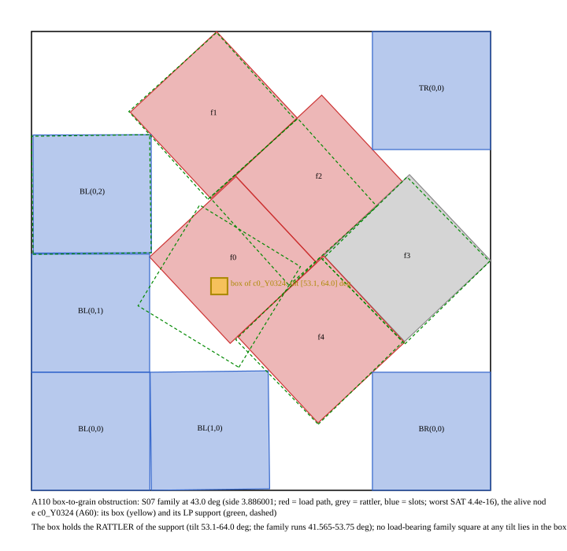

**GRAIN-FLOOD as stated is true and empty.** A packing at side ≤ s0 makes the global minimum over the class's compact
phase space a local minimum ≤ s0, so "every local minimum ≤ s0 lies in Trump's grain" is the class kill itself. Both
certificate shapes reduce to it: the only quantity monotone along a flow from a box is the side, which is the node's
own bound; and the grains reachable from a box are the selection census (≈ 8⁴⁵ separating-axis choices for five free
squares), which is what the tree prunes by localising — the existential-filter law again. The obstruction, drawn:
node c0_Y0324's box holds its LP support's rattler (tilt 53–64°) and no load-bearing S07-family square at any tilt;
the nearest is 0.21 away against a half-width of 0.07.

**What is proved and n-general.** Lemma GRAIN-LP: at fixed tilts and a fixed separating-axis selection, the side
minimum is an LP whose dual is a balanced force system, i.e. a load path — the same object as the leaf certificate's
dual. Lemma INHERIT: the chain formula survives every unloaded contact change. Theorem CONT: s_min is continuous in
the tilts; the PI's dichotomy is about which rows are loaded, not about continuity. GRAIN-ROW: a conflict row on the
support's cells, sound, kills the support pattern, not the node (yield open).

**The menu.** Trump, S07 and S02 are three kink minima of one family of chain formulas in the common tilt θ, with
u = cos θ + sin θ: the ladder Λ(θ) = 2 + 4u/(u² + 1) (minimum 2 + 4√2/3 at 45° only; = 4 at 0° and 90°, the grid), the
column chain Y(θ), the diagonal chain D(θ) = 2 + (2 + cos θ)/u, and the gap chain F_T(θ) = 2 + (2 + sin θ)/u = D(90° − θ).
S07 = Λ crossing Y at 45°. S02 = the triple point sin θ cos θ = 2 sin θ − 1 of Λ with D, θ* = 48.43512°, s* = Λ(θ*) =
3.886746029. **S07's Trump boundary** is at sin θ cos θ = 2 cos θ − 1, θ = 41.56488°, where f0's vertex reaches
BL(0,1)'s corner and the basis changes to F_T; the crest there is exactly S02's value 3.886746029, and F_T then falls to
ŝ. **Corollary TRUMP-GAP: ŝ = 2 + (2 + sin θ_T)/(cos θ_T + sin θ_T) at Trump's tilt, to 40 digits.** So on the S07
sweep exactly two load-path changes matter: 45° (both formulas ≥ 2 + 4√2/3, the flood crosses) and 41.565° (the
formula drops toward ŝ, the flood stops). Sweeps with all eleven squares free confirm each formula to 10⁻⁷ with one
loaded set per side while thirteen contacts flicker unloaded. S02's family never touches Trump's grain.

**T4 counts.** S07 family: 0 of 19 supports inside it (the six f1 nodes match Trump's grain at 39–41°, the canary;
the cover nodes draw the skeleton at 21–44° or 58–69°). S02 family: 56 of 267 (37 level 1 + 19 level 2 of A57; none of
the 14 deep nodes, none of A60's or A61's). Price of the sound consumer: two one-variable inequalities per family —
but it kills support patterns, not nodes, so the tree price is unchanged.

**What this leaves of the idea.** The grain menu is real, exact, and three-for-three on the known minima; it is the
right language for the paper's "why Trump" and for higher n (the same four chain formulas with ⌈√n⌉ in place of 4).
As a kill it needs the localisation the tree provides; the honest form is GRAIN-ROW inside the node LP, priced next.
