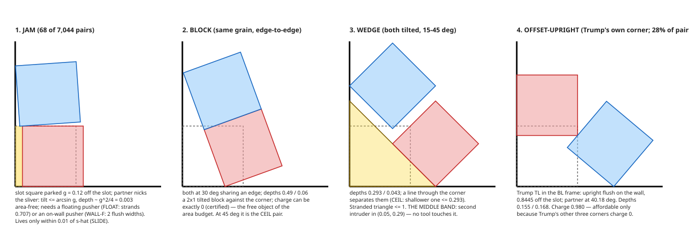
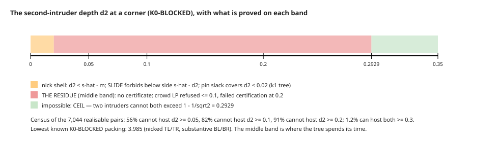
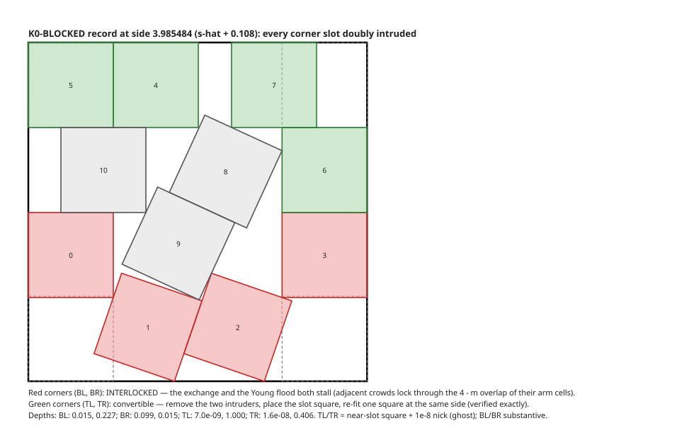
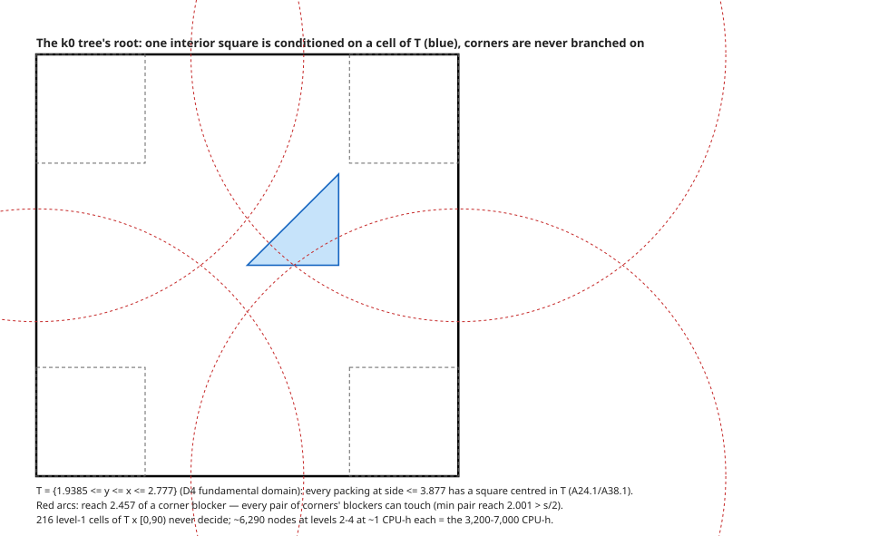

# The residue map — what is left to prove, where it lives, and what it looks like

*2026-09-04, coordinator. Every number is measured or certified unless marked (model). Figures are in
`docs/residue_map/`, generated by `gen.py` with every square checked for containment, disjointness and depth.
Pending measurements at the time of writing are listed in §7 and will be folded in as they land.*

## 0. The one-paragraph version

The theorem is s(11) = ŝ = 3.877083590022814 with Trump's packing unique. The proof is a stratification by simple
squares: every packing is labelled by its Young diagram of flush corner squares (k = number of simple squares), kills
climb (a dead class kills its extensions), and every class must be killed at every side in the window [3.82, ŝ).
Three blocks remain: (i) the k = 5 classes k5_11 and k5_16 on the window (A57, now parametric via A96), plus the
trump5 residual (A60) and the straggler rows (A61) — running, priced, no theory needed; (ii) the protected tier: the
16 classes that are Trump's own sub-skeletons (6 k4 incl. corners4, 10 k ≤ 3), priced by a model, never run on the
new pipeline (A100 is measuring); (iii) k0_00, the class with no simple square, whose residue after this week's
theorems is a specific geometric object: **all four corner slots doubly intruded, with substantive (not nick)
second intruders in the depth band 0.02–0.29, arranged as an interlocked frame**. Everything proved this week
either killed a piece of (iii) or priced a route to it; none deleted it. It is killed today only by the tree.

## 1. The stratification and where each block sits

| block | classes | status | price (CPU-h) | source of price |
|---|---|---|---|---|
| k ≥ 6 | 33 | dead, window-converted (A54/A61) | 0 | done |
| k = 5 unprotected | k5_11, k5_16 | A57 → A96 parametric; class coverage 0.980 / 0.992 | **~1,925** (80 CPU-days: level 1 11.6, level 2 44.4, level 3 24.3; 16 wall-days at 5 workers; four fixed sides would be 136 CPU-days) | measured (A96, 2026-09-04 evening): level-2 verify 506 s/child (n = 15, censored), level-2 LP 1.55× level 1, level-3 descent 6.8% |
| trump5 (Trump's own class) | 1 | A60 residual tree, cover done, deepen + tube | 300–500 | running |
| stragglers (s0-only rows) | 6 left | A61 converting | small | running |
| protected k4 | 6 (incl. corners4) | P-TREE trees; k4_08/k4_11 killed at 3.833 (A82) | **161–277 per class → 966–1,662 group** (k4_11: closing terms 96.0 CPU-h + one non-closing level-2 round 107.1). First-pass certification **0.385**: τ pins exactly to the budget on 61% of level-1 cells (η = 0), and those cells resist certification, ε_geo *and* level-2 bisection | A100 **measured** (39/882 cells; downstream + (D) complete) |
| protected k ≤ 3 (excl. k0_00) | 9 | P-TREE trees | **2,541 group** (k3_02 242, k2 313, k1 392 per class; k3_02 closing terms 141.0 CPU-h + level-2 round 149.2). Certification 0.75, resolver 9/9, ladder lands at level 24 in the tube (59 (D) leaves) | A100 **measured** (20/780 cells) + budget scaling ×1.149/step |
| k0_00 | 1 | interior-first tree unrun | 3,200–7,000 at s0 → 400–700 if A99 lands | A85 model; A99 measuring |

The protected tier and k0_00 are the two blocks where a theorem could delete work; the rest is engineering.

## 2. Trump, and why the protected tier is protected

Trump has five simple squares (the BL staircase of three, the BR and TR corner squares) and one *non-simple* corner:
the TL two-crowd, an upright flush on the left wall 0.8445 above its slot plus a 40.18° square, at depths 0.155 /
0.168. That corner pair strands 0.980 of the 4.032 wastage budget; Trump affords it because its other three corners
strand exactly 0.

Every class whose pins are a subset of Trump's five pins contains Trump (or an image) as a feasible point, so no
single-square certificate can kill it: the LP cannot separate Trump from the class. Those 16 classes are the
protected tier. Their kill has to say "only Trump survives", which is a residual tree ending in the basin/tube
(Lemma P-TREE, A84), not a plain kill. k0_00 is protected for the same reason in the extreme: no pins at all, so
all eight Trump images sit inside it.

## 3. k0_00: the chain of reductions and the residue

Everything below is for a packing z at side m ∈ [3.82, ŝ) with no simple square. Status tags: **T** theorem (prose,
drain-v3 rigor), **L** Lean, **C** certificate, **S** free selection of the representative, **M** measured only.

1. **K0-FREE** (L): if some corner slot is free once one square is removed, teleport that square into it — a k1
   packing at the same side. Conditional on k1_00 being dead on the window (K0-O1, a protected k ≤ 3 class, unrun).
2. **K0-BLOCKED** is therefore the residue: every corner's open unit slot is met by ≥ 2 squares. Exactly two, in
   every measured case (Lemma TWO: some corner always has exactly two).
3. **SLIDE** (L, modulo K0-O1): translate the whole packing away from a corner while the container grows; at side
   m < ŝ every corner's second intruder has depth d₂ ≥ ŝ − m. A nick costs its depth in side.
4. **CEIL** (T): two intruders of one corner cannot both exceed depth 1 − 1/√2 = 0.2929; equality only for the
   diagonal 45° pair.
5. **Not all four corners shallow** at depth 0.3 (C, window-valid). Three-shallow uncertified (LP budget only).
6. **Selection** (S): take the global minimiser with least weighted total corner intrusion. Then **NOCRIT-SEL** (T):
   every intruder's outward retreat cluster is anchored to a far wall (W-GEN), through columns of ≥ 3 squares below
   side 1 + 2√2 (COL). The residue is a *wall-anchored frame*.
7. **Basin/tube** (L): nothing within 3/2000 of a Trump image, nor in the tube along the slot ray, is below ŝ.

What the week's other results did to this residue:

| result | effect on k0_00 |
|---|---|
| crowd certificates (A92, A94) | certify only at d₂ ≥ 0.3, which CEIL makes empty; refused at ≤ 0.1; **no window content** |
| contact-structure and frame censuses (A88, A91) | 10¹¹ / 10²⁸ combinatorial objects; geometry kills 99.7% of samples but cannot be applied per object; **dead** |
| reach (cases85) | min pair reach 2.001 > s/2: **no corner pair is ever separated**; touchability vacuous |
| area budget with exact pair charges (charge85) | four-corner sum kills 5·10⁻⁵ of combinations; BLOCK and JAM corners can charge **0** |
| wall-length budget (A97) | WALL-F theorem; j ≤ 3 jams; two jams never share a wall; FLOAT prices a floating pusher at 0.707; **composition not dead by area** |
| pin supply (supply85) | every required lock/anchor zone has an intruder supplier; free squares never needed; **vacuous** |
| exchange / Young flood (A98) | 30/33 corners convert at the same side; the stalls are **interlocks** |
| pocket exemption (pocket96) | 0.3–0.6% of A57 holes; **yield zero** |
| global degeneration with the wider move set (degen87, after the PI's correction) | tangency-tolerant intruders (depth > 10⁻⁶), simultaneous align + cell-level teleport + wall-slides + exchange: **6 of 8 K0-BLOCKED packings reach a dead class at the same side**, all 8 degenerate (k 0 → 6…11), the 3.985 record to k = 7; Trump makes zero moves. The two failures are at side 4.0000 and stop at a tuple not realisable at s₀. Eight points, not a lemma; but the corner-local "interlock" was an artefact of counting tangencies as blocks |

## 4. The corner cases — the object in pictures

The 7,044 realisable corner-pair boxes fall into four cases (cases85):

| case | share | second intruder | what kills it / what protects it |
|---|---|---|---|
| **JAM** | 1% | nick, depth ~ g²/4 | lives only within 0.01 of ŝ (SLIDE); pays 0.707 area or wall length (FLOAT/WALL-F); pin slack covers g < 0.02 |
| **BLOCK** | 40% (overlaps wedge) | 0–0.35 | same-grain 2×1 block; charge can be exactly 0; no tool bites |
| **WEDGE** | 30% | 0.02–0.36 | CEIL caps it at 0.293; charge 0.02–1.05; no tool bites below 0.29 |
| **OFFSET-UPRIGHT** | 28% | 0.12–1.06 charge | Trump's own corner type; charge rises with offset then fans out; no cap (offset floor 0.27 beside a jam) |

The depth axis says where the residue's mass is: below 0.02 the nick shell (SLIDE plus pin slack), above 0.29
impossible (CEIL), and the band between is untouched by any certificate. 82% of realisable pairs cannot host a second
intruder above 0.1 and 91% not above 0.2, so the band's mass is concentrated at 0.02–0.1: **substantive but shallow
wedges and blocks**.

## 5. The interlock — the real packing that stalls

The lowest known K0-BLOCKED packing (side 3.985, ŝ + 0.108, exact) shows the residue in one picture. Its TL and TR
corners are ghosts: a near-slot square plus a 10⁻⁸ nick, convertible to k ≥ 1 at the same side by the exchange. Its
BL and BR corners are substantive (second intruders 0.015 / 0.099 with partners 0.227 / 0.015) and **interlocked**:
the two adjacent crowds lock each other through the overlap of their arm cells, which exists only because the side is
below 4. The exchange and the Young flood both stall there. This is the structure no lemma excludes: two adjacent
substantive crowds, one interior grain, columns to the walls around them. Trump's TL corner is the same object with
three slot corners beside it.

**PI correction (2026-09-05): the whole packing degenerates anyway, by a move the corner-local flood does not make.**
Squares 4 and 5 are on their TL cells to 10⁻⁴ and square 6 is exactly on the cell below TR; the "nick" at TR is a
10⁻⁸ tangency of 6, not a block. Align 4, 5, 6 (moves of 10⁻⁴), slide 10 left into the cell below TL (0.38) and 7
right into the TR corner (0.39, now unblocked): a valid packing at the same side (checked exactly), with five simple
squares, TL staircase [2,1] plus TR column [1,1] — the class **k5_10** (canonical BL [2,1] + TL [2]), which A61
converted to the full window (PASS, margin 0.016). k5_10 contains no Trump image, so its minimum side is above ŝ and
at most 3.985. Two lessons: a tangency-level "intruder" must not count as a block (the certifier bar is gap ≥ 0), and
the degeneration move set must include sliding along a wall into a corner cell freed by aligning its tangent
neighbour, which is K0-FREE applied at the *cell* level — the interlock at BL/BR is not an obstruction to global
degeneration; only to the corner-local flood. Under the strict convention (depth > 10⁻⁶) this packing is not
K0-BLOCKED at all: TR and TL drop to one meeter, so K0-FREE applies directly. Under that convention **no K0-BLOCKED
packing below side 4.000004 is known**; the six that remain sit at the search's own depth floor of 10⁻⁴ (strict85).
The pair census is invariant under the convention (its shallowest pair depth is 3.8·10⁻⁵), so the tree is unchanged.

The flood potential makes the stall quantitative: X(D) = overhang − free area inside the diagram D; the flood wins at
X ≤ 0; below side 4 the 3×3 block has X = 2 exactly, so a win needs ≤ 8 cells. Trump keeps X = 1 on every diagram.

## 6. The tree that answers it, and its anatomy

The interior-first tree conditions one interior square on a cell of T (the centre region every packing must put a
square in) and bisects it; corners are never branched on, which is why none of the corner insight lowered its price.
Its cost: 216 level-1 cells that never decide; ~6,290 nodes at levels 2–4 at ~1 CPU-h each (1,000 s LP + 630–860 s
certification); the 3,200–7,000 spread is the first-pass certification rate (0.33 measured vs 0.85 assumed); priced at
s0 only (window: four fixed sides ×4, parametric ×0.8).

Three reductions are being measured on its own nodes (A99): failures certified by sub-box re-verification instead of
descending (A57: 82/82 closed in seconds; effect 2–3×), corner shallow/deep patterns at the root with Lemma ID's
exempt boxes (does a level-1 cell ever decide; effect ≥ 2×), and per-node engineering (2–3×).

## 7. Pending measurements (folded in as they land)

- A96 (landed): level-2 parametric verify 506 s/child (2.5× the level-1 mean; n = 15, censored by one timeout),
  level-2 LP 1.55× level 1 (70 children, 8 parents; the earlier 2.76× was one outlier parent), level-3 descent 6.8%
  (was an unstated zero). A57 = 80 CPU-days, 16 wall-days at 5 workers; the parametric route still beats four fixed
  sides by 1.7×. Levels 2+3 are 86% of it. Follow-ups measured: the honest range is 14–16 wall-days (median vs
  censored-mean verify wall); one 88-atom child is 23% of the level-2 verify wall (a completed FAIL plus resolver
  beats a timeout, so the cap is being raised for high-atom children, not lowered); level-2 partials close through
  the resolver in 3–11 s each; the σ ladder propagates to level 2 and would save 2 wall-days net but requires
  resetting k5_11's live coverage, so it is recorded, not deployed.
- A99: the three k0 tree reductions, stacked, at s0 and window-valid.
- A100 (landed 2026-09-05): k4_11 and k3_02 run end to end. **The η law is exact on 54/54 cover nodes** —
  η < 0 ⇔ a certificate exists — so the LP decides killability before certification is attempted, and
  certification + ε_geo on the η = 0 cells is pure loss (39.5% of k4_11's cover leg, 0 kills in 12 attempts);
  η-gating cuts the per-node wall 558.8 → 337.9 s. The **parametric route carries to protected classes**
  (A96's emitter accepts cover certificates verbatim, 28/28; **resolver 20/20 CLOSED**, 43 window rows, 0
  residual) but **not to ladder or NO-family nodes**. **Level-2 at δ_pin = 1e-2 killed 1 of 16 children** —
  the resister branch has no measured closing mechanism, and it is the whole gap to A84's model. (D) side is
  cheap and identical to A84's (both ladders land at level 24, all_in_tube; 28 leaves for |G_S| = 1, 59 for 2).
  **Protected tier, 15 classes excl. k0_00: 3,500–4,200 CPU-h** central, band 2,900–6,300 on the level-2
  child wall, vs A84's 1,800 model. **All layers: 5,900–13,700 CPU-h** against the ~400 CPU-h PI target;
  k0_00 alone is 400–7,000 of it. Detail: `attempts/A100-protected-pilot/results/a100_{report,projection}.json`.

## 8. What would delete the residue — candidate theorems, with the effect each would have

Ordered by what it would remove. Each is stated so that it is checkable against the figures above.

1. **Interlock exclusion below ŝ** (deletes k0_00 entirely, given K0-O1). Statement: a K0-BLOCKED packing in which
   the Young flood stalls at every corner (X(D) ≥ 1 on every reachable diagram, every frontier square wall-anchored)
   has side ≥ ŝ, with equality only at Trump's images. Evidence: no four-corner interlock is known at any side; the
   only two-corner interlock below 4 is at 3.985; Trump is the archetype. Obstruction: an interlock is a rigidity
   statement about four crowds and one interior grain, and rigidity is what the basin proves *near* Trump only.
   A proof would be a global rigidity theorem: "an interlocked frame is a critical configuration of the side, and
   the only critical frames are Trump's" — the FJ machinery cannot see it (BLIND), so it would have to be a
   contact-structure rigidity argument on the frame's columns.
2. **Degeneration for the protected tier** (deletes the 16 trees). Statement: a packing in a protected class S that
   is not in Trump's tube converts, at the same side, into a strict extension of S. This is the flood with a head
   start (the pins are already a diagram). It fails exactly where k0's does, on interlocks, but a protected class has
   fewer free squares and more cells, so its interlocks may be provably Trump's. A100's runs will show how much of
   each tree is spent near the images (tube leaves) versus far from them.
3. **A two-corner interlock lemma** (shrinks the k0 residue to a thin band). Statement: two adjacent substantive
   crowds cannot interlock below side 4 − ε unless both second intruders exceed depth δ*, for some δ* well above 0.02.
   This is the arm-cell overlap of the 3.985 packing made quantitative: the overlap is 4 − m wide, and the lock
   needs both arms to reach it. If δ* ≈ 0.1, then 82% of the pair census cannot participate in an interlock, and the
   corner-first tree's frontier drops by that factor per corner (3.9·10¹³ → ~10¹⁰), possibly to viability.
4. **Grain rigidity of the middle**: the three free squares in a K0-BLOCKED packing must form the interior grain
   that all eight anchoring columns pass through; a same-grain block of three squares spanning wall to wall in both
   axes at side < 3.9 has a finite list of shapes (A50-style quantisation). If that list is short, the residue is a
   finite case analysis, which is what every other route failed to reach.

5. **The seam, for the protected tier** (this is where A100's k4_11 cost comes from). A100 measured the η law to be
   exact on 54 cover nodes: η < 0 always certifies, η = 0 (τ equal to the budget to the last digit) never does, and
   bisecting an η = 0 cell gives η = 0 children (1 kill in 16). Those cells are the ones where Trump's image, or its
   fractional shadow, is feasible for the class LP at s₀; below ŝ the image does not fit (A82: the aliveness cliff is
   a step of exactly one *at* ŝ, dτ/ds ≈ 8), and the class dies by plain certificates from ŝ − 0.025 down, the 0.025
   being the certifier's slack gate (≈ 0.21) divided by dτ/ds. So the tier's residue is the slab (ŝ − 0.025, ŝ) of
   each image-bearing class, and inside it the tree cannot decide by LP at s₀ at all. Two levers, one engineering and
   one theorem: (a) η-gating, free — skip certification and ε-geometry on η = 0 cells (25–40% of A84's cover leg;
   A57's engine already does this, and on A57's 1,206 rows the other half of the law fails: η < 0 certifies only 79%
   of the time, so the rule is "η = 0 never certifies", not "η < 0 always does"), and a certifier that verifies at
   smaller slack (narrows the slab from below); (b) the statement that in the top slab a
   packing of an image-bearing class lies in the image's tube — a class-level basin — which would replace the
   resister branch by (D) leaves. (b) is the theorem restricted to the class, so it is not free either.

The honest assessment: 1 is the theorem; 3 is the most likely to be provable and is worth roughly the factor the PI
asked for on the corner-first route; 2 is the same theorem as 1 in easier clothing and A100 will say how much it is
worth; 4 is unexplored; 5 is the only lever on the protected tier that does not require a theorem.
