# The shadow gallery (A107)

What the LP is looking at when it stalls.  For every ALIVE-at-LP node of A57 (both classes, all
shards, levels 1-4), A60 (trump5) and A61 (window stragglers), the LP dual support was loaded,
turned into a candidate near-packing, snapped to named slot cells, and minimised directly over
the side.  Distinct shadows are listed once, ordered by the number of alive nodes they explain.

Part I below is the pinned classes (A57 k5_11 / k5_16, A60 trump5, A61 window stragglers).
**Part II, at the end of this file, is the k0_00 cells** of A38-root-power, A85-k0-route and
A99-k0-tree-v2, which have no pins and so are de-duplicated over the full D4.

## Method

1. **Alive-at-LP** = `dead == False` in the node json (the LP did not certify the case).
   1566 such nodes on disk: A57 1227, A60 325, A61 14.
2. **Shadow** = the hypothesis cores (the class skeleton + every conditioned square, taken at
   its box centre) together with the integral part of the dual support (weights 1).  The LP rows
   are configuration-space *cells* of pitch 0.192 in position and 5 deg in tilt, so the drawn
   representatives overlap by up to that pitch - this is the "overlaps and all" panel, and the
   numbers are reported on every drawing.  Verified integral LP solutions in this corpus have
   worst pairwise SAT gap -0.2045, which fixes the disjointness tolerance at -0.21.
3. **Fractional supports** are split into integral components: a weight-greedy maximum-
   independent-set search over the placements with y > 0.02 in the cell-disjointness graph,
   looking for `budget` many.  A node is *explained* only if a full-size component exists.
4. **Snapping**: a placement within 0.05 of a corner-stacked unit cell and 3 deg of axis is
   named BL(i,j)/BR(i,j)/TL(i,j)/TR(i,j); the rest are the free squares f0..fn.
5. **Minimisation**: slot squares fixed as affine functions of s, free squares (cx, cy, theta)
   and s variable, SLSQP, restarts = every alive node's own LP seed + >= 100 random
   (pinwheel rings and scatters).  Generalises `docs/residue_map/gen_pinwheel_k7.py`.
6. **De-duplication.**  Each alive node is followed from its OWN LP seed to the minimum it
   actually reaches, so a structure with several local minima splits its nodes between them.
   The landings are then de-duplicated.  The unit of the gallery is a **value of s\***, not a
   point in configuration space, for a reason the k7 family makes concrete: its five landings
   share the same three-square 48.435 deg core and the same seven slot squares, and differ
   only in where the loose fourth square sits along its flat direction (0.15 in x) - the
   brief's 0.05 / 3 deg point rule would call those five different shadows.  A106 reached the
   same conclusion independently ("a shadow is a value of s*, not a point", `measurements.md`
   2.1).  The column **#cfg** counts how many distinct minimised configurations share the
   value, under the brief's 0.05 / 3 deg rule applied modulo D4 to the **load-bearing**
   squares (nonzero Fritz-John force); rattlers and struts are excluded from that comparison
   for exactly the reason above.  Different slot/free splittings of one packing collapse
   automatically - that is why 5-slot+6-free, 6-slot+5-free and 7-slot+4-free structures land
   on one entry.
7. **Contacts and forces**: contacts at gap < 1e-7, classified vertex-on-edge / flush /
   exactly-opposite (vertex-vertex).  The Jacobian rows are the exact analytic derivatives of
   the vertex-to-supporting-line distance (including the lever term from the edge owner's
   rotation) - never a finite difference of a SAT gap, which is wrong at flush and opposite
   contacts.  Contact forces are the Fritz-John multipliers from nnls(J^T, e_s), rows unit-
   normalised.  Every flat direction is then tested at SECOND order along the exact gaps.

8. **Gallery v2 drawings (PI, 2026-09-07).**  The left panel no longer encodes tilt at all: every
   dual-support placement is filled on ONE sequential scale by its dual weight y (pale yellow at
   y -> 0, dark orange at y = 1), with the number printed inside the faint squares, and the
   hypothesis square(s) are bright cyan with a heavy black outline and an **H** - a colour used
   nowhere else.  In the right panel, a free square whose pose sits within **1e-3** of a lattice
   cell centre and **0.05 deg** of axis is drawn blue like the other snapped slot squares and
   carries its cell name: A121 found the v1 gallery drawing these red as if they were free.  The
   `gallery v1 split` column keeps the old counts so A121's audit stays reproducible, the
   f-indices are unchanged everywhere (contact graph, forces, flat directions, rattler table),
   and the v1 SVGs are kept byte-for-byte under `docs/shadows/v1/`.  Every SVG carries a
   one-line legend.

### What "explains" means, and what it does not

A shadow explains a node when that node's own LP dual support, snapped and then released,
minimises to it.  It does **not** mean the node's pose box contains the shadow: A106
(`attempts/A106-shadow-diameter/notes/measurements.md` 2.2) measured exactly that and found
**zero** of 62 landed open boxes contains a shadow - the box-constrained minimum always sits
on the box boundary and flows out of B when released, median inf-gap 0.3166, about 9 basin
radii.  A107 reuses that finding rather than re-deriving it; what is new here is *which*
shadow each alive node's support flows to, and the contact graph of that shadow.  The s*
spectrum below reproduces A106's census (3.886746, 3.902674, 3.912232, 3.914214, 3.924003,
3.942809, 4.000000) to 6-7 digits from an independent minimiser, with the slot squares held
exactly on their slot lines rather than sliding inside A57's delta = 1e-2 slack cores.

### Shadows with fewer than 11 squares

A node whose LP run did not converge can be ALIVE-at-LP with an integral support SHORTER than
its budget.  Its shadow then has k < 11 squares and its s* falls below s-hat - correctly so:
a k9 or k10 packing has room to spare.  Those entries are the LP telling you it never found
the last square, not a near-solution.

## Gallery table

| shadow | class(es) of the alive nodes | k of the shadow | gallery v1 split | s* | s* - s-hat | alive nodes | #cfg | levels | free sq | common tilt | flexes at fixed s |
|---|---|---|---|---|---|---|---|---|---|---|---|
| **S01** | k5_11 x238, trump5 x196, k5_16 x178, k5_05 x2, k5_10 x2, k5_12 x1, k5_17 x1, k6_20 x1, k6_29 x1 | k11 (7 slot + 4 free) | 5 slot + 6 free | 4.000000 | +0.122916 | 620 | 62 | L1:532, L2:84, L3:1, L4:3 | 4 | no | 5 |
| **S02** | k5_11 x184, k5_16 x68, trump5 x12, k5_02 x1, k5_03 x1, k6_29 x1 | k11 (7 slot + 4 free) | 7 slot + 4 free | 3.886746 | +0.009662 | 267 | 15 | L1:156, L2:97, L3:10, L4:4 | 4 | 48.435 deg | 1 |
| **S03** | k5_16 x50, k5_11 x30, trump5 x16 | k11 (8 slot + 3 free) | 6 slot + 5 free | 3.942809 | +0.065725 | 96 | 31 | L1:78, L2:18 | 3 | no | 1 |
| **S04** | k5_16 x48, k5_11 x10, trump5 x1 | k10 (6 slot + 4 free) | 5 slot + 5 free | 3.822876 | -0.054208 | 59 | 5 | L1:53, L2:4, L3:1, L4:1 | 4 | no | 5 |
| **S05** | k5_16 x32, trump5 x7, k5_11 x3, k6_20 x1, k6_27 x1 | k11 (7 slot + 4 free) | 7 slot + 4 free | 3.912232 | +0.035148 | 44 | 8 | L1:39, L2:5 | 4 | no | 3 |
| **S06** | k5_11 x28, k5_16 x5, trump5 x3 | k10 (7 slot + 3 free) | 5 slot + 5 free | 3.707107 | -0.169977 | 36 | 9 | L1:18, L2:13, L3:5 | 3 | no | 1 |
| **S07** | trump5 x18, k5_16 x1 | k11 (6 slot + 5 free) | 6 slot + 5 free | 3.885618 | +0.008534 | 19 | 2 | L1:19 | 5 | 44.879 deg | 8 |
| **S08** | k5_16 x6, k5_11 x5, trump5 x5, k6_21 x1 | k11 (5 slot + 6 free) | 5 slot + 6 free | 3.914214 | +0.037130 | 17 | 8 | L1:16, L2:1 | 6 | no | 5 |
| **S09** | k5_16 x9, trump5 x2, k5_11 x1 | k11 (7 slot + 4 free) | 7 slot + 4 free | 3.925149 | +0.048065 | 12 | 6 | L1:12 | 4 | no | 2 |
| **S10** | k5_16 x8, k5_11 x1, trump5 x1 | k11 (7 slot + 4 free) | 7 slot + 4 free | 3.902674 | +0.025590 | 10 | 4 | L1:10 | 4 | no | 0 |
| **S11** | k5_11 x4, trump5 x2, k5_16 x1 | k11 (8 slot + 3 free) | 8 slot + 3 free | 3.976620 | +0.099536 | 7 | 3 | L1:5, L2:2 | 3 | no | 3 |
| **S12** | k5_11 x3, k5_16 x2, trump5 x1 | k9 (5 slot + 4 free) | 5 slot + 4 free | 3.400000 | -0.477084 | 6 | 2 | L1:6 | 4 | no | 11 |
| **S13** | trump5 x4, k5_16 x1 | k11 (6 slot + 5 free) | 6 slot + 5 free | 3.991994 | +0.114911 | 5 | 2 | L1:5 | 5 | no | 2 |
| **S14** | k5_16 x3, k5_11 x2 | k10 (6 slot + 4 free) | 5 slot + 5 free | 3.767767 | -0.109317 | 5 | 3 | L1:3, L2:1, L3:1 | 4 | no | 7 |
| **S15** | k5_11 x2, trump5 x2, k5_16 x1 | k11 (7 slot + 4 free) | 6 slot + 5 free | 3.996117 | +0.119033 | 5 | 5 | L1:4, L2:1 | 4 | no | 0 |
| **S16** | k5_11 x3, k5_16 x1 | k10 (7 slot + 3 free) | 6 slot + 4 free | 3.768118 | -0.108966 | 4 | 2 | L1:2, L3:1, L4:1 | 3 | no | 0 |
| **S17** | k5_11 x2, k5_16 x2 | k10 (5 slot + 5 free) | 5 slot + 5 free | 3.858216 | -0.018867 | 4 | 2 | L1:3, L2:1 | 5 | no | 8 |
| **S18** | k5_11 x3 | k10 (5 slot + 5 free) | 5 slot + 5 free | 3.755342 | -0.121742 | 3 | 1 | L1:2, L2:1 | 5 | no | 5 |
| **S19** | k5_11 x2 | k10 (7 slot + 3 free) | 5 slot + 5 free | 3.728581 | -0.148502 | 2 | 1 | L1:2 | 3 | no | 5 |
| **S20** | trump5 x2 | k10 (6 slot + 4 free) | 6 slot + 4 free | 3.806721 | -0.070363 | 2 | 1 | L1:2 | 4 | no | 5 |
| **S21** | trump5 x2 | k11 (6 slot + 5 free) | 6 slot + 5 free | 3.894322 | +0.017238 | 2 | 1 | L1:2 | 5 | no | 0 |
| **S22** | k5_11 x2 | k11 (8 slot + 3 free) | 8 slot + 3 free | 3.998111 | +0.121027 | 2 | 1 | L1:2 | 3 | no | 1 |
| **S23** | k5_11 x2 | k10 (7 slot + 3 free) | 6 slot + 4 free | 3.894653 | +0.017569 | 2 | 2 | L2:2 | 3 | no | 0 |
| **S24** | k5_11 x1, k5_16 x1 | k11 (7 slot + 4 free) | 7 slot + 4 free | 3.989264 | +0.112181 | 2 | 2 | L1:2 | 4 | no | 2 |
| **S25** | k5_11 x1 | k10 (6 slot + 4 free) | 5 slot + 5 free | 3.728606 | -0.148477 | 1 | 1 | L1:1 | 4 | no | 4 |
| **S26** | k5_16 x1 | k10 (6 slot + 4 free) | 6 slot + 4 free | 3.822889 | -0.054195 | 1 | 1 | L1:1 | 4 | no | 5 |
| **S27** | k5_16 x1 | k10 (6 slot + 4 free) | 6 slot + 4 free | 3.823521 | -0.053562 | 1 | 1 | L1:1 | 4 | no | 8 |
| **S28** | k5_16 x1 | k10 (6 slot + 4 free) | 6 slot + 4 free | 3.825844 | -0.051239 | 1 | 1 | L1:1 | 4 | no | 6 |
| **S29** | k5_16 x1 | k11 (7 slot + 4 free) | 6 slot + 5 free | 3.886761 | +0.009677 | 1 | 1 | L1:1 | 4 | no | 5 |
| **S30** | k5_11 x1 | k11 (6 slot + 5 free) | 6 slot + 5 free | 3.897231 | +0.020147 | 1 | 1 | L1:1 | 5 | 56.104 deg | 2 |
| **S31** | trump5 x1 | k11 (6 slot + 5 free) | 6 slot + 5 free | 3.907472 | +0.030388 | 1 | 1 | L1:1 | 5 | no | 0 |
| **S32** | k5_16 x1 | k11 (7 slot + 4 free) | 6 slot + 5 free | 3.912250 | +0.035166 | 1 | 1 | L1:1 | 4 | no | 4 |
| **S33** | trump5 x1 | k11 (6 slot + 5 free) | 6 slot + 5 free | 3.916931 | +0.039847 | 1 | 1 | L1:1 | 5 | no | 1 |
| **S34** | trump5 x1 | k11 (6 slot + 5 free) | 6 slot + 5 free | 3.917360 | +0.040276 | 1 | 1 | L1:1 | 5 | no | 0 |
| **S35** | trump5 x1 | k11 (6 slot + 5 free) | 6 slot + 5 free | 3.917433 | +0.040349 | 1 | 1 | L1:1 | 5 | no | 0 |
| **S36** | k5_11 x1 | k11 (5 slot + 6 free) | 5 slot + 6 free | 3.924003 | +0.046919 | 1 | 1 | L1:1 | 6 | no | 3 |
| **S37** | trump5 x1 | k11 (7 slot + 4 free) | 7 slot + 4 free | 3.925470 | +0.048387 | 1 | 1 | L1:1 | 4 | no | 0 |
| **S38** | trump5 x1 | k11 (6 slot + 5 free) | 6 slot + 5 free | 3.928915 | +0.051831 | 1 | 1 | L1:1 | 5 | 41.754 deg | 1 |
| **S39** | k5_16 x1 | k11 (6 slot + 5 free) | 6 slot + 5 free | 3.932425 | +0.055341 | 1 | 1 | L1:1 | 5 | no | 0 |
| **S40** | k5_16 x1 | k10 (7 slot + 3 free) | 7 slot + 3 free | 3.940518 | +0.063434 | 1 | 1 | L1:1 | 3 | 52.315 deg | 0 |
| **S41** | k5_16 x1 | k11 (6 slot + 5 free) | 6 slot + 5 free | 3.940838 | +0.063755 | 1 | 1 | L1:1 | 5 | no | 2 |
| **S42** | k5_16 x1 | k11 (6 slot + 5 free) | 6 slot + 5 free | 3.952692 | +0.075608 | 1 | 1 | L1:1 | 5 | no | 0 |
| **S43** | k5_11 x1 | k11 (6 slot + 5 free) | 6 slot + 5 free | 3.956360 | +0.079277 | 1 | 1 | L2:1 | 5 | no | 2 |
| **S44** | k5_11 x1 | k11 (6 slot + 5 free) | 5 slot + 6 free | 3.958425 | +0.081341 | 1 | 1 | L1:1 | 5 | no | 1 |
| **S45** | trump5 x1 | k11 (6 slot + 5 free) | 6 slot + 5 free | 3.985467 | +0.108383 | 1 | 1 | L1:1 | 5 | no | 5 |
| **S46** | k5_16 x1 | k11 (7 slot + 4 free) | 7 slot + 4 free | 3.985478 | +0.108394 | 1 | 1 | L1:1 | 4 | no | 5 |
| **S47** | k5_11 x1 | k11 (8 slot + 3 free) | 8 slot + 3 free | 3.989280 | +0.112196 | 1 | 1 | L1:1 | 3 | 22.551 deg | 1 |
| **S48** | k5_16 x1 | k11 (6 slot + 5 free) | 6 slot + 5 free | 3.996435 | +0.119351 | 1 | 1 | L1:1 | 5 | no | 7 |
| **S49** | k5_11 x1 | k11 (7 slot + 4 free) | 7 slot + 4 free | 3.996724 | +0.119641 | 1 | 1 | L1:1 | 4 | no | 5 |
| **S50** | trump5 x1 | k11 (8 slot + 3 free) | 8 slot + 3 free | 4.000027 | +0.122944 | 1 | 1 | L1:1 | 3 | no | 4 |
| **S51** | k5_11 x1 | k11 (8 slot + 3 free) | 8 slot + 3 free | 4.000052 | +0.122968 | 1 | 1 | L2:1 | 3 | no | 4 |
| **S52** | trump5 x1 | k11 (8 slot + 3 free) | 7 slot + 4 free | 4.000197 | +0.123113 | 1 | 1 | L1:1 | 3 | no | 4 |
| **S53** | k5_11 x1 | k11 (9 slot + 2 free) | 9 slot + 2 free | 4.000261 | +0.123177 | 1 | 1 | L1:1 | 2 | 85.192 deg | 1 |

Total alive nodes explained by an integral shadow: **1260** of **1566**.  Not explained: **306** (see the last section).

### What the table says

* **Half of the explained alive nodes (620 of 1260) sit on S01, whose shadow minimises to a
  side of exactly 4.000000** - s-hat + 0.1229, thirteen times the k7 pinwheel's own slack.
  For those nodes the LP is not near a critical packing at all; its integral support is a
  side-4 arrangement, and 62 combinatorially distinct ones share the value.  That is the LP
  saying "this branch has room", not "this branch is nearly feasible".
* **S02 is the PI's k7 pinwheel** (7 slot squares, 4 free at one tilt 48.4351 deg,
  s* = 3.886746 = s-hat + 0.009662), reproduced here to 7 digits from an independent
  minimiser and from 267 different nodes' own LP seeds across THREE classes (k5_11, k5_16,
  trump5).  It carries the deep tree: of the 19 explained level-3 and 9 explained level-4
  nodes, 10 and 4 respectively are on S02 - more than any other entry, and 97 of the 232
  explained level-2 nodes as well.  The deeper A57 goes, the more of what is left is this one
  shadow.
* **S07 is new: s\* = 3.885618 = s-hat + 0.008534, BELOW the k7 pinwheel.**  A k11 packing on
  the trump5 skeleton `BL(0,0) BL(0,1) BL(0,2) BL(1,0) BR(0,0) TR(0,0)` with five free
  squares near 44.88 deg.  A106's census floor for these classes was 3.886746, so that floor
  was not the true one.  Verified: containment exact, worst pairwise SAT -9.5e-8 (inside
  SLSQP's own tolerance), and feasibility restoration at s = s* + 1e-7 reaches a
  configuration with every non-degenerate gap >= 0.  NOT verified: an exact interval
  endpoint certificate in A106's style; treat it as numerically verified only.
* Entries with s\* **below** s-hat are the k9/k10 shadows of non-converged LP runs: fewer
  than 11 squares, so a smaller side is expected and means nothing.
* **13 of the 53 entries are clean stationary points** (KKT residual <= 1e-6), among them S01,
  S02, S03, S05, S08 and S09 - between them 1065 of the 1260 explained nodes.  The other 40
  (S04, S06, S07, S10-S18, S20, S21, S23-S29, S31, S33-S35, S37-S43, S45-S47, S49-S53) lean on
  a variable bound or stopped short; each carries a convergence caveat in its section and its
  s* is an upper bound on that shadow.
* Across the gallery: 38 k11 shadows (1132 nodes) and 15 k9/k10 ones (128 nodes); 207 distinct
  minimised configurations; 160 flat directions in all, of which 71 are genuine flexes and 80
  are blocked at second order (the exactly-opposite point contacts - 15 entries carry one);
  20 of 238 free squares are rattlers whose removal leaves s* unchanged.

## S01 - a k11 packing at s* = 4.000000 on the boundary of class k5_11, k5_16, trump5, k5_05, k5_10, k5_12, k5_17, k6_20, k6_29

* **s\*** = 4.000000000 = s-hat +0.122916410  (s0 = 3.877084, s\* - s0 = +0.122916)
* **shadow** = 7 slot squares `BL(0,0) BL(0,1) BL(1,0) BR(0,0) TR(0,0)` `BR(1,1) (=f3)` `BR(0,1) (=f4)` + 4 free squares; a k11 packing.
  * **gallery v1 counted this as 5 slot + 6 free** (A121): `f3` sits on `BR(1,1)`, `f4` sits on `BR(0,1)` to within 1e-3 in position and 0.05 deg of axis - snapped slot squares, not free ones.  The f-indices are kept everywhere below (contact graph, forces, flat directions, rattler table) so A121's review rows stay valid.
* **explains** 620 alive-at-LP nodes: k5_11 x238, trump5 x196, k5_16 x178, k5_05 x2, k5_10 x2, k5_12 x1, k5_17 x1, k6_20 x1, k6_29 x1; levels L1:532, L2:84, L3:1, L4:3; component 490, integral 130 support.
* **load-bearing squares at this landing**: `f3` `BL(1,0)` `BR(0,0)` (3 of 11); **62 distinct minimised configuration(s)** share this s*.
* **multiplicity**: 132 landings / slot-free splittings (5 slot + 6 free (71 nodes); 5 slot + 6 free (48 nodes); 6 slot + 5 free (45 nodes); 6 slot + 5 free (37 nodes); 5 slot + 6 free (29 nodes); 6 slot + 5 free (29 nodes); +126 more).
* the free squares do **not** share a tilt: f0 13.508 deg, f1 0.000 deg, f2 0.000 deg, f3 90.000 deg, f4 90.000 deg, f5 0.000 deg.
* **restarts**: 62 feasible of 120; distinct minima [3.88678, 3.88682, 3.91223, 3.91421, 3.94281, 4.0, 4.00001, 4.20194].

**Free square poses at s\***

| square | cx | cy | tilt (deg) |
|---|---|---|---|
| f0 | 0.746781 | 2.715188 | 13.5078 |
| f1 | 1.500000 | 1.686108 | 0.0000 |
| f2 | 1.725053 | 3.499999 | 0.0001 |
| f3 | 2.500000 | 1.499425 | 90.0000 |
| f4 | 3.500000 | 1.500000 | 90.0000 |
| f5 | 2.516622 | 2.500000 | 0.0000 |

**Contact graph at s\*** (gap < 1e-7; contact force = Fritz-John multiplier, rows unit-normalised)

| contact | type | gap | force |
|---|---|---|---|
| `f1` - `f3` | vertex-on-edge | +3.2e-10 | 0.0000 |
| `f1` - `BL(0,1)` | vertex-on-edge | +1.2e-12 | 0.0000 |
| `f2` - `f5` | vertex-on-edge | +2.8e-12 | 0.0000 |
| `f3` - `f4` | vertex-on-edge | -9.7e-10 | 0.0000 |
| `f3` - `BL(1,0)` | vertex-on-edge | -4.4e-13 | 1.1178 |
| `f3` - `BR(0,0)` | vertex-on-edge | +2.1e-12 | 1.4998 |
| `f4` - `f5` | vertex-on-edge | -6.2e-09 | 0.0000 |
| `f4` - `BR(0,0)` | exactly-opposite | -7.2e-09 | 0.0000 |
| `f5` - `TR(0,0)` | vertex-on-edge | -8.3e-10 | 0.0000 |
| `f2` - top wall | wall | 0 | 0.0000 |
| `f4` - right wall | wall | 0 | 0.0000 |

**Binding** (largest Fritz-John resultant first): `f3`-`BR(0,0)` (1.500), `f3`-`BL(1,0)` (1.118).  KKT residual 1.1e-16.  Exactly-opposite (vertex-vertex) contacts, whose normal is a cone and whose individual multipliers are therefore ill-conditioned: `f4`-`BR(0,0)`.
**Rank**: 23 contact rows, 19 variables (s + 3 per free square); rank 14; at fixed s rank 13 of 18, so **5 flat direction(s)**.
  * flat direction 0: blocked at first order (rank tolerance artefact) (worst active gap changes by -3.33e-12 at |t| = 1e-3 and -9.98e-12 at 3e-3 and -3.33e-11 at 1e-2, ratios 3.0 / 10.0; 9 and 100 are the quadratic signature - curvature -3.325e-06).
  * flat direction 1: blocked at first order (rank tolerance artefact) (worst active gap changes by -7.47e-14 at |t| = 1e-3 and -2.24e-13 at 3e-3 and -7.48e-13 at 1e-2, ratios 3.0 / 10.0; 9 and 100 are the quadratic signature - curvature -7.472e-08).
  * flat direction 2: free (flex to at least third order) (worst active gap changes by -4.44e-16 at |t| = 1e-3 and -4.44e-16 at 3e-3 and -4.44e-16 at 1e-2, ratios 1.0 / 1.0; 9 and 100 are the quadratic signature - curvature -4.441e-10).
  * flat direction 3: free (flex to at least third order) (worst active gap changes by -4.44e-16 at |t| = 1e-3 and -4.44e-16 at 3e-3 and -4.44e-16 at 1e-2, ratios 1.0 / 1.0; 9 and 100 are the quadratic signature - curvature -4.441e-10).
  * flat direction 4: free (flex to at least third order) (worst active gap changes by +0.00e+00 at |t| = 1e-3 and +0.00e+00 at 3e-3 and +0.00e+00 at 1e-2, no change at any step - a genuine one-parameter motion).

**T2 drain hint - the load-bearing subgraph** (remove one free square and re-minimise)

| removed | s* without it | drop | role |
|---|---|---|---|
| `f0` | 4.000000 | +0.000000 | rattler |
| `f1` | 3.822876 | +0.177124 | load-bearing |
| `f2` | 4.000000 | +0.000000 | rattler |
| `f3` | 3.707107 | +0.292893 | load-bearing |
| `f4` | 3.899873 | +0.100127 | load-bearing |
| `f5` | 4.000000 | +0.000000 | rattler |

**Idle contacts** (zero Fritz-John force - struts, not load paths): `f1`-`BL(0,1)`, `f1`-`f3`, `f2`-`f5`, `f2`-`top wall`, `f3`-`f4`, `f4`-`BR(0,0)`, `f4`-`f5`, `f4`-`right wall`, `f5`-`TR(0,0)`.

Load-bearing free squares: `f1`, `f3`, `f4`.  Rattlers/struts (removal leaves s\* unchanged): `f0`, `f2`, `f5`.

**Alive nodes explained** (620; each id is src/shard/node(level).  Their pose boxes: A57 level-1 boxes are 0.1398 x 0.1398 x 9.73 deg and halve in every coordinate per level (A106 T1); the conditioned square pose of every node below is in `attempts/A107-shadow-gallery/results/shadow_nodes.json`): 
`A57/k5_11_interior_G1/k5_11_interior_Y0009(L1)` `A57/k5_11_interior_G1/k5_11_interior_Y0017(L1)` `A57/k5_11_interior_G1/k5_11_interior_Y0025(L1)` `A57/k5_11_interior_G1/k5_11_interior_Y0027(L1)` `A57/k5_11_interior_G1/k5_11_interior_Y0033(L1)` `A57/k5_11_interior_G1/k5_11_interior_Y0039(L1)` `A57/k5_11_interior_G1/k5_11_interior_Y0041(L1)` `A57/k5_11_interior_G1/k5_11_interior_Y0044(L1)` `A57/k5_11_interior_G1/k5_11_interior_Y0049(L1)` `A57/k5_11_interior_G1/k5_11_interior_Y0055(L1)` `A57/k5_11_interior_G1/k5_11_interior_Y0058(L1)` `A57/k5_11_interior_G1/k5_11_interior_Y0059(L1)` `A57/k5_11_interior_G1/k5_11_interior_Y0060(L1)` `A57/k5_11_interior_G1/k5_11_interior_Y0063(L1)` `A57/k5_11_interior_G1/k5_11_interior_Y0068(L1)` `A57/k5_11_interior_G1/k5_11_interior_Y0072(L1)` `A57/k5_11_interior_G1/k5_11_interior_Y0078(L1)` `A57/k5_11_interior_G1/k5_11_interior_Y0080(L1)` `A57/k5_11_interior_G1/k5_11_interior_Y0087(L1)` `A57/k5_11_interior_G1/k5_11_interior_Y0095(L1)` `A57/k5_11_interior_G1/k5_11_interior_Y0096(L1)` `A57/k5_11_interior_G1/k5_11_interior_Y0097(L1)` `A57/k5_11_interior_G1/k5_11_interior_Y0099(L1)` `A57/k5_11_interior_G1/k5_11_interior_Y0100(L1)` `A57/k5_11_interior_G1/k5_11_interior_Y0101(L1)` `A57/k5_11_interior_G1/k5_11_interior_Y0103(L1)` `A57/k5_11_interior_G1/k5_11_interior_Y0107(L1)` `A57/k5_11_interior_G1/k5_11_interior_Y0121(L1)` `A57/k5_11_interior_G1/k5_11_interior_Y0122(L1)` `A57/k5_11_interior_G1/k5_11_interior_Y0124(L1)` `A57/k5_11_interior_G1/k5_11_interior_Y0126(L1)` `A57/k5_11_interior_G1/k5_11_interior_Y0128(L1)` `A57/k5_11_interior_G1/k5_11_interior_Y0130(L1)` `A57/k5_11_interior_G1/k5_11_interior_Y0133(L1)` `A57/k5_11_interior_G1/k5_11_interior_Y0145(L1)` `A57/k5_11_interior_G1/k5_11_interior_Y0147(L1)` `A57/k5_11_interior_G1/k5_11_interior_Y0150(L1)` `A57/k5_11_interior_G1/k5_11_interior_Y0154(L1)` `A57/k5_11_interior_G1/k5_11_interior_Y0162(L1)` `A57/k5_11_interior_G1/k5_11_interior_Y0168(L1)` `A57/k5_11_interior_G1/k5_11_interior_Y0170(L1)` `A57/k5_11_interior_G1/k5_11_interior_Y0172(L1)` `A57/k5_11_interior_G1/k5_11_interior_Y0178(L1)` `A57/k5_11_interior_G1/k5_11_interior_Y0183(L1)` `A57/k5_11_interior_G1/k5_11_interior_Y0186(L1)` `A57/k5_11_interior_G1/k5_11_interior_Y0188(L1)` `A57/k5_11_interior_G1/k5_11_interior_Y0195(L1)` `A57/k5_11_interior_G1/k5_11_interior_Y0206(L1)` `A57/k5_11_interior_G1/k5_11_interior_Y0207(L1)` `A57/k5_11_interior_G1/k5_11_interior_Y0208(L1)` `A57/k5_11_interior_G1/k5_11_interior_Y0211(L1)` `A57/k5_11_interior_G1/k5_11_interior_Y0216(L1)` `A57/k5_11_interior_G1/k5_11_interior_Y0220(L1)` `A57/k5_11_interior_G1/k5_11_interior_Y0228(L1)` `A57/k5_11_interior_G1/k5_11_interior_Y0234(L1)` `A57/k5_11_interior_G1/k5_11_interior_Y0241(L1)` `A57/k5_11_interior_G1/k5_11_interior_Y0243(L1)` `A57/k5_11_interior_G1/k5_11_interior_Y0244(L1)` `A57/k5_11_interior_G1/k5_11_interior_Y0249(L1)` `A57/k5_11_interior_G1/k5_11_interior_Y0250(L1)` `A57/k5_11_interior_G1/k5_11_interior_Y0253(L1)` `A57/k5_11_interior_G1/k5_11_interior_Y0260(L1)` `A57/k5_11_interior_G1/k5_11_interior_Y0262(L1)` `A57/k5_11_interior_G1/k5_11_interior_Y0273(L1)` `A57/k5_11_interior_G1/k5_11_interior_Y0276(L1)` `A57/k5_11_interior_G1/k5_11_interior_Y0277(L1)` `A57/k5_11_interior_G1/k5_11_interior_Y0283(L1)` `A57/k5_11_interior_G1/k5_11_interior_Y0286(L1)` `A57/k5_11_interior_G1/k5_11_interior_Y0290(L1)` `A57/k5_11_interior_G1/k5_11_interior_Y0291(L1)` `A57/k5_11_interior_G1/k5_11_interior_Y0295(L1)` `A57/k5_11_interior_G1/k5_11_interior_Y0298(L1)` `A57/k5_11_interior_G1/k5_11_interior_Y0306(L1)` `A57/k5_11_interior_G1/k5_11_interior_Y0307(L1)` `A57/k5_11_interior_G1/k5_11_interior_Y0308(L1)` `A57/k5_11_interior_G1/k5_11_interior_Y0309(L1)` `A57/k5_11_interior_G1/k5_11_interior_Y0314(L1)` `A57/k5_11_interior_G1/k5_11_interior_Y0325(L1)` `A57/k5_11_interior_G1/k5_11_interior_Y0326(L1)` `A57/k5_11_interior_G1/k5_11_interior_Y0332(L1)` `A57/k5_11_interior_G1/k5_11_interior_Y0339(L1)` `A57/k5_11_interior_G1/k5_11_interior_Y0357(L1)` `A57/k5_11_interior_G1/k5_11_interior_Y0360(L1)` `A57/k5_11_interior_G1/k5_11_interior_Y0361(L1)` `A57/k5_11_interior_G1/k5_11_interior_Y0372(L1)` `A57/k5_11_interior_G1/k5_11_interior_Y0384(L1)` `A57/k5_11_interior_G1/k5_11_interior_Y0392(L1)` `A57/k5_11_interior_G1/k5_11_interior_Y0393(L1)` `A57/k5_11_interior_G1/k5_11_interior_Y0414(L1)` `A57/k5_11_interior_G1/k5_11_interior_Y0432(L1)` `A57/k5_11_interior_G1/k5_11_interior_Y0440(L1)` `A57/k5_11_interior_G1/k5_11_interior_Y0446(L1)` `A57/k5_11_interior_G1/k5_11_interior_Y0458(L1)` `A57/k5_11_interior_G1/k5_11_interior_Y0495(L1)` `A57/k5_11_interior_G1/k5_11_interior_Y0513(L1)` `A57/k5_11_interior_G1/k5_11_interior_Y0560(L1)` `A57/k5_11_interior_G1/k5_11_interior_Y0565(L1)` `A57/k5_11_interior_G1/k5_11_interior_Y0570(L1)` `A57/k5_11_interior_G1/k5_11_interior_Y0572(L1)` `A57/k5_11_interior_G1/k5_11_interior_Y0590(L1)` `A57/k5_11_interior_G1/k5_11_interior_Y0619(L1)` `A57/k5_11_interior_G1/k5_11_interior_Y0631(L1)` `A57/k5_11_interior_G1/k5_11_interior_Y0636(L1)` `A57/k5_11_interior_G1/k5_11_interior_Y0654(L1)` `A57/k5_11_interior_G1/k5_11_interior_Y0667(L1)` `A57/k5_11_interior_G1/k5_11_interior_Y0696(L1)` `A57/k5_11_interior_G1/k5_11_interior_Y0721(L1)` `A57/k5_11_interior_G1/k5_11_interior_Y0727(L1)` `A57/k5_11_interior_G1/k5_11_interior_Y0804(L1)` `A57/k5_11_interior_G1/k5_11_interior_Y0816(L1)` `A57/k5_11_interior_G1/k5_11_interior_Y0823(L1)` `A57/k5_11_interior_G1/k5_11_interior_Y0828(L1)` `A57/k5_11_interior_G1/k5_11_interior_Y0901(L1)` `A57/k5_11_interior_G1/k5_11_interior_Y0912(L1)` `A57/k5_11_interior_G1/k5_11_interior_Y0936(L1)` `A57/k5_11_interior_G1/k5_11_interior_Y0943(L1)` `A57/k5_11_interior_G1/k5_11_interior_Y0985(L1)` `A57/k5_11_interior_G1/k5_11_interior_Y0996(L1)` `A57/k5_11_interior_G1/k5_11_interior_Y1015(L1)` `A57/k5_11_interior_G1/k5_11_interior_Y1038(L1)` `A57/k5_11_interior_G1/k5_11_interior_Y1057(L1)` `A57/k5_11_interior_G1/k5_11_interior_Y1062(L1)` `A57/k5_11_interior_G1/k5_11_interior_Y1086(L1)` `A57/k5_11_interior_G1/k5_11_interior_Y1092(L1)` `A57/k5_11_interior_G1/k5_11_interior_Y1122(L1)` `A57/k5_11_interior_G1/k5_11_interior_Y1134(L1)` `A57/k5_11_interior_G1/k5_11_interior_Y1135(L1)` `A57/k5_11_interior_G1/k5_11_interior_Y1141(L1)` `A57/k5_11_interior_G1_D2/k5_11_interior_Y0025_D04(L2)` `A57/k5_11_interior_G1_D2/k5_11_interior_Y0041_D06(L2)` `A57/k5_11_interior_G1_D2/k5_11_interior_Y0054_D02(L2)` `A57/k5_11_interior_G1_D2/k5_11_interior_Y0059_D00(L2)` `A57/k5_11_interior_G1_D2/k5_11_interior_Y0059_D02(L2)` `A57/k5_11_interior_G1_D2/k5_11_interior_Y0059_D03(L2)` `A57/k5_11_interior_G1_D2/k5_11_interior_Y0059_D04(L2)` `A57/k5_11_interior_G1_D2/k5_11_interior_Y0103_D04(L2)` `A57/k5_11_interior_G1_D2/k5_11_interior_Y0108_D04(L2)` `A57/k5_11_interior_G1_D2/k5_11_interior_Y0108_D06(L2)` `A57/k5_11_interior_G1_D2/k5_11_interior_Y0126_D02(L2)` `A57/k5_11_interior_G1_D2/k5_11_interior_Y0126_D03(L2)` `A57/k5_11_interior_G1_D2/k5_11_interior_Y0127_D04(L2)` `A57/k5_11_interior_G1_D2/k5_11_interior_Y0133_D01(L2)` `A57/k5_11_interior_G1_D2/k5_11_interior_Y0133_D02(L2)` `A57/k5_11_interior_G1_D2/k5_11_interior_Y0133_D04(L2)` `A57/k5_11_interior_G1_D2/k5_11_interior_Y0133_D05(L2)` `A57/k5_11_interior_G1_D2/k5_11_interior_Y0145_D04(L2)` `A57/k5_11_interior_G1_D2/k5_11_interior_Y0145_D05(L2)` `A57/k5_11_interior_G1_D2/k5_11_interior_Y0145_D06(L2)` `A57/k5_11_interior_G1_D2/k5_11_interior_Y0145_D07(L2)` `A57/k5_11_interior_G1_D2/k5_11_interior_Y0150_D02(L2)` `A57/k5_11_interior_G1_D2/k5_11_interior_Y0150_D03(L2)` `A57/k5_11_interior_G1_D2/k5_11_interior_Y0150_D06(L2)` `A57/k5_11_interior_G1_D2/k5_11_interior_Y0150_D07(L2)` `A57/k5_11_interior_G1_D2/k5_11_interior_Y0186_D00(L2)` `A57/k5_11_interior_G1_D2/k5_11_interior_Y0186_D01(L2)` `A57/k5_11_interior_G1_D2/k5_11_interior_Y0186_D03(L2)` `A57/k5_11_interior_G1_D2/k5_11_interior_Y0211_D07(L2)` `A57/k5_11_interior_G1_D2/k5_11_interior_Y0217_D05(L2)` `A57/k5_11_interior_G1_D2/k5_11_interior_Y0360_D02(L2)` `A57/k5_11_interior_G1_D2/k5_11_interior_Y0360_D06(L2)` `A57/k5_11_interior_G1_D2/k5_11_interior_Y0360_D07(L2)` `A57/k5_11_interior_G1_D2/k5_11_interior_Y0384_D02(L2)` `A57/k5_11_interior_G1_D2/k5_11_interior_Y0384_D06(L2)` `A57/k5_11_interior_G1_D2/k5_11_interior_Y0486_D04(L2)` `A57/k5_11_interior_G1_D2/k5_11_interior_Y0486_D05(L2)` `A57/k5_11_interior_G1_D2/k5_11_interior_Y0540_D03(L2)` `A57/k5_11_interior_G1_D2/k5_11_interior_Y0570_D05(L2)` `A57/k5_11_interior_G1_D2/k5_11_interior_Y0588_D06(L2)` `A57/k5_11_interior_G1_D2/k5_11_interior_Y0642_D00(L2)` `A57/k5_11_interior_G1_D2/k5_11_interior_Y0642_D07(L2)` `A57/k5_11_interior_G1_D2/k5_11_interior_Y0672_D00(L2)` `A57/k5_11_interior_G1_D2/k5_11_interior_Y0672_D02(L2)` `A57/k5_11_interior_G1_D2/k5_11_interior_Y0672_D06(L2)` `A57/k5_11_interior_G1_D2/k5_11_interior_Y0726_D03(L2)` `A57/k5_11_interior_G1_D2/k5_11_interior_Y0726_D07(L2)` `A57/k5_11_interior_G1_D2/k5_11_interior_Y0738_D04(L2)` `A57/k5_11_interior_G1_D2/k5_11_interior_Y0738_D06(L2)` `A57/k5_11_interior_G1_D2/k5_11_interior_Y0828_D01(L2)` `A57/k5_11_interior_G1_D2/k5_11_interior_Y0828_D05(L2)` `A57/k5_11_interior_G1_D2/k5_11_interior_Y0840_D01(L2)` `A57/k5_11_interior_G1_D2/k5_11_interior_Y0954_D00(L2)` `A57/k5_11_interior_G1_D2/k5_11_interior_Y0996_D02(L2)` `A57/k5_11_interior_G1_D2/k5_11_interior_Y0996_D03(L2)` `A57/k5_11_interior_G1_D2/k5_11_interior_Y1038_D06(L2)` `A57/k5_11_interior_G1_D2/k5_11_interior_Y1038_D07(L2)` `A57/k5_11_interior_G1_D2/k5_11_interior_Y1104_D00(L2)` `A57/k5_11_interior_G1_D2/k5_11_interior_Y1104_D01(L2)` `A57/k5_11_interior_G1_D2/k5_11_interior_Y1104_D04(L2)` `A57/k5_11_interior_G1_D2/k5_11_interior_Y1104_D05(L2)` `A57/k5_11_interior_G1_D2/k5_11_interior_Y1104_D06(L2)` `A57/k5_11_interior_G1_D2/k5_11_interior_Y1104_D07(L2)` `A57/k5_11_interior_G1_D2/k5_11_interior_Y1122_D06(L2)` `A57/k5_11_interior_G1_D2/k5_11_interior_Y1122_D07(L2)` `A57/k5_11_interior_G1_D2/k5_11_interior_Y1128_D03(L2)` `A57/k5_11_interior_G1_D2/k5_11_interior_Y1128_D04(L2)` `A57/k5_11_interior_G1_D2/k5_11_interior_Y1134_D01(L2)` `A57/k5_11_interior_G1_D2/k5_11_interior_Y1134_D06(L2)` `A57/k5_11_interior_G1_D2/k5_11_interior_Y1134_D07(L2)` `A57/k5_11_interior_G1_D2/k5_11_interior_Y1140_D02(L2)` `A57/k5_11_interior_G1_D2/k5_11_interior_Y1140_D05(L2)` ... (+420 more, full list in `attempts/A107-shadow-gallery/results/shadow_nodes.json`)

## S02 - a k11 packing at s* = 3.886746 on the boundary of class k5_11, k5_16, trump5, k5_02, k5_03, k6_29

* **s\*** = 3.886746030 = s-hat +0.009662440  (s0 = 3.877084, s\* - s0 = +0.009662)
* **shadow** = 7 slot squares `BL(0,0) BL(0,1) BL(1,0) BR(0,0) BR(0,1) TL(0,0) TR(0,0)` + 4 free squares; a k11 packing.
* **explains** 267 alive-at-LP nodes: k5_11 x184, k5_16 x68, trump5 x12, k5_02 x1, k5_03 x1, k6_29 x1; levels L1:156, L2:97, L3:10, L4:4; component 155, integral 112 support.
* **load-bearing squares at this landing**: `f0` `f1` `f2` `f3` `BL(0,1)` `BL(1,0)` `BR(0,1)` `TL(0,0)` `TR(0,0)` (9 of 11); **15 distinct minimised configuration(s)** share this s*.
* **multiplicity**: 19 landings / slot-free splittings (7 slot + 4 free (177 nodes); 6 slot + 5 free (32 nodes); 6 slot + 5 free (18 nodes); 7 slot + 4 free (15 nodes); 6 slot + 5 free (4 nodes); 7 slot + 4 free (3 nodes); +13 more).
* **the free squares share one tilt**: 48.4351 deg (spread 1.68e-05 deg).
* **restarts**: 98 feasible of 120; distinct minima [3.88675, 3.90267, 3.91223, 3.91421, 3.92547, 3.94281, 4.0, 4.6].

**Free square poses at s\***

| square | cx | cy | tilt (deg) |
|---|---|---|---|
| f0 | 2.167757 | 1.519508 | 48.4351 |
| f1 | 1.265647 | 2.432705 | 48.4351 |
| f2 | 1.929115 | 3.180910 | 48.4351 |
| f3 | 2.621099 | 2.454041 | 48.4351 |

**Contact graph at s\*** (gap < 1e-7; contact force = Fritz-John multiplier, rows unit-normalised)

| contact | type | gap | force |
|---|---|---|---|
| `f0` - `f3` | vertex-on-edge | +1.5e-11 | 0.0005 |
| `f0` - `BL(1,0)` | vertex-on-edge | +2.0e-11 | 0.0003 |
| `f1` - `f2` | exactly-opposite | -1.1e-09 | 0.6542 |
| `f1` - `f3` | vertex-on-edge | -8.4e-11 | 0.0907 |
| `f1` - `BL(0,1)` | vertex-on-edge | +2.2e-16 | 0.4604 |
| `f1` - `TL(0,0)` | vertex-on-edge | -2.2e-16 | 0.0706 |
| `f2` - `f3` | vertex-on-edge | -2.6e-09 | 0.5839 |
| `f3` - `BR(0,1)` | vertex-on-edge | -2.2e-16 | 0.5857 |
| `f3` - `TR(0,0)` | vertex-on-edge | +3.5e-09 | 0.0006 |
| `f2` - top wall | wall | 0 | 0.8673 |

**Binding** (largest Fritz-John resultant first): `f2`-`top wall` (0.867), `f1`-`f2` (0.654), `f3`-`BR(0,1)` (0.586), `f2`-`f3` (0.584), `f1`-`BL(0,1)` (0.460), `f1`-`f3` (0.091).  KKT residual 0.0e+00.  Exactly-opposite (vertex-vertex) contacts, whose normal is a cone and whose individual multipliers are therefore ill-conditioned: `f1`-`f2`.
**Rank**: 16 contact rows, 13 variables (s + 3 per free square); rank 12; at fixed s rank 11 of 12, so **1 flat direction(s)**.
  * flat direction 0: blocked at second order (worst active gap changes by -3.93e-13 at |t| = 1e-3 and -3.54e-12 at 3e-3 and -3.93e-11 at 1e-2, ratios 8.99 / 99.9; 9 and 100 are the quadratic signature - curvature -3.931e-07).

**T2 drain hint - the load-bearing subgraph** (remove one free square and re-minimise)

| removed | s* without it | drop | role |
|---|---|---|---|
| `f0` | 3.886746 | +0.000000 | rattler |
| `f1` | 3.822876 | +0.063870 | load-bearing |
| `f2` | 3.822876 | +0.063870 | load-bearing |
| `f3` | 3.767767 | +0.118979 | load-bearing |

Load-bearing free squares: `f1`, `f2`, `f3`.  Rattlers/struts (removal leaves s\* unchanged): `f0`.

**Common-tilt sweep** (all free squares held at one tilt, slot squares fixed, s minimised)

| tilt (deg) | 39.44 | 42.44 | 44.44 | 46.44 | 47.44 | 48.04 | 48.44 | 48.84 | 49.44 | 50.44 | 52.44 | 54.44 | 57.44 |
|---|---|---|---|---|---|---|---|---|---|---|---|---|---|
| s* | 3.969627 | 3.938030 | 3.919212 | 3.902131 | 3.894229 | 3.889689 | 3.886746 | 3.887023 | 3.887496 | 3.888435 | 3.890873 | 3.894042 | 3.900120 |

**Alive nodes explained** (267; each id is src/shard/node(level).  Their pose boxes: A57 level-1 boxes are 0.1398 x 0.1398 x 9.73 deg and halve in every coordinate per level (A106 T1); the conditioned square pose of every node below is in `attempts/A107-shadow-gallery/results/shadow_nodes.json`): 
`A57/k5_11_interior_G1/k5_11_interior_Y0036(L1)` `A57/k5_11_interior_G1/k5_11_interior_Y0054(L1)` `A57/k5_11_interior_G1/k5_11_interior_Y0083(L1)` `A57/k5_11_interior_G1/k5_11_interior_Y0144(L1)` `A57/k5_11_interior_G1/k5_11_interior_Y0196(L1)` `A57/k5_11_interior_G1/k5_11_interior_Y0230(L1)` `A57/k5_11_interior_G1/k5_11_interior_Y0231(L1)` `A57/k5_11_interior_G1/k5_11_interior_Y0246(L1)` `A57/k5_11_interior_G1/k5_11_interior_Y0274(L1)` `A57/k5_11_interior_G1/k5_11_interior_Y0300(L1)` `A57/k5_11_interior_G1/k5_11_interior_Y0303(L1)` `A57/k5_11_interior_G1/k5_11_interior_Y0321(L1)` `A57/k5_11_interior_G1/k5_11_interior_Y0345(L1)` `A57/k5_11_interior_G1/k5_11_interior_Y0373(L1)` `A57/k5_11_interior_G1/k5_11_interior_Y0380(L1)` `A57/k5_11_interior_G1/k5_11_interior_Y0385(L1)` `A57/k5_11_interior_G1/k5_11_interior_Y0387(L1)` `A57/k5_11_interior_G1/k5_11_interior_Y0397(L1)` `A57/k5_11_interior_G1/k5_11_interior_Y0402(L1)` `A57/k5_11_interior_G1/k5_11_interior_Y0422(L1)` `A57/k5_11_interior_G1/k5_11_interior_Y0441(L1)` `A57/k5_11_interior_G1/k5_11_interior_Y0452(L1)` `A57/k5_11_interior_G1/k5_11_interior_Y0462(L1)` `A57/k5_11_interior_G1/k5_11_interior_Y0489(L1)` `A57/k5_11_interior_G1/k5_11_interior_Y0500(L1)` `A57/k5_11_interior_G1/k5_11_interior_Y0517(L1)` `A57/k5_11_interior_G1/k5_11_interior_Y0546(L1)` `A57/k5_11_interior_G1/k5_11_interior_Y0559(L1)` `A57/k5_11_interior_G1/k5_11_interior_Y0564(L1)` `A57/k5_11_interior_G1/k5_11_interior_Y0577(L1)` `A57/k5_11_interior_G1/k5_11_interior_Y0588(L1)` `A57/k5_11_interior_G1/k5_11_interior_Y0637(L1)` `A57/k5_11_interior_G1/k5_11_interior_Y0642(L1)` `A57/k5_11_interior_G1/k5_11_interior_Y0660(L1)` `A57/k5_11_interior_G1/k5_11_interior_Y0691(L1)` `A57/k5_11_interior_G1/k5_11_interior_Y0709(L1)` `A57/k5_11_interior_G1/k5_11_interior_Y0726(L1)` `A57/k5_11_interior_G1/k5_11_interior_Y0738(L1)` `A57/k5_11_interior_G1/k5_11_interior_Y0745(L1)` `A57/k5_11_interior_G1/k5_11_interior_Y0817(L1)` `A57/k5_11_interior_G1/k5_11_interior_Y0840(L1)` `A57/k5_11_interior_G1/k5_11_interior_Y0864(L1)` `A57/k5_11_interior_G1/k5_11_interior_Y0865(L1)` `A57/k5_11_interior_G1/k5_11_interior_Y0930(L1)` `A57/k5_11_interior_G1/k5_11_interior_Y0954(L1)` `A57/k5_11_interior_G1/k5_11_interior_Y0973(L1)` `A57/k5_11_interior_G1/k5_11_interior_Y0978(L1)` `A57/k5_11_interior_G1/k5_11_interior_Y0991(L1)` `A57/k5_11_interior_G1/k5_11_interior_Y0997(L1)` `A57/k5_11_interior_G1/k5_11_interior_Y1002(L1)` `A57/k5_11_interior_G1/k5_11_interior_Y1003(L1)` `A57/k5_11_interior_G1/k5_11_interior_Y1033(L1)` `A57/k5_11_interior_G1/k5_11_interior_Y1051(L1)` `A57/k5_11_interior_G1/k5_11_interior_Y1056(L1)` `A57/k5_11_interior_G1/k5_11_interior_Y1069(L1)` `A57/k5_11_interior_G1/k5_11_interior_Y1075(L1)` `A57/k5_11_interior_G1/k5_11_interior_Y1099(L1)` `A57/k5_11_interior_G1/k5_11_interior_Y1116(L1)` `A57/k5_11_interior_G1/k5_11_interior_Y1128(L1)` `A57/k5_11_interior_G1/k5_11_interior_Y1140(L1)` `A57/k5_11_interior_G1/k5_11_interior_Y1146(L1)` `A57/k5_11_interior_G1/k5_11_interior_Y1147(L1)` `A57/k5_11_interior_G1_D2/k5_11_interior_Y0025_D00(L2)` `A57/k5_11_interior_G1_D2/k5_11_interior_Y0036_D02(L2)` `A57/k5_11_interior_G1_D2/k5_11_interior_Y0036_D03(L2)` `A57/k5_11_interior_G1_D2/k5_11_interior_Y0036_D06(L2)` `A57/k5_11_interior_G1_D2/k5_11_interior_Y0036_D07(L2)` `A57/k5_11_interior_G1_D2/k5_11_interior_Y0041_D02(L2)` `A57/k5_11_interior_G1_D2/k5_11_interior_Y0054_D00(L2)` `A57/k5_11_interior_G1_D2/k5_11_interior_Y0054_D01(L2)` `A57/k5_11_interior_G1_D2/k5_11_interior_Y0072_D03(L2)` `A57/k5_11_interior_G1_D2/k5_11_interior_Y0072_D06(L2)` `A57/k5_11_interior_G1_D2/k5_11_interior_Y0083_D02(L2)` `A57/k5_11_interior_G1_D2/k5_11_interior_Y0083_D03(L2)` `A57/k5_11_interior_G1_D2/k5_11_interior_Y0084_D02(L2)` `A57/k5_11_interior_G1_D2/k5_11_interior_Y0084_D03(L2)` `A57/k5_11_interior_G1_D2/k5_11_interior_Y0101_D02(L2)` `A57/k5_11_interior_G1_D2/k5_11_interior_Y0103_D05(L2)` `A57/k5_11_interior_G1_D2/k5_11_interior_Y0103_D06(L2)` `A57/k5_11_interior_G1_D2/k5_11_interior_Y0103_D07(L2)` `A57/k5_11_interior_G1_D2/k5_11_interior_Y0108_D05(L2)` `A57/k5_11_interior_G1_D2/k5_11_interior_Y0108_D07(L2)` `A57/k5_11_interior_G1_D2/k5_11_interior_Y0127_D00(L2)` `A57/k5_11_interior_G1_D2/k5_11_interior_Y0127_D01(L2)` `A57/k5_11_interior_G1_D2/k5_11_interior_Y0127_D02(L2)` `A57/k5_11_interior_G1_D2/k5_11_interior_Y0127_D05(L2)` `A57/k5_11_interior_G1_D2/k5_11_interior_Y0127_D06(L2)` `A57/k5_11_interior_G1_D2/k5_11_interior_Y0127_D07(L2)` `A57/k5_11_interior_G1_D2/k5_11_interior_Y0133_D00(L2)` `A57/k5_11_interior_G1_D2/k5_11_interior_Y0144_D00(L2)` `A57/k5_11_interior_G1_D2/k5_11_interior_Y0144_D01(L2)` `A57/k5_11_interior_G1_D2/k5_11_interior_Y0186_D04(L2)` `A57/k5_11_interior_G1_D2/k5_11_interior_Y0186_D05(L2)` `A57/k5_11_interior_G1_D2/k5_11_interior_Y0217_D02(L2)` `A57/k5_11_interior_G1_D2/k5_11_interior_Y0217_D03(L2)` `A57/k5_11_interior_G1_D2/k5_11_interior_Y0217_D06(L2)` `A57/k5_11_interior_G1_D2/k5_11_interior_Y0217_D07(L2)` `A57/k5_11_interior_G1_D2/k5_11_interior_Y0276_D05(L2)` `A57/k5_11_interior_G1_D2/k5_11_interior_Y0276_D07(L2)` `A57/k5_11_interior_G1_D2/k5_11_interior_Y0414_D02(L2)` `A57/k5_11_interior_G1_D2/k5_11_interior_Y0414_D03(L2)` `A57/k5_11_interior_G1_D2/k5_11_interior_Y0414_D06(L2)` `A57/k5_11_interior_G1_D2/k5_11_interior_Y0414_D07(L2)` `A57/k5_11_interior_G1_D2/k5_11_interior_Y0546_D06(L2)` `A57/k5_11_interior_G1_D2/k5_11_interior_Y0546_D07(L2)` `A57/k5_11_interior_G1_D2/k5_11_interior_Y0588_D01(L2)` `A57/k5_11_interior_G1_D2/k5_11_interior_Y0636_D04(L2)` `A57/k5_11_interior_G1_D2/k5_11_interior_Y0636_D05(L2)` `A57/k5_11_interior_G1_D2/k5_11_interior_Y0636_D06(L2)` `A57/k5_11_interior_G1_D2/k5_11_interior_Y0636_D07(L2)` `A57/k5_11_interior_G1_D2/k5_11_interior_Y0642_D01(L2)` `A57/k5_11_interior_G1_D2/k5_11_interior_Y0660_D02(L2)` `A57/k5_11_interior_G1_D2/k5_11_interior_Y0726_D06(L2)` `A57/k5_11_interior_G1_D2/k5_11_interior_Y0738_D00(L2)` `A57/k5_11_interior_G1_D2/k5_11_interior_Y0738_D01(L2)` `A57/k5_11_interior_G1_D2/k5_11_interior_Y0738_D02(L2)` `A57/k5_11_interior_G1_D2/k5_11_interior_Y0738_D03(L2)` `A57/k5_11_interior_G1_D2/k5_11_interior_Y0738_D05(L2)` `A57/k5_11_interior_G1_D2/k5_11_interior_Y0738_D07(L2)` `A57/k5_11_interior_G1_D2/k5_11_interior_Y0864_D02(L2)` `A57/k5_11_interior_G1_D2/k5_11_interior_Y0864_D03(L2)` `A57/k5_11_interior_G1_D2/k5_11_interior_Y0864_D05(L2)` `A57/k5_11_interior_G1_D2/k5_11_interior_Y0864_D06(L2)` `A57/k5_11_interior_G1_D2/k5_11_interior_Y0864_D07(L2)` `A57/k5_11_interior_G1_D2/k5_11_interior_Y0930_D04(L2)` `A57/k5_11_interior_G1_D2/k5_11_interior_Y0930_D06(L2)` `A57/k5_11_interior_G1_D2/k5_11_interior_Y0930_D07(L2)` `A57/k5_11_interior_G1_D2/k5_11_interior_Y0954_D01(L2)` `A57/k5_11_interior_G1_D2/k5_11_interior_Y0954_D03(L2)` `A57/k5_11_interior_G1_D2/k5_11_interior_Y0954_D04(L2)` `A57/k5_11_interior_G1_D2/k5_11_interior_Y0978_D04(L2)` `A57/k5_11_interior_G1_D2/k5_11_interior_Y0978_D05(L2)` `A57/k5_11_interior_G1_D2/k5_11_interior_Y0978_D06(L2)` `A57/k5_11_interior_G1_D2/k5_11_interior_Y0978_D07(L2)` `A57/k5_11_interior_G1_D2/k5_11_interior_Y0996_D06(L2)` `A57/k5_11_interior_G1_D2/k5_11_interior_Y1002_D04(L2)` `A57/k5_11_interior_G1_D2/k5_11_interior_Y1002_D05(L2)` `A57/k5_11_interior_G1_D2/k5_11_interior_Y1056_D00(L2)` `A57/k5_11_interior_G1_D2/k5_11_interior_Y1056_D01(L2)` `A57/k5_11_interior_G1_D2/k5_11_interior_Y1092_D05(L2)` `A57/k5_11_interior_G1_D2/k5_11_interior_Y1092_D06(L2)` `A57/k5_11_interior_G1_D2/k5_11_interior_Y1092_D07(L2)` `A57/k5_11_interior_G1_D2/k5_11_interior_Y1128_D02(L2)` `A57/k5_11_interior_G1_D2/k5_11_interior_Y1128_D05(L2)` `A57/k5_11_interior_G1_D2/k5_11_interior_Y1128_D06(L2)` `A57/k5_11_interior_G1_D2/k5_11_interior_Y1128_D07(L2)` `A57/k5_11_interior_G1_D2/k5_11_interior_Y1134_D05(L2)` `A57/k5_11_interior_G1_D2/k5_11_interior_Y1140_D06(L2)` `A57/k5_11_interior_G1_D2/k5_11_interior_Y1140_D07(L2)` `A57/k5_11_interior_G1_D2/k5_11_interior_Y1146_D07(L2)` `A57/k5_11_interior_G1_D2_D2/k5_11_interior_Y0036_D02_D05(L3)` `A57/k5_11_interior_G1_D2_D2/k5_11_interior_Y0036_D03_D04(L3)` `A57/k5_11_interior_G1_D2_D2/k5_11_interior_Y0036_D07_D00(L3)` `A57/k5_11_interior_G1_D2_D2/k5_11_interior_Y0036_D07_D01(L3)` `A57/k5_11_interior_G1_D2_D2/k5_11_interior_Y0036_D07_D03(L3)` `A57/k5_11_interior_G1_D2_D2/k5_11_interior_Y0036_D07_D04(L3)` `A57/k5_11_interior_G1_D2_D2/k5_11_interior_Y0036_D07_D05(L3)` `A57/k5_11_interior_G1_D2_D2/k5_11_interior_Y0036_D07_D06(L3)` `A57/k5_11_interior_G1_D2_D2/k5_11_interior_Y0186_D00_D00(L3)` `A57/k5_11_interior_G1_D2_D2/k5_11_interior_Y0186_D00_D01(L3)` `A57/k5_11_interior_G1_D2_D2_D2/k5_11_interior_Y0036_D07_D04_D06(L4)` `A57/k5_11_interior_G1_D2_D2_D2/k5_11_interior_Y0036_D07_D05_D02(L4)` `A57/k5_11_interior_G1_D2_D2_D2/k5_11_interior_Y0036_D07_D05_D03(L4)` `A57/k5_11_interior_G1_D2_D2_D2/k5_11_interior_Y0186_D00_D00_D02(L4)` `A57/k5_11_interior_L1/k5_11_interior_Y0054(L1)` `A57/k5_11_interior_L1/k5_11_interior_Y0072(L1)` `A57/k5_11_interior_L1/k5_11_interior_Y0083(L1)` `A57/k5_11_interior_L1/k5_11_interior_Y0084(L1)` `A57/k5_11_interior_L1/k5_11_interior_Y0108(L1)` `A57/k5_11_interior_L1/k5_11_interior_Y0143(L1)` `A57/k5_11_interior_L1/k5_11_interior_Y0144(L1)` `A57/k5_11_interior_L1/k5_11_interior_Y0228(L1)` `A57/k5_11_interior_L1/k5_11_interior_Y0245(L1)` `A57/k5_11_interior_L1/k5_11_interior_Y0246(L1)` `A57/k5_11_interior_L1/k5_11_interior_Y0276(L1)` `A57/k5_11_interior_L1/k5_11_interior_Y0288(L1)` `A57/k5_11_interior_L1/k5_11_interior_Y0300(L1)` `A57/k5_11_interior_L1/k5_11_interior_Y0462(L1)` `A57/k5_11_interior_L1/k5_11_interior_Y0527(L1)` `A57/k5_11_interior_L1_D2/k5_11_interior_Y0041_D02(L2)` `A57/k5_11_interior_L1_D2/k5_11_interior_Y0119_D04(L2)` `A57/k5_11_interior_L1_D2/k5_11_interior_Y0119_D05(L2)` `A57/k5_11_interior_L1_D2/k5_11_interior_Y0119_D06(L2)` `A57/k5_11_interior_L1_D2/k5_11_interior_Y0119_D07(L2)` `A57/k5_16_interior_G1/k5_16_interior_Y0054(L1)` `A57/k5_16_interior_G1/k5_16_interior_Y0083(L1)` `A57/k5_16_interior_G1/k5_16_interior_Y0183(L1)` `A57/k5_16_interior_G1/k5_16_interior_Y0196(L1)` `A57/k5_16_interior_G1/k5_16_interior_Y0202(L1)` `A57/k5_16_interior_G1/k5_16_interior_Y0228(L1)` `A57/k5_16_interior_G1/k5_16_interior_Y0231(L1)` `A57/k5_16_interior_G1/k5_16_interior_Y0262(L1)` `A57/k5_16_interior_G1/k5_16_interior_Y0300(L1)` `A57/k5_16_interior_G1/k5_16_interior_Y0355(L1)` `A57/k5_16_interior_G1/k5_16_interior_Y0373(L1)` `A57/k5_16_interior_G1/k5_16_interior_Y0380(L1)` `A57/k5_16_interior_G1/k5_16_interior_Y0414(L1)` `A57/k5_16_interior_G1/k5_16_interior_Y0422(L1)` `A57/k5_16_interior_G1/k5_16_interior_Y0452(L1)` `A57/k5_16_interior_G1/k5_16_interior_Y0462(L1)` ... (+67 more, full list in `attempts/A107-shadow-gallery/results/shadow_nodes.json`)

## S03 - a k11 packing at s* = 3.942809 on the boundary of class k5_11, k5_16, trump5

* **s\*** = 3.942809044 = s-hat +0.065725454  (s0 = 3.877084, s\* - s0 = +0.065725)
* **shadow** = 8 slot squares `BL(0,0) BL(0,1) BR(0,0) TL(0,0) TL(1,0) TR(0,0)` `BL(1,1) (=f0)` `TR(0,1) (=f2)` + 3 free squares; a k11 packing.
  * **gallery v1 counted this as 6 slot + 5 free** (A121): `f0` sits on `BL(1,1)`, `f2` sits on `TR(0,1)` to within 1e-3 in position and 0.05 deg of axis - snapped slot squares, not free ones.  The f-indices are kept everywhere below (contact graph, forces, flat directions, rattler table) so A121's review rows stay valid.
* **explains** 96 alive-at-LP nodes: k5_16 x50, k5_11 x30, trump5 x16; levels L1:78, L2:18; component 76, integral 20 support.
* **load-bearing squares at this landing**: `f0` `f1` `f2` `f3` `f4` `BL(0,0)` `BL(0,1)` `BR(0,0)` `TL(1,0)` `TR(0,0)` (10 of 11); **31 distinct minimised configuration(s)** share this s*.
* **multiplicity**: 37 landings / slot-free splittings (6 slot + 5 free (22 nodes); 7 slot + 4 free (9 nodes); 7 slot + 4 free (7 nodes); 5 slot + 6 free (4 nodes); 8 slot + 3 free (4 nodes); 6 slot + 5 free (4 nodes); +31 more).
* the free squares do **not** share a tilt: f0 90.000 deg, f1 90.000 deg, f2 90.000 deg, f3 45.000 deg, f4 45.000 deg.
* **restarts**: 82 feasible of 120; distinct minima [3.88675, 3.91223, 3.92515, 3.93697, 3.94281, 3.94372, 4.0, 4.12132].

**Free square poses at s\***

| square | cx | cy | tilt (deg) |
|---|---|---|---|
| f0 | 1.500000 | 1.500000 | 90.0000 |
| f1 | 1.811927 | 0.500000 | 90.0000 |
| f2 | 3.442809 | 2.442809 | 90.0000 |
| f3 | 2.707107 | 1.471406 | 45.0003 |
| f4 | 2.235702 | 2.471404 | 45.0000 |

**Contact graph at s\*** (gap < 1e-7; contact force = Fritz-John multiplier, rows unit-normalised)

| contact | type | gap | force |
|---|---|---|---|
| `f0` - `f1` | vertex-on-edge | -8.0e-10 | 0.5015 |
| `f0` - `f3` | vertex-on-edge | +7.2e-11 | 0.0046 |
| `f0` - `f4` | vertex-on-edge | -8.8e-11 | 0.6680 |
| `f0` - `BL(0,0)` | exactly-opposite | +1.0e-09 | 0.0019 |
| `f0` - `BL(0,1)` | exactly-opposite | -1.2e-09 | 0.3726 |
| `f2` - `f3` | vertex-on-edge | -8.4e-11 | 0.0033 |
| `f2` - `f4` | vertex-on-edge | +7.4e-11 | 0.9384 |
| `f2` - `TR(0,0)` | exactly-opposite | +7.3e-11 | 0.5274 |
| `f3` - `BR(0,0)` | vertex-on-edge | -8.4e-11 | 0.0028 |
| `f4` - `TL(1,0)` | vertex-on-edge | -8.8e-11 | 0.5798 |
| `f1` - bottom wall | wall | 0 | 0.3375 |
| `f2` - right wall | wall | 0 | 0.4715 |

**Binding** (largest Fritz-John resultant first): `f2`-`f4` (0.938), `f0`-`f4` (0.668), `f4`-`TL(1,0)` (0.580), `f2`-`TR(0,0)` (0.527), `f0`-`f1` (0.501), `f2`-`right wall` (0.472).  KKT residual 1.2e-07.  Exactly-opposite (vertex-vertex) contacts, whose normal is a cone and whose individual multipliers are therefore ill-conditioned: `f0`-`BL(0,0)`, `f0`-`BL(0,1)`, `f2`-`TR(0,0)`.
**Rank**: 22 contact rows, 16 variables (s + 3 per free square); rank 14; at fixed s rank 14 of 15, so **1 flat direction(s)**.
  * flat direction 0: blocked at second order (worst active gap changes by -2.84e-13 at |t| = 1e-3 and -1.92e-12 at 3e-3 and -2.14e-11 at 1e-2, ratios 6.77 / 75.2; 9 and 100 are the quadratic signature - curvature -2.843e-07).

**T2 drain hint - the load-bearing subgraph** (remove one free square and re-minimise)

| removed | s* without it | drop | role |
|---|---|---|---|
| `f0` | 3.822876 | +0.119933 | load-bearing |
| `f1` | 3.942809 | +0.000000 | rattler |
| `f2` | 3.822876 | +0.119933 | load-bearing |
| `f3` | 3.942809 | +0.000000 | rattler |
| `f4` | 3.942809 | +0.000000 | rattler |

Load-bearing free squares: `f0`, `f2`.  Rattlers/struts (removal leaves s\* unchanged): `f1`, `f3`, `f4`.

**Alive nodes explained** (96; each id is src/shard/node(level).  Their pose boxes: A57 level-1 boxes are 0.1398 x 0.1398 x 9.73 deg and halve in every coordinate per level (A106 T1); the conditioned square pose of every node below is in `attempts/A107-shadow-gallery/results/shadow_nodes.json`): 
`A57/k5_11_interior_G1/k5_11_interior_Y0019(L1)` `A57/k5_11_interior_G1/k5_11_interior_Y0090(L1)` `A57/k5_11_interior_G1/k5_11_interior_Y0105(L1)` `A57/k5_11_interior_G1/k5_11_interior_Y0158(L1)` `A57/k5_11_interior_G1/k5_11_interior_Y0164(L1)` `A57/k5_11_interior_G1/k5_11_interior_Y0279(L1)` `A57/k5_11_interior_G1/k5_11_interior_Y0280(L1)` `A57/k5_11_interior_G1/k5_11_interior_Y0391(L1)` `A57/k5_11_interior_G1/k5_11_interior_Y0494(L1)` `A57/k5_11_interior_G1/k5_11_interior_Y0540(L1)` `A57/k5_11_interior_G1/k5_11_interior_Y1032(L1)` `A57/k5_11_interior_G1_D2/k5_11_interior_Y0041_D03(L2)` `A57/k5_11_interior_G1_D2/k5_11_interior_Y0041_D07(L2)` `A57/k5_11_interior_G1_D2/k5_11_interior_Y0072_D02(L2)` `A57/k5_11_interior_G1_D2/k5_11_interior_Y0127_D03(L2)` `A57/k5_11_interior_G1_D2/k5_11_interior_Y0133_D03(L2)` `A57/k5_11_interior_G1_D2/k5_11_interior_Y0133_D06(L2)` `A57/k5_11_interior_G1_D2/k5_11_interior_Y0384_D00(L2)` `A57/k5_11_interior_G1_D2/k5_11_interior_Y0384_D04(L2)` `A57/k5_11_interior_G1_D2/k5_11_interior_Y0540_D04(L2)` `A57/k5_11_interior_G1_D2/k5_11_interior_Y0540_D07(L2)` `A57/k5_11_interior_G1_D2/k5_11_interior_Y0828_D00(L2)` `A57/k5_11_interior_G1_D2/k5_11_interior_Y0954_D02(L2)` `A57/k5_11_interior_G1_D2/k5_11_interior_Y1122_D00(L2)` `A57/k5_11_interior_G1_D2/k5_11_interior_Y1134_D00(L2)` `A57/k5_11_interior_L1/k5_11_interior_Y0168(L1)` `A57/k5_11_interior_L1/k5_11_interior_Y0203(L1)` `A57/k5_11_interior_L1/k5_11_interior_Y0461(L1)` `A57/k5_11_interior_L1/k5_11_interior_Y0486(L1)` `A57/k5_11_interior_L1_D2/k5_11_interior_Y0041_D03(L2)` `A57/k5_16_interior_G1/k5_16_interior_Y0019(L1)` `A57/k5_16_interior_G1/k5_16_interior_Y0041(L1)` `A57/k5_16_interior_G1/k5_16_interior_Y0072(L1)` `A57/k5_16_interior_G1/k5_16_interior_Y0084(L1)` `A57/k5_16_interior_G1/k5_16_interior_Y0099(L1)` `A57/k5_16_interior_G1/k5_16_interior_Y0108(L1)` `A57/k5_16_interior_G1/k5_16_interior_Y0120(L1)` `A57/k5_16_interior_G1/k5_16_interior_Y0127(L1)` `A57/k5_16_interior_G1/k5_16_interior_Y0128(L1)` `A57/k5_16_interior_G1/k5_16_interior_Y0186(L1)` `A57/k5_16_interior_G1/k5_16_interior_Y0191(L1)` `A57/k5_16_interior_G1/k5_16_interior_Y0206(L1)` `A57/k5_16_interior_G1/k5_16_interior_Y0220(L1)` `A57/k5_16_interior_G1/k5_16_interior_Y0241(L1)` `A57/k5_16_interior_G1/k5_16_interior_Y0249(L1)` `A57/k5_16_interior_G1/k5_16_interior_Y0256(L1)` `A57/k5_16_interior_G1/k5_16_interior_Y0280(L1)` `A57/k5_16_interior_G1/k5_16_interior_Y0303(L1)` `A57/k5_16_interior_G1/k5_16_interior_Y0318(L1)` `A57/k5_16_interior_G1/k5_16_interior_Y0391(L1)` `A57/k5_16_interior_G1/k5_16_interior_Y0402(L1)` `A57/k5_16_interior_G1/k5_16_interior_Y0467(L1)` `A57/k5_16_interior_G1/k5_16_interior_Y0494(L1)` `A57/k5_16_interior_G1/k5_16_interior_Y0564(L1)` `A57/k5_16_interior_G1/k5_16_interior_Y0577(L1)` `A57/k5_16_interior_G1/k5_16_interior_Y0641(L1)` `A57/k5_16_interior_G1/k5_16_interior_Y0654(L1)` `A57/k5_16_interior_G1/k5_16_interior_Y0660(L1)` `A57/k5_16_interior_G1/k5_16_interior_Y0727(L1)` `A57/k5_16_interior_G1/k5_16_interior_Y0840(L1)` `A57/k5_16_interior_G1/k5_16_interior_Y0865(L1)` `A57/k5_16_interior_G1/k5_16_interior_Y0954(L1)` `A57/k5_16_interior_G1/k5_16_interior_Y0991(L1)` `A57/k5_16_interior_G1/k5_16_interior_Y1022(L1)` `A57/k5_16_interior_G1/k5_16_interior_Y1057(L1)` `A57/k5_16_interior_G1/k5_16_interior_Y1092(L1)` `A57/k5_16_interior_G1/k5_16_interior_Y1105(L1)` `A57/k5_16_interior_G1/k5_16_interior_Y1112(L1)` `A57/k5_16_interior_G1/k5_16_interior_Y1124(L1)` `A57/k5_16_interior_G1_D2/k5_16_interior_Y0041_D03(L2)` `A57/k5_16_interior_G1_D2/k5_16_interior_Y0041_D07(L2)` `A57/k5_16_interior_G1_D2/k5_16_interior_Y0149_D03(L2)` `A57/k5_16_interior_L1/k5_16_interior_Y0041(L1)` `A57/k5_16_interior_L1/k5_16_interior_Y0143(L1)` `A57/k5_16_interior_L1/k5_16_interior_Y0191(L1)` `A57/k5_16_interior_L1/k5_16_interior_Y0335(L1)` `A57/k5_16_interior_L1/k5_16_interior_Y0383(L1)` `A57/k5_16_interior_L1/k5_16_interior_Y0467(L1)` `A57/k5_16_interior_L1/k5_16_interior_Y0533(L1)` `A57/k5_16_interior_L1/k5_16_interior_Y0587(L1)` `A60/nodes/c0_Y0216(L1)` `A60/nodes/c0_Y0223(L1)` `A60/nodes/c0_Y0231(L1)` `A60/nodes/c0_Y0255(L1)` `A60/nodes/c0_Y0256(L1)` `A60/nodes/c0_Y0304(L1)` `A60/nodes/c0_Y0310(L1)` `A60/nodes/c0_Y0317(L1)` `A60/nodes/c0_Y0318(L1)` `A60/nodes/c0_Y0406(L1)` `A60/nodes/c0_Y0407(L1)` `A60/nodes/c0_Y0596(L1)` `A60/nodes/c0_Y0788(L1)` `A60/nodes/c0_Y0923(L1)` `A60/nodes/c0_Y0926(L1)` `A60/nodes/c0_Y0931(L1)`

## S04 - a k10 packing at s* = 3.822876 on the boundary of class k5_11, k5_16, trump5

* **s\*** = 3.822875659 = s-hat -0.054207931  (s0 = 3.877084, s\* - s0 = -0.054208)
* **shadow** = 6 slot squares `BL(0,0) BL(0,1) BR(0,0) TL(0,0) TR(0,0)` `BR(1,0) (=f2)` + 4 free squares; a k10 packing.
  * **gallery v1 counted this as 5 slot + 5 free** (A121): `f2` sits on `BR(1,0)` to within 1e-3 in position and 0.05 deg of axis - snapped slot squares, not free ones.  The f-indices are kept everywhere below (contact graph, forces, flat directions, rattler table) so A121's review rows stay valid.
* **explains** 59 alive-at-LP nodes: k5_16 x48, k5_11 x10, trump5 x1; levels L1:53, L2:4, L3:1, L4:1; integral 59 support.
* **load-bearing squares at this landing**: `f1` `f2` `f3` `f4` `BL(0,1)` `BR(0,0)` `TL(0,0)` `TR(0,0)` (8 of 10); **5 distinct minimised configuration(s)** share this s*.
* **multiplicity**: 7 landings / slot-free splittings (5 slot + 5 free (16 nodes); 6 slot + 4 free (12 nodes); 7 slot + 3 free (10 nodes); 6 slot + 4 free (9 nodes); 6 slot + 4 free (9 nodes); 7 slot + 3 free (2 nodes); +1 more).
* the free squares do **not** share a tilt: f0 80.787 deg, f1 24.293 deg, f2 90.000 deg, f3 24.293 deg, f4 24.293 deg.
* **restarts**: 68 feasible of 116; distinct minima [3.70711, 3.76777, 3.76812, 3.82288, 3.88562, 3.8864, 3.88675, 3.89987].

**Free square poses at s\***

| square | cx | cy | tilt (deg) |
|---|---|---|---|
| f0 | 2.905367 | 1.576052 | 80.7868 |
| f1 | 2.355592 | 2.642779 | 24.2928 |
| f2 | 2.322876 | 0.500000 | 90.0000 |
| f3 | 1.352872 | 2.433577 | 24.2928 |
| f4 | 1.661508 | 1.475738 | 24.2928 |

**Contact graph at s\*** (gap < 1e-7; contact force = Fritz-John multiplier, rows unit-normalised)

| contact | type | gap | force |
|---|---|---|---|
| `f1` - `f3` | vertex-on-edge | -2.9e-11 | 1.0858 |
| `f1` - `TR(0,0)` | vertex-on-edge | +6.2e-12 | 1.2537 |
| `f2` - `f4` | vertex-on-edge | +3.2e-13 | 0.0001 |
| `f2` - `BR(0,0)` | exactly-opposite | +5.1e-10 | 0.0000 |
| `f3` - `f4` | vertex-on-edge | -1.8e-09 | 0.0001 |
| `f3` - `BL(0,1)` | vertex-on-edge | +3.0e-11 | 0.7791 |
| `f3` - `TL(0,0)` | vertex-on-edge | -1.3e-12 | 0.0001 |
| `f2` - bottom wall | wall | 0 | 0.0001 |

**Binding** (largest Fritz-John resultant first): `f1`-`TR(0,0)` (1.254), `f1`-`f3` (1.086), `f3`-`BL(0,1)` (0.779), `f3`-`f4` (0.000), `f2`-`f4` (0.000), `f3`-`TL(0,0)` (0.000).  KKT residual 3.5e-05.  Exactly-opposite (vertex-vertex) contacts, whose normal is a cone and whose individual multipliers are therefore ill-conditioned: `f2`-`BR(0,0)`.
**Convergence caveat**: KKT residual 3.5e-05 (> 1e-6).  The residual measures how far e_s is from the cone of the active CONTACT rows; it is nonzero when the landing also leans on a variable BOUND (s in [3.4, 4.6], centres in [0, 4.6]), which is not a contact and so is not in the Jacobian, or when SLSQP stopped short of a stationary point.  Either way s* = 3.822876 is an upper bound on this shadow's true value and the contact set may be mis-counted at the 1e-7 threshold.
**Rank**: 14 contact rows, 16 variables (s + 3 per free square); rank 10; at fixed s rank 10 of 15, so **5 flat direction(s)**.
  * flat direction 0: blocked at second order (worst active gap changes by -7.14e-12 at |t| = 1e-3 and -6.24e-11 at 3e-3 and -6.86e-10 at 1e-2, ratios 8.73 / 96.0; 9 and 100 are the quadratic signature - curvature -7.143e-06).
  * flat direction 1: blocked at second order (worst active gap changes by -9.03e-14 at |t| = 1e-3 and -8.11e-13 at 3e-3 and -9.01e-12 at 1e-2, ratios 8.99 / 99.9; 9 and 100 are the quadratic signature - curvature -9.026e-08).
  * flat direction 2: blocked at second order (worst active gap changes by -7.50e-12 at |t| = 1e-3 and -6.75e-11 at 3e-3 and -7.50e-10 at 1e-2, ratios 9.0 / 100.0; 9 and 100 are the quadratic signature - curvature -7.501e-06).
  * flat direction 3: blocked at second order (worst active gap changes by -2.00e-15 at |t| = 1e-3 and -1.54e-14 at 3e-3 and -1.68e-13 at 1e-2, ratios 7.72 / 84.2; 9 and 100 are the quadratic signature - curvature -1.998e-09).
  * flat direction 4: free (flex to at least third order) (worst active gap changes by -9.99e-16 at |t| = 1e-3 and -6.99e-15 at 3e-3 and -7.59e-14 at 1e-2, ratios 7.0 / 76.0; 9 and 100 are the quadratic signature - curvature -9.992e-10).

**T2 drain hint - the load-bearing subgraph** (remove one free square and re-minimise)

| removed | s* without it | drop | role |
|---|---|---|---|
| `f0` | 3.400000 | +0.422876 | load-bearing |
| `f1` | 3.400000 | +0.422876 | load-bearing |
| `f2` | 3.400000 | +0.422876 | load-bearing |
| `f3` | 3.400000 | +0.422876 | load-bearing |
| `f4` | 3.400000 | +0.422876 | load-bearing |

Load-bearing free squares: `f0`, `f1`, `f2`, `f3`, `f4`.  Rattlers/struts (removal leaves s\* unchanged): none.

**Alive nodes explained** (59; each id is src/shard/node(level).  Their pose boxes: A57 level-1 boxes are 0.1398 x 0.1398 x 9.73 deg and halve in every coordinate per level (A106 T1); the conditioned square pose of every node below is in `attempts/A107-shadow-gallery/results/shadow_nodes.json`): 
`A57/k5_11_interior_G1/k5_11_interior_Y0146(L1)` `A57/k5_11_interior_G1/k5_11_interior_Y0213(L1)` `A57/k5_11_interior_G1/k5_11_interior_Y0238(L1)` `A57/k5_11_interior_G1/k5_11_interior_Y0476(L1)` `A57/k5_11_interior_G1/k5_11_interior_Y0606(L1)` `A57/k5_11_interior_G1_D2/k5_11_interior_Y0059_D05(L2)` `A57/k5_11_interior_G1_D2_D2/k5_11_interior_Y0083_D02_D05(L3)` `A57/k5_11_interior_G1_D2_D2_D2/k5_11_interior_Y0036_D07_D04_D02(L4)` `A57/k5_11_interior_L1/k5_11_interior_Y0125(L1)` `A57/k5_11_interior_L1/k5_11_interior_Y0305(L1)` `A57/k5_16_interior_G1/k5_16_interior_Y0004(L1)` `A57/k5_16_interior_G1/k5_16_interior_Y0065(L1)` `A57/k5_16_interior_G1/k5_16_interior_Y0142(L1)` `A57/k5_16_interior_G1/k5_16_interior_Y0146(L1)` `A57/k5_16_interior_G1/k5_16_interior_Y0193(L1)` `A57/k5_16_interior_G1/k5_16_interior_Y0213(L1)` `A57/k5_16_interior_G1/k5_16_interior_Y0224(L1)` `A57/k5_16_interior_G1/k5_16_interior_Y0226(L1)` `A57/k5_16_interior_G1/k5_16_interior_Y0229(L1)` `A57/k5_16_interior_G1/k5_16_interior_Y0285(L1)` `A57/k5_16_interior_G1/k5_16_interior_Y0293(L1)` `A57/k5_16_interior_G1/k5_16_interior_Y0329(L1)` `A57/k5_16_interior_G1/k5_16_interior_Y0331(L1)` `A57/k5_16_interior_G1/k5_16_interior_Y0366(L1)` `A57/k5_16_interior_G1/k5_16_interior_Y0395(L1)` `A57/k5_16_interior_G1/k5_16_interior_Y0396(L1)` `A57/k5_16_interior_G1/k5_16_interior_Y0482(L1)` `A57/k5_16_interior_G1/k5_16_interior_Y0533(L1)` `A57/k5_16_interior_G1/k5_16_interior_Y0547(L1)` `A57/k5_16_interior_G1/k5_16_interior_Y0589(L1)` `A57/k5_16_interior_G1/k5_16_interior_Y0606(L1)` `A57/k5_16_interior_G1/k5_16_interior_Y0649(L1)` `A57/k5_16_interior_G1/k5_16_interior_Y0667(L1)` `A57/k5_16_interior_G1/k5_16_interior_Y0689(L1)` `A57/k5_16_interior_G1/k5_16_interior_Y0695(L1)` `A57/k5_16_interior_G1/k5_16_interior_Y0708(L1)` `A57/k5_16_interior_G1/k5_16_interior_Y0728(L1)` `A57/k5_16_interior_G1/k5_16_interior_Y0732(L1)` `A57/k5_16_interior_G1/k5_16_interior_Y0762(L1)` `A57/k5_16_interior_G1/k5_16_interior_Y0774(L1)` `A57/k5_16_interior_G1/k5_16_interior_Y0775(L1)` `A57/k5_16_interior_G1/k5_16_interior_Y0781(L1)` `A57/k5_16_interior_G1/k5_16_interior_Y0787(L1)` `A57/k5_16_interior_G1/k5_16_interior_Y0794(L1)` `A57/k5_16_interior_G1/k5_16_interior_Y0800(L1)` `A57/k5_16_interior_G1/k5_16_interior_Y0845(L1)` `A57/k5_16_interior_G1/k5_16_interior_Y0884(L1)` `A57/k5_16_interior_G1/k5_16_interior_Y0889(L1)` `A57/k5_16_interior_G1/k5_16_interior_Y0913(L1)` `A57/k5_16_interior_G1/k5_16_interior_Y0979(L1)` `A57/k5_16_interior_G1/k5_16_interior_Y1081(L1)` `A57/k5_16_interior_G1/k5_16_interior_Y1118(L1)` `A57/k5_16_interior_G1_D2/k5_16_interior_Y0059_D05(L2)` `A57/k5_16_interior_G1_D2/k5_16_interior_Y0059_D07(L2)` `A57/k5_16_interior_G1_D2/k5_16_interior_Y0101_D06(L2)` `A57/k5_16_interior_L1/k5_16_interior_Y0395(L1)` `A57/k5_16_interior_L1/k5_16_interior_Y0503(L1)` `A57/k5_16_interior_L1/k5_16_interior_Y0617(L1)` `A60/nodes/c0_Y1083(L1)`

## S05 - a k11 packing at s* = 3.912232 on the boundary of class k5_11, k5_16, trump5, k6_20, k6_27

* **s\*** = 3.912232042 = s-hat +0.035148452  (s0 = 3.877084, s\* - s0 = +0.035148)
* **shadow** = 7 slot squares `BL(0,0) BL(0,1) BL(1,0) BR(0,0) TL(0,0) TL(1,0) TR(0,0)` + 4 free squares; a k11 packing.
* **explains** 44 alive-at-LP nodes: k5_16 x32, trump5 x7, k5_11 x3, k6_20 x1, k6_27 x1; levels L1:39, L2:5; component 34, integral 10 support.
* **load-bearing squares at this landing**: `f0` `f1` `f2` `f3` `BL(0,1)` `BL(1,0)` `TL(1,0)` `TR(0,0)` (8 of 11); **8 distinct minimised configuration(s)** share this s*.
* **multiplicity**: 12 landings / slot-free splittings (7 slot + 4 free (27 nodes); 7 slot + 4 free (4 nodes); 5 slot + 6 free (2 nodes); 7 slot + 4 free (2 nodes); 7 slot + 4 free (2 nodes); 6 slot + 5 free (1 nodes); +6 more).
* the free squares do **not** share a tilt: f0 41.470 deg, f1 24.184 deg, f2 90.000 deg, f3 44.920 deg.
* **restarts**: 84 feasible of 120; distinct minima [3.88675, 3.91223, 3.91421, 3.92515, 3.94281, 4.0, 4.00004, 4.00007].

**Free square poses at s\***

| square | cx | cy | tilt (deg) |
|---|---|---|---|
| f0 | 1.578972 | 2.099931 | 41.4704 |
| f1 | 2.402452 | 1.324333 | 24.1844 |
| f2 | 3.412232 | 1.909674 | 90.0000 |
| f3 | 2.456404 | 2.661240 | 44.9196 |

**Contact graph at s\*** (gap < 1e-7; contact force = Fritz-John multiplier, rows unit-normalised)

| contact | type | gap | force |
|---|---|---|---|
| `f0` - `f3` | vertex-on-edge | +2.9e-15 | 0.1962 |
| `f0` - `BL(0,1)` | vertex-on-edge | -8.9e-16 | 0.1349 |
| `f1` - `f2` | vertex-on-edge | +3.0e-15 | 0.6864 |
| `f1` - `BL(1,0)` | vertex-on-edge | -2.0e-15 | 0.4800 |
| `f2` - `f3` | vertex-on-edge | +2.2e-16 | 0.3914 |
| `f3` - `TL(1,0)` | vertex-on-edge | -4.4e-16 | 0.3302 |
| `f3` - `TR(0,0)` | vertex-on-edge | -1.3e-15 | 0.2237 |
| `f2` - right wall | wall | 0 | 0.8969 |

**Binding** (largest Fritz-John resultant first): `f2`-`right wall` (0.897), `f1`-`f2` (0.686), `f1`-`BL(1,0)` (0.480), `f2`-`f3` (0.391), `f3`-`TL(1,0)` (0.330), `f3`-`TR(0,0)` (0.224).  KKT residual 6.5e-09.
**Rank**: 9 contact rows, 13 variables (s + 3 per free square); rank 9; at fixed s rank 9 of 12, so **3 flat direction(s)**.
  * flat direction 0: blocked at second order (worst active gap changes by -9.26e-08 at |t| = 1e-3 and -8.34e-07 at 3e-3 and -9.28e-06 at 1e-2, ratios 9.0 / 100.1; 9 and 100 are the quadratic signature - curvature -9.264e-02).
  * flat direction 1: blocked at second order (worst active gap changes by -4.07e-07 at |t| = 1e-3 and -3.66e-06 at 3e-3 and -4.07e-05 at 1e-2, ratios 9.0 / 100.1; 9 and 100 are the quadratic signature - curvature -4.066e-01).
  * flat direction 2: blocked at second order (worst active gap changes by -2.41e-07 at |t| = 1e-3 and -2.17e-06 at 3e-3 and -2.41e-05 at 1e-2, ratios 9.0 / 100.0; 9 and 100 are the quadratic signature - curvature -2.410e-01).

**T2 drain hint - the load-bearing subgraph** (remove one free square and re-minimise)

| removed | s* without it | drop | role |
|---|---|---|---|
| `f0` | 3.899873 | +0.012359 | load-bearing |
| `f1` | 3.767767 | +0.144465 | load-bearing |
| `f2` | 3.822876 | +0.089356 | load-bearing |
| `f3` | 3.707107 | +0.205125 | load-bearing |

Load-bearing free squares: `f0`, `f1`, `f2`, `f3`.  Rattlers/struts (removal leaves s\* unchanged): none.

**Alive nodes explained** (44; each id is src/shard/node(level).  Their pose boxes: A57 level-1 boxes are 0.1398 x 0.1398 x 9.73 deg and halve in every coordinate per level (A106 T1); the conditioned square pose of every node below is in `attempts/A107-shadow-gallery/results/shadow_nodes.json`): 
`A57/k5_11_interior_G1/k5_11_interior_Y0202(L1)` `A57/k5_11_interior_G1/k5_11_interior_Y0217(L1)` `A57/k5_11_interior_G1/k5_11_interior_Y0355(L1)` `A57/k5_16_interior_G1/k5_16_interior_Y0058(L1)` `A57/k5_16_interior_G1/k5_16_interior_Y0090(L1)` `A57/k5_16_interior_G1/k5_16_interior_Y0119(L1)` `A57/k5_16_interior_G1/k5_16_interior_Y0122(L1)` `A57/k5_16_interior_G1/k5_16_interior_Y0626(L1)` `A57/k5_16_interior_G1/k5_16_interior_Y0637(L1)` `A57/k5_16_interior_G1/k5_16_interior_Y0644(L1)` `A57/k5_16_interior_G1/k5_16_interior_Y0668(L1)` `A57/k5_16_interior_G1/k5_16_interior_Y0674(L1)` `A57/k5_16_interior_G1/k5_16_interior_Y0752(L1)` `A57/k5_16_interior_G1/k5_16_interior_Y0978(L1)` `A57/k5_16_interior_G1/k5_16_interior_Y0997(L1)` `A57/k5_16_interior_G1/k5_16_interior_Y0998(L1)` `A57/k5_16_interior_G1/k5_16_interior_Y1014(L1)` `A57/k5_16_interior_G1/k5_16_interior_Y1015(L1)` `A57/k5_16_interior_G1/k5_16_interior_Y1033(L1)` `A57/k5_16_interior_G1/k5_16_interior_Y1040(L1)` `A57/k5_16_interior_G1/k5_16_interior_Y1051(L1)` `A57/k5_16_interior_G1/k5_16_interior_Y1058(L1)` `A57/k5_16_interior_G1/k5_16_interior_Y1099(L1)` `A57/k5_16_interior_G1/k5_16_interior_Y1100(L1)` `A57/k5_16_interior_G1/k5_16_interior_Y1135(L1)` `A57/k5_16_interior_G1/k5_16_interior_Y1140(L1)` `A57/k5_16_interior_G1/k5_16_interior_Y1142(L1)` `A57/k5_16_interior_G1/k5_16_interior_Y1147(L1)` `A57/k5_16_interior_G1/k5_16_interior_Y1148(L1)` `A57/k5_16_interior_G1_D2/k5_16_interior_Y0119_D04(L2)` `A57/k5_16_interior_G1_D2/k5_16_interior_Y0119_D05(L2)` `A57/k5_16_interior_G1_D2/k5_16_interior_Y0119_D06(L2)` `A57/k5_16_interior_G1_D2/k5_16_interior_Y0143_D02(L2)` `A57/k5_16_interior_G1_D2/k5_16_interior_Y0143_D03(L2)` `A57/k5_16_interior_L1/k5_16_interior_Y0119(L1)` `A60/nodes/c0_Y0242(L1)` `A60/nodes/c0_Y0249(L1)` `A60/nodes/c0_Y0260(L1)` `A60/nodes/c0_Y0314(L1)` `A60/nodes/c0_Y0412(L1)` `A60/nodes/c0_Y0507(L1)` `A60/nodes/c0_Y0607(L1)` `A61/nodes/k6_20.stageA(L1)` `A61/nodes/k6_27.stageA(L1)`

## S06 - a k10 packing at s* = 3.707107 on the boundary of class k5_11, k5_16, trump5

* **s\*** = 3.707106786 = s-hat -0.169976804  (s0 = 3.877084, s\* - s0 = -0.169977)
* **shadow** = 7 slot squares `BL(0,0) BL(0,1) BL(1,0) BR(0,0) TL(0,0)` `TL(1,1) (=f0)` `TR(0,1) (=f3)` + 3 free squares; a k10 packing.
  * **gallery v1 counted this as 5 slot + 5 free** (A121): `f0` sits on `TL(1,1)`, `f3` sits on `TR(0,1)` to within 1e-3 in position and 0.05 deg of axis - snapped slot squares, not free ones.  The f-indices are kept everywhere below (contact graph, forces, flat directions, rattler table) so A121's review rows stay valid.
* **explains** 36 alive-at-LP nodes: k5_11 x28, k5_16 x5, trump5 x3; levels L1:18, L2:13, L3:5; integral 36 support.
* **load-bearing squares at this landing**: `f2` `f3` `f4` `BL(1,0)` (4 of 10); **9 distinct minimised configuration(s)** share this s*.
* **multiplicity**: 9 landings / slot-free splittings (5 slot + 5 free (21 nodes); 6 slot + 4 free (4 nodes); 6 slot + 4 free (3 nodes); 6 slot + 4 free (2 nodes); 5 slot + 5 free (2 nodes); 8 slot + 2 free (1 nodes); +3 more).
* the free squares do **not** share a tilt: f0 90.000 deg, f1 90.000 deg, f2 90.000 deg, f3 90.000 deg, f4 44.998 deg.
* **restarts**: 72 feasible of 120; distinct minima [3.70711, 3.72858, 3.76812, 3.82288, 3.85822, 3.89443, 3.91421, 3.9174].

**Free square poses at s\***

| square | cx | cy | tilt (deg) |
|---|---|---|---|
| f0 | 1.500000 | 2.207107 | 90.0000 |
| f1 | 1.503052 | 3.207107 | 90.0000 |
| f2 | 2.641975 | 3.207107 | 90.0000 |
| f3 | 3.207107 | 2.207107 | 90.0000 |
| f4 | 2.353553 | 1.353553 | 44.9977 |

**Contact graph at s\*** (gap < 1e-7; contact force = Fritz-John multiplier, rows unit-normalised)

| contact | type | gap | force |
|---|---|---|---|
| `f0` - `f1` | vertex-on-edge | +4.4e-11 | 0.0000 |
| `f0` - `f4` | vertex-on-edge | -1.6e-15 | 0.0000 |
| `f0` - `BL(0,1)` | vertex-on-edge | -5.0e-11 | 0.0000 |
| `f0` - `TL(0,0)` | exactly-opposite | +1.1e-08 | 0.0000 |
| `f2` - `f3` | vertex-on-edge | -1.0e-10 | 0.7507 |
| `f3` - `f4` | vertex-on-edge | +6.2e-13 | 1.0000 |
| `f4` - `BL(1,0)` | vertex-on-edge | +2.3e-09 | 0.7071 |
| `f4` - `BR(0,0)` | vertex-on-edge | -1.8e-15 | 0.0000 |
| `f1` - top wall | wall | 0 | 0.0000 |
| `f2` - top wall | wall | 0 | 0.7500 |
| `f3` - right wall | wall | 0 | 0.7079 |

**Binding** (largest Fritz-John resultant first): `f3`-`f4` (1.000), `f2`-`f3` (0.751), `f2`-`top wall` (0.750), `f3`-`right wall` (0.708), `f4`-`BL(1,0)` (0.707).  KKT residual 2.9e-05.  Exactly-opposite (vertex-vertex) contacts, whose normal is a cone and whose individual multipliers are therefore ill-conditioned: `f0`-`TL(0,0)`.
**Convergence caveat**: KKT residual 2.9e-05 (> 1e-6).  The residual measures how far e_s is from the cone of the active CONTACT rows; it is nonzero when the landing also leans on a variable BOUND (s in [3.4, 4.6], centres in [0, 4.6]), which is not a contact and so is not in the Jacobian, or when SLSQP stopped short of a stationary point.  Either way s* = 3.707107 is an upper bound on this shadow's true value and the contact set may be mis-counted at the 1e-7 threshold.
**Rank**: 18 contact rows, 16 variables (s + 3 per free square); rank 14; at fixed s rank 14 of 15, so **1 flat direction(s)**.
  * flat direction 0: blocked at first order (rank tolerance artefact) (worst active gap changes by -8.35e-13 at |t| = 1e-3 and -2.50e-12 at 3e-3 and -8.35e-12 at 1e-2, ratios 3.0 / 10.0; 9 and 100 are the quadratic signature - curvature -8.347e-07).

**T2 drain hint - the load-bearing subgraph** (remove one free square and re-minimise)

| removed | s* without it | drop | role |
|---|---|---|---|
| `f0` | 3.707107 | +0.000000 | rattler |
| `f1` | 3.707107 | +0.000000 | rattler |
| `f2` | 3.707107 | +0.000000 | rattler |
| `f3` | 3.707107 | +0.000000 | rattler |
| `f4` | 3.400000 | +0.307107 | load-bearing |

**Idle contacts** (zero Fritz-John force - struts, not load paths): `f0`-`BL(0,1)`, `f0`-`TL(0,0)`, `f0`-`f1`, `f0`-`f4`, `f1`-`top wall`, `f4`-`BR(0,0)`.

Load-bearing free squares: `f4`.  Rattlers/struts (removal leaves s\* unchanged): `f0`, `f1`, `f2`, `f3`.

**Alive nodes explained** (36; each id is src/shard/node(level).  Their pose boxes: A57 level-1 boxes are 0.1398 x 0.1398 x 9.73 deg and halve in every coordinate per level (A106 T1); the conditioned square pose of every node below is in `attempts/A107-shadow-gallery/results/shadow_nodes.json`): 
`A57/k5_11_interior_G1/k5_11_interior_Y0120(L1)` `A57/k5_11_interior_G1/k5_11_interior_Y0288(L1)` `A57/k5_11_interior_G1/k5_11_interior_Y0403(L1)` `A57/k5_11_interior_G1/k5_11_interior_Y0409(L1)` `A57/k5_11_interior_G1/k5_11_interior_Y0558(L1)` `A57/k5_11_interior_G1/k5_11_interior_Y0750(L1)` `A57/k5_11_interior_G1/k5_11_interior_Y0756(L1)` `A57/k5_11_interior_G1/k5_11_interior_Y0966(L1)` `A57/k5_11_interior_G1/k5_11_interior_Y0979(L1)` `A57/k5_11_interior_G1/k5_11_interior_Y1026(L1)` `A57/k5_11_interior_G1/k5_11_interior_Y1080(L1)` `A57/k5_11_interior_G1_D2/k5_11_interior_Y0059_D07(L2)` `A57/k5_11_interior_G1_D2/k5_11_interior_Y0186_D02(L2)` `A57/k5_11_interior_G1_D2/k5_11_interior_Y0186_D07(L2)` `A57/k5_11_interior_G1_D2/k5_11_interior_Y0211_D03(L2)` `A57/k5_11_interior_G1_D2/k5_11_interior_Y0306_D03(L2)` `A57/k5_11_interior_G1_D2/k5_11_interior_Y0306_D07(L2)` `A57/k5_11_interior_G1_D2/k5_11_interior_Y0570_D06(L2)` `A57/k5_11_interior_G1_D2/k5_11_interior_Y0954_D05(L2)` `A57/k5_11_interior_G1_D2/k5_11_interior_Y0996_D07(L2)` `A57/k5_11_interior_G1_D2/k5_11_interior_Y1134_D04(L2)` `A57/k5_11_interior_G1_D2_D2/k5_11_interior_Y0036_D02_D02(L3)` `A57/k5_11_interior_G1_D2_D2/k5_11_interior_Y0036_D02_D07(L3)` `A57/k5_11_interior_G1_D2_D2/k5_11_interior_Y0036_D07_D02(L3)` `A57/k5_11_interior_G1_D2_D2/k5_11_interior_Y0054_D01_D02(L3)` `A57/k5_11_interior_G1_D2_D2/k5_11_interior_Y0054_D01_D03(L3)` `A57/k5_11_interior_L1_D2/k5_11_interior_Y0041_D07(L2)` `A57/k5_11_interior_L1_D2/k5_11_interior_Y0107_D05(L2)` `A57/k5_16_interior_G1/k5_16_interior_Y0075(L1)` `A57/k5_16_interior_G1/k5_16_interior_Y1044(L1)` `A57/k5_16_interior_G1/k5_16_interior_Y1111(L1)` `A57/k5_16_interior_G1/k5_16_interior_Y1130(L1)` `A57/k5_16_interior_G1_D2/k5_16_interior_Y0041_D05(L2)` `A60/nodes/c0_Y0415(L1)` `A60/nodes/c0_Y1080(L1)` `A60/nodes/c0_Y1120(L1)`

## S07 - a k11 packing at s* = 3.885618 on the boundary of class k5_16, trump5

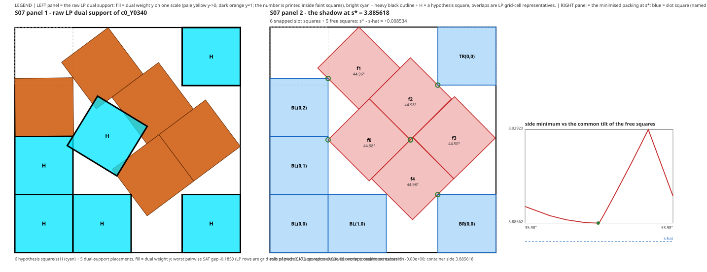

* **s\*** = 3.885618055 = s-hat +0.008534465  (s0 = 3.877084, s\* - s0 = +0.008534)
* **shadow** = 6 slot squares `BL(0,0) BL(0,1) BL(0,2) BL(1,0) BR(0,0) TR(0,0)` + 5 free squares; a k11 packing.
* **explains** 19 alive-at-LP nodes: trump5 x18, k5_16 x1; levels L1:19; integral 12, component 7 support.
* **load-bearing squares at this landing**: `f0` `f2` `f4` `BL(0,1)` `BR(0,0)` `TR(0,0)` (6 of 11); **2 distinct minimised configuration(s)** share this s*.
* **multiplicity**: 2 landings / slot-free splittings (6 slot + 5 free (18 nodes); 5 slot + 5 free (1 nodes)).
* **the free squares share one tilt**: 44.8794 deg (spread 4.74e-01 deg).
* **restarts**: 67 feasible of 118; distinct minima [3.88562, 3.88675, 3.91736, 3.92515, 3.94281, 3.96236, 3.96322, 3.99362].

**Free square poses at s\***

| square | cx | cy | tilt (deg) |
|---|---|---|---|
| f0 | 1.707107 | 1.942898 | 44.9784 |
| f1 | 1.528341 | 3.178508 | 44.9577 |
| f2 | 2.414413 | 2.649805 | 44.9784 |
| f3 | 3.167191 | 1.979393 | 44.5044 |
| f4 | 2.452244 | 1.273793 | 44.9784 |

**Contact graph at s\*** (gap < 1e-7; contact force = Fritz-John multiplier, rows unit-normalised)

| contact | type | gap | force |
|---|---|---|---|
| `f0` - `f2` | exactly-opposite | -6.5e-08 | 0.6761 |
| `f0` - `f4` | vertex-on-edge | -9.5e-08 | 0.6731 |
| `f0` - `BL(0,1)` | vertex-on-edge | +1.6e-15 | 0.6667 |
| `f2` - `TR(0,0)` | vertex-on-edge | -2.2e-14 | 0.8206 |
| `f4` - `BR(0,0)` | vertex-on-edge | +1.3e-12 | 0.5795 |

**Binding** (largest Fritz-John resultant first): `f2`-`TR(0,0)` (0.821), `f0`-`f2` (0.676), `f0`-`f4` (0.673), `f0`-`BL(0,1)` (0.667), `f4`-`BR(0,0)` (0.579).  KKT residual 1.3e-04.  Exactly-opposite (vertex-vertex) contacts, whose normal is a cone and whose individual multipliers are therefore ill-conditioned: `f0`-`f2`.
**Convergence caveat**: KKT residual 1.3e-04 (> 1e-6).  The residual measures how far e_s is from the cone of the active CONTACT rows; it is nonzero when the landing also leans on a variable BOUND (s in [3.4, 4.6], centres in [0, 4.6]), which is not a contact and so is not in the Jacobian, or when SLSQP stopped short of a stationary point.  Either way s* = 3.885618 is an upper bound on this shadow's true value and the contact set may be mis-counted at the 1e-7 threshold.
**Rank**: 7 contact rows, 16 variables (s + 3 per free square); rank 7; at fixed s rank 7 of 15, so **8 flat direction(s)**.
  * flat direction 0: blocked at second order (worst active gap changes by -6.09e-12 at |t| = 1e-3 and -5.48e-11 at 3e-3 and -6.09e-10 at 1e-2, ratios 9.0 / 100.0; 9 and 100 are the quadratic signature - curvature -6.094e-06).
  * flat direction 1: blocked at second order (worst active gap changes by -2.58e-12 at |t| = 1e-3 and -2.32e-11 at 3e-3 and -2.57e-10 at 1e-2, ratios 9.0 / 100.0; 9 and 100 are the quadratic signature - curvature -2.575e-06).
  * flat direction 2: free (flex to at least third order) (worst active gap changes by +0.00e+00 at |t| = 1e-3 and +0.00e+00 at 3e-3 and +0.00e+00 at 1e-2, no change at any step - a genuine one-parameter motion).
  * flat direction 3: free (flex to at least third order) (worst active gap changes by +0.00e+00 at |t| = 1e-3 and +0.00e+00 at 3e-3 and +0.00e+00 at 1e-2, no change at any step - a genuine one-parameter motion).
  * flat direction 4: free (flex to at least third order) (worst active gap changes by +0.00e+00 at |t| = 1e-3 and +0.00e+00 at 3e-3 and +0.00e+00 at 1e-2, no change at any step - a genuine one-parameter motion).
  * flat direction 5: blocked at second order (worst active gap changes by -1.99e-12 at |t| = 1e-3 and -1.79e-11 at 3e-3 and -1.99e-10 at 1e-2, ratios 9.0 / 100.0; 9 and 100 are the quadratic signature - curvature -1.987e-06).
  * flat direction 6: blocked at second order (worst active gap changes by -4.93e-13 at |t| = 1e-3 and -4.43e-12 at 3e-3 and -4.93e-11 at 1e-2, ratios 9.0 / 100.0; 9 and 100 are the quadratic signature - curvature -4.926e-07).
  * flat direction 7: blocked at second order (worst active gap changes by -7.16e-13 at |t| = 1e-3 and -6.44e-12 at 3e-3 and -7.16e-11 at 1e-2, ratios 9.0 / 100.0; 9 and 100 are the quadratic signature - curvature -7.158e-07).

**T2 drain hint - the load-bearing subgraph** (remove one free square and re-minimise)

| removed | s* without it | drop | role |
|---|---|---|---|
| `f0` | 3.767767 | +0.117851 | load-bearing |
| `f1` | 3.885618 | -0.000000 | rattler |
| `f2` | 3.767767 | +0.117851 | load-bearing |
| `f3` | 3.772262 | +0.113356 | load-bearing |
| `f4` | 3.772262 | +0.113356 | load-bearing |

Load-bearing free squares: `f0`, `f2`, `f3`, `f4`.  Rattlers/struts (removal leaves s\* unchanged): `f1`.

**Common-tilt sweep** (all free squares held at one tilt, slot squares fixed, s minimised)

| tilt (deg) | 35.98 | 38.98 | 40.98 | 42.98 | 43.98 | 44.58 | 44.98 | 45.38 | 45.98 | 46.98 | 48.98 | 50.98 | 53.98 |
|---|---|---|---|---|---|---|---|---|---|---|---|---|---|
| s* | 3.893328 | 3.889073 | 3.887163 | 3.886009 | 3.885718 | 3.885635 | 3.885618 | 3.888211 | 3.892376 | 3.899458 | 3.914089 | 3.929234 | 3.898189 |

**Alive nodes explained** (19; each id is src/shard/node(level).  Their pose boxes: A57 level-1 boxes are 0.1398 x 0.1398 x 9.73 deg and halve in every coordinate per level (A106 T1); the conditioned square pose of every node below is in `attempts/A107-shadow-gallery/results/shadow_nodes.json`): 
`A57/k5_16_interior_G1/k5_16_interior_Y0984(L1)` `A60/nodes/c0_Y0324(L1)` `A60/nodes/c0_Y0340(L1)` `A60/nodes/c0_Y0345(L1)` `A60/nodes/c0_Y0346(L1)` `A60/nodes/c0_Y0428(L1)` `A60/nodes/c0_Y0429(L1)` `A60/nodes/c0_Y0433(L1)` `A60/nodes/c0_Y0882(L1)` `A60/nodes/c0_Y0883(L1)` `A60/nodes/c0_Y0888(L1)` `A60/nodes/c0_Y0953(L1)` `A60/nodes/c0_Y0973(L1)` `A60/nodes/f1_L07_0002(L1)` `A60/nodes/f1_L10_0003(L1)` `A60/nodes/f1_L15_0006(L1)` `A60/nodes/f1_L16_0000(L1)` `A60/nodes/f1_L19_0002(L1)` `A60/nodes/f1_L23_0030(L1)`

## S08 - a k11 packing at s* = 3.914214 on the boundary of class k5_11, k5_16, trump5, k6_21

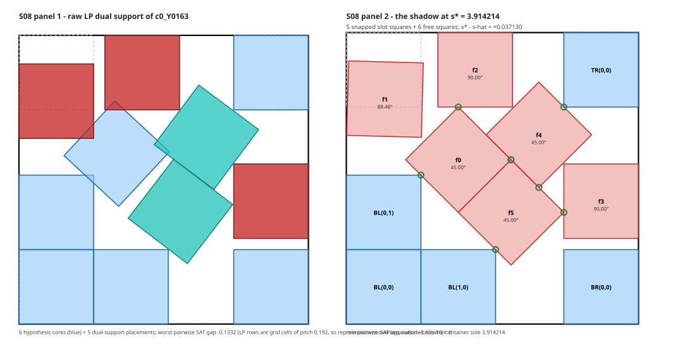

* **s\*** = 3.914213562 = s-hat +0.037129972  (s0 = 3.877084, s\* - s0 = +0.037130)
* **shadow** = 5 slot squares `BL(0,0) BL(0,1) BL(1,0) BR(0,0) TR(0,0)` + 6 free squares; a k11 packing.
* **explains** 17 alive-at-LP nodes: k5_16 x6, k5_11 x5, trump5 x5, k6_21 x1; levels L1:16, L2:1; integral 9, component 8 support.
* **load-bearing squares at this landing**: `f0` `f2` `f3` `f4` `f5` `BL(0,1)` `BL(1,0)` `TR(0,0)` (8 of 11); **8 distinct minimised configuration(s)** share this s*.
* **multiplicity**: 11 landings / slot-free splittings (5 slot + 6 free (4 nodes); 7 slot + 4 free (2 nodes); 8 slot + 3 free (2 nodes); 6 slot + 5 free (2 nodes); 6 slot + 5 free (1 nodes); 7 slot + 4 free (1 nodes); +5 more).
* the free squares do **not** share a tilt: f0 45.000 deg, f1 88.476 deg, f2 90.000 deg, f3 90.000 deg, f4 45.000 deg, f5 45.000 deg.
* **restarts**: 59 feasible of 104; distinct minima [3.91421, 3.9153, 3.93242, 3.9334, 3.94281, 3.95565, 3.97532, 4.0].

**Free square poses at s\***

| square | cx | cy | tilt (deg) |
|---|---|---|---|
| f0 | 1.500000 | 2.207107 | 45.0000 |
| f1 | 0.518184 | 3.020537 | 88.4761 |
| f2 | 1.726524 | 3.414214 | 90.0000 |
| f3 | 3.414214 | 1.650858 | 90.0000 |
| f4 | 2.579296 | 2.542024 | 45.0000 |
| f5 | 2.207107 | 1.500000 | 45.0000 |

**Contact graph at s\*** (gap < 1e-7; contact force = Fritz-John multiplier, rows unit-normalised)

| contact | type | gap | force |
|---|---|---|---|
| `f0` - `f2` | vertex-on-edge | +1.1e-13 | 0.2978 |
| `f0` - `f4` | vertex-on-edge | -8.4e-10 | 0.3262 |
| `f0` - `f5` | exactly-opposite | -3.3e-10 | 0.2331 |
| `f0` - `BL(0,1)` | vertex-on-edge | +6.5e-11 | 0.3611 |
| `f3` - `f5` | vertex-on-edge | +1.1e-15 | 0.2957 |
| `f4` - `f5` | vertex-on-edge | +9.8e-11 | 0.2935 |
| `f4` - `TR(0,0)` | vertex-on-edge | -1.7e-14 | 0.7155 |
| `f5` - `BL(1,0)` | vertex-on-edge | +2.2e-15 | 0.3611 |
| `f2` - top wall | wall | 0 | 0.2978 |
| `f3` - right wall | wall | 0 | 0.2957 |

**Binding** (largest Fritz-John resultant first): `f4`-`TR(0,0)` (0.716), `f0`-`BL(0,1)` (0.361), `f5`-`BL(1,0)` (0.361), `f0`-`f4` (0.326), `f0`-`f2` (0.298), `f2`-`top wall` (0.298).  KKT residual 2.4e-09.  Exactly-opposite (vertex-vertex) contacts, whose normal is a cone and whose individual multipliers are therefore ill-conditioned: `f0`-`f5`.
**Rank**: 17 contact rows, 19 variables (s + 3 per free square); rank 13; at fixed s rank 13 of 18, so **5 flat direction(s)**.
  * flat direction 0: blocked at first order (rank tolerance artefact) (worst active gap changes by -7.46e-13 at |t| = 1e-3 and -2.24e-12 at 3e-3 and -7.45e-12 at 1e-2, ratios 3.0 / 10.0; 9 and 100 are the quadratic signature - curvature -7.461e-07).
  * flat direction 1: free (flex to at least third order) (worst active gap changes by +0.00e+00 at |t| = 1e-3 and -2.22e-16 at 3e-3 and -2.22e-16 at 1e-2, no change at any step - a genuine one-parameter motion).
  * flat direction 2: free (flex to at least third order) (worst active gap changes by -2.22e-16 at |t| = 1e-3 and -2.22e-16 at 3e-3 and -2.22e-16 at 1e-2, ratios 1.0 / 1.0; 9 and 100 are the quadratic signature - curvature -2.220e-10).
  * flat direction 3: free (flex to at least third order) (worst active gap changes by -2.22e-16 at |t| = 1e-3 and -2.22e-16 at 3e-3 and +0.00e+00 at 1e-2, ratios 1.0 / -0.0; 9 and 100 are the quadratic signature - curvature -2.220e-10).
  * flat direction 4: free (flex to at least third order) (worst active gap changes by -2.22e-16 at |t| = 1e-3 and -2.22e-16 at 3e-3 and +0.00e+00 at 1e-2, ratios 1.0 / -0.0; 9 and 100 are the quadratic signature - curvature -2.220e-10).

**T2 drain hint - the load-bearing subgraph** (remove one free square and re-minimise)

| removed | s* without it | drop | role |
|---|---|---|---|
| `f0` | 3.822876 | +0.091338 | load-bearing |
| `f1` | 3.914214 | -0.000000 | rattler |
| `f2` | 3.707107 | +0.207107 | load-bearing |
| `f3` | 3.767767 | +0.146446 | load-bearing |
| `f4` | 3.707107 | +0.207107 | load-bearing |
| `f5` | 3.822876 | +0.091338 | load-bearing |

Load-bearing free squares: `f0`, `f2`, `f3`, `f4`, `f5`.  Rattlers/struts (removal leaves s\* unchanged): `f1`.

**Alive nodes explained** (17; each id is src/shard/node(level).  Their pose boxes: A57 level-1 boxes are 0.1398 x 0.1398 x 9.73 deg and halve in every coordinate per level (A106 T1); the conditioned square pose of every node below is in `attempts/A107-shadow-gallery/results/shadow_nodes.json`): 
`A57/k5_11_interior_G1/k5_11_interior_Y0084(L1)` `A57/k5_11_interior_G1/k5_11_interior_Y0108(L1)` `A57/k5_11_interior_G1/k5_11_interior_Y0127(L1)` `A57/k5_11_interior_G1/k5_11_interior_Y0256(L1)` `A57/k5_11_interior_G1_D2/k5_11_interior_Y0300_D06(L2)` `A57/k5_16_interior_G1/k5_16_interior_Y0521(L1)` `A57/k5_16_interior_G1/k5_16_interior_Y0607(L1)` `A57/k5_16_interior_G1/k5_16_interior_Y0822(L1)` `A57/k5_16_interior_G1/k5_16_interior_Y0851(L1)` `A57/k5_16_interior_G1/k5_16_interior_Y0959(L1)` `A57/k5_16_interior_G1/k5_16_interior_Y1056(L1)` `A60/nodes/c0_Y0163(L1)` `A60/nodes/c0_Y0250(L1)` `A60/nodes/c0_Y0251(L1)` `A60/nodes/c0_Y0252(L1)` `A60/nodes/c0_Y0257(L1)` `A61/nodes/k6_21.stageA(L1)`

## S09 - a k11 packing at s* = 3.925149 on the boundary of class k5_11, k5_16, trump5

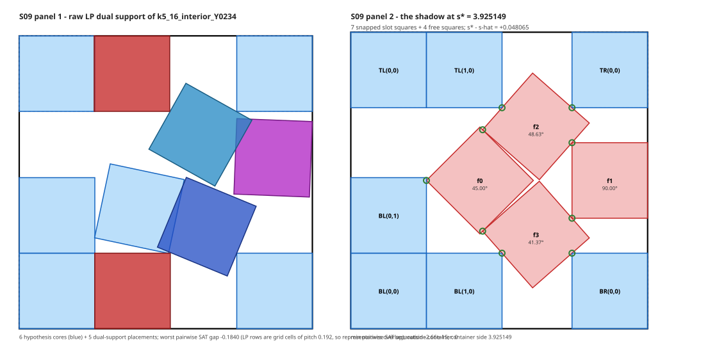

* **s\*** = 3.925148814 = s-hat +0.048065224  (s0 = 3.877084, s\* - s0 = +0.048065)
* **shadow** = 7 slot squares `BL(0,0) BL(0,1) BL(1,0) BR(0,0) TL(0,0) TL(1,0) TR(0,0)` + 4 free squares; a k11 packing.
* **explains** 12 alive-at-LP nodes: k5_16 x9, trump5 x2, k5_11 x1; levels L1:12; component 10, integral 2 support.
* **load-bearing squares at this landing**: `f0` `f1` `f2` `f3` `BL(0,1)` `BL(1,0)` `BR(0,0)` `TL(1,0)` `TR(0,0)` (9 of 11); **6 distinct minimised configuration(s)** share this s*.
* **multiplicity**: 7 landings / slot-free splittings (7 slot + 4 free (5 nodes); 6 slot + 5 free (2 nodes); 5 slot + 6 free (1 nodes); 7 slot + 4 free (1 nodes); 6 slot + 5 free (1 nodes); 7 slot + 4 free (1 nodes); +1 more).
* the free squares do **not** share a tilt: f0 45.000 deg, f1 90.000 deg, f2 48.628 deg, f3 41.372 deg.
* **restarts**: 83 feasible of 105; distinct minima [3.88675, 3.90267, 3.91421, 3.92515, 3.94281, 3.98926, 4.0, 4.47489].

**Free square poses at s\***

| square | cx | cy | tilt (deg) |
|---|---|---|---|
| f0 | 1.707107 | 1.962574 | 45.0000 |
| f1 | 3.425149 | 1.962574 | 90.0000 |
| f2 | 2.448894 | 2.678329 | 48.6281 |
| f3 | 2.448894 | 1.246820 | 41.3719 |

**Contact graph at s\*** (gap < 1e-7; contact force = Fritz-John multiplier, rows unit-normalised)

| contact | type | gap | force |
|---|---|---|---|
| `f0` - `f2` | vertex-on-edge | -2.7e-15 | 0.2076 |
| `f0` - `f3` | vertex-on-edge | +4.4e-15 | 0.2076 |
| `f0` - `BL(0,1)` | vertex-on-edge | +1.8e-15 | 0.1888 |
| `f1` - `f2` | vertex-on-edge | +5.3e-15 | 0.4803 |
| `f1` - `f3` | vertex-on-edge | +2.2e-16 | 0.4803 |
| `f2` - `TL(1,0)` | vertex-on-edge | -1.1e-15 | 0.3961 |
| `f2` - `TR(0,0)` | vertex-on-edge | +3.1e-15 | 0.2319 |
| `f3` - `BL(1,0)` | vertex-on-edge | -7.8e-16 | 0.3310 |
| `f3` - `BR(0,0)` | vertex-on-edge | -2.1e-15 | 0.1618 |
| `f1` - right wall | wall | 0 | 0.7163 |

**Binding** (largest Fritz-John resultant first): `f1`-`right wall` (0.716), `f1`-`f2` (0.480), `f1`-`f3` (0.480), `f2`-`TL(1,0)` (0.396), `f3`-`BL(1,0)` (0.331), `f2`-`TR(0,0)` (0.232).  KKT residual 8.4e-10.
**Rank**: 11 contact rows, 13 variables (s + 3 per free square); rank 11; at fixed s rank 10 of 12, so **2 flat direction(s)**.
  * flat direction 0: blocked at second order (worst active gap changes by -1.51e-07 at |t| = 1e-3 and -1.36e-06 at 3e-3 and -1.51e-05 at 1e-2, ratios 9.0 / 100.0; 9 and 100 are the quadratic signature - curvature -1.507e-01).
  * flat direction 1: blocked at second order (worst active gap changes by -4.65e-07 at |t| = 1e-3 and -4.18e-06 at 3e-3 and -4.66e-05 at 1e-2, ratios 9.0 / 100.1; 9 and 100 are the quadratic signature - curvature -4.648e-01).

**T2 drain hint - the load-bearing subgraph** (remove one free square and re-minimise)

| removed | s* without it | drop | role |
|---|---|---|---|
| `f0` | 3.899873 | +0.025276 | load-bearing |
| `f1` | 3.728581 | +0.196568 | load-bearing |
| `f2` | 3.728581 | +0.196568 | load-bearing |
| `f3` | 3.767767 | +0.157382 | load-bearing |

Load-bearing free squares: `f0`, `f1`, `f2`, `f3`.  Rattlers/struts (removal leaves s\* unchanged): none.

**Alive nodes explained** (12; each id is src/shard/node(level).  Their pose boxes: A57 level-1 boxes are 0.1398 x 0.1398 x 9.73 deg and halve in every coordinate per level (A106 T1); the conditioned square pose of every node below is in `attempts/A107-shadow-gallery/results/shadow_nodes.json`): 
`A57/k5_11_interior_G1/k5_11_interior_Y0302(L1)` `A57/k5_16_interior_G1/k5_16_interior_Y0234(L1)` `A57/k5_16_interior_G1/k5_16_interior_Y0245(L1)` `A57/k5_16_interior_G1/k5_16_interior_Y0273(L1)` `A57/k5_16_interior_G1/k5_16_interior_Y0274(L1)` `A57/k5_16_interior_G1/k5_16_interior_Y0302(L1)` `A57/k5_16_interior_G1/k5_16_interior_Y0665(L1)` `A57/k5_16_interior_G1/k5_16_interior_Y0709(L1)` `A57/k5_16_interior_G1/k5_16_interior_Y0713(L1)` `A57/k5_16_interior_G1/k5_16_interior_Y1002(L1)` `A60/nodes/c0_Y0326(L1)` `A60/nodes/c0_Y0515(L1)`

## S10 - a k11 packing at s* = 3.902674 on the boundary of class k5_11, k5_16, trump5

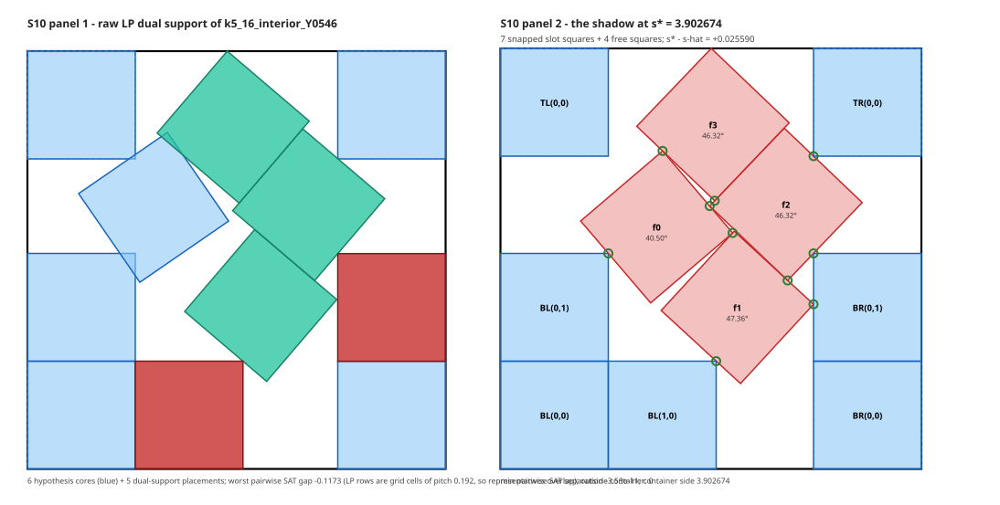

* **s\*** = 3.902673975 = s-hat +0.025590385  (s0 = 3.877084, s\* - s0 = +0.025590)
* **shadow** = 7 slot squares `BL(0,0) BL(0,1) BL(1,0) BR(0,0) BR(0,1) TL(0,0) TR(0,0)` + 4 free squares; a k11 packing.
* **explains** 10 alive-at-LP nodes: k5_16 x8, k5_11 x1, trump5 x1; levels L1:10; integral 5, component 5 support.
* **load-bearing squares at this landing**: `f0` `f1` `f2` `f3` `BL(0,1)` `BL(1,0)` `BR(0,1)` `TR(0,0)` (8 of 11); **4 distinct minimised configuration(s)** share this s*.
* **multiplicity**: 7 landings / slot-free splittings (7 slot + 4 free (4 nodes); 7 slot + 4 free (1 nodes); 6 slot + 5 free (1 nodes); 5 slot + 6 free (1 nodes); 6 slot + 5 free (1 nodes); 5 slot + 6 free (1 nodes); +1 more).
* the free squares do **not** share a tilt: f0 40.498 deg, f1 47.356 deg, f2 46.323 deg, f3 46.323 deg.
* **restarts**: 77 feasible of 104; distinct minima [3.88675, 3.90267, 3.91223, 3.91421, 3.92515, 3.94281, 3.99612, 4.0].

**Free square poses at s\***

| square | cx | cy | tilt (deg) |
|---|---|---|---|
| f0 | 1.447841 | 2.245526 | 40.4983 |
| f1 | 2.196165 | 1.499077 | 47.3560 |
| f2 | 2.646611 | 2.455848 | 46.3234 |
| f3 | 1.970455 | 3.195756 | 46.3234 |

**Contact graph at s\*** (gap < 1e-7; contact force = Fritz-John multiplier, rows unit-normalised)

| contact | type | gap | force |
|---|---|---|---|
| `f0` - `f1` | vertex-on-edge | +4.8e-13 | 0.0258 |
| `f0` - `f2` | vertex-on-edge | +3.2e-13 | 0.3386 |
| `f0` - `f3` | vertex-on-edge | +3.2e-15 | 0.2418 |
| `f0` - `BL(0,1)` | vertex-on-edge | -2.9e-15 | 0.3920 |
| `f1` - `f2` | vertex-on-edge | +4.0e-13 | 0.3293 |
| `f1` - `BL(1,0)` | vertex-on-edge | +7.9e-14 | 0.2381 |
| `f1` - `BR(0,1)` | vertex-on-edge | +2.0e-12 | 0.0318 |
| `f2` - `f3` | vertex-on-edge | -3.5e-11 | 0.2227 |
| `f2` - `BR(0,1)` | vertex-on-edge | +1.2e-15 | 0.2161 |
| `f2` - `TR(0,0)` | vertex-on-edge | +1.1e-16 | 0.7709 |
| `f3` - top wall | wall | 0 | 0.3168 |

**Binding** (largest Fritz-John resultant first): `f2`-`TR(0,0)` (0.771), `f0`-`BL(0,1)` (0.392), `f0`-`f2` (0.339), `f1`-`f2` (0.329), `f3`-`top wall` (0.317), `f0`-`f3` (0.242).  KKT residual 1.2e-05.
**Convergence caveat**: KKT residual 1.2e-05 (> 1e-6).  The residual measures how far e_s is from the cone of the active CONTACT rows; it is nonzero when the landing also leans on a variable BOUND (s in [3.4, 4.6], centres in [0, 4.6]), which is not a contact and so is not in the Jacobian, or when SLSQP stopped short of a stationary point.  Either way s* = 3.902674 is an upper bound on this shadow's true value and the contact set may be mis-counted at the 1e-7 threshold.
**Rank**: 12 contact rows, 13 variables (s + 3 per free square); rank 12; at fixed s rank 12 of 12, so **0 flat direction(s)**.
  * no flat directions: the shadow is first-order rigid at fixed s.

**T2 drain hint - the load-bearing subgraph** (remove one free square and re-minimise)

| removed | s* without it | drop | role |
|---|---|---|---|
| `f0` | 3.768118 | +0.134556 | load-bearing |
| `f1` | 3.886746 | +0.015928 | load-bearing |
| `f2` | 3.767767 | +0.134907 | load-bearing |
| `f3` | 3.822876 | +0.079798 | load-bearing |

Load-bearing free squares: `f0`, `f1`, `f2`, `f3`.  Rattlers/struts (removal leaves s\* unchanged): none.

**Alive nodes explained** (10; each id is src/shard/node(level).  Their pose boxes: A57 level-1 boxes are 0.1398 x 0.1398 x 9.73 deg and halve in every coordinate per level (A106 T1); the conditioned square pose of every node below is in `attempts/A107-shadow-gallery/results/shadow_nodes.json`): 
`A57/k5_11_interior_G1/k5_11_interior_Y1104(L1)` `A57/k5_16_interior_G1/k5_16_interior_Y0105(L1)` `A57/k5_16_interior_G1/k5_16_interior_Y0290(L1)` `A57/k5_16_interior_G1/k5_16_interior_Y0389(L1)` `A57/k5_16_interior_G1/k5_16_interior_Y0546(L1)` `A57/k5_16_interior_G1/k5_16_interior_Y0738(L1)` `A57/k5_16_interior_G1/k5_16_interior_Y0848(L1)` `A57/k5_16_interior_G1/k5_16_interior_Y0929(L1)` `A57/k5_16_interior_G1/k5_16_interior_Y0996(L1)` `A60/nodes/c0_Y1131(L1)`

## S11 - a k11 packing at s* = 3.976620 on the boundary of class k5_11, k5_16, trump5

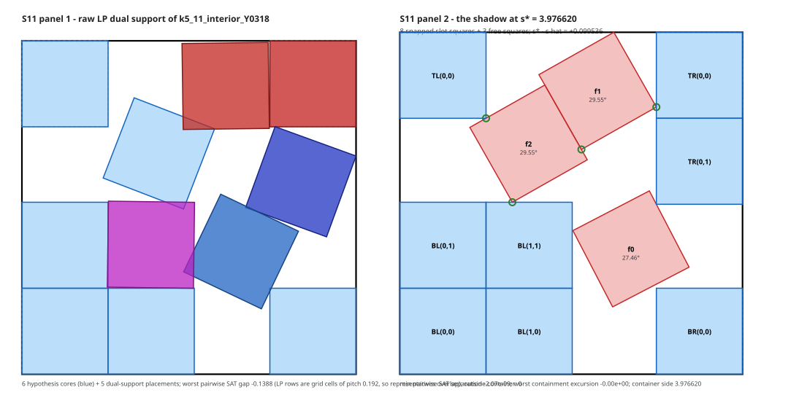

* **s\*** = 3.976619590 = s-hat +0.099536000  (s0 = 3.877084, s\* - s0 = +0.099536)
* **shadow** = 8 slot squares `BL(0,0) BL(0,1) BL(1,0) BL(1,1) BR(0,0) TL(0,0) TR(0,0) TR(0,1)` + 3 free squares; a k11 packing.
* **explains** 7 alive-at-LP nodes: k5_11 x4, trump5 x2, k5_16 x1; levels L1:5, L2:2; component 6, integral 1 support.
* **load-bearing squares at this landing**: `f1` `f2` `BL(1,1)` `TL(0,0)` `TR(0,0)` (5 of 11); **3 distinct minimised configuration(s)** share this s*.
* **multiplicity**: 5 landings / slot-free splittings (8 slot + 3 free (3 nodes); 7 slot + 4 free (1 nodes); 6 slot + 5 free (1 nodes); 6 slot + 5 free (1 nodes); 6 slot + 5 free (1 nodes)).
* the free squares do **not** share a tilt: f0 27.464 deg, f1 29.547 deg, f2 29.547 deg.
* **restarts**: 80 feasible of 103; distinct minima [3.94281, 3.94294, 3.97662, 4.0, 4.00013, 4.6].

**Free square poses at s\***

| square | cx | cy | tilt (deg) |
|---|---|---|---|
| f0 | 2.681572 | 1.457618 | 27.4639 |
| f1 | 2.295075 | 3.295075 | 29.5469 |
| f2 | 1.493370 | 2.681544 | 29.5469 |

**Contact graph at s\*** (gap < 1e-7; contact force = Fritz-John multiplier, rows unit-normalised)

| contact | type | gap | force |
|---|---|---|---|
| `f1` - `f2` | vertex-on-edge | -2.1e-09 | 0.4977 |
| `f1` - `TR(0,0)` | vertex-on-edge | +6.7e-10 | 0.4283 |
| `f2` - `BL(1,1)` | vertex-on-edge | +6.6e-10 | 0.7121 |
| `f2` - `TL(0,0)` | vertex-on-edge | -7.1e-10 | 0.8252 |
| `f1` - top wall | wall | 0 | 0.2428 |

**Binding** (largest Fritz-John resultant first): `f2`-`TL(0,0)` (0.825), `f2`-`BL(1,1)` (0.712), `f1`-`f2` (0.498), `f1`-`TR(0,0)` (0.428), `f1`-`top wall` (0.243).  KKT residual 2.5e-06.
**Convergence caveat**: KKT residual 2.5e-06 (> 1e-6).  The residual measures how far e_s is from the cone of the active CONTACT rows; it is nonzero when the landing also leans on a variable BOUND (s in [3.4, 4.6], centres in [0, 4.6]), which is not a contact and so is not in the Jacobian, or when SLSQP stopped short of a stationary point.  Either way s* = 3.976620 is an upper bound on this shadow's true value and the contact set may be mis-counted at the 1e-7 threshold.
**Rank**: 6 contact rows, 10 variables (s + 3 per free square); rank 6; at fixed s rank 6 of 9, so **3 flat direction(s)**.
  * flat direction 0: free (flex to at least third order) (worst active gap changes by -4.44e-16 at |t| = 1e-3 and -2.22e-16 at 3e-3 and -4.44e-16 at 1e-2, ratios 0.5 / 1.0; 9 and 100 are the quadratic signature - curvature -4.441e-10).
  * flat direction 1: free (flex to at least third order) (worst active gap changes by -2.22e-16 at |t| = 1e-3 and -2.22e-16 at 3e-3 and -2.22e-16 at 1e-2, ratios 1.0 / 1.0; 9 and 100 are the quadratic signature - curvature -2.220e-10).
  * flat direction 2: free (flex to at least third order) (worst active gap changes by -4.44e-16 at |t| = 1e-3 and -1.11e-16 at 3e-3 and -2.22e-16 at 1e-2, ratios 0.25 / 0.5; 9 and 100 are the quadratic signature - curvature -4.441e-10).

**T2 drain hint - the load-bearing subgraph** (remove one free square and re-minimise)

| removed | s* without it | drop | role |
|---|---|---|---|
| `f0` | 3.976620 | +0.000000 | rattler |
| `f1` | 3.942809 | +0.033811 | load-bearing |
| `f2` | 3.942809 | +0.033811 | load-bearing |

Load-bearing free squares: `f1`, `f2`.  Rattlers/struts (removal leaves s\* unchanged): `f0`.

**Alive nodes explained** (7; each id is src/shard/node(level).  Their pose boxes: A57 level-1 boxes are 0.1398 x 0.1398 x 9.73 deg and halve in every coordinate per level (A106 T1); the conditioned square pose of every node below is in `attempts/A107-shadow-gallery/results/shadow_nodes.json`): 
`A57/k5_11_interior_G1/k5_11_interior_Y0318(L1)` `A57/k5_11_interior_G1/k5_11_interior_Y0499(L1)` `A57/k5_11_interior_G1_D2/k5_11_interior_Y0540_D00(L2)` `A57/k5_11_interior_G1_D2/k5_11_interior_Y0642_D06(L2)` `A57/k5_16_interior_G1/k5_16_interior_Y0275(L1)` `A60/nodes/c0_Y0215(L1)` `A60/nodes/c0_Y0935(L1)`

## S12 - a k9 packing at s* = 3.400000 on the boundary of class k5_11, k5_16, trump5

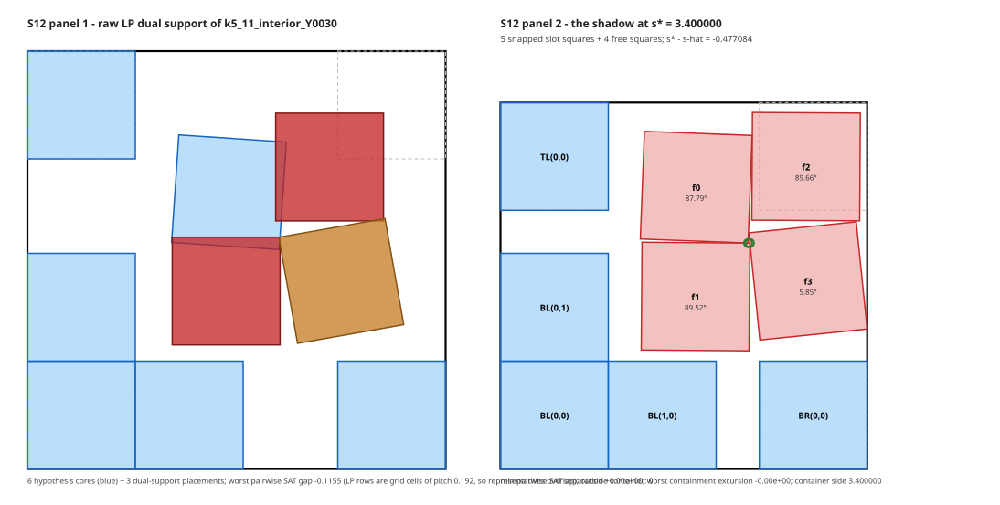

* **s\*** = 3.400000000 = s-hat -0.477083590  (s0 = 3.877084, s\* - s0 = -0.477084)
* **shadow** = 5 slot squares `BL(0,0) BL(0,1) BL(1,0) BR(0,0) TL(0,0)` + 4 free squares; a k9 packing.
* **explains** 6 alive-at-LP nodes: k5_11 x3, k5_16 x2, trump5 x1; levels L1:6; integral 6 support.
* **load-bearing squares at this landing**: `` (0 of 9); **2 distinct minimised configuration(s)** share this s*.
* **multiplicity**: 4 landings / slot-free splittings (5 slot + 4 free (3 nodes); 6 slot + 3 free (1 nodes); 5 slot + 4 free (1 nodes); 5 slot + 4 free (1 nodes)).
* the free squares do **not** share a tilt: f0 87.793 deg, f1 89.519 deg, f2 89.660 deg, f3 5.855 deg.
* **restarts**: 72 feasible of 103; distinct minima [3.4, 3.62132, 3.66322, 3.70711, 3.76777, 3.98699, 4.0, 4.12132].

**Free square poses at s\***

| square | cx | cy | tilt (deg) |
|---|---|---|---|
| f0 | 1.815447 | 2.614365 | 87.7926 |
| f1 | 1.808881 | 1.599549 | 89.5189 |
| f2 | 2.833198 | 2.805343 | 89.6601 |
| f3 | 2.851604 | 1.745047 | 5.8548 |

**Contact graph at s\*** (gap < 1e-7; contact force = Fritz-John multiplier, rows unit-normalised)

| contact | type | gap | force |
|---|---|---|---|
| `f0` - `f1` | vertex-on-edge | +8.8e-14 | 0.0000 |

**Convergence caveat**: KKT residual 1.0e+00 (> 1e-6).  The residual measures how far e_s is from the cone of the active CONTACT rows; it is nonzero when the landing also leans on a variable BOUND (s in [3.4, 4.6], centres in [0, 4.6]), which is not a contact and so is not in the Jacobian, or when SLSQP stopped short of a stationary point.  Either way s* = 3.400000 is an upper bound on this shadow's true value and the contact set may be mis-counted at the 1e-7 threshold.
**Rank**: 1 contact rows, 13 variables (s + 3 per free square); rank 1; at fixed s rank 1 of 12, so **11 flat direction(s)**.
  * flat direction 0: free (flex to at least third order) (worst active gap changes by +1.45e-07 at |t| = 1e-3 and +1.30e-06 at 3e-3 and +1.45e-05 at 1e-2, no change at any step - a genuine one-parameter motion).
  * flat direction 1: free (flex to at least third order) (worst active gap changes by +1.94e-07 at |t| = 1e-3 and +1.74e-06 at 3e-3 and +1.93e-05 at 1e-2, no change at any step - a genuine one-parameter motion).
  * flat direction 2: blocked at second order (worst active gap changes by -1.62e-09 at |t| = 1e-3 and -1.46e-08 at 3e-3 and -1.62e-07 at 1e-2, ratios 9.0 / 100.0; 9 and 100 are the quadratic signature - curvature -1.624e-03).
  * flat direction 3: free (flex to at least third order) (worst active gap changes by +1.45e-07 at |t| = 1e-3 and +1.30e-06 at 3e-3 and +1.45e-05 at 1e-2, no change at any step - a genuine one-parameter motion).
  * flat direction 4: blocked at second order (worst active gap changes by -5.24e-07 at |t| = 1e-3 and -4.72e-06 at 3e-3 and -5.25e-05 at 1e-2, ratios 9.0 / 100.2; 9 and 100 are the quadratic signature - curvature -5.240e-01).
  * flat direction 5: free (flex to at least third order) (worst active gap changes by +0.00e+00 at |t| = 1e-3 and +0.00e+00 at 3e-3 and +0.00e+00 at 1e-2, no change at any step - a genuine one-parameter motion).
  * flat direction 6: free (flex to at least third order) (worst active gap changes by +0.00e+00 at |t| = 1e-3 and +0.00e+00 at 3e-3 and +0.00e+00 at 1e-2, no change at any step - a genuine one-parameter motion).
  * flat direction 7: free (flex to at least third order) (worst active gap changes by +0.00e+00 at |t| = 1e-3 and +0.00e+00 at 3e-3 and +0.00e+00 at 1e-2, no change at any step - a genuine one-parameter motion).
  * flat direction 8: free (flex to at least third order) (worst active gap changes by +0.00e+00 at |t| = 1e-3 and +0.00e+00 at 3e-3 and +0.00e+00 at 1e-2, no change at any step - a genuine one-parameter motion).
  * flat direction 9: free (flex to at least third order) (worst active gap changes by +0.00e+00 at |t| = 1e-3 and +0.00e+00 at 3e-3 and +0.00e+00 at 1e-2, no change at any step - a genuine one-parameter motion).
  * flat direction 10: free (flex to at least third order) (worst active gap changes by +0.00e+00 at |t| = 1e-3 and +0.00e+00 at 3e-3 and +0.00e+00 at 1e-2, no change at any step - a genuine one-parameter motion).

**T2 drain hint - the load-bearing subgraph** (remove one free square and re-minimise)

| removed | s* without it | drop | role |
|---|---|---|---|
| `f0` | 3.400000 | +0.000000 | rattler |
| `f1` | 3.400000 | +0.000000 | rattler |
| `f2` | 3.400000 | +0.000000 | rattler |
| `f3` | 3.400000 | +0.000000 | rattler |

**Idle contacts** (zero Fritz-John force - struts, not load paths): `f0`-`f1`.

Load-bearing free squares: none.  Rattlers/struts (removal leaves s\* unchanged): `f0`, `f1`, `f2`, `f3`.

**Alive nodes explained** (6; each id is src/shard/node(level).  Their pose boxes: A57 level-1 boxes are 0.1398 x 0.1398 x 9.73 deg and halve in every coordinate per level (A106 T1); the conditioned square pose of every node below is in `attempts/A107-shadow-gallery/results/shadow_nodes.json`): 
`A57/k5_11_interior_L1/k5_11_interior_Y0030(L1)` `A57/k5_11_interior_L1/k5_11_interior_Y0053(L1)` `A57/k5_11_interior_L1/k5_11_interior_Y0605(L1)` `A57/k5_16_interior_G1/k5_16_interior_Y0764(L1)` `A57/k5_16_interior_L1/k5_16_interior_Y0023(L1)` `A60/nodes/slack0.02_c0_Y0554(L1)`

## S13 - a k11 packing at s* = 3.991994 on the boundary of class k5_16, trump5

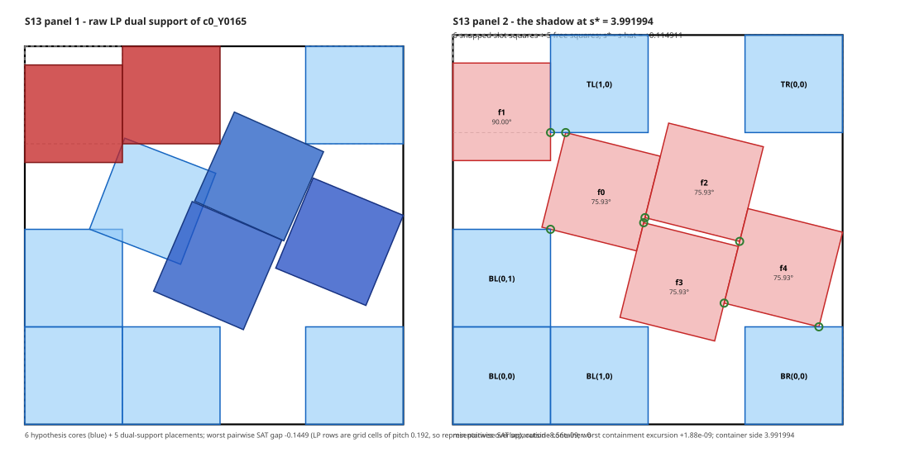

* **s\*** = 3.991994282 = s-hat +0.114910692  (s0 = 3.877084, s\* - s0 = +0.114910)
* **shadow** = 6 slot squares `BL(0,0) BL(0,1) BL(1,0) BR(0,0) TL(1,0) TR(0,0)` + 5 free squares; a k11 packing.
* **explains** 5 alive-at-LP nodes: trump5 x4, k5_16 x1; levels L1:5; integral 4, component 1 support.
* **load-bearing squares at this landing**: `f0` `f2` `f3` `f4` `BL(0,1)` `BR(0,0)` `TL(1,0)` (7 of 11); **2 distinct minimised configuration(s)** share this s*.
* **multiplicity**: 2 landings / slot-free splittings (6 slot + 5 free (4 nodes); 7 slot + 4 free (1 nodes)).
* the free squares do **not** share a tilt: f0 75.932 deg, f1 90.000 deg, f2 75.932 deg, f3 75.932 deg, f4 75.932 deg.
* **restarts**: 69 feasible of 104; distinct minima [3.94281, 3.99199, 4.0, 4.12132, 4.40595, 4.41421, 4.47487].

**Free square poses at s\***

| square | cx | cy | tilt (deg) |
|---|---|---|---|
| f0 | 1.518803 | 2.385455 | 75.9323 |
| f1 | 0.500000 | 3.205338 | 90.0000 |
| f2 | 2.574088 | 2.482696 | 75.9323 |
| f3 | 2.318121 | 1.461215 | 75.9323 |
| f4 | 3.385455 | 1.606539 | 75.9323 |

**Contact graph at s\*** (gap < 1e-7; contact force = Fritz-John multiplier, rows unit-normalised)

| contact | type | gap | force |
|---|---|---|---|
| `f0` - `f2` | vertex-on-edge | -2.4e-09 | 0.2826 |
| `f0` - `f3` | vertex-on-edge | -3.0e-09 | 0.0000 |
| `f0` - `BL(0,1)` | vertex-on-edge | -1.6e-15 | 0.8482 |
| `f0` - `TL(1,0)` | vertex-on-edge | +0.0e+00 | 1.1816 |
| `f1` - `TL(1,0)` | vertex-on-edge | -1.8e-09 | 0.0000 |
| `f2` - `f4` | vertex-on-edge | -8.6e-09 | 0.2943 |
| `f3` - `f4` | vertex-on-edge | -4.3e-09 | 0.0000 |
| `f4` - `BR(0,0)` | vertex-on-edge | +1.0e-15 | 0.0509 |
| `f1` - left wall | wall | 0 | 0.0000 |
| `f4` - right wall | wall | 0 | 0.2786 |

**Binding** (largest Fritz-John resultant first): `f0`-`TL(1,0)` (1.182), `f0`-`BL(0,1)` (0.848), `f2`-`f4` (0.294), `f0`-`f2` (0.283), `f4`-`right wall` (0.279), `f4`-`BR(0,0)` (0.051).  KKT residual 3.2e-06.
**Convergence caveat**: KKT residual 3.2e-06 (> 1e-6).  The residual measures how far e_s is from the cone of the active CONTACT rows; it is nonzero when the landing also leans on a variable BOUND (s in [3.4, 4.6], centres in [0, 4.6]), which is not a contact and so is not in the Jacobian, or when SLSQP stopped short of a stationary point.  Either way s* = 3.991994 is an upper bound on this shadow's true value and the contact set may be mis-counted at the 1e-7 threshold.
**Rank**: 16 contact rows, 16 variables (s + 3 per free square); rank 13; at fixed s rank 13 of 15, so **2 flat direction(s)**.
  * flat direction 0: blocked at second order (worst active gap changes by -4.96e-11 at |t| = 1e-3 and -4.40e-10 at 3e-3 and -4.86e-09 at 1e-2, ratios 8.87 / 98.0; 9 and 100 are the quadratic signature - curvature -4.959e-05).
  * flat direction 1: blocked at first order (rank tolerance artefact) (worst active gap changes by -1.70e-12 at |t| = 1e-3 and -5.11e-12 at 3e-3 and -1.70e-11 at 1e-2, ratios 3.0 / 10.0; 9 and 100 are the quadratic signature - curvature -1.704e-06).

**T2 drain hint - the load-bearing subgraph** (remove one free square and re-minimise)

| removed | s* without it | drop | role |
|---|---|---|---|
| `f0` | 3.822876 | +0.169118 | load-bearing |
| `f1` | 3.942809 | +0.049185 | load-bearing |
| `f2` | 3.914214 | +0.077781 | load-bearing |
| `f3` | 3.822876 | +0.169118 | load-bearing |
| `f4` | 3.707107 | +0.284887 | load-bearing |

**Idle contacts** (zero Fritz-John force - struts, not load paths): `f1`-`TL(1,0)`, `f1`-`left wall`.

Load-bearing free squares: `f0`, `f1`, `f2`, `f3`, `f4`.  Rattlers/struts (removal leaves s\* unchanged): none.

**Alive nodes explained** (5; each id is src/shard/node(level).  Their pose boxes: A57 level-1 boxes are 0.1398 x 0.1398 x 9.73 deg and halve in every coordinate per level (A106 T1); the conditioned square pose of every node below is in `attempts/A107-shadow-gallery/results/shadow_nodes.json`): 
`A57/k5_16_interior_L1/k5_16_interior_Y0449(L1)` `A60/nodes/c0_Y0165(L1)` `A60/nodes/c0_Y0786(L1)` `A60/nodes/f1_L02_0007(L1)` `A60/nodes/slack0.02_c0_Y0419(L1)`

## S14 - a k10 packing at s* = 3.767767 on the boundary of class k5_11, k5_16

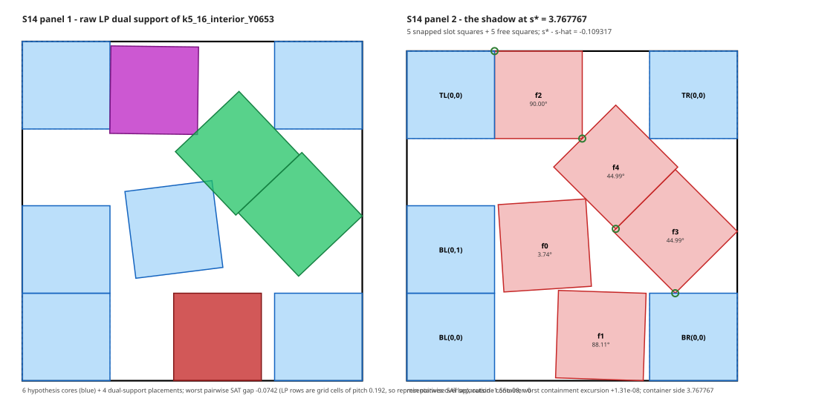

* **s\*** = 3.767766944 = s-hat -0.109316646  (s0 = 3.877084, s\* - s0 = -0.109317)
* **shadow** = 6 slot squares `BL(0,0) BL(0,1) BR(0,0) TL(0,0) TR(0,0)` `TL(1,0) (=f2)` + 4 free squares; a k10 packing.
  * **gallery v1 counted this as 5 slot + 5 free** (A121): `f2` sits on `TL(1,0)` to within 1e-3 in position and 0.05 deg of axis - snapped slot squares, not free ones.  The f-indices are kept everywhere below (contact graph, forces, flat directions, rattler table) so A121's review rows stay valid.
* **explains** 5 alive-at-LP nodes: k5_16 x3, k5_11 x2; levels L1:3, L2:1, L3:1; integral 5 support.
* **load-bearing squares at this landing**: `f2` `f3` `f4` `BR(0,0)` `TL(0,0)` (5 of 10); **3 distinct minimised configuration(s)** share this s*.
* **multiplicity**: 4 landings / slot-free splittings (5 slot + 5 free (2 nodes); 7 slot + 3 free (1 nodes); 6 slot + 4 free (1 nodes); 5 slot + 5 free (1 nodes)).
* the free squares do **not** share a tilt: f0 3.741 deg, f1 88.113 deg, f2 90.000 deg, f3 44.992 deg, f4 44.992 deg.
* **restarts**: 63 feasible of 102; distinct minima [3.70711, 3.76777, 3.82288, 3.82843, 3.89723, 3.92572, 3.94281, 3.96937].

**Free square poses at s\***

| square | cx | cy | tilt (deg) |
|---|---|---|---|
| f0 | 1.572833 | 1.546138 | 3.7414 |
| f1 | 2.211964 | 0.516245 | 88.1131 |
| f2 | 1.500000 | 3.267767 | 90.0000 |
| f3 | 3.060660 | 1.707107 | 44.9921 |
| f4 | 2.382052 | 2.442704 | 44.9921 |

**Contact graph at s\*** (gap < 1e-7; contact force = Fritz-John multiplier, rows unit-normalised)

| contact | type | gap | force |
|---|---|---|---|
| `f2` - `f4` | vertex-on-edge | -1.7e-15 | 1.0004 |
| `f2` - `TL(0,0)` | exactly-opposite | -1.3e-08 | 0.5589 |
| `f3` - `f4` | vertex-on-edge | -1.6e-08 | 1.0004 |
| `f3` - `BR(0,0)` | vertex-on-edge | -2.2e-16 | 0.5001 |
| `f2` - top wall | wall | 0 | 0.7501 |
| `f3` - right wall | wall | 0 | 0.7070 |

**Binding** (largest Fritz-John resultant first): `f3`-`f4` (1.000), `f2`-`f4` (1.000), `f2`-`top wall` (0.750), `f3`-`right wall` (0.707), `f2`-`TL(0,0)` (0.559), `f3`-`BR(0,0)` (0.500).  KKT residual 3.4e-05.  Exactly-opposite (vertex-vertex) contacts, whose normal is a cone and whose individual multipliers are therefore ill-conditioned: `f2`-`TL(0,0)`.
**Convergence caveat**: KKT residual 3.4e-05 (> 1e-6).  The residual measures how far e_s is from the cone of the active CONTACT rows; it is nonzero when the landing also leans on a variable BOUND (s in [3.4, 4.6], centres in [0, 4.6]), which is not a contact and so is not in the Jacobian, or when SLSQP stopped short of a stationary point.  Either way s* = 3.767767 is an upper bound on this shadow's true value and the contact set may be mis-counted at the 1e-7 threshold.
**Rank**: 11 contact rows, 16 variables (s + 3 per free square); rank 8; at fixed s rank 8 of 15, so **7 flat direction(s)**.
  * flat direction 0: blocked at second order (worst active gap changes by -1.93e-12 at |t| = 1e-3 and -1.74e-11 at 3e-3 and -1.93e-10 at 1e-2, ratios 9.0 / 100.0; 9 and 100 are the quadratic signature - curvature -1.932e-06).
  * flat direction 1: blocked at second order (worst active gap changes by -2.04e-12 at |t| = 1e-3 and -1.83e-11 at 3e-3 and -2.03e-10 at 1e-2, ratios 9.0 / 100.0; 9 and 100 are the quadratic signature - curvature -2.035e-06).
  * flat direction 2: blocked at second order (worst active gap changes by -2.89e-12 at |t| = 1e-3 and -2.60e-11 at 3e-3 and -2.89e-10 at 1e-2, ratios 9.0 / 100.0; 9 and 100 are the quadratic signature - curvature -2.893e-06).
  * flat direction 3: blocked at second order (worst active gap changes by -7.44e-15 at |t| = 1e-3 and -6.56e-14 at 3e-3 and -7.28e-13 at 1e-2, ratios 8.82 / 97.8; 9 and 100 are the quadratic signature - curvature -7.438e-09).
  * flat direction 4: blocked at second order (worst active gap changes by -9.01e-13 at |t| = 1e-3 and -8.10e-12 at 3e-3 and -9.00e-11 at 1e-2, ratios 9.0 / 100.0; 9 and 100 are the quadratic signature - curvature -9.006e-07).
  * flat direction 5: blocked at second order (worst active gap changes by -6.09e-12 at |t| = 1e-3 and -5.48e-11 at 3e-3 and -6.09e-10 at 1e-2, ratios 9.0 / 100.0; 9 and 100 are the quadratic signature - curvature -6.091e-06).
  * flat direction 6: blocked at second order (worst active gap changes by -1.07e-12 at |t| = 1e-3 and -9.59e-12 at 3e-3 and -1.07e-10 at 1e-2, ratios 9.0 / 100.0; 9 and 100 are the quadratic signature - curvature -1.066e-06).

**T2 drain hint - the load-bearing subgraph** (remove one free square and re-minimise)

| removed | s* without it | drop | role |
|---|---|---|---|
| `f0` | 3.400000 | +0.367767 | load-bearing |
| `f1` | 3.400000 | +0.367767 | load-bearing |
| `f2` | 3.707107 | +0.060660 | load-bearing |
| `f3` | 3.707107 | +0.060660 | load-bearing |
| `f4` | 3.400000 | +0.367767 | load-bearing |

Load-bearing free squares: `f0`, `f1`, `f2`, `f3`, `f4`.  Rattlers/struts (removal leaves s\* unchanged): none.

**Alive nodes explained** (5; each id is src/shard/node(level).  Their pose boxes: A57 level-1 boxes are 0.1398 x 0.1398 x 9.73 deg and halve in every coordinate per level (A106 T1); the conditioned square pose of every node below is in `attempts/A107-shadow-gallery/results/shadow_nodes.json`): 
`A57/k5_11_interior_G1_D2/k5_11_interior_Y0144_D06(L2)` `A57/k5_11_interior_G1_D2_D2/k5_11_interior_Y0083_D02_D04(L3)` `A57/k5_16_interior_G1/k5_16_interior_Y0653(L1)` `A57/k5_16_interior_G1/k5_16_interior_Y0769(L1)` `A57/k5_16_interior_G1/k5_16_interior_Y0950(L1)`

## S15 - a k11 packing at s* = 3.996117 on the boundary of class k5_11, k5_16, trump5

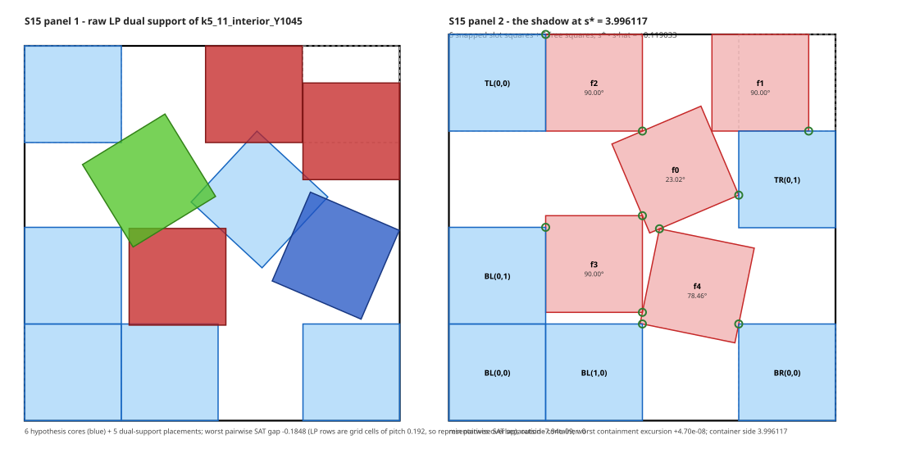

* **s\*** = 3.996117051 = s-hat +0.119033461  (s0 = 3.877084, s\* - s0 = +0.119033)
* **shadow** = 7 slot squares `BL(0,0) BL(0,1) BL(1,0) BR(0,0) TL(0,0) TR(0,1)` `TL(1,0) (=f2)` + 4 free squares; a k11 packing.
  * **gallery v1 counted this as 6 slot + 5 free** (A121): `f2` sits on `TL(1,0)` to within 1e-3 in position and 0.05 deg of axis - snapped slot squares, not free ones.  The f-indices are kept everywhere below (contact graph, forces, flat directions, rattler table) so A121's review rows stay valid.
* **explains** 5 alive-at-LP nodes: k5_11 x2, trump5 x2, k5_16 x1; levels L1:4, L2:1; component 5 support.
* **load-bearing squares at this landing**: `f0` `f2` `f3` `f4` `BL(0,1)` `BL(1,0)` `BR(0,0)` `TL(0,0)` `TR(0,1)` (9 of 11); **5 distinct minimised configuration(s)** share this s*.
* **multiplicity**: 5 landings / slot-free splittings (6 slot + 5 free (1 nodes); 6 slot + 5 free (1 nodes); 6 slot + 5 free (1 nodes); 7 slot + 4 free (1 nodes); 8 slot + 3 free (1 nodes)).
* the free squares do **not** share a tilt: f0 23.019 deg, f1 90.000 deg, f2 90.000 deg, f3 90.000 deg, f4 78.461 deg.
* **restarts**: 65 feasible of 101; distinct minima [3.99612, 4.0, 4.00001, 4.00011, 4.08342, 4.12132].

**Free square poses at s\***

| square | cx | cy | tilt (deg) |
|---|---|---|---|
| f0 | 2.340409 | 2.597490 | 23.0195 |
| f1 | 3.218423 | 3.496117 | 90.0000 |
| f2 | 1.500000 | 3.496117 | 90.0000 |
| f3 | 1.500000 | 1.620058 | 90.0000 |
| f4 | 2.566382 | 1.394681 | 78.4610 |

**Contact graph at s\*** (gap < 1e-7; contact force = Fritz-John multiplier, rows unit-normalised)

| contact | type | gap | force |
|---|---|---|---|
| `f0` - `f2` | vertex-on-edge | -9.6e-10 | 0.2914 |
| `f0` - `f3` | vertex-on-edge | -6.0e-10 | 0.3738 |
| `f0` - `f4` | vertex-on-edge | +8.7e-10 | 0.1375 |
| `f0` - `TR(0,1)` | vertex-on-edge | +6.7e-10 | 0.3973 |
| `f1` - `TR(0,1)` | vertex-on-edge | +2.2e-09 | 0.0000 |
| `f2` - `TL(0,0)` | exactly-opposite | -7.9e-09 | 0.0880 |
| `f3` - `f4` | vertex-on-edge | +3.6e-10 | 0.7531 |
| `f3` - `BL(0,1)` | vertex-on-edge | -6.1e-09 | 0.7316 |
| `f4` - `BL(1,0)` | vertex-on-edge | +2.9e-11 | 0.0851 |
| `f4` - `BR(0,0)` | vertex-on-edge | -4.2e-10 | 0.7872 |
| `f1` - top wall | wall | 0 | 0.0000 |
| `f2` - top wall | wall | 0 | 0.2624 |

**Binding** (largest Fritz-John resultant first): `f4`-`BR(0,0)` (0.787), `f3`-`f4` (0.753), `f3`-`BL(0,1)` (0.732), `f0`-`TR(0,1)` (0.397), `f0`-`f3` (0.374), `f0`-`f2` (0.291).  KKT residual 1.0e-06.  Exactly-opposite (vertex-vertex) contacts, whose normal is a cone and whose individual multipliers are therefore ill-conditioned: `f2`-`TL(0,0)`.
**Convergence caveat**: KKT residual 1.0e-06 (> 1e-6).  The residual measures how far e_s is from the cone of the active CONTACT rows; it is nonzero when the landing also leans on a variable BOUND (s in [3.4, 4.6], centres in [0, 4.6]), which is not a contact and so is not in the Jacobian, or when SLSQP stopped short of a stationary point.  Either way s* = 3.996117 is an upper bound on this shadow's true value and the contact set may be mis-counted at the 1e-7 threshold.
**Rank**: 19 contact rows, 16 variables (s + 3 per free square); rank 15; at fixed s rank 15 of 15, so **0 flat direction(s)**.
  * no flat directions: the shadow is first-order rigid at fixed s.

**T2 drain hint - the load-bearing subgraph** (remove one free square and re-minimise)

| removed | s* without it | drop | role |
|---|---|---|---|
| `f0` | 3.707107 | +0.289010 | load-bearing |
| `f1` | 3.942809 | +0.053308 | load-bearing |
| `f2` | 3.707107 | +0.289010 | load-bearing |
| `f3` | 3.822876 | +0.173241 | load-bearing |
| `f4` | 3.942809 | +0.053308 | load-bearing |

**Idle contacts** (zero Fritz-John force - struts, not load paths): `f1`-`TR(0,1)`, `f1`-`top wall`.

Load-bearing free squares: `f0`, `f1`, `f2`, `f3`, `f4`.  Rattlers/struts (removal leaves s\* unchanged): none.

**Alive nodes explained** (5; each id is src/shard/node(level).  Their pose boxes: A57 level-1 boxes are 0.1398 x 0.1398 x 9.73 deg and halve in every coordinate per level (A106 T1); the conditioned square pose of every node below is in `attempts/A107-shadow-gallery/results/shadow_nodes.json`): 
`A57/k5_11_interior_G1/k5_11_interior_Y1045(L1)` `A57/k5_11_interior_G1_D2/k5_11_interior_Y0072_D07(L2)` `A57/k5_16_interior_G1/k5_16_interior_Y1134(L1)` `A60/nodes/c0_Y0508(L1)` `A60/nodes/c0_Y0922(L1)`

## S16 - a k10 packing at s* = 3.768118 on the boundary of class k5_11, k5_16

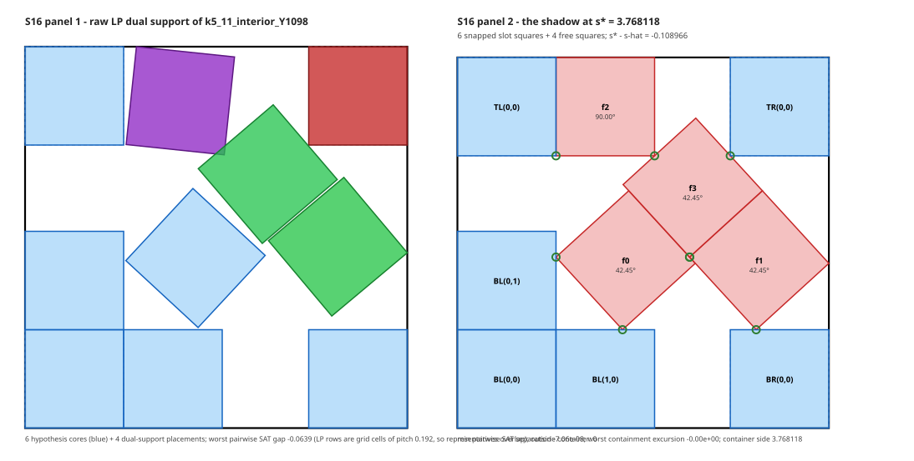

* **s\*** = 3.768117767 = s-hat -0.108965823  (s0 = 3.877084, s\* - s0 = -0.108966)
* **shadow** = 7 slot squares `BL(0,0) BL(0,1) BL(1,0) BR(0,0) TL(0,0) TR(0,0)` `TL(1,0) (=f2)` + 3 free squares; a k10 packing.
  * **gallery v1 counted this as 6 slot + 4 free** (A121): `f2` sits on `TL(1,0)` to within 1e-3 in position and 0.05 deg of axis - snapped slot squares, not free ones.  The f-indices are kept everywhere below (contact graph, forces, flat directions, rattler table) so A121's review rows stay valid.
* **explains** 4 alive-at-LP nodes: k5_11 x3, k5_16 x1; levels L1:2, L3:1, L4:1; integral 4 support.
* **load-bearing squares at this landing**: `f0` `f1` `f2` `f3` `BL(0,1)` `BL(1,0)` `BR(0,0)` `TL(0,0)` `TR(0,0)` (9 of 10); **2 distinct minimised configuration(s)** share this s*.
* **multiplicity**: 2 landings / slot-free splittings (6 slot + 4 free (3 nodes); 6 slot + 4 free (1 nodes)).
* the free squares do **not** share a tilt: f0 42.451 deg, f1 42.451 deg, f2 90.000 deg, f3 42.451 deg.
* **restarts**: 59 feasible of 103; distinct minima [3.70711, 3.76777, 3.76812, 3.82288, 3.85822, 3.94281, 3.98547, 4.0].

**Free square poses at s\***

| square | cx | cy | tilt (deg) |
|---|---|---|---|
| f0 | 1.706407 | 1.706407 | 42.4510 |
| f1 | 3.061711 | 1.706407 | 42.4510 |
| f2 | 1.500000 | 3.268118 | 90.0000 |
| f3 | 2.386738 | 2.444250 | 42.4510 |

**Contact graph at s\*** (gap < 1e-7; contact force = Fritz-John multiplier, rows unit-normalised)

| contact | type | gap | force |
|---|---|---|---|
| `f0` - `f3` | vertex-on-edge | -6.1e-08 | 0.9851 |
| `f0` - `BL(0,1)` | vertex-on-edge | -1.7e-13 | 0.5139 |
| `f0` - `BL(1,0)` | vertex-on-edge | +2.2e-11 | 0.4701 |
| `f1` - `f3` | exactly-opposite | -7.1e-08 | 0.0183 |
| `f1` - `BR(0,0)` | vertex-on-edge | +1.4e-09 | 0.0087 |
| `f2` - `f3` | vertex-on-edge | +1.5e-09 | 0.0160 |
| `f2` - `TL(0,0)` | exactly-opposite | +1.8e-09 | 0.0132 |
| `f3` - `TR(0,0)` | vertex-on-edge | +1.1e-11 | 1.2050 |
| `f1` - right wall | wall | 0 | 0.0114 |
| `f2` - top wall | wall | 0 | 0.0011 |

**Binding** (largest Fritz-John resultant first): `f3`-`TR(0,0)` (1.205), `f0`-`f3` (0.985), `f0`-`BL(0,1)` (0.514), `f0`-`BL(1,0)` (0.470), `f1`-`f3` (0.018), `f2`-`f3` (0.016).  KKT residual 9.1e-03.  Exactly-opposite (vertex-vertex) contacts, whose normal is a cone and whose individual multipliers are therefore ill-conditioned: `f1`-`f3`, `f2`-`TL(0,0)`.
**Convergence caveat**: KKT residual 9.1e-03 (> 1e-6).  The residual measures how far e_s is from the cone of the active CONTACT rows; it is nonzero when the landing also leans on a variable BOUND (s in [3.4, 4.6], centres in [0, 4.6]), which is not a contact and so is not in the Jacobian, or when SLSQP stopped short of a stationary point.  Either way s* = 3.768118 is an upper bound on this shadow's true value and the contact set may be mis-counted at the 1e-7 threshold.
**Rank**: 18 contact rows, 13 variables (s + 3 per free square); rank 13; at fixed s rank 12 of 12, so **0 flat direction(s)**.
  * no flat directions: the shadow is first-order rigid at fixed s.

**T2 drain hint - the load-bearing subgraph** (remove one free square and re-minimise)

| removed | s* without it | drop | role |
|---|---|---|---|
| `f0` | 3.400000 | +0.368118 | load-bearing |
| `f1` | 3.400000 | +0.368118 | load-bearing |
| `f2` | 3.400000 | +0.368118 | load-bearing |
| `f3` | 3.400000 | +0.368118 | load-bearing |

Load-bearing free squares: `f0`, `f1`, `f2`, `f3`.  Rattlers/struts (removal leaves s\* unchanged): none.

**Alive nodes explained** (4; each id is src/shard/node(level).  Their pose boxes: A57 level-1 boxes are 0.1398 x 0.1398 x 9.73 deg and halve in every coordinate per level (A106 T1); the conditioned square pose of every node below is in `attempts/A107-shadow-gallery/results/shadow_nodes.json`): 
`A57/k5_11_interior_G1/k5_11_interior_Y1098(L1)` `A57/k5_11_interior_G1_D2_D2/k5_11_interior_Y0054_D01_D06(L3)` `A57/k5_11_interior_G1_D2_D2_D2/k5_11_interior_Y0036_D07_D04_D03(L4)` `A57/k5_16_interior_G1/k5_16_interior_Y0476(L1)`

## S17 - a k10 packing at s* = 3.858216 on the boundary of class k5_11, k5_16

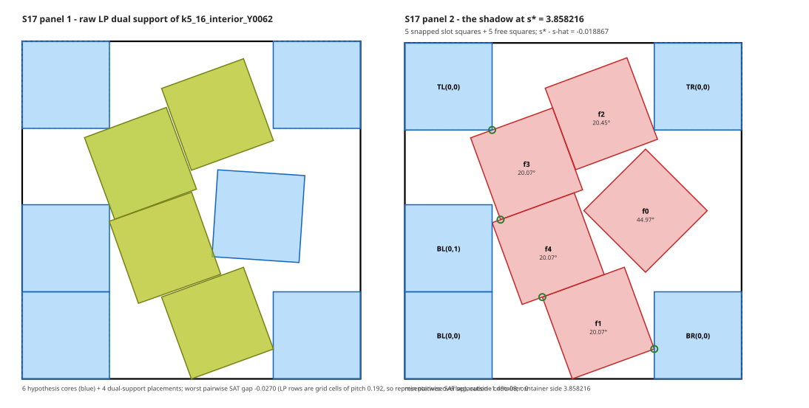

* **s\*** = 3.858216318 = s-hat -0.018867272  (s0 = 3.877084, s\* - s0 = -0.018868)
* **shadow** = 5 slot squares `BL(0,0) BL(0,1) BR(0,0) TL(0,0) TR(0,0)` + 5 free squares; a k10 packing.
* **explains** 4 alive-at-LP nodes: k5_11 x2, k5_16 x2; levels L1:3, L2:1; integral 4 support.
* **load-bearing squares at this landing**: `f1` `f3` `f4` `BR(0,0)` `TL(0,0)` (5 of 10); **2 distinct minimised configuration(s)** share this s*.
* **multiplicity**: 2 landings / slot-free splittings (5 slot + 5 free (2 nodes); 6 slot + 4 free (2 nodes)).
* the free squares do **not** share a tilt: f0 44.975 deg, f1 20.072 deg, f2 20.447 deg, f3 20.072 deg, f4 20.072 deg.
* **restarts**: 59 feasible of 102; distinct minima [3.70711, 3.72858, 3.76777, 3.76812, 3.82288, 3.85822, 3.89723, 3.89987].

**Free square poses at s\***

| square | cx | cy | tilt (deg) |
|---|---|---|---|
| f0 | 2.757796 | 1.931677 | 44.9746 |
| f1 | 2.216983 | 0.641233 | 20.0723 |
| f2 | 2.251389 | 3.045273 | 20.4466 |
| f3 | 1.395007 | 2.470218 | 20.0723 |
| f4 | 1.642345 | 1.495928 | 20.0723 |

**Contact graph at s\*** (gap < 1e-7; contact force = Fritz-John multiplier, rows unit-normalised)

| contact | type | gap | force |
|---|---|---|---|
| `f1` - `f4` | vertex-on-edge | -1.5e-08 | 1.1472 |
| `f1` - `BR(0,0)` | vertex-on-edge | +2.8e-10 | 0.3868 |
| `f3` - `f4` | vertex-on-edge | -1.3e-08 | 1.1232 |
| `f3` - `TL(0,0)` | vertex-on-edge | +2.3e-10 | 1.0857 |
| `f1` - bottom wall | wall | 0 | 0.7642 |

**Binding** (largest Fritz-John resultant first): `f1`-`f4` (1.147), `f3`-`f4` (1.123), `f3`-`TL(0,0)` (1.086), `f1`-`bottom wall` (0.764), `f1`-`BR(0,0)` (0.387).  KKT residual 1.1e-05.
**Convergence caveat**: KKT residual 1.1e-05 (> 1e-6).  The residual measures how far e_s is from the cone of the active CONTACT rows; it is nonzero when the landing also leans on a variable BOUND (s in [3.4, 4.6], centres in [0, 4.6]), which is not a contact and so is not in the Jacobian, or when SLSQP stopped short of a stationary point.  Either way s* = 3.858216 is an upper bound on this shadow's true value and the contact set may be mis-counted at the 1e-7 threshold.
**Rank**: 7 contact rows, 16 variables (s + 3 per free square); rank 7; at fixed s rank 7 of 15, so **8 flat direction(s)**.
  * flat direction 0: free (flex to at least third order) (worst active gap changes by +0.00e+00 at |t| = 1e-3 and +0.00e+00 at 3e-3 and +0.00e+00 at 1e-2, no change at any step - a genuine one-parameter motion).
  * flat direction 1: free (flex to at least third order) (worst active gap changes by +0.00e+00 at |t| = 1e-3 and +0.00e+00 at 3e-3 and +0.00e+00 at 1e-2, no change at any step - a genuine one-parameter motion).
  * flat direction 2: blocked at second order (worst active gap changes by -3.74e-11 at |t| = 1e-3 and -3.36e-10 at 3e-3 and -3.74e-09 at 1e-2, ratios 9.0 / 100.0; 9 and 100 are the quadratic signature - curvature -3.738e-05).
  * flat direction 3: blocked at second order (worst active gap changes by -4.99e-12 at |t| = 1e-3 and -4.49e-11 at 3e-3 and -4.99e-10 at 1e-2, ratios 9.0 / 100.0; 9 and 100 are the quadratic signature - curvature -4.990e-06).
  * flat direction 4: free (flex to at least third order) (worst active gap changes by -3.33e-16 at |t| = 1e-3 and -1.11e-16 at 3e-3 and -1.11e-16 at 1e-2, ratios 0.33 / 0.3; 9 and 100 are the quadratic signature - curvature -3.331e-10).
  * flat direction 5: blocked at second order (worst active gap changes by -1.61e-11 at |t| = 1e-3 and -1.45e-10 at 3e-3 and -1.61e-09 at 1e-2, ratios 9.0 / 100.0; 9 and 100 are the quadratic signature - curvature -1.615e-05).
  * flat direction 6: blocked at second order (worst active gap changes by -2.16e-12 at |t| = 1e-3 and -1.94e-11 at 3e-3 and -2.16e-10 at 1e-2, ratios 9.0 / 100.0; 9 and 100 are the quadratic signature - curvature -2.156e-06).
  * flat direction 7: free (flex to at least third order) (worst active gap changes by -3.33e-16 at |t| = 1e-3 and -2.22e-16 at 3e-3 and -4.44e-16 at 1e-2, ratios 0.67 / 1.3; 9 and 100 are the quadratic signature - curvature -3.331e-10).

**T2 drain hint - the load-bearing subgraph** (remove one free square and re-minimise)

| removed | s* without it | drop | role |
|---|---|---|---|
| `f0` | 3.707107 | +0.151110 | load-bearing |
| `f1` | 3.707107 | +0.151110 | load-bearing |
| `f2` | 3.400000 | +0.458216 | load-bearing |
| `f3` | 3.400000 | +0.458216 | load-bearing |
| `f4` | 3.400000 | +0.458216 | load-bearing |

Load-bearing free squares: `f0`, `f1`, `f2`, `f3`, `f4`.  Rattlers/struts (removal leaves s\* unchanged): none.

**Alive nodes explained** (4; each id is src/shard/node(level).  Their pose boxes: A57 level-1 boxes are 0.1398 x 0.1398 x 9.73 deg and halve in every coordinate per level (A106 T1); the conditioned square pose of every node below is in `attempts/A107-shadow-gallery/results/shadow_nodes.json`): 
`A57/k5_11_interior_G1/k5_11_interior_Y0768(L1)` `A57/k5_11_interior_G1_D2/k5_11_interior_Y0059_D06(L2)` `A57/k5_16_interior_G1/k5_16_interior_Y0062(L1)` `A57/k5_16_interior_G1/k5_16_interior_Y0698(L1)`

## S18 - a k10 packing at s* = 3.755342 on the boundary of class k5_11

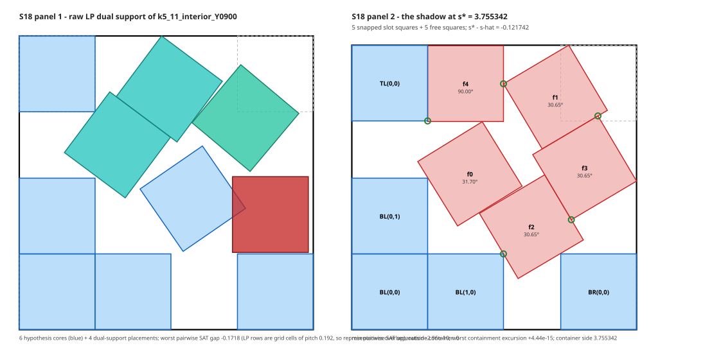

* **s\*** = 3.755342035 = s-hat -0.121741555  (s0 = 3.877084, s\* - s0 = -0.121742)
* **shadow** = 5 slot squares `BL(0,0) BL(0,1) BL(1,0) BR(0,0) TL(0,0)` + 5 free squares; a k10 packing.
* **explains** 3 alive-at-LP nodes: k5_11 x3; levels L1:2, L2:1; integral 3 support.
* **load-bearing squares at this landing**: `f1` `f2` `f3` `f4` `BL(1,0)` `TL(0,0)` (6 of 10); **1 distinct minimised configuration(s)** share this s*.
* **multiplicity**: 1 landings / slot-free splittings (5 slot + 5 free (3 nodes)).
* the free squares do **not** share a tilt: f0 31.701 deg, f1 30.653 deg, f2 30.653 deg, f3 30.653 deg, f4 90.000 deg.
* **restarts**: 67 feasible of 103; distinct minima [3.70711, 3.72858, 3.75534, 3.75535, 3.76777, 3.76812, 3.82288, 3.91229].

**Free square poses at s\***

| square | cx | cy | tilt (deg) |
|---|---|---|---|
| f0 | 1.557808 | 2.056442 | 31.7009 |
| f1 | 2.685053 | 3.070289 | 30.6527 |
| f2 | 2.368330 | 1.359206 | 30.6527 |
| f3 | 3.070289 | 2.136174 | 30.6527 |
| f4 | 1.500000 | 3.247407 | 90.0000 |

**Contact graph at s\*** (gap < 1e-7; contact force = Fritz-John multiplier, rows unit-normalised)

| contact | type | gap | force |
|---|---|---|---|
| `f1` - `f3` | vertex-on-edge | +1.7e-13 | 0.5263 |
| `f1` - `f4` | vertex-on-edge | +1.7e-15 | 0.2575 |
| `f2` - `f3` | vertex-on-edge | -1.6e-10 | 0.8872 |
| `f2` - `BL(1,0)` | vertex-on-edge | +8.5e-13 | 0.6024 |
| `f4` - `TL(0,0)` | vertex-on-edge | -3.0e-10 | 0.1807 |
| `f1` - top wall | wall | 0 | 0.4345 |
| `f3` - right wall | wall | 0 | 0.9906 |

**Binding** (largest Fritz-John resultant first): `f3`-`right wall` (0.991), `f2`-`f3` (0.887), `f2`-`BL(1,0)` (0.602), `f1`-`f3` (0.526), `f1`-`top wall` (0.434), `f1`-`f4` (0.257).  KKT residual 1.3e-05.
**Convergence caveat**: KKT residual 1.3e-05 (> 1e-6).  The residual measures how far e_s is from the cone of the active CONTACT rows; it is nonzero when the landing also leans on a variable BOUND (s in [3.4, 4.6], centres in [0, 4.6]), which is not a contact and so is not in the Jacobian, or when SLSQP stopped short of a stationary point.  Either way s* = 3.755342 is an upper bound on this shadow's true value and the contact set may be mis-counted at the 1e-7 threshold.
**Rank**: 10 contact rows, 16 variables (s + 3 per free square); rank 10; at fixed s rank 10 of 15, so **5 flat direction(s)**.
  * flat direction 0: blocked at second order (worst active gap changes by -2.69e-13 at |t| = 1e-3 and -2.42e-12 at 3e-3 and -2.68e-11 at 1e-2, ratios 8.99 / 99.9; 9 and 100 are the quadratic signature - curvature -2.686e-07).
  * flat direction 1: blocked at second order (worst active gap changes by -8.22e-14 at |t| = 1e-3 and -7.38e-13 at 3e-3 and -8.20e-12 at 1e-2, ratios 8.99 / 99.8; 9 and 100 are the quadratic signature - curvature -8.216e-08).
  * flat direction 2: blocked at second order (worst active gap changes by -1.12e-13 at |t| = 1e-3 and -1.01e-12 at 3e-3 and -1.12e-11 at 1e-2, ratios 8.98 / 99.7; 9 and 100 are the quadratic signature - curvature -1.121e-07).
  * flat direction 3: blocked at second order (worst active gap changes by -4.22e-15 at |t| = 1e-3 and -3.77e-14 at 3e-3 and -4.20e-13 at 1e-2, ratios 8.95 / 99.6; 9 and 100 are the quadratic signature - curvature -4.219e-09).
  * flat direction 4: blocked at second order (worst active gap changes by -1.18e-13 at |t| = 1e-3 and -1.06e-12 at 3e-3 and -1.18e-11 at 1e-2, ratios 9.0 / 100.0; 9 and 100 are the quadratic signature - curvature -1.181e-07).

**T2 drain hint - the load-bearing subgraph** (remove one free square and re-minimise)

| removed | s* without it | drop | role |
|---|---|---|---|
| `f0` | 3.707107 | +0.048235 | load-bearing |
| `f1` | 3.707107 | +0.048235 | load-bearing |
| `f2` | 3.400000 | +0.355342 | load-bearing |
| `f3` | 3.707107 | +0.048235 | load-bearing |
| `f4` | 3.621320 | +0.134022 | load-bearing |

Load-bearing free squares: `f0`, `f1`, `f2`, `f3`, `f4`.  Rattlers/struts (removal leaves s\* unchanged): none.

**Alive nodes explained** (3; each id is src/shard/node(level).  Their pose boxes: A57 level-1 boxes are 0.1398 x 0.1398 x 9.73 deg and halve in every coordinate per level (A106 T1); the conditioned square pose of every node below is in `attempts/A107-shadow-gallery/results/shadow_nodes.json`): 
`A57/k5_11_interior_G1/k5_11_interior_Y0900(L1)` `A57/k5_11_interior_G1/k5_11_interior_Y1111(L1)` `A57/k5_11_interior_G1_D2/k5_11_interior_Y0306_D04(L2)`

## S19 - a k10 packing at s* = 3.728581 on the boundary of class k5_11

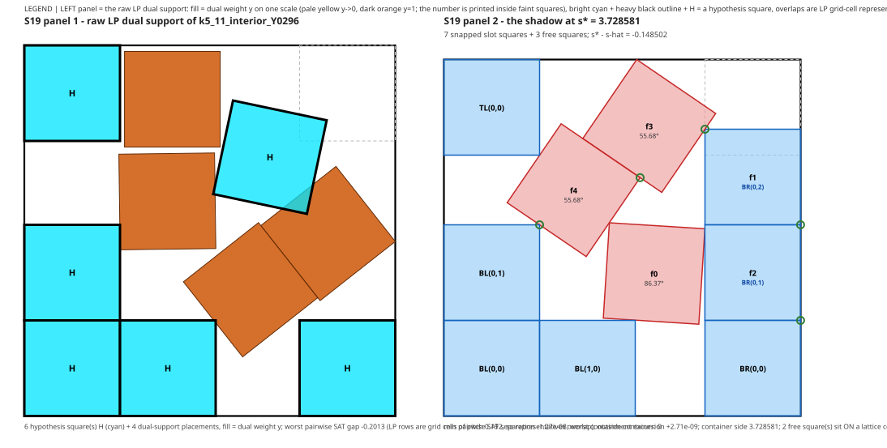

* **s\*** = 3.728581293 = s-hat -0.148502297  (s0 = 3.877084, s\* - s0 = -0.148503)
* **shadow** = 7 slot squares `BL(0,0) BL(0,1) BL(1,0) BR(0,0) TL(0,0)` `BR(0,2) (=f1)` `BR(0,1) (=f2)` + 3 free squares; a k10 packing.
  * **gallery v1 counted this as 5 slot + 5 free** (A121): `f1` sits on `BR(0,2)`, `f2` sits on `BR(0,1)` to within 1e-3 in position and 0.05 deg of axis - snapped slot squares, not free ones.  The f-indices are kept everywhere below (contact graph, forces, flat directions, rattler table) so A121's review rows stay valid.
* **explains** 2 alive-at-LP nodes: k5_11 x2; levels L1:2; integral 2 support.
* **load-bearing squares at this landing**: `f1` `f2` `f3` `f4` `BL(0,1)` `BR(0,0)` (6 of 10); **1 distinct minimised configuration(s)** share this s*.
* **multiplicity**: 1 landings / slot-free splittings (5 slot + 5 free (2 nodes)).
* the free squares do **not** share a tilt: f0 86.373 deg, f1 90.000 deg, f2 90.000 deg, f3 55.680 deg, f4 55.680 deg.
* **restarts**: 60 feasible of 102; distinct minima [3.70711, 3.72858, 3.75744, 3.76777, 3.82288, 3.91465, 3.94281, 4.0].

**Free square poses at s\***

| square | cx | cy | tilt (deg) |
|---|---|---|---|
| f0 | 2.197064 | 1.490768 | 86.3732 |
| f1 | 3.228581 | 2.500000 | 90.0000 |
| f2 | 3.227730 | 1.500000 | 90.0000 |
| f3 | 2.146200 | 3.033722 | 55.6795 |
| f4 | 1.356165 | 2.362257 | 55.6795 |

**Contact graph at s\*** (gap < 1e-7; contact force = Fritz-John multiplier, rows unit-normalised)

| contact | type | gap | force |
|---|---|---|---|
| `f1` - `f2` | vertex-on-edge | -6.6e-11 | 0.3427 |
| `f1` - `f3` | vertex-on-edge | -2.5e-13 | 0.5585 |
| `f2` - `BR(0,0)` | vertex-on-edge | +1.4e-09 | 0.2423 |
| `f3` - `f4` | vertex-on-edge | -1.3e-08 | 0.8244 |
| `f4` - `BL(0,1)` | vertex-on-edge | -5.7e-13 | 0.5658 |
| `f1` - right wall | wall | 0 | 0.4765 |
| `f3` - top wall | wall | 0 | 0.9690 |

**Binding** (largest Fritz-John resultant first): `f3`-`top wall` (0.969), `f3`-`f4` (0.824), `f4`-`BL(0,1)` (0.566), `f1`-`f3` (0.558), `f1`-`right wall` (0.476), `f1`-`f2` (0.343).  KKT residual 9.9e-07.
**Rank**: 11 contact rows, 16 variables (s + 3 per free square); rank 10; at fixed s rank 10 of 15, so **5 flat direction(s)**.
  * flat direction 0: blocked at first order (rank tolerance artefact) (worst active gap changes by -5.01e-13 at |t| = 1e-3 and -1.51e-12 at 3e-3 and -5.25e-12 at 1e-2, ratios 3.0 / 10.5; 9 and 100 are the quadratic signature - curvature -5.014e-07).
  * flat direction 1: free (flex to at least third order) (worst active gap changes by +0.00e+00 at |t| = 1e-3 and -2.22e-16 at 3e-3 and -5.55e-16 at 1e-2, no change at any step - a genuine one-parameter motion).
  * flat direction 2: blocked at second order (worst active gap changes by -9.30e-11 at |t| = 1e-3 and -8.37e-10 at 3e-3 and -9.30e-09 at 1e-2, ratios 9.0 / 100.0; 9 and 100 are the quadratic signature - curvature -9.297e-05).
  * flat direction 3: blocked at second order (worst active gap changes by -4.33e-11 at |t| = 1e-3 and -3.90e-10 at 3e-3 and -4.33e-09 at 1e-2, ratios 9.0 / 100.0; 9 and 100 are the quadratic signature - curvature -4.333e-05).
  * flat direction 4: free (flex to at least third order) (worst active gap changes by -2.22e-16 at |t| = 1e-3 and -1.11e-16 at 3e-3 and -3.33e-16 at 1e-2, ratios 0.5 / 1.5; 9 and 100 are the quadratic signature - curvature -2.220e-10).

**T2 drain hint - the load-bearing subgraph** (remove one free square and re-minimise)

| removed | s* without it | drop | role |
|---|---|---|---|
| `f0` | 3.707107 | +0.021475 | load-bearing |
| `f1` | 3.707107 | +0.021475 | load-bearing |
| `f2` | 3.663224 | +0.065357 | load-bearing |
| `f3` | 3.707107 | +0.021475 | load-bearing |
| `f4` | 3.400000 | +0.328581 | load-bearing |

Load-bearing free squares: `f0`, `f1`, `f2`, `f3`, `f4`.  Rattlers/struts (removal leaves s\* unchanged): none.

**Alive nodes explained** (2; each id is src/shard/node(level).  Their pose boxes: A57 level-1 boxes are 0.1398 x 0.1398 x 9.73 deg and halve in every coordinate per level (A106 T1); the conditioned square pose of every node below is in `attempts/A107-shadow-gallery/results/shadow_nodes.json`): 
`A57/k5_11_interior_G1/k5_11_interior_Y0296(L1)` `A57/k5_11_interior_G1/k5_11_interior_Y0319(L1)`

## S20 - a k10 packing at s* = 3.806721 on the boundary of class trump5

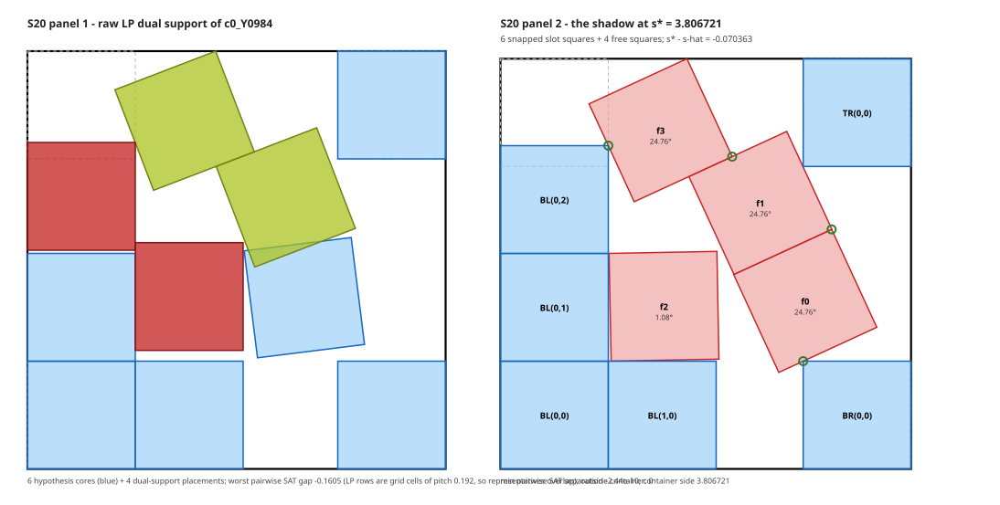

* **s\*** = 3.806720615 = s-hat -0.070362975  (s0 = 3.877084, s\* - s0 = -0.070363)
* **shadow** = 6 slot squares `BL(0,0) BL(0,1) BL(0,2) BL(1,0) BR(0,0) TR(0,0)` + 4 free squares; a k10 packing.
* **explains** 2 alive-at-LP nodes: trump5 x2; levels L1:2; integral 2 support.
* **load-bearing squares at this landing**: `f0` `f1` `f3` `BL(0,2)` `BR(0,0)` (5 of 10); **1 distinct minimised configuration(s)** share this s*.
* **multiplicity**: 1 landings / slot-free splittings (6 slot + 4 free (2 nodes)).
* the free squares do **not** share a tilt: f0 24.757 deg, f1 24.757 deg, f2 1.079 deg, f3 24.757 deg.
* **restarts**: 62 feasible of 102; distinct minima [3.70711, 3.72858, 3.76777, 3.80672, 3.88675, 3.89528, 3.89637, 3.9273].

**Free square poses at s\***

| square | cx | cy | tilt (deg) |
|---|---|---|---|
| f0 | 2.825462 | 1.559248 | 24.7570 |
| f1 | 2.409652 | 2.468705 | 24.7570 |
| f2 | 1.516447 | 1.509500 | 1.0791 |
| f3 | 1.484526 | 3.143289 | 24.7570 |

**Contact graph at s\*** (gap < 1e-7; contact force = Fritz-John multiplier, rows unit-normalised)

| contact | type | gap | force |
|---|---|---|---|
| `f0` - `f1` | vertex-on-edge | -2.4e-10 | 0.9597 |
| `f0` - `BR(0,0)` | vertex-on-edge | -1.1e-16 | 0.7322 |
| `f1` - `f3` | vertex-on-edge | -3.6e-13 | 0.9661 |
| `f3` - `BL(0,2)` | vertex-on-edge | +3.3e-16 | 0.3042 |
| `f3` - top wall | wall | 0 | 1.0398 |

**Binding** (largest Fritz-John resultant first): `f3`-`top wall` (1.040), `f1`-`f3` (0.966), `f0`-`f1` (0.960), `f0`-`BR(0,0)` (0.732), `f3`-`BL(0,2)` (0.304).  KKT residual 5.1e-05.
**Convergence caveat**: KKT residual 5.1e-05 (> 1e-6).  The residual measures how far e_s is from the cone of the active CONTACT rows; it is nonzero when the landing also leans on a variable BOUND (s in [3.4, 4.6], centres in [0, 4.6]), which is not a contact and so is not in the Jacobian, or when SLSQP stopped short of a stationary point.  Either way s* = 3.806721 is an upper bound on this shadow's true value and the contact set may be mis-counted at the 1e-7 threshold.
**Rank**: 7 contact rows, 13 variables (s + 3 per free square); rank 7; at fixed s rank 7 of 12, so **5 flat direction(s)**.
  * flat direction 0: free (flex to at least third order) (worst active gap changes by +0.00e+00 at |t| = 1e-3 and +0.00e+00 at 3e-3 and +0.00e+00 at 1e-2, no change at any step - a genuine one-parameter motion).
  * flat direction 1: free (flex to at least third order) (worst active gap changes by +0.00e+00 at |t| = 1e-3 and +0.00e+00 at 3e-3 and +0.00e+00 at 1e-2, no change at any step - a genuine one-parameter motion).
  * flat direction 2: blocked at second order (worst active gap changes by -7.28e-12 at |t| = 1e-3 and -6.55e-11 at 3e-3 and -7.28e-10 at 1e-2, ratios 9.0 / 100.0; 9 and 100 are the quadratic signature - curvature -7.281e-06).
  * flat direction 3: blocked at second order (worst active gap changes by -1.52e-11 at |t| = 1e-3 and -1.37e-10 at 3e-3 and -1.52e-09 at 1e-2, ratios 9.0 / 100.0; 9 and 100 are the quadratic signature - curvature -1.519e-05).
  * flat direction 4: blocked at second order (worst active gap changes by -5.37e-12 at |t| = 1e-3 and -4.83e-11 at 3e-3 and -5.37e-10 at 1e-2, ratios 9.0 / 100.0; 9 and 100 are the quadratic signature - curvature -5.365e-06).

**T2 drain hint - the load-bearing subgraph** (remove one free square and re-minimise)

| removed | s* without it | drop | role |
|---|---|---|---|
| `f0` | 3.400000 | +0.406721 | load-bearing |
| `f1` | 3.400000 | +0.406721 | load-bearing |
| `f2` | 3.728582 | +0.078139 | load-bearing |
| `f3` | 3.400000 | +0.406721 | load-bearing |

Load-bearing free squares: `f0`, `f1`, `f2`, `f3`.  Rattlers/struts (removal leaves s\* unchanged): none.

**Alive nodes explained** (2; each id is src/shard/node(level).  Their pose boxes: A57 level-1 boxes are 0.1398 x 0.1398 x 9.73 deg and halve in every coordinate per level (A106 T1); the conditioned square pose of every node below is in `attempts/A107-shadow-gallery/results/shadow_nodes.json`): 
`A60/nodes/c0_Y0984(L1)` `A60/nodes/c0_Y1084(L1)`

## S21 - a k11 packing at s* = 3.894322 on the boundary of class trump5

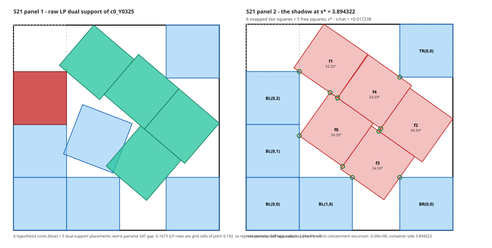

* **s\*** = 3.894321926 = s-hat +0.017238336  (s0 = 3.877084, s\* - s0 = +0.017238)
* **shadow** = 6 slot squares `BL(0,0) BL(0,1) BL(0,2) BL(1,0) BR(0,0) TR(0,0)` + 5 free squares; a k11 packing.
* **explains** 2 alive-at-LP nodes: trump5 x2; levels L1:2; integral 2 support.
* **load-bearing squares at this landing**: `f0` `f1` `f2` `f3` `f4` `BL(0,1)` `BL(0,2)` `BL(1,0)` `BR(0,0)` (9 of 11); **1 distinct minimised configuration(s)** share this s*.
* **multiplicity**: 1 landings / slot-free splittings (6 slot + 5 free (2 nodes)).
* the free squares do **not** share a tilt: f0 54.593 deg, f1 55.523 deg, f2 54.593 deg, f3 54.593 deg, f4 54.593 deg.
* **restarts**: 66 feasible of 102; distinct minima [3.88675, 3.89432, 3.94281, 3.96236, 4.0].

**Free square poses at s\***

| square | cx | cy | tilt (deg) |
|---|---|---|---|
| f0 | 1.697220 | 1.904920 | 54.5925 |
| f1 | 1.593322 | 3.199107 | 55.5229 |
| f2 | 3.197102 | 1.989402 | 54.5925 |
| f3 | 2.476275 | 1.274893 | 54.5925 |
| f4 | 2.418047 | 2.619428 | 54.5925 |

**Contact graph at s\*** (gap < 1e-7; contact force = Fritz-John multiplier, rows unit-normalised)

| contact | type | gap | force |
|---|---|---|---|
| `f0` - `f1` | vertex-on-edge | +8.8e-14 | 0.3242 |
| `f0` - `f3` | vertex-on-edge | -1.6e-11 | 0.4955 |
| `f0` - `f4` | vertex-on-edge | +3.4e-08 | 0.0208 |
| `f0` - `BL(0,1)` | vertex-on-edge | +0.0e+00 | 0.4012 |
| `f1` - `f4` | vertex-on-edge | -9.9e-15 | 0.3353 |
| `f1` - `BL(0,2)` | vertex-on-edge | +8.3e-13 | 0.1094 |
| `f2` - `f3` | vertex-on-edge | -9.8e-15 | 0.2841 |
| `f2` - `f4` | vertex-on-edge | -2.2e-11 | 0.3419 |
| `f3` - `BL(1,0)` | vertex-on-edge | +7.9e-13 | 0.2142 |
| `f3` - `BR(0,0)` | vertex-on-edge | +2.2e-16 | 0.4471 |
| `f1` - top wall | wall | 0 | 0.5615 |
| `f2` - right wall | wall | 0 | 0.4421 |

**Binding** (largest Fritz-John resultant first): `f1`-`top wall` (0.562), `f0`-`f3` (0.495), `f3`-`BR(0,0)` (0.447), `f2`-`right wall` (0.442), `f0`-`BL(0,1)` (0.401), `f2`-`f4` (0.342).  KKT residual 1.0e-01.
**Convergence caveat**: KKT residual 1.0e-01 (> 1e-6).  The residual measures how far e_s is from the cone of the active CONTACT rows; it is nonzero when the landing also leans on a variable BOUND (s in [3.4, 4.6], centres in [0, 4.6]), which is not a contact and so is not in the Jacobian, or when SLSQP stopped short of a stationary point.  Either way s* = 3.894322 is an upper bound on this shadow's true value and the contact set may be mis-counted at the 1e-7 threshold.
**Rank**: 16 contact rows, 16 variables (s + 3 per free square); rank 15; at fixed s rank 15 of 15, so **0 flat direction(s)**.
  * no flat directions: the shadow is first-order rigid at fixed s.

**T2 drain hint - the load-bearing subgraph** (remove one free square and re-minimise)

| removed | s* without it | drop | role |
|---|---|---|---|
| `f0` | 3.870286 | +0.024036 | load-bearing |
| `f1` | 3.885618 | +0.008704 | load-bearing |
| `f2` | 3.728582 | +0.165740 | load-bearing |
| `f3` | 3.787987 | +0.106335 | load-bearing |
| `f4` | 3.767767 | +0.126555 | load-bearing |

Load-bearing free squares: `f0`, `f1`, `f2`, `f3`, `f4`.  Rattlers/struts (removal leaves s\* unchanged): none.

**Alive nodes explained** (2; each id is src/shard/node(level).  Their pose boxes: A57 level-1 boxes are 0.1398 x 0.1398 x 9.73 deg and halve in every coordinate per level (A106 T1); the conditioned square pose of every node below is in `attempts/A107-shadow-gallery/results/shadow_nodes.json`): 
`A60/nodes/c0_Y0325(L1)` `A60/nodes/c0_Y0877(L1)`

## S22 - a k11 packing at s* = 3.998111 on the boundary of class k5_11

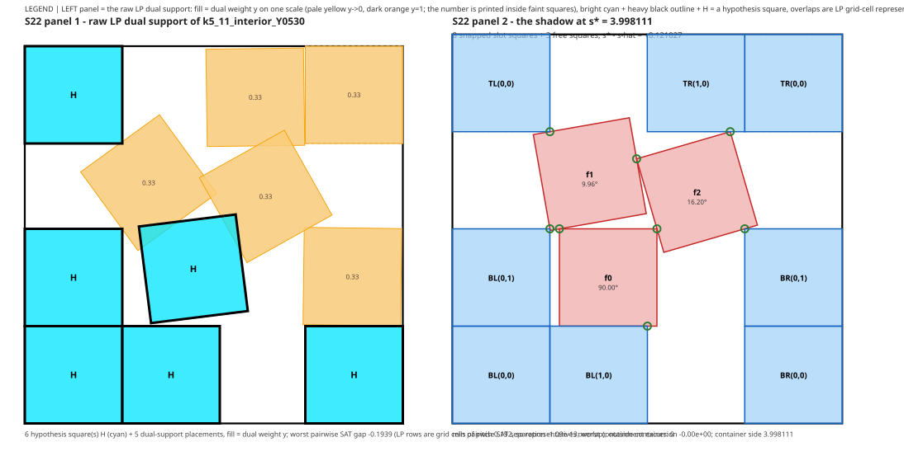

* **s\*** = 3.998110682 = s-hat +0.121027092  (s0 = 3.877084, s\* - s0 = +0.121027)
* **shadow** = 8 slot squares `BL(0,0) BL(0,1) BL(1,0) BR(0,0) BR(0,1) TL(0,0) TR(0,0) TR(1,0)` + 3 free squares; a k11 packing.
* **explains** 2 alive-at-LP nodes: k5_11 x2; levels L1:2; component 2 support.
* **load-bearing squares at this landing**: `f0` `f1` `f2` `BL(0,1)` `BL(1,0)` `BR(0,1)` `TL(0,0)` `TR(1,0)` (8 of 11); **1 distinct minimised configuration(s)** share this s*.
* **multiplicity**: 1 landings / slot-free splittings (8 slot + 3 free (2 nodes)).
* the free squares do **not** share a tilt: f0 90.000 deg, f1 9.963 deg, f2 16.200 deg.
* **restarts**: 84 feasible of 102; distinct minima [3.94281, 3.99811, 4.0, 4.00005].

**Free square poses at s\***

| square | cx | cy | tilt (deg) |
|---|---|---|---|
| f0 | 1.597915 | 1.500000 | 90.0000 |
| f1 | 1.408889 | 2.562278 | 9.9626 |
| f2 | 2.508635 | 2.378469 | 16.1998 |

**Contact graph at s\*** (gap < 1e-7; contact force = Fritz-John multiplier, rows unit-normalised)

| contact | type | gap | force |
|---|---|---|---|
| `f0` - `f1` | vertex-on-edge | +3.8e-15 | 0.6281 |
| `f0` - `f2` | vertex-on-edge | -6.0e-15 | 0.1095 |
| `f0` - `BL(1,0)` | vertex-on-edge | -1.1e-13 | 0.4676 |
| `f1` - `f2` | vertex-on-edge | -7.5e-15 | 0.0840 |
| `f1` - `BL(0,1)` | vertex-on-edge | +0.0e+00 | 0.0629 |
| `f1` - `TL(0,0)` | vertex-on-edge | -6.0e-15 | 0.5933 |
| `f2` - `BR(0,1)` | vertex-on-edge | -3.2e-15 | 0.5008 |
| `f2` - `TR(1,0)` | vertex-on-edge | +3.2e-15 | 0.6801 |

**Binding** (largest Fritz-John resultant first): `f2`-`TR(1,0)` (0.680), `f0`-`f1` (0.628), `f1`-`TL(0,0)` (0.593), `f2`-`BR(0,1)` (0.501), `f0`-`BL(1,0)` (0.468), `f0`-`f2` (0.109).  KKT residual 5.1e-10.
**Rank**: 9 contact rows, 10 variables (s + 3 per free square); rank 9; at fixed s rank 8 of 9, so **1 flat direction(s)**.
  * flat direction 0: blocked at second order (worst active gap changes by -3.24e-07 at |t| = 1e-3 and -2.91e-06 at 3e-3 and -3.24e-05 at 1e-2, ratios 9.0 / 100.1; 9 and 100 are the quadratic signature - curvature -3.238e-01).

**T2 drain hint - the load-bearing subgraph** (remove one free square and re-minimise)

| removed | s* without it | drop | role |
|---|---|---|---|
| `f0` | 3.985467 | +0.012644 | load-bearing |
| `f1` | 3.942809 | +0.055302 | load-bearing |
| `f2` | 3.707107 | +0.291004 | load-bearing |

Load-bearing free squares: `f0`, `f1`, `f2`.  Rattlers/struts (removal leaves s\* unchanged): none.

**Alive nodes explained** (2; each id is src/shard/node(level).  Their pose boxes: A57 level-1 boxes are 0.1398 x 0.1398 x 9.73 deg and halve in every coordinate per level (A106 T1); the conditioned square pose of every node below is in `attempts/A107-shadow-gallery/results/shadow_nodes.json`): 
`A57/k5_11_interior_G1/k5_11_interior_Y0069(L1)` `A57/k5_11_interior_G1/k5_11_interior_Y0530(L1)`

## S23 - a k10 packing at s* = 3.894653 on the boundary of class k5_11

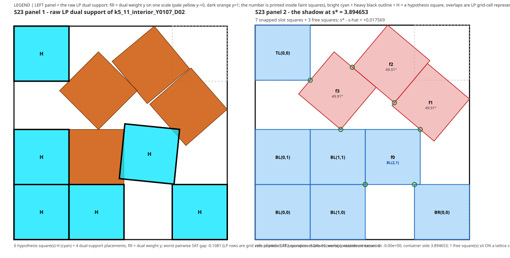

* **s\*** = 3.894653059 = s-hat +0.017569469  (s0 = 3.877084, s\* - s0 = +0.017569)
* **shadow** = 7 slot squares `BL(0,0) BL(0,1) BL(1,0) BL(1,1) BR(0,0) TL(0,0)` `BL(2,1) (=f0)` + 3 free squares; a k10 packing.
  * **gallery v1 counted this as 6 slot + 4 free** (A121): `f0` sits on `BL(2,1)` to within 1e-3 in position and 0.05 deg of axis - snapped slot squares, not free ones.  The f-indices are kept everywhere below (contact graph, forces, flat directions, rattler table) so A121's review rows stay valid.
* **explains** 2 alive-at-LP nodes: k5_11 x2; levels L2:2; integral 2 support.
* **load-bearing squares at this landing**: `f0` `f1` `f2` `f3` `BL(1,0)` `BL(1,1)` `BR(0,0)` `TL(0,0)` (8 of 10); **2 distinct minimised configuration(s)** share this s*.
* **multiplicity**: 2 landings / slot-free splittings (6 slot + 4 free (1 nodes); 7 slot + 3 free (1 nodes)).
* the free squares do **not** share a tilt: f0 90.000 deg, f1 49.914 deg, f2 49.914 deg, f3 49.914 deg.
* **restarts**: 73 feasible of 101; distinct minima [3.70711, 3.88562, 3.89465, 3.94281, 3.97662, 3.98547, 4.0, 4.0085].

**Free square poses at s\***

| square | cx | cy | tilt (deg) |
|---|---|---|---|
| f0 | 2.500000 | 1.500000 | 90.0000 |
| f1 | 3.190145 | 2.493491 | 49.9136 |
| f2 | 2.469436 | 3.190145 | 49.9136 |
| f3 | 1.493491 | 2.704508 | 49.9136 |

**Contact graph at s\*** (gap < 1e-7; contact force = Fritz-John multiplier, rows unit-normalised)

| contact | type | gap | force |
|---|---|---|---|
| `f0` - `f1` | vertex-on-edge | +1.4e-14 | 0.3425 |
| `f0` - `BL(1,0)` | exactly-opposite | +6.5e-10 | 0.0216 |
| `f0` - `BL(1,1)` | exactly-opposite | -3.2e-10 | 0.1513 |
| `f0` - `BR(0,0)` | vertex-on-edge | -5.2e-11 | 0.1976 |
| `f1` - `f2` | vertex-on-edge | -9.9e-11 | 0.4110 |
| `f2` - `f3` | vertex-on-edge | -4.9e-12 | 0.4907 |
| `f3` - `BL(1,1)` | vertex-on-edge | +2.0e-13 | 0.4440 |
| `f3` - `TL(0,0)` | vertex-on-edge | -5.2e-14 | 0.3430 |
| `f1` - right wall | wall | 0 | 0.5280 |
| `f2` - top wall | wall | 0 | 0.6274 |

**Binding** (largest Fritz-John resultant first): `f2`-`top wall` (0.627), `f1`-`right wall` (0.528), `f2`-`f3` (0.491), `f3`-`BL(1,1)` (0.444), `f1`-`f2` (0.411), `f3`-`TL(0,0)` (0.343).  KKT residual 2.0e-05.  Exactly-opposite (vertex-vertex) contacts, whose normal is a cone and whose individual multipliers are therefore ill-conditioned: `f0`-`BL(1,0)`, `f0`-`BL(1,1)`.
**Convergence caveat**: KKT residual 2.0e-05 (> 1e-6).  The residual measures how far e_s is from the cone of the active CONTACT rows; it is nonzero when the landing also leans on a variable BOUND (s in [3.4, 4.6], centres in [0, 4.6]), which is not a contact and so is not in the Jacobian, or when SLSQP stopped short of a stationary point.  Either way s* = 3.894653 is an upper bound on this shadow's true value and the contact set may be mis-counted at the 1e-7 threshold.
**Rank**: 17 contact rows, 13 variables (s + 3 per free square); rank 12; at fixed s rank 12 of 12, so **0 flat direction(s)**.
  * no flat directions: the shadow is first-order rigid at fixed s.

**T2 drain hint - the load-bearing subgraph** (remove one free square and re-minimise)

| removed | s* without it | drop | role |
|---|---|---|---|
| `f0` | 3.400000 | +0.494653 | load-bearing |
| `f1` | 3.400000 | +0.494653 | load-bearing |
| `f2` | 3.400000 | +0.494653 | load-bearing |
| `f3` | 3.400000 | +0.494653 | load-bearing |

Load-bearing free squares: `f0`, `f1`, `f2`, `f3`.  Rattlers/struts (removal leaves s\* unchanged): none.

**Alive nodes explained** (2; each id is src/shard/node(level).  Their pose boxes: A57 level-1 boxes are 0.1398 x 0.1398 x 9.73 deg and halve in every coordinate per level (A106 T1); the conditioned square pose of every node below is in `attempts/A107-shadow-gallery/results/shadow_nodes.json`): 
`A57/k5_11_interior_G1_D2/k5_11_interior_Y0133_D07(L2)` `A57/k5_11_interior_L1_D2/k5_11_interior_Y0107_D02(L2)`

## S24 - a k11 packing at s* = 3.989264 on the boundary of class k5_11, k5_16

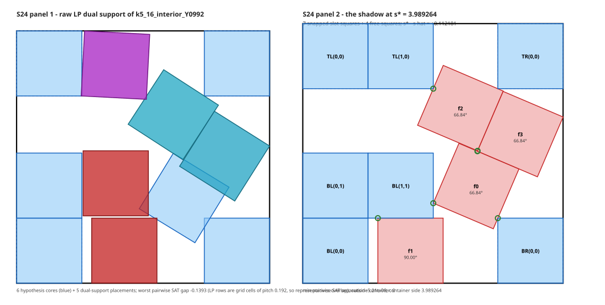

* **s\*** = 3.989264411 = s-hat +0.112180821  (s0 = 3.877084, s\* - s0 = +0.112180)
* **shadow** = 7 slot squares `BL(0,0) BL(0,1) BL(1,1) BR(0,0) TL(0,0) TL(1,0) TR(0,0)` + 4 free squares; a k11 packing.
* **explains** 2 alive-at-LP nodes: k5_11 x1, k5_16 x1; levels L1:2; integral 1, component 1 support.
* **load-bearing squares at this landing**: `f0` `f2` `f3` `BL(1,1)` `BR(0,0)` `TL(1,0)` (6 of 11); **2 distinct minimised configuration(s)** share this s*.
* **multiplicity**: 2 landings / slot-free splittings (7 slot + 4 free (1 nodes); 7 slot + 4 free (1 nodes)).
* the free squares do **not** share a tilt: f0 66.835 deg, f1 90.000 deg, f2 66.835 deg, f3 66.835 deg.
* **restarts**: 72 feasible of 101; distinct minima [3.98926, 4.0, 4.0001, 4.00025, 4.08342, 4.41421].

**Free square poses at s\***

| square | cx | cy | tilt (deg) |
|---|---|---|---|
| f0 | 2.656377 | 1.493041 | 66.8352 |
| f1 | 1.650834 | 0.500000 | 90.0000 |
| f2 | 2.415764 | 2.689918 | 66.8352 |
| f3 | 3.332887 | 2.291273 | 66.8352 |

**Contact graph at s\*** (gap < 1e-7; contact force = Fritz-John multiplier, rows unit-normalised)

| contact | type | gap | force |
|---|---|---|---|
| `f0` - `f3` | vertex-on-edge | -2.2e-08 | 0.2621 |
| `f0` - `BL(1,1)` | vertex-on-edge | +4.2e-15 | 0.4686 |
| `f0` - `BR(0,0)` | vertex-on-edge | -4.2e-15 | 0.5817 |
| `f1` - `BL(1,1)` | vertex-on-edge | -1.8e-12 | 0.0000 |
| `f2` - `f3` | vertex-on-edge | -5.2e-08 | 0.5930 |
| `f2` - `TL(1,0)` | vertex-on-edge | -1.4e-14 | 0.4500 |
| `f1` - bottom wall | wall | 0 | 0.0000 |
| `f3` - right wall | wall | 0 | 0.6517 |

**Binding** (largest Fritz-John resultant first): `f3`-`right wall` (0.652), `f2`-`f3` (0.593), `f0`-`BR(0,0)` (0.582), `f0`-`BL(1,1)` (0.469), `f2`-`TL(1,0)` (0.450), `f0`-`f3` (0.262).  KKT residual 1.4e-04.
**Convergence caveat**: KKT residual 1.4e-04 (> 1e-6).  The residual measures how far e_s is from the cone of the active CONTACT rows; it is nonzero when the landing also leans on a variable BOUND (s in [3.4, 4.6], centres in [0, 4.6]), which is not a contact and so is not in the Jacobian, or when SLSQP stopped short of a stationary point.  Either way s* = 3.989264 is an upper bound on this shadow's true value and the contact set may be mis-counted at the 1e-7 threshold.
**Rank**: 12 contact rows, 13 variables (s + 3 per free square); rank 10; at fixed s rank 10 of 12, so **2 flat direction(s)**.
  * flat direction 0: blocked at first order (rank tolerance artefact) (worst active gap changes by -1.04e-13 at |t| = 1e-3 and -3.12e-13 at 3e-3 and -1.04e-12 at 1e-2, ratios 3.0 / 10.0; 9 and 100 are the quadratic signature - curvature -1.040e-07).
  * flat direction 1: blocked at second order (worst active gap changes by -8.24e-13 at |t| = 1e-3 and -7.41e-12 at 3e-3 and -8.23e-11 at 1e-2, ratios 9.0 / 100.0; 9 and 100 are the quadratic signature - curvature -8.236e-07).

**T2 drain hint - the load-bearing subgraph** (remove one free square and re-minimise)

| removed | s* without it | drop | role |
|---|---|---|---|
| `f0` | 3.707107 | +0.282158 | load-bearing |
| `f1` | 3.989264 | +0.000000 | rattler |
| `f2` | 3.942809 | +0.046455 | load-bearing |
| `f3` | 3.985467 | +0.003798 | load-bearing |

**Idle contacts** (zero Fritz-John force - struts, not load paths): `f1`-`BL(1,1)`, `f1`-`bottom wall`.

Load-bearing free squares: `f0`, `f2`, `f3`.  Rattlers/struts (removal leaves s\* unchanged): `f1`.

**Alive nodes explained** (2; each id is src/shard/node(level).  Their pose boxes: A57 level-1 boxes are 0.1398 x 0.1398 x 9.73 deg and halve in every coordinate per level (A106 T1); the conditioned square pose of every node below is in `attempts/A107-shadow-gallery/results/shadow_nodes.json`): 
`A57/k5_11_interior_G1/k5_11_interior_Y0871(L1)` `A57/k5_16_interior_G1/k5_16_interior_Y0992(L1)`

## S25 - a k10 packing at s* = 3.728606 on the boundary of class k5_11

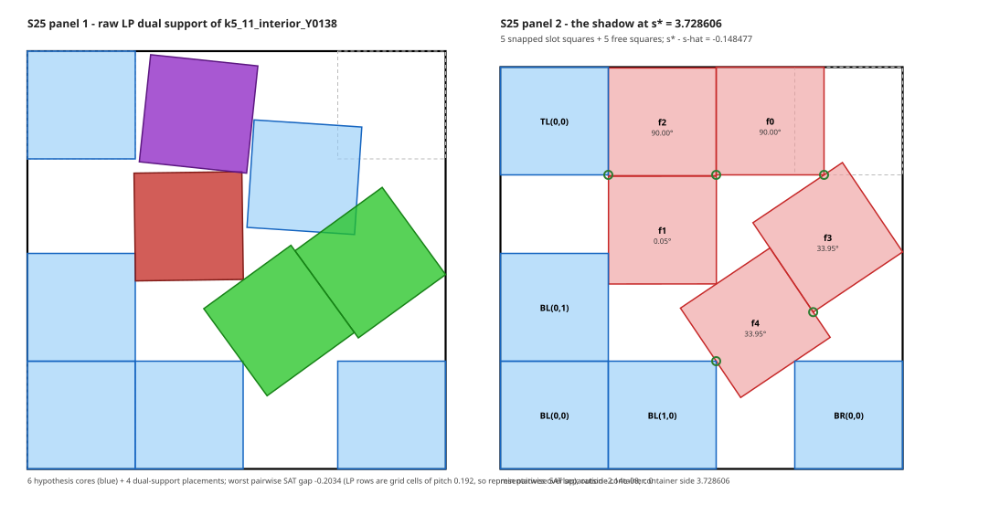

* **s\*** = 3.728606234 = s-hat -0.148477356  (s0 = 3.877084, s\* - s0 = -0.148478)
* **shadow** = 6 slot squares `BL(0,0) BL(0,1) BL(1,0) BR(0,0) TL(0,0)` `TL(2,0) (=f0)` + 4 free squares; a k10 packing.
  * **gallery v1 counted this as 5 slot + 5 free** (A121): `f0` sits on `TL(2,0)` to within 1e-3 in position and 0.05 deg of axis - snapped slot squares, not free ones.  The f-indices are kept everywhere below (contact graph, forces, flat directions, rattler table) so A121's review rows stay valid.
* **explains** 1 alive-at-LP nodes: k5_11 x1; levels L1:1; integral 1 support.
* **load-bearing squares at this landing**: `f0` `f2` `f3` `f4` `BL(1,0)` `TL(0,0)` (6 of 10); **1 distinct minimised configuration(s)** share this s*.
* **multiplicity**: 1 landings / slot-free splittings (5 slot + 5 free (1 nodes)).
* the free squares do **not** share a tilt: f0 90.000 deg, f1 0.046 deg, f2 90.000 deg, f3 33.949 deg, f4 33.949 deg.
* **restarts**: 62 feasible of 101; distinct minima [3.70711, 3.72858, 3.72861, 3.75534, 3.76777, 3.85822, 3.88675, 3.89443].

**Free square poses at s\***

| square | cx | cy | tilt (deg) |
|---|---|---|---|
| f0 | 2.500000 | 3.228606 | 90.0000 |
| f1 | 1.501742 | 2.216652 | 0.0459 |
| f2 | 1.500000 | 3.221113 | 90.0000 |
| f3 | 3.034612 | 2.149161 | 33.9488 |
| f4 | 2.362528 | 1.356825 | 33.9488 |

**Contact graph at s\*** (gap < 1e-7; contact force = Fritz-John multiplier, rows unit-normalised)

| contact | type | gap | force |
|---|---|---|---|
| `f0` - `f2` | vertex-on-edge | -2.1e-08 | 0.3371 |
| `f0` - `f3` | vertex-on-edge | -1.2e-14 | 0.5548 |
| `f2` - `TL(0,0)` | vertex-on-edge | -1.7e-08 | 0.2380 |
| `f3` - `f4` | vertex-on-edge | +2.4e-15 | 0.8275 |
| `f4` - `BL(1,0)` | vertex-on-edge | +1.8e-15 | 0.5672 |
| `f0` - top wall | wall | 0 | 0.4758 |
| `f3` - right wall | wall | 0 | 0.9700 |

**Binding** (largest Fritz-John resultant first): `f3`-`right wall` (0.970), `f3`-`f4` (0.827), `f4`-`BL(1,0)` (0.567), `f0`-`f3` (0.555), `f0`-`top wall` (0.476), `f0`-`f2` (0.337).  KKT residual 5.1e-03.
**Convergence caveat**: KKT residual 5.1e-03 (> 1e-6).  The residual measures how far e_s is from the cone of the active CONTACT rows; it is nonzero when the landing also leans on a variable BOUND (s in [3.4, 4.6], centres in [0, 4.6]), which is not a contact and so is not in the Jacobian, or when SLSQP stopped short of a stationary point.  Either way s* = 3.728606 is an upper bound on this shadow's true value and the contact set may be mis-counted at the 1e-7 threshold.
**Rank**: 11 contact rows, 16 variables (s + 3 per free square); rank 11; at fixed s rank 11 of 15, so **4 flat direction(s)**.
  * flat direction 0: free (flex to at least third order) (worst active gap changes by +0.00e+00 at |t| = 1e-3 and -2.22e-16 at 3e-3 and -3.33e-16 at 1e-2, no change at any step - a genuine one-parameter motion).
  * flat direction 1: blocked at second order (worst active gap changes by -1.01e-13 at |t| = 1e-3 and -9.11e-13 at 3e-3 and -1.01e-11 at 1e-2, ratios 8.99 / 99.8; 9 and 100 are the quadratic signature - curvature -1.014e-07).
  * flat direction 2: blocked at second order (worst active gap changes by -2.23e-13 at |t| = 1e-3 and -2.01e-12 at 3e-3 and -2.23e-11 at 1e-2, ratios 8.99 / 99.9; 9 and 100 are the quadratic signature - curvature -2.235e-07).
  * flat direction 3: free (flex to at least third order) (worst active gap changes by -2.22e-16 at |t| = 1e-3 and -4.44e-16 at 3e-3 and -2.22e-16 at 1e-2, ratios 2.0 / 1.0; 9 and 100 are the quadratic signature - curvature -2.220e-10).

**T2 drain hint - the load-bearing subgraph** (remove one free square and re-minimise)

| removed | s* without it | drop | role |
|---|---|---|---|
| `f0` | 3.707107 | +0.021500 | load-bearing |
| `f1` | 3.400000 | +0.328606 | load-bearing |
| `f2` | 3.707107 | +0.021499 | load-bearing |
| `f3` | 3.707107 | +0.021499 | load-bearing |
| `f4` | 3.400000 | +0.328606 | load-bearing |

Load-bearing free squares: `f0`, `f1`, `f2`, `f3`, `f4`.  Rattlers/struts (removal leaves s\* unchanged): none.

**Alive nodes explained** (1; each id is src/shard/node(level).  Their pose boxes: A57 level-1 boxes are 0.1398 x 0.1398 x 9.73 deg and halve in every coordinate per level (A106 T1); the conditioned square pose of every node below is in `attempts/A107-shadow-gallery/results/shadow_nodes.json`): 
`A57/k5_11_interior_G1/k5_11_interior_Y0138(L1)`

## S26 - a k10 packing at s* = 3.822889 on the boundary of class k5_16

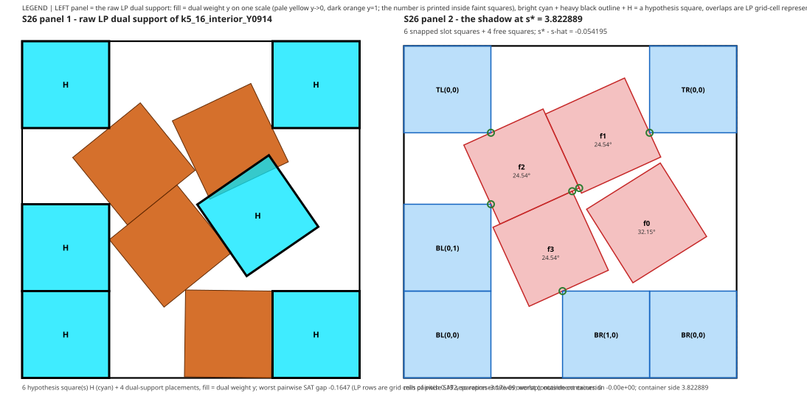

* **s\*** = 3.822888964 = s-hat -0.054194626  (s0 = 3.877084, s\* - s0 = -0.054195)
* **shadow** = 6 slot squares `BL(0,0) BL(0,1) BR(0,0) BR(1,0) TL(0,0) TR(0,0)` + 4 free squares; a k10 packing.
* **explains** 1 alive-at-LP nodes: k5_16 x1; levels L1:1; integral 1 support.
* **load-bearing squares at this landing**: `f1` `f2` `f3` `BL(0,1)` `BR(1,0)` `TL(0,0)` `TR(0,0)` (7 of 10); **1 distinct minimised configuration(s)** share this s*.
* **multiplicity**: 1 landings / slot-free splittings (6 slot + 4 free (1 nodes)).
* the free squares do **not** share a tilt: f0 32.152 deg, f1 24.536 deg, f2 24.536 deg, f3 24.536 deg.
* **restarts**: 73 feasible of 101; distinct minima [3.70711, 3.76777, 3.76812, 3.82288, 3.82289, 3.88509, 3.88675, 3.89987].

**Free square poses at s\***

| square | cx | cy | tilt (deg) |
|---|---|---|---|
| f0 | 2.788847 | 1.785127 | 32.1516 |
| f1 | 2.288055 | 2.790475 | 24.5358 |
| f2 | 1.351624 | 2.433768 | 24.5358 |
| f3 | 1.686328 | 1.487293 | 24.5358 |

**Contact graph at s\*** (gap < 1e-7; contact force = Fritz-John multiplier, rows unit-normalised)

| contact | type | gap | force |
|---|---|---|---|
| `f1` - `f2` | vertex-on-edge | -1.6e-10 | 0.0047 |
| `f1` - `TR(0,0)` | vertex-on-edge | +8.4e-13 | 0.0044 |
| `f2` - `f3` | vertex-on-edge | -3.2e-09 | 1.0720 |
| `f2` - `BL(0,1)` | vertex-on-edge | +2.6e-13 | 0.0036 |
| `f2` - `TL(0,0)` | vertex-on-edge | +8.9e-10 | 1.0239 |
| `f3` - `BR(1,0)` | vertex-on-edge | +8.8e-14 | 0.8161 |

**Binding** (largest Fritz-John resultant first): `f2`-`f3` (1.072), `f2`-`TL(0,0)` (1.024), `f3`-`BR(1,0)` (0.816), `f1`-`f2` (0.005), `f1`-`TR(0,0)` (0.004), `f2`-`BL(0,1)` (0.004).  KKT residual 3.6e-03.
**Convergence caveat**: KKT residual 3.6e-03 (> 1e-6).  The residual measures how far e_s is from the cone of the active CONTACT rows; it is nonzero when the landing also leans on a variable BOUND (s in [3.4, 4.6], centres in [0, 4.6]), which is not a contact and so is not in the Jacobian, or when SLSQP stopped short of a stationary point.  Either way s* = 3.822889 is an upper bound on this shadow's true value and the contact set may be mis-counted at the 1e-7 threshold.
**Rank**: 8 contact rows, 13 variables (s + 3 per free square); rank 7; at fixed s rank 7 of 12, so **5 flat direction(s)**.
  * flat direction 0: blocked at first order (rank tolerance artefact) (worst active gap changes by -6.49e-13 at |t| = 1e-3 and -2.91e-12 at 3e-3 and -2.09e-11 at 1e-2, ratios 4.48 / 32.2; 9 and 100 are the quadratic signature - curvature -6.493e-07).
  * flat direction 1: free (flex to at least third order) (worst active gap changes by -2.22e-16 at |t| = 1e-3 and -2.22e-16 at 3e-3 and -3.33e-16 at 1e-2, ratios 1.0 / 1.5; 9 and 100 are the quadratic signature - curvature -2.220e-10).
  * flat direction 2: blocked at second order (worst active gap changes by -6.11e-15 at |t| = 1e-3 and -5.52e-14 at 3e-3 and -6.12e-13 at 1e-2, ratios 9.04 / 100.3; 9 and 100 are the quadratic signature - curvature -6.106e-09).
  * flat direction 3: blocked at second order (worst active gap changes by -2.00e-15 at |t| = 1e-3 and -1.80e-14 at 3e-3 and -1.97e-13 at 1e-2, ratios 9.0 / 98.4; 9 and 100 are the quadratic signature - curvature -1.998e-09).
  * flat direction 4: free (flex to at least third order) (worst active gap changes by -2.22e-16 at |t| = 1e-3 and -2.22e-16 at 3e-3 and -4.44e-16 at 1e-2, ratios 1.0 / 2.0; 9 and 100 are the quadratic signature - curvature -2.220e-10).

**T2 drain hint - the load-bearing subgraph** (remove one free square and re-minimise)

| removed | s* without it | drop | role |
|---|---|---|---|
| `f0` | 3.822876 | +0.000013 | load-bearing |
| `f1` | 3.400000 | +0.422889 | load-bearing |
| `f2` | 3.400000 | +0.422889 | load-bearing |
| `f3` | 3.822876 | +0.000013 | load-bearing |

Load-bearing free squares: `f0`, `f1`, `f2`, `f3`.  Rattlers/struts (removal leaves s\* unchanged): none.

**Alive nodes explained** (1; each id is src/shard/node(level).  Their pose boxes: A57 level-1 boxes are 0.1398 x 0.1398 x 9.73 deg and halve in every coordinate per level (A106 T1); the conditioned square pose of every node below is in `attempts/A107-shadow-gallery/results/shadow_nodes.json`): 
`A57/k5_16_interior_G1/k5_16_interior_Y0914(L1)`

## S27 - a k10 packing at s* = 3.823521 on the boundary of class k5_16

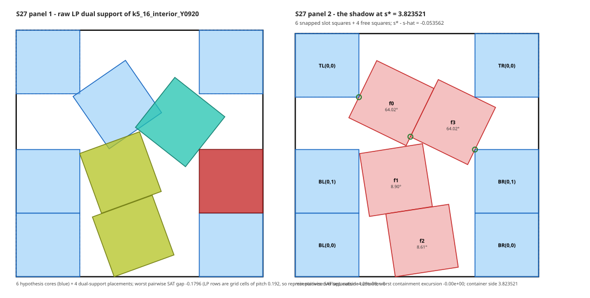

* **s\*** = 3.823521494 = s-hat -0.053562096  (s0 = 3.877084, s\* - s0 = -0.053563)
* **shadow** = 6 slot squares `BL(0,0) BL(0,1) BR(0,0) BR(0,1) TL(0,0) TR(0,0)` + 4 free squares; a k10 packing.
* **explains** 1 alive-at-LP nodes: k5_16 x1; levels L1:1; integral 1 support.
* **load-bearing squares at this landing**: `f0` `f3` `BR(0,1)` `TL(0,0)` (4 of 10); **1 distinct minimised configuration(s)** share this s*.
* **multiplicity**: 1 landings / slot-free splittings (6 slot + 4 free (1 nodes)).
* the free squares do **not** share a tilt: f0 64.021 deg, f1 8.903 deg, f2 8.608 deg, f3 64.021 deg.
* **restarts**: 69 feasible of 101; distinct minima [3.70711, 3.82288, 3.82352, 3.88675, 4.0].

**Free square poses at s\***

| square | cx | cy | tilt (deg) |
|---|---|---|---|
| f0 | 1.510697 | 2.730137 | 64.0211 |
| f1 | 1.582668 | 1.520023 | 8.9029 |
| f2 | 1.991844 | 0.569245 | 8.6084 |
| f3 | 2.477728 | 2.431802 | 64.0211 |

**Contact graph at s\*** (gap < 1e-7; contact force = Fritz-John multiplier, rows unit-normalised)

| contact | type | gap | force |
|---|---|---|---|
| `f0` - `f3` | vertex-on-edge | -4.3e-08 | 1.0742 |
| `f0` - `TL(0,0)` | vertex-on-edge | -2.9e-09 | 0.8163 |
| `f3` - `BR(0,1)` | vertex-on-edge | +2.2e-09 | 1.0240 |

**Binding** (largest Fritz-John resultant first): `f0`-`f3` (1.074), `f3`-`BR(0,1)` (1.024), `f0`-`TL(0,0)` (0.816).  KKT residual 3.0e-02.
**Convergence caveat**: KKT residual 3.0e-02 (> 1e-6).  The residual measures how far e_s is from the cone of the active CONTACT rows; it is nonzero when the landing also leans on a variable BOUND (s in [3.4, 4.6], centres in [0, 4.6]), which is not a contact and so is not in the Jacobian, or when SLSQP stopped short of a stationary point.  Either way s* = 3.823521 is an upper bound on this shadow's true value and the contact set may be mis-counted at the 1e-7 threshold.
**Rank**: 4 contact rows, 13 variables (s + 3 per free square); rank 4; at fixed s rank 4 of 12, so **8 flat direction(s)**.
  * flat direction 0: free (flex to at least third order) (worst active gap changes by +0.00e+00 at |t| = 1e-3 and +0.00e+00 at 3e-3 and +0.00e+00 at 1e-2, no change at any step - a genuine one-parameter motion).
  * flat direction 1: free (flex to at least third order) (worst active gap changes by +0.00e+00 at |t| = 1e-3 and +0.00e+00 at 3e-3 and +0.00e+00 at 1e-2, no change at any step - a genuine one-parameter motion).
  * flat direction 2: free (flex to at least third order) (worst active gap changes by +0.00e+00 at |t| = 1e-3 and +0.00e+00 at 3e-3 and +0.00e+00 at 1e-2, no change at any step - a genuine one-parameter motion).
  * flat direction 3: free (flex to at least third order) (worst active gap changes by +0.00e+00 at |t| = 1e-3 and +0.00e+00 at 3e-3 and +0.00e+00 at 1e-2, no change at any step - a genuine one-parameter motion).
  * flat direction 4: free (flex to at least third order) (worst active gap changes by +0.00e+00 at |t| = 1e-3 and +0.00e+00 at 3e-3 and +0.00e+00 at 1e-2, no change at any step - a genuine one-parameter motion).
  * flat direction 5: free (flex to at least third order) (worst active gap changes by -7.77e-16 at |t| = 1e-3 and -5.88e-15 at 3e-3 and -6.37e-14 at 1e-2, ratios 7.57 / 82.0; 9 and 100 are the quadratic signature - curvature -7.772e-10).
  * flat direction 6: blocked at second order (worst active gap changes by -4.77e-15 at |t| = 1e-3 and -4.21e-14 at 3e-3 and -4.67e-13 at 1e-2, ratios 8.81 / 97.8; 9 and 100 are the quadratic signature - curvature -4.774e-09).
  * flat direction 7: blocked at second order (worst active gap changes by -1.33e-15 at |t| = 1e-3 and -1.04e-14 at 3e-3 and -1.14e-13 at 1e-2, ratios 7.83 / 85.8; 9 and 100 are the quadratic signature - curvature -1.332e-09).

**T2 drain hint - the load-bearing subgraph** (remove one free square and re-minimise)

| removed | s* without it | drop | role |
|---|---|---|---|
| `f0` | 3.707107 | +0.116415 | load-bearing |
| `f1` | 3.400000 | +0.423521 | load-bearing |
| `f2` | 3.400000 | +0.423521 | load-bearing |
| `f3` | 3.400000 | +0.423521 | load-bearing |

Load-bearing free squares: `f0`, `f1`, `f2`, `f3`.  Rattlers/struts (removal leaves s\* unchanged): none.

**Alive nodes explained** (1; each id is src/shard/node(level).  Their pose boxes: A57 level-1 boxes are 0.1398 x 0.1398 x 9.73 deg and halve in every coordinate per level (A106 T1); the conditioned square pose of every node below is in `attempts/A107-shadow-gallery/results/shadow_nodes.json`): 
`A57/k5_16_interior_G1/k5_16_interior_Y0920(L1)`

## S28 - a k10 packing at s* = 3.825844 on the boundary of class k5_16

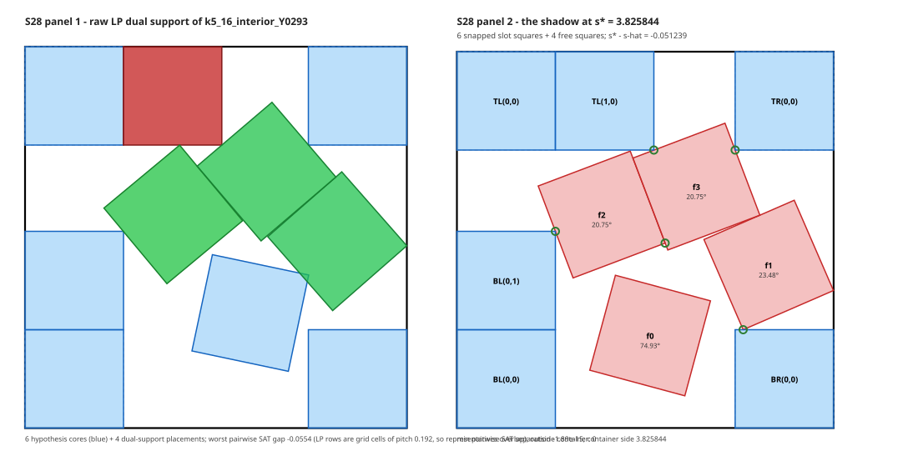

* **s\*** = 3.825844092 = s-hat -0.051239498  (s0 = 3.877084, s\* - s0 = -0.051240)
* **shadow** = 6 slot squares `BL(0,0) BL(0,1) BR(0,0) TL(0,0) TL(1,0) TR(0,0)` + 4 free squares; a k10 packing.
* **explains** 1 alive-at-LP nodes: k5_16 x1; levels L1:1; integral 1 support.
* **load-bearing squares at this landing**: `f2` `f3` `BL(0,1)` `TR(0,0)` (4 of 10); **1 distinct minimised configuration(s)** share this s*.
* **multiplicity**: 1 landings / slot-free splittings (6 slot + 4 free (1 nodes)).
* the free squares do **not** share a tilt: f0 74.933 deg, f1 23.485 deg, f2 20.750 deg, f3 20.750 deg.
* **restarts**: 73 feasible of 101; distinct minima [3.70711, 3.76779, 3.76853, 3.82288, 3.82584, 3.85822, 3.90453, 3.90964].

**Free square poses at s\***

| square | cx | cy | tilt (deg) |
|---|---|---|---|
| f0 | 1.961992 | 0.940731 | 74.9331 |
| f1 | 3.166174 | 1.657836 | 23.4849 |
| f2 | 1.470034 | 2.170635 | 20.7499 |
| f3 | 2.431760 | 2.454741 | 20.7499 |

**Contact graph at s\*** (gap < 1e-7; contact force = Fritz-John multiplier, rows unit-normalised)

| contact | type | gap | force |
|---|---|---|---|
| `f1` - `BR(0,0)` | vertex-on-edge | +7.2e-10 | 0.0000 |
| `f2` - `f3` | vertex-on-edge | +2.1e-11 | 1.1042 |
| `f2` - `BL(0,1)` | vertex-on-edge | -1.3e-15 | 0.7762 |
| `f3` - `TL(1,0)` | vertex-on-edge | +4.1e-08 | 0.0000 |
| `f3` - `TR(0,0)` | vertex-on-edge | -1.9e-15 | 1.2697 |

**Binding** (largest Fritz-John resultant first): `f3`-`TR(0,0)` (1.270), `f2`-`f3` (1.104), `f2`-`BL(0,1)` (0.776).  KKT residual 6.8e-02.
**Convergence caveat**: KKT residual 6.8e-02 (> 1e-6).  The residual measures how far e_s is from the cone of the active CONTACT rows; it is nonzero when the landing also leans on a variable BOUND (s in [3.4, 4.6], centres in [0, 4.6]), which is not a contact and so is not in the Jacobian, or when SLSQP stopped short of a stationary point.  Either way s* = 3.825844 is an upper bound on this shadow's true value and the contact set may be mis-counted at the 1e-7 threshold.
**Rank**: 6 contact rows, 13 variables (s + 3 per free square); rank 6; at fixed s rank 6 of 12, so **6 flat direction(s)**.
  * flat direction 0: blocked at second order (worst active gap changes by -1.11e-15 at |t| = 1e-3 and -1.09e-14 at 3e-3 and -1.20e-13 at 1e-2, ratios 9.8 / 107.9; 9 and 100 are the quadratic signature - curvature -1.110e-09).
  * flat direction 1: blocked at second order (worst active gap changes by -8.44e-15 at |t| = 1e-3 and -7.53e-14 at 3e-3 and -8.36e-13 at 1e-2, ratios 8.92 / 99.1; 9 and 100 are the quadratic signature - curvature -8.438e-09).
  * flat direction 2: free (flex to at least third order) (worst active gap changes by +0.00e+00 at |t| = 1e-3 and +0.00e+00 at 3e-3 and +0.00e+00 at 1e-2, no change at any step - a genuine one-parameter motion).
  * flat direction 3: free (flex to at least third order) (worst active gap changes by +0.00e+00 at |t| = 1e-3 and +0.00e+00 at 3e-3 and +0.00e+00 at 1e-2, no change at any step - a genuine one-parameter motion).
  * flat direction 4: free (flex to at least third order) (worst active gap changes by +0.00e+00 at |t| = 1e-3 and +0.00e+00 at 3e-3 and +0.00e+00 at 1e-2, no change at any step - a genuine one-parameter motion).
  * flat direction 5: free (flex to at least third order) (worst active gap changes by +0.00e+00 at |t| = 1e-3 and +0.00e+00 at 3e-3 and +0.00e+00 at 1e-2, no change at any step - a genuine one-parameter motion).

**T2 drain hint - the load-bearing subgraph** (remove one free square and re-minimise)

| removed | s* without it | drop | role |
|---|---|---|---|
| `f0` | 3.822876 | +0.002968 | load-bearing |
| `f1` | 3.400000 | +0.425844 | load-bearing |
| `f2` | 3.707107 | +0.118737 | load-bearing |
| `f3` | 3.400000 | +0.425844 | load-bearing |

**Idle contacts** (zero Fritz-John force - struts, not load paths): `f1`-`BR(0,0)`, `f3`-`TL(1,0)`.

Load-bearing free squares: `f0`, `f1`, `f2`, `f3`.  Rattlers/struts (removal leaves s\* unchanged): none.

**Alive nodes explained** (1; each id is src/shard/node(level).  Their pose boxes: A57 level-1 boxes are 0.1398 x 0.1398 x 9.73 deg and halve in every coordinate per level (A106 T1); the conditioned square pose of every node below is in `attempts/A107-shadow-gallery/results/shadow_nodes.json`): 
`A57/k5_16_interior_L1/k5_16_interior_Y0293(L1)`

## S29 - a k11 packing at s* = 3.886761 on the boundary of class k5_16

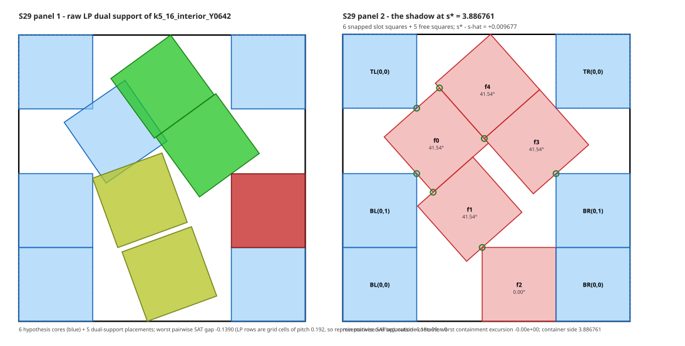

* **s\*** = 3.886760521 = s-hat +0.009676931  (s0 = 3.877084, s\* - s0 = +0.009677)
* **shadow** = 7 slot squares `BL(0,0) BL(0,1) BR(0,0) BR(0,1) TL(0,0) TR(0,0)` `BR(1,0) (=f2)` + 4 free squares; a k11 packing.
  * **gallery v1 counted this as 6 slot + 5 free** (A121): `f2` sits on `BR(1,0)` to within 1e-3 in position and 0.05 deg of axis - snapped slot squares, not free ones.  The f-indices are kept everywhere below (contact graph, forces, flat directions, rattler table) so A121's review rows stay valid.
* **explains** 1 alive-at-LP nodes: k5_16 x1; levels L1:1; integral 1 support.
* **load-bearing squares at this landing**: `f0` `f1` `f3` `f4` `BL(0,1)` `BR(0,1)` (6 of 11); **1 distinct minimised configuration(s)** share this s*.
* **multiplicity**: 1 landings / slot-free splittings (6 slot + 5 free (1 nodes)).
* the free squares do **not** share a tilt: f0 41.543 deg, f1 41.541 deg, f2 0.000 deg, f3 41.543 deg, f4 41.543 deg.
* **restarts**: 77 feasible of 101; distinct minima [3.88676, 3.91421, 3.92471, 3.94281, 4.0, 4.00003].

**Free square poses at s\***

| square | cx | cy | tilt (deg) |
|---|---|---|---|
| f0 | 1.265664 | 2.454116 | 41.5428 |
| f1 | 1.717969 | 1.518800 | 41.5414 |
| f2 | 2.386683 | 0.500260 | 0.0000 |
| f3 | 2.620914 | 2.432483 | 41.5428 |
| f4 | 1.957732 | 3.180941 | 41.5428 |

**Contact graph at s\*** (gap < 1e-7; contact force = Fritz-John multiplier, rows unit-normalised)

| contact | type | gap | force |
|---|---|---|---|
| `f0` - `f1` | vertex-on-edge | +3.8e-08 | 0.0043 |
| `f0` - `f4` | vertex-on-edge | -6.2e-09 | 0.6314 |
| `f0` - `BL(0,1)` | vertex-on-edge | -3.3e-13 | 0.4432 |
| `f3` - `f4` | exactly-opposite | -2.6e-10 | 0.7121 |
| `f3` - `BR(0,1)` | vertex-on-edge | +3.5e-13 | 0.6036 |
| `f4` - top wall | wall | 0 | 0.9435 |

**Binding** (largest Fritz-John resultant first): `f4`-`top wall` (0.943), `f3`-`f4` (0.712), `f0`-`f4` (0.631), `f3`-`BR(0,1)` (0.604), `f0`-`BL(0,1)` (0.443), `f0`-`f1` (0.004).  KKT residual 2.1e-02.  Exactly-opposite (vertex-vertex) contacts, whose normal is a cone and whose individual multipliers are therefore ill-conditioned: `f3`-`f4`.
**Convergence caveat**: KKT residual 2.1e-02 (> 1e-6).  The residual measures how far e_s is from the cone of the active CONTACT rows; it is nonzero when the landing also leans on a variable BOUND (s in [3.4, 4.6], centres in [0, 4.6]), which is not a contact and so is not in the Jacobian, or when SLSQP stopped short of a stationary point.  Either way s* = 3.886761 is an upper bound on this shadow's true value and the contact set may be mis-counted at the 1e-7 threshold.
**Rank**: 11 contact rows, 16 variables (s + 3 per free square); rank 10; at fixed s rank 10 of 15, so **5 flat direction(s)**.
  * flat direction 0: free (flex to at least third order) (worst active gap changes by -2.22e-16 at |t| = 1e-3 and -1.11e-15 at 3e-3 and -1.25e-14 at 1e-2, ratios 5.0 / 56.5; 9 and 100 are the quadratic signature - curvature -2.220e-10).
  * flat direction 1: blocked at second order (worst active gap changes by -1.41e-14 at |t| = 1e-3 and -1.27e-13 at 3e-3 and -1.41e-12 at 1e-2, ratios 9.01 / 99.9; 9 and 100 are the quadratic signature - curvature -1.410e-08).
  * flat direction 2: free (flex to at least third order) (worst active gap changes by -2.22e-16 at |t| = 1e-3 and -3.55e-15 at 3e-3 and -3.75e-14 at 1e-2, ratios 16.0 / 169.0; 9 and 100 are the quadratic signature - curvature -2.220e-10).
  * flat direction 3: blocked at second order (worst active gap changes by -1.11e-15 at |t| = 1e-3 and -8.88e-15 at 3e-3 and -1.01e-13 at 1e-2, ratios 8.0 / 91.2; 9 and 100 are the quadratic signature - curvature -1.110e-09).
  * flat direction 4: blocked at second order (worst active gap changes by -5.55e-15 at |t| = 1e-3 and -5.00e-14 at 3e-3 and -5.58e-13 at 1e-2, ratios 9.0 / 100.4; 9 and 100 are the quadratic signature - curvature -5.551e-09).

**T2 drain hint - the load-bearing subgraph** (remove one free square and re-minimise)

| removed | s* without it | drop | role |
|---|---|---|---|
| `f0` | 3.767767 | +0.118994 | load-bearing |
| `f1` | 3.767889 | +0.118872 | load-bearing |
| `f2` | 3.886746 | +0.000015 | load-bearing |
| `f3` | 3.768118 | +0.118643 | load-bearing |
| `f4` | 3.767767 | +0.118994 | load-bearing |

Load-bearing free squares: `f0`, `f1`, `f2`, `f3`, `f4`.  Rattlers/struts (removal leaves s\* unchanged): none.

**Alive nodes explained** (1; each id is src/shard/node(level).  Their pose boxes: A57 level-1 boxes are 0.1398 x 0.1398 x 9.73 deg and halve in every coordinate per level (A106 T1); the conditioned square pose of every node below is in `attempts/A107-shadow-gallery/results/shadow_nodes.json`): 
`A57/k5_16_interior_G1/k5_16_interior_Y0642(L1)`

## S30 - a k11 packing at s* = 3.897231 on the boundary of class k5_11

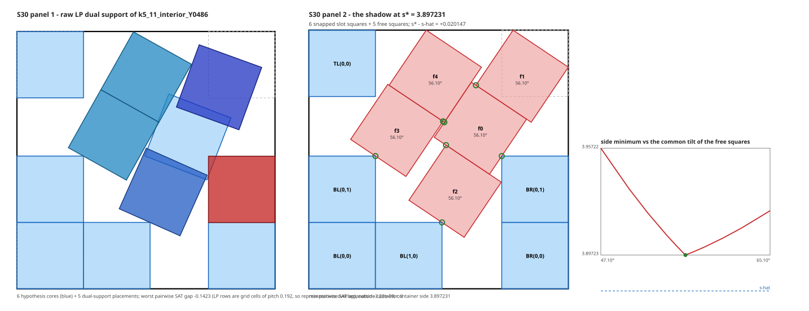

* **s\*** = 3.897230788 = s-hat +0.020147198  (s0 = 3.877084, s\* - s0 = +0.020147)
* **shadow** = 6 slot squares `BL(0,0) BL(0,1) BL(1,0) BR(0,0) BR(0,1) TL(0,0)` + 5 free squares; a k11 packing.
* **explains** 1 alive-at-LP nodes: k5_11 x1; levels L1:1; integral 1 support.
* **load-bearing squares at this landing**: `f0` `f1` `f2` `f3` `f4` `BL(0,1)` `BL(1,0)` `BR(0,1)` (8 of 11); **1 distinct minimised configuration(s)** share this s*.
* **multiplicity**: 1 landings / slot-free splittings (6 slot + 5 free (1 nodes)).
* **the free squares share one tilt**: 56.1037 deg (spread 4.25e-06 deg).
* **restarts**: 73 feasible of 101; distinct minima [3.88675, 3.89723, 3.90267, 3.91421, 4.0].

**Free square poses at s\***

| square | cx | cy | tilt (deg) |
|---|---|---|---|
| f0 | 2.576776 | 2.419600 | 56.1037 |
| f1 | 3.203361 | 3.203361 | 56.1037 |
| f2 | 2.196334 | 1.470462 | 56.1037 |
| f3 | 1.321127 | 2.386616 | 56.1037 |
| f4 | 1.898619 | 3.203361 | 56.1037 |

**Contact graph at s\*** (gap < 1e-7; contact force = Fritz-John multiplier, rows unit-normalised)

| contact | type | gap | force |
|---|---|---|---|
| `f0` - `f1` | vertex-on-edge | +5.4e-08 | 0.2894 |
| `f0` - `f2` | vertex-on-edge | -1.5e-08 | 0.2937 |
| `f0` - `f4` | vertex-on-edge | -3.2e-08 | 0.3914 |
| `f0` - `BR(0,1)` | vertex-on-edge | -7.7e-13 | 0.3594 |
| `f2` - `BL(1,0)` | vertex-on-edge | +1.7e-10 | 0.2033 |
| `f3` - `f4` | vertex-on-edge | -1.0e-08 | 0.5783 |
| `f3` - `BL(0,1)` | vertex-on-edge | -2.1e-10 | 0.4086 |
| `f1` - right wall | wall | 0 | 0.1603 |
| `f1` - top wall | wall | 0 | 0.2386 |
| `f4` - top wall | wall | 0 | 0.6985 |

**Binding** (largest Fritz-John resultant first): `f4`-`top wall` (0.699), `f3`-`f4` (0.578), `f3`-`BL(0,1)` (0.409), `f0`-`f4` (0.391), `f0`-`BR(0,1)` (0.359), `f0`-`f2` (0.294).  KKT residual 2.1e-09.
**Rank**: 14 contact rows, 16 variables (s + 3 per free square); rank 14; at fixed s rank 13 of 15, so **2 flat direction(s)**.
  * flat direction 0: blocked at first order (rank tolerance artefact) (worst active gap changes by -1.40e-12 at |t| = 1e-3 and -4.20e-12 at 3e-3 and -1.40e-11 at 1e-2, ratios 3.0 / 10.0; 9 and 100 are the quadratic signature - curvature -1.402e-06).
  * flat direction 1: blocked at second order (worst active gap changes by -2.86e-14 at |t| = 1e-3 and -2.57e-13 at 3e-3 and -2.86e-12 at 1e-2, ratios 8.98 / 99.7; 9 and 100 are the quadratic signature - curvature -2.864e-08).

**T2 drain hint - the load-bearing subgraph** (remove one free square and re-minimise)

| removed | s* without it | drop | role |
|---|---|---|---|
| `f0` | 3.728581 | +0.168650 | load-bearing |
| `f1` | 3.885618 | +0.011613 | load-bearing |
| `f2` | 3.858217 | +0.039014 | load-bearing |
| `f3` | 3.822876 | +0.074355 | load-bearing |
| `f4` | 3.858219 | +0.039012 | load-bearing |

Load-bearing free squares: `f0`, `f1`, `f2`, `f3`, `f4`.  Rattlers/struts (removal leaves s\* unchanged): none.

**Common-tilt sweep** (all free squares held at one tilt, slot squares fixed, s minimised)

| tilt (deg) | 47.10 | 50.10 | 52.10 | 54.10 | 55.10 | 55.70 | 56.10 | 56.50 | 57.10 | 58.10 | 60.10 | 62.10 | 65.10 |
|---|---|---|---|---|---|---|---|---|---|---|---|---|---|
| s* | 3.957223 | 3.934450 | 3.920809 | 3.908398 | 3.902658 | 3.899364 | 3.897231 | 3.898067 | 3.899373 | 3.901683 | 3.906789 | 3.912508 | 3.922122 |

**Alive nodes explained** (1; each id is src/shard/node(level).  Their pose boxes: A57 level-1 boxes are 0.1398 x 0.1398 x 9.73 deg and halve in every coordinate per level (A106 T1); the conditioned square pose of every node below is in `attempts/A107-shadow-gallery/results/shadow_nodes.json`): 
`A57/k5_11_interior_G1/k5_11_interior_Y0486(L1)`

## S31 - a k11 packing at s* = 3.907472 on the boundary of class trump5

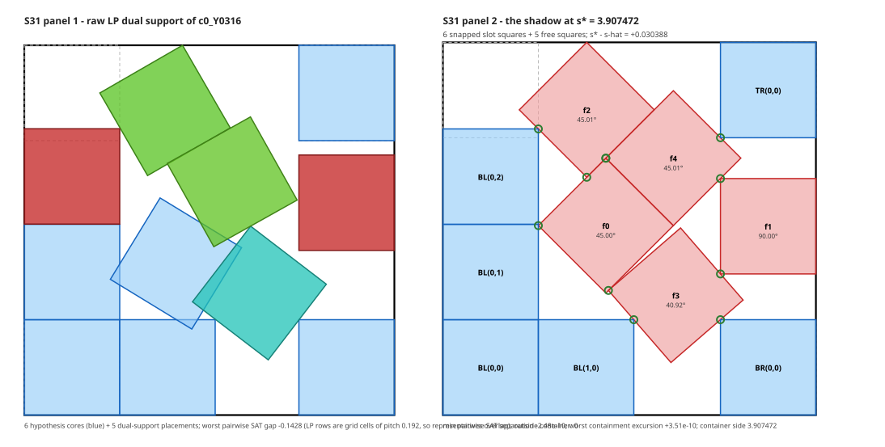

* **s\*** = 3.907471834 = s-hat +0.030388244  (s0 = 3.877084, s\* - s0 = +0.030388)
* **shadow** = 6 slot squares `BL(0,0) BL(0,1) BL(0,2) BL(1,0) BR(0,0) TR(0,0)` + 5 free squares; a k11 packing.
* **explains** 1 alive-at-LP nodes: trump5 x1; levels L1:1; component 1 support.
* **load-bearing squares at this landing**: `f0` `f1` `f2` `f3` `f4` `BL(0,1)` `BL(0,2)` `BL(1,0)` `BR(0,0)` `TR(0,0)` (10 of 11); **1 distinct minimised configuration(s)** share this s*.
* **multiplicity**: 1 landings / slot-free splittings (6 slot + 5 free (1 nodes)).
* the free squares do **not** share a tilt: f0 45.000 deg, f1 90.000 deg, f2 45.008 deg, f3 40.919 deg, f4 45.008 deg.
* **restarts**: 55 feasible of 101; distinct minima [3.88675, 3.90747, 3.94281, 4.0, 4.47487].

**Free square poses at s\***

| square | cx | cy | tilt (deg) |
|---|---|---|---|
| f0 | 1.707107 | 1.986381 | 44.9998 |
| f1 | 3.407472 | 1.979825 | 90.0000 |
| f2 | 1.506783 | 3.200365 | 45.0077 |
| f3 | 2.439640 | 1.256174 | 40.9190 |
| f4 | 2.414188 | 2.693611 | 45.0077 |

**Contact graph at s\*** (gap < 1e-7; contact force = Fritz-John multiplier, rows unit-normalised)

| contact | type | gap | force |
|---|---|---|---|
| `f0` - `f2` | vertex-on-edge | +5.6e-08 | 0.0080 |
| `f0` - `f3` | vertex-on-edge | -2.0e-15 | 0.1594 |
| `f0` - `f4` | vertex-on-edge | +6.7e-15 | 0.1529 |
| `f0` - `BL(0,1)` | vertex-on-edge | +6.7e-16 | 0.1370 |
| `f1` - `f3` | vertex-on-edge | +1.1e-16 | 0.4121 |
| `f1` - `f4` | vertex-on-edge | -6.7e-16 | 0.3836 |
| `f2` - `f4` | vertex-on-edge | -2.5e-10 | 0.3852 |
| `f2` - `BL(0,2)` | vertex-on-edge | -3.3e-16 | 0.2803 |
| `f3` - `BL(1,0)` | vertex-on-edge | +7.8e-16 | 0.2838 |
| `f3` - `BR(0,0)` | vertex-on-edge | +1.1e-16 | 0.1235 |
| `f4` - `TR(0,0)` | vertex-on-edge | -1.1e-14 | 0.1686 |
| `f1` - right wall | wall | 0 | 0.5786 |
| `f2` - top wall | wall | 0 | 0.5479 |

**Binding** (largest Fritz-John resultant first): `f1`-`right wall` (0.579), `f2`-`top wall` (0.548), `f1`-`f3` (0.412), `f2`-`f4` (0.385), `f1`-`f4` (0.384), `f3`-`BL(1,0)` (0.284).  KKT residual 3.5e-04.
**Convergence caveat**: KKT residual 3.5e-04 (> 1e-6).  The residual measures how far e_s is from the cone of the active CONTACT rows; it is nonzero when the landing also leans on a variable BOUND (s in [3.4, 4.6], centres in [0, 4.6]), which is not a contact and so is not in the Jacobian, or when SLSQP stopped short of a stationary point.  Either way s* = 3.907472 is an upper bound on this shadow's true value and the contact set may be mis-counted at the 1e-7 threshold.
**Rank**: 15 contact rows, 16 variables (s + 3 per free square); rank 15; at fixed s rank 15 of 15, so **0 flat direction(s)**.
  * no flat directions: the shadow is first-order rigid at fixed s.

**T2 drain hint - the load-bearing subgraph** (remove one free square and re-minimise)

| removed | s* without it | drop | role |
|---|---|---|---|
| `f0` | 3.707107 | +0.200365 | load-bearing |
| `f1` | 3.885618 | +0.021854 | load-bearing |
| `f2` | 3.707107 | +0.200365 | load-bearing |
| `f3` | 3.767767 | +0.139705 | load-bearing |
| `f4` | 3.767767 | +0.139705 | load-bearing |

Load-bearing free squares: `f0`, `f1`, `f2`, `f3`, `f4`.  Rattlers/struts (removal leaves s\* unchanged): none.

**Alive nodes explained** (1; each id is src/shard/node(level).  Their pose boxes: A57 level-1 boxes are 0.1398 x 0.1398 x 9.73 deg and halve in every coordinate per level (A106 T1); the conditioned square pose of every node below is in `attempts/A107-shadow-gallery/results/shadow_nodes.json`): 
`A60/nodes/c0_Y0316(L1)`

## S32 - a k11 packing at s* = 3.912250 on the boundary of class k5_16

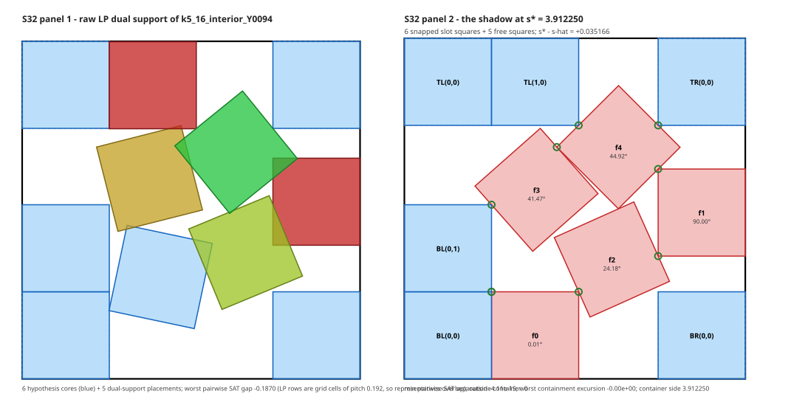

* **s\*** = 3.912250002 = s-hat +0.035166412  (s0 = 3.877084, s\* - s0 = +0.035166)
* **shadow** = 7 slot squares `BL(0,0) BL(0,1) BR(0,0) TL(0,0) TL(1,0) TR(0,0)` `BL(1,0) (=f0)` + 4 free squares; a k11 packing.
  * **gallery v1 counted this as 6 slot + 5 free** (A121): `f0` sits on `BL(1,0)` to within 1e-3 in position and 0.05 deg of axis - snapped slot squares, not free ones.  The f-indices are kept everywhere below (contact graph, forces, flat directions, rattler table) so A121's review rows stay valid.
* **explains** 1 alive-at-LP nodes: k5_16 x1; levels L1:1; component 1 support.
* **load-bearing squares at this landing**: `f0` `f1` `f2` `f3` `f4` `BL(0,0)` `BL(0,1)` `TL(1,0)` `TR(0,0)` (9 of 11); **1 distinct minimised configuration(s)** share this s*.
* **multiplicity**: 1 landings / slot-free splittings (6 slot + 5 free (1 nodes)).
* the free squares do **not** share a tilt: f0 0.005 deg, f1 90.000 deg, f2 24.182 deg, f3 41.470 deg, f4 44.922 deg.
* **restarts**: 84 feasible of 101; distinct minima [3.88675, 3.91225, 3.91226, 4.0, 4.00001, 4.00012, 4.41421, 4.6].

**Free square poses at s\***

| square | cx | cy | tilt (deg) |
|---|---|---|---|
| f0 | 1.500046 | 0.500046 | 0.0053 |
| f1 | 3.412250 | 1.909726 | 90.0000 |
| f2 | 2.381447 | 1.371215 | 24.1818 |
| f3 | 1.516059 | 2.171114 | 41.4703 |
| f4 | 2.456405 | 2.661267 | 44.9218 |

**Contact graph at s\*** (gap < 1e-7; contact force = Fritz-John multiplier, rows unit-normalised)

| contact | type | gap | force |
|---|---|---|---|
| `f0` - `f2` | vertex-on-edge | -4.4e-16 | 0.6891 |
| `f0` - `BL(0,0)` | exactly-opposite | +2.0e-13 | 2364.8975 |
| `f0` - `BL(0,1)` | exactly-opposite | +4.2e-09 | 0.0000 |
| `f1` - `f2` | vertex-on-edge | +7.8e-16 | 0.6891 |
| `f1` - `f4` | vertex-on-edge | +5.6e-16 | 0.3914 |
| `f3` - `f4` | vertex-on-edge | -4.1e-15 | 0.1940 |
| `f3` - `BL(0,1)` | vertex-on-edge | +2.4e-15 | 0.1318 |
| `f4` - `TL(1,0)` | vertex-on-edge | +2.2e-16 | 0.3302 |
| `f4` - `TR(0,0)` | vertex-on-edge | +2.2e-16 | 0.2236 |
| `f0` - bottom wall | wall | 0 | 2365.1253 |
| `f1` - right wall | wall | 0 | 0.8970 |

**Binding** (largest Fritz-John resultant first): `f0`-`bottom wall` (2365.125), `f0`-`BL(0,0)` (2364.897), `f1`-`right wall` (0.897), `f0`-`f2` (0.689), `f1`-`f2` (0.689), `f1`-`f4` (0.391).  KKT residual 9.0e-09.  Exactly-opposite (vertex-vertex) contacts, whose normal is a cone and whose individual multipliers are therefore ill-conditioned: `f0`-`BL(0,0)`, `f0`-`BL(0,1)`.
**Rank**: 14 contact rows, 16 variables (s + 3 per free square); rank 12; at fixed s rank 11 of 15, so **4 flat direction(s)**.
  * flat direction 0: blocked at second order (worst active gap changes by -2.42e-07 at |t| = 1e-3 and -2.18e-06 at 3e-3 and -2.42e-05 at 1e-2, ratios 9.0 / 100.2; 9 and 100 are the quadratic signature - curvature -2.420e-01).
  * flat direction 1: blocked at second order (worst active gap changes by -3.97e-08 at |t| = 1e-3 and -3.57e-07 at 3e-3 and -3.97e-06 at 1e-2, ratios 9.0 / 100.0; 9 and 100 are the quadratic signature - curvature -3.971e-02).
  * flat direction 2: blocked at second order (worst active gap changes by -4.37e-07 at |t| = 1e-3 and -3.94e-06 at 3e-3 and -4.38e-05 at 1e-2, ratios 9.0 / 100.1; 9 and 100 are the quadratic signature - curvature -4.375e-01).
  * flat direction 3: blocked at second order (worst active gap changes by -2.74e-07 at |t| = 1e-3 and -2.46e-06 at 3e-3 and -2.74e-05 at 1e-2, ratios 9.0 / 100.0; 9 and 100 are the quadratic signature - curvature -2.736e-01).

**T2 drain hint - the load-bearing subgraph** (remove one free square and re-minimise)

| removed | s* without it | drop | role |
|---|---|---|---|
| `f0` | 3.822876 | +0.089374 | load-bearing |
| `f1` | 3.767767 | +0.144483 | load-bearing |
| `f2` | 3.822876 | +0.089374 | load-bearing |
| `f3` | 3.899873 | +0.012377 | load-bearing |
| `f4` | 3.707107 | +0.205143 | load-bearing |

**Idle contacts** (zero Fritz-John force - struts, not load paths): `f0`-`BL(0,1)`.

Load-bearing free squares: `f0`, `f1`, `f2`, `f3`, `f4`.  Rattlers/struts (removal leaves s\* unchanged): none.

**Alive nodes explained** (1; each id is src/shard/node(level).  Their pose boxes: A57 level-1 boxes are 0.1398 x 0.1398 x 9.73 deg and halve in every coordinate per level (A106 T1); the conditioned square pose of every node below is in `attempts/A107-shadow-gallery/results/shadow_nodes.json`): 
`A57/k5_16_interior_G1/k5_16_interior_Y0094(L1)`

## S33 - a k11 packing at s* = 3.916931 on the boundary of class trump5

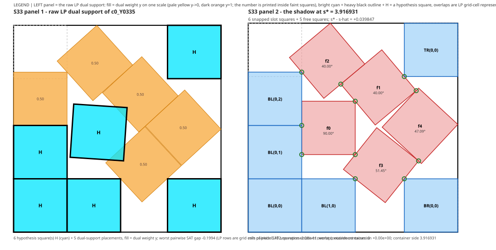

* **s\*** = 3.916930867 = s-hat +0.039847277  (s0 = 3.877084, s\* - s0 = +0.039847)
* **shadow** = 6 slot squares `BL(0,0) BL(0,1) BL(0,2) BL(1,0) BR(0,0) TR(0,0)` + 5 free squares; a k11 packing.
* **explains** 1 alive-at-LP nodes: trump5 x1; levels L1:1; component 1 support.
* **load-bearing squares at this landing**: `f0` `f1` `f2` `f3` `f4` `BL(0,1)` `BL(0,2)` `BL(1,0)` `BR(0,0)` `TR(0,0)` (10 of 11); **1 distinct minimised configuration(s)** share this s*.
* **multiplicity**: 1 landings / slot-free splittings (6 slot + 5 free (1 nodes)).
* the free squares do **not** share a tilt: f0 90.000 deg, f1 40.004 deg, f2 40.004 deg, f3 51.452 deg, f4 47.090 deg.
* **restarts**: 59 feasible of 101; distinct minima [3.91693, 3.92547, 3.94281, 4.0, 4.00004, 4.08613].

**Free square poses at s\***

| square | cx | cy | tilt (deg) |
|---|---|---|---|
| f0 | 1.500000 | 1.953937 | 90.0000 |
| f1 | 2.435105 | 2.713269 | 40.0040 |
| f2 | 1.474399 | 3.212511 | 40.0040 |
| f3 | 2.481392 | 1.255742 | 51.4522 |
| f4 | 3.210294 | 1.993446 | 47.0897 |

**Contact graph at s\*** (gap < 1e-7; contact force = Fritz-John multiplier, rows unit-normalised)

| contact | type | gap | force |
|---|---|---|---|
| `f0` - `f1` | vertex-on-edge | +0.0e+00 | 0.4616 |
| `f0` - `f3` | vertex-on-edge | +6.7e-16 | 0.4782 |
| `f0` - `BL(0,1)` | vertex-on-edge | -2.1e-11 | 0.5121 |
| `f0` - `BL(0,2)` | vertex-on-edge | +7.3e-10 | 0.0000 |
| `f1` - `f2` | vertex-on-edge | +4.0e-12 | 0.1642 |
| `f1` - `f4` | vertex-on-edge | +2.2e-16 | 0.1767 |
| `f1` - `TR(0,0)` | vertex-on-edge | +0.0e+00 | 0.5402 |
| `f2` - `BL(0,2)` | vertex-on-edge | -1.1e-16 | 0.0964 |
| `f3` - `f4` | vertex-on-edge | -2.2e-16 | 0.1649 |
| `f3` - `BL(1,0)` | vertex-on-edge | +0.0e+00 | 0.1087 |
| `f3` - `BR(0,0)` | vertex-on-edge | +2.2e-16 | 0.4168 |
| `f2` - top wall | wall | 0 | 0.2101 |
| `f4` - right wall | wall | 0 | 0.2213 |

**Binding** (largest Fritz-John resultant first): `f1`-`TR(0,0)` (0.540), `f0`-`BL(0,1)` (0.512), `f0`-`f3` (0.478), `f0`-`f1` (0.462), `f3`-`BR(0,0)` (0.417), `f4`-`right wall` (0.221).  KKT residual 1.2e-05.
**Convergence caveat**: KKT residual 1.2e-05 (> 1e-6).  The residual measures how far e_s is from the cone of the active CONTACT rows; it is nonzero when the landing also leans on a variable BOUND (s in [3.4, 4.6], centres in [0, 4.6]), which is not a contact and so is not in the Jacobian, or when SLSQP stopped short of a stationary point.  Either way s* = 3.916931 is an upper bound on this shadow's true value and the contact set may be mis-counted at the 1e-7 threshold.
**Rank**: 16 contact rows, 16 variables (s + 3 per free square); rank 14; at fixed s rank 14 of 15, so **1 flat direction(s)**.
  * flat direction 0: blocked at second order (worst active gap changes by -4.97e-07 at |t| = 1e-3 and -4.47e-06 at 3e-3 and -4.97e-05 at 1e-2, ratios 9.0 / 100.2; 9 and 100 are the quadratic signature - curvature -4.966e-01).

**T2 drain hint - the load-bearing subgraph** (remove one free square and re-minimise)

| removed | s* without it | drop | role |
|---|---|---|---|
| `f0` | 3.870286 | +0.046645 | load-bearing |
| `f1` | 3.707107 | +0.209824 | load-bearing |
| `f2` | 3.894427 | +0.022504 | load-bearing |
| `f3` | 3.771189 | +0.145742 | load-bearing |
| `f4` | 3.895284 | +0.021647 | load-bearing |

**Idle contacts** (zero Fritz-John force - struts, not load paths): `f0`-`BL(0,2)`.

Load-bearing free squares: `f0`, `f1`, `f2`, `f3`, `f4`.  Rattlers/struts (removal leaves s\* unchanged): none.

**Alive nodes explained** (1; each id is src/shard/node(level).  Their pose boxes: A57 level-1 boxes are 0.1398 x 0.1398 x 9.73 deg and halve in every coordinate per level (A106 T1); the conditioned square pose of every node below is in `attempts/A107-shadow-gallery/results/shadow_nodes.json`): 
`A60/nodes/c0_Y0335(L1)`

## S34 - a k11 packing at s* = 3.917360 on the boundary of class trump5

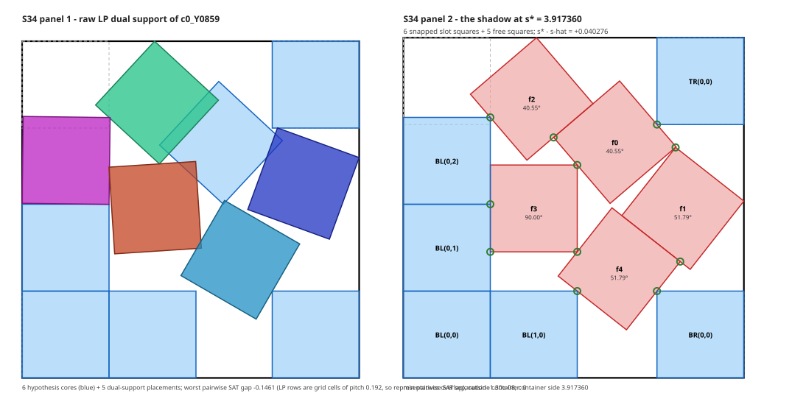

* **s\*** = 3.917360053 = s-hat +0.040276463  (s0 = 3.877084, s\* - s0 = +0.040276)
* **shadow** = 6 slot squares `BL(0,0) BL(0,1) BL(0,2) BL(1,0) BR(0,0) TR(0,0)` + 5 free squares; a k11 packing.
* **explains** 1 alive-at-LP nodes: trump5 x1; levels L1:1; component 1 support.
* **load-bearing squares at this landing**: `f0` `f1` `f2` `f3` `f4` `BL(0,1)` `BL(0,2)` `BL(1,0)` `BR(0,0)` `TR(0,0)` (10 of 11); **1 distinct minimised configuration(s)** share this s*.
* **multiplicity**: 1 landings / slot-free splittings (6 slot + 5 free (1 nodes)).
* the free squares do **not** share a tilt: f0 40.552 deg, f1 51.792 deg, f2 40.552 deg, f3 90.000 deg, f4 51.792 deg.
* **restarts**: 63 feasible of 101; distinct minima [3.88675, 3.90747, 3.91736, 3.92515, 3.97383, 4.0, 4.00001, 4.41421].

**Free square poses at s\***

| square | cx | cy | tilt (deg) |
|---|---|---|---|
| f0 | 2.432759 | 2.714646 | 40.5520 |
| f1 | 3.215216 | 1.952401 | 51.7923 |
| f2 | 1.476328 | 3.212383 | 40.5520 |
| f3 | 1.500000 | 1.951344 | 90.0000 |
| f4 | 2.482785 | 1.256296 | 51.7923 |

**Contact graph at s\*** (gap < 1e-7; contact force = Fritz-John multiplier, rows unit-normalised)

| contact | type | gap | force |
|---|---|---|---|
| `f0` - `f1` | vertex-on-edge | +2.0e-15 | 0.1723 |
| `f0` - `f2` | vertex-on-edge | -1.3e-08 | 0.1605 |
| `f0` - `f3` | vertex-on-edge | +2.2e-16 | 0.4531 |
| `f0` - `TR(0,0)` | vertex-on-edge | -1.1e-15 | 0.5549 |
| `f1` - `f4` | vertex-on-edge | -1.1e-15 | 0.1627 |
| `f2` - `BL(0,2)` | vertex-on-edge | -8.9e-16 | 0.0963 |
| `f3` - `f4` | vertex-on-edge | +1.6e-15 | 0.4784 |
| `f3` - `BL(0,1)` | vertex-on-edge | -3.2e-10 | 0.5069 |
| `f3` - `BL(0,2)` | vertex-on-edge | +7.6e-10 | 0.0000 |
| `f4` - `BL(1,0)` | vertex-on-edge | +1.3e-15 | 0.1102 |
| `f4` - `BR(0,0)` | vertex-on-edge | -1.6e-15 | 0.4279 |
| `f1` - right wall | wall | 0 | 0.1968 |
| `f2` - top wall | wall | 0 | 0.2073 |

**Binding** (largest Fritz-John resultant first): `f0`-`TR(0,0)` (0.555), `f3`-`BL(0,1)` (0.507), `f3`-`f4` (0.478), `f0`-`f3` (0.453), `f4`-`BR(0,0)` (0.428), `f2`-`top wall` (0.207).  KKT residual 2.4e-06.
**Convergence caveat**: KKT residual 2.4e-06 (> 1e-6).  The residual measures how far e_s is from the cone of the active CONTACT rows; it is nonzero when the landing also leans on a variable BOUND (s in [3.4, 4.6], centres in [0, 4.6]), which is not a contact and so is not in the Jacobian, or when SLSQP stopped short of a stationary point.  Either way s* = 3.917360 is an upper bound on this shadow's true value and the contact set may be mis-counted at the 1e-7 threshold.
**Rank**: 17 contact rows, 16 variables (s + 3 per free square); rank 15; at fixed s rank 15 of 15, so **0 flat direction(s)**.
  * no flat directions: the shadow is first-order rigid at fixed s.

**T2 drain hint - the load-bearing subgraph** (remove one free square and re-minimise)

| removed | s* without it | drop | role |
|---|---|---|---|
| `f0` | 3.707107 | +0.210253 | load-bearing |
| `f1` | 3.895284 | +0.022077 | load-bearing |
| `f2` | 3.767767 | +0.149593 | load-bearing |
| `f3` | 3.877743 | +0.039617 | load-bearing |
| `f4` | 3.771189 | +0.146171 | load-bearing |

**Idle contacts** (zero Fritz-John force - struts, not load paths): `f3`-`BL(0,2)`.

Load-bearing free squares: `f0`, `f1`, `f2`, `f3`, `f4`.  Rattlers/struts (removal leaves s\* unchanged): none.

**Alive nodes explained** (1; each id is src/shard/node(level).  Their pose boxes: A57 level-1 boxes are 0.1398 x 0.1398 x 9.73 deg and halve in every coordinate per level (A106 T1); the conditioned square pose of every node below is in `attempts/A107-shadow-gallery/results/shadow_nodes.json`): 
`A60/nodes/c0_Y0859(L1)`

## S35 - a k11 packing at s* = 3.917433 on the boundary of class trump5

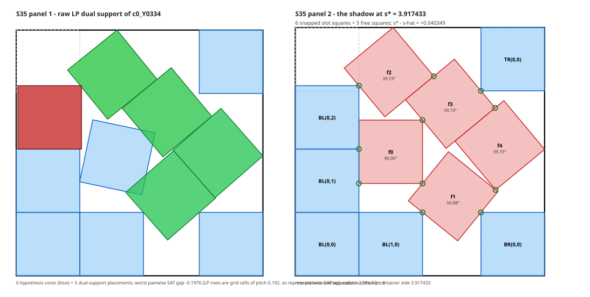

* **s\*** = 3.917432667 = s-hat +0.040349077  (s0 = 3.877084, s\* - s0 = +0.040349)
* **shadow** = 6 slot squares `BL(0,0) BL(0,1) BL(0,2) BL(1,0) BR(0,0) TR(0,0)` + 5 free squares; a k11 packing.
* **explains** 1 alive-at-LP nodes: trump5 x1; levels L1:1; integral 1 support.
* **load-bearing squares at this landing**: `f0` `f1` `f2` `f3` `f4` `BL(0,1)` `BL(0,2)` `BL(1,0)` `BR(0,0)` `TR(0,0)` (10 of 11); **1 distinct minimised configuration(s)** share this s*.
* **multiplicity**: 1 landings / slot-free splittings (6 slot + 5 free (1 nodes)).
* the free squares do **not** share a tilt: f0 90.000 deg, f1 50.884 deg, f2 39.727 deg, f3 39.727 deg, f4 39.727 deg.
* **restarts**: 58 feasible of 101; distinct minima [3.88675, 3.91743, 3.92515, 3.92731, 3.94281, 3.96322, 4.0, 4.00001].

**Free square poses at s\***

| square | cx | cy | tilt (deg) |
|---|---|---|---|
| f0 | 1.500000 | 1.956802 | 90.0000 |
| f1 | 2.479781 | 1.254306 | 50.8835 |
| f2 | 1.472841 | 3.213319 | 39.7267 |
| f3 | 2.436474 | 2.713883 | 39.7267 |
| f4 | 3.213318 | 2.059226 | 39.7268 |

**Contact graph at s\*** (gap < 1e-7; contact force = Fritz-John multiplier, rows unit-normalised)

| contact | type | gap | force |
|---|---|---|---|
| `f0` - `f1` | vertex-on-edge | -1.0e-15 | 0.4706 |
| `f0` - `f3` | vertex-on-edge | -1.0e-15 | 0.4634 |
| `f0` - `BL(0,1)` | vertex-on-edge | -2.1e-12 | 0.2869 |
| `f0` - `BL(0,2)` | vertex-on-edge | +4.8e-10 | 0.2808 |
| `f1` - `f4` | vertex-on-edge | +1.1e-14 | 0.1688 |
| `f1` - `BL(1,0)` | vertex-on-edge | -2.4e-15 | 0.1124 |
| `f1` - `BR(0,0)` | vertex-on-edge | -2.2e-16 | 0.4191 |
| `f2` - `f3` | vertex-on-edge | +1.7e-11 | 0.1591 |
| `f2` - `BL(0,2)` | vertex-on-edge | +6.2e-15 | 0.0926 |
| `f3` - `f4` | vertex-on-edge | +3.3e-15 | 0.1681 |
| `f3` - `TR(0,0)` | vertex-on-edge | +5.6e-15 | 0.5668 |
| `f2` - top wall | wall | 0 | 0.2030 |
| `f4` - right wall | wall | 0 | 0.1980 |

**Binding** (largest Fritz-John resultant first): `f3`-`TR(0,0)` (0.567), `f0`-`f1` (0.471), `f0`-`f3` (0.463), `f1`-`BR(0,0)` (0.419), `f0`-`BL(0,1)` (0.287), `f0`-`BL(0,2)` (0.281).  KKT residual 1.8e-03.
**Convergence caveat**: KKT residual 1.8e-03 (> 1e-6).  The residual measures how far e_s is from the cone of the active CONTACT rows; it is nonzero when the landing also leans on a variable BOUND (s in [3.4, 4.6], centres in [0, 4.6]), which is not a contact and so is not in the Jacobian, or when SLSQP stopped short of a stationary point.  Either way s* = 3.917433 is an upper bound on this shadow's true value and the contact set may be mis-counted at the 1e-7 threshold.
**Rank**: 17 contact rows, 16 variables (s + 3 per free square); rank 15; at fixed s rank 15 of 15, so **0 flat direction(s)**.
  * no flat directions: the shadow is first-order rigid at fixed s.

**T2 drain hint - the load-bearing subgraph** (remove one free square and re-minimise)

| removed | s* without it | drop | role |
|---|---|---|---|
| `f0` | 3.877743 | +0.039690 | load-bearing |
| `f1` | 3.771189 | +0.146244 | load-bearing |
| `f2` | 3.894427 | +0.023005 | load-bearing |
| `f3` | 3.707107 | +0.210326 | load-bearing |
| `f4` | 3.895284 | +0.022149 | load-bearing |

Load-bearing free squares: `f0`, `f1`, `f2`, `f3`, `f4`.  Rattlers/struts (removal leaves s\* unchanged): none.

**Alive nodes explained** (1; each id is src/shard/node(level).  Their pose boxes: A57 level-1 boxes are 0.1398 x 0.1398 x 9.73 deg and halve in every coordinate per level (A106 T1); the conditioned square pose of every node below is in `attempts/A107-shadow-gallery/results/shadow_nodes.json`): 
`A60/nodes/c0_Y0334(L1)`

## S36 - a k11 packing at s* = 3.924003 on the boundary of class k5_11

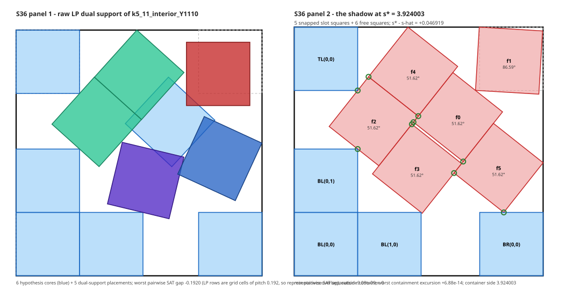

* **s\*** = 3.924003080 = s-hat +0.046919490  (s0 = 3.877084, s\* - s0 = +0.046919)
* **shadow** = 5 slot squares `BL(0,0) BL(0,1) BL(1,0) BR(0,0) TL(0,0)` + 6 free squares; a k11 packing.
* **explains** 1 alive-at-LP nodes: k5_11 x1; levels L1:1; integral 1 support.
* **load-bearing squares at this landing**: `f0` `f2` `f3` `f4` `f5` `BL(0,1)` `BR(0,0)` `TL(0,0)` (8 of 11); **1 distinct minimised configuration(s)** share this s*.
* **multiplicity**: 1 landings / slot-free splittings (5 slot + 6 free (1 nodes)).
* the free squares do **not** share a tilt: f0 51.619 deg, f1 86.586 deg, f2 51.619 deg, f3 51.619 deg, f4 51.619 deg, f5 51.619 deg.
* **restarts**: 59 feasible of 101; distinct minima [3.88675, 3.89723, 3.924, 3.94281, 4.0, 4.10159, 4.12132, 4.12154].

**Free square poses at s\***

| square | cx | cy | tilt (deg) |
|---|---|---|---|
| f0 | 2.581700 | 2.505075 | 51.6189 |
| f1 | 3.386243 | 3.394558 | 86.5865 |
| f2 | 1.252669 | 2.437711 | 51.6189 |
| f3 | 1.935363 | 1.689048 | 51.6189 |
| f4 | 1.873558 | 3.221609 | 51.6189 |
| f5 | 3.221609 | 1.702394 | 51.6189 |

**Contact graph at s\*** (gap < 1e-7; contact force = Fritz-John multiplier, rows unit-normalised)

| contact | type | gap | force |
|---|---|---|---|
| `f0` - `f2` | vertex-on-edge | +6.8e-10 | 0.0901 |
| `f0` - `f4` | vertex-on-edge | -2.7e-09 | 0.2986 |
| `f0` - `f5` | vertex-on-edge | -1.4e-09 | 0.3829 |
| `f2` - `f3` | vertex-on-edge | -9.1e-09 | 0.2518 |
| `f2` - `f4` | exactly-opposite | -6.8e-09 | 0.8108 |
| `f2` - `BL(0,1)` | vertex-on-edge | +2.0e-13 | 0.5201 |
| `f2` - `TL(0,0)` | vertex-on-edge | +6.2e-12 | 0.0139 |
| `f3` - `f5` | vertex-on-edge | +2.5e-09 | 0.2613 |
| `f5` - `BR(0,0)` | vertex-on-edge | +1.1e-13 | 0.2631 |
| `f4` - top wall | wall | 0 | 0.9373 |
| `f5` - right wall | wall | 0 | 0.4691 |

**Binding** (largest Fritz-John resultant first): `f4`-`top wall` (0.937), `f2`-`f4` (0.811), `f2`-`BL(0,1)` (0.520), `f5`-`right wall` (0.469), `f0`-`f5` (0.383), `f0`-`f4` (0.299).  KKT residual 6.7e-09.  Exactly-opposite (vertex-vertex) contacts, whose normal is a cone and whose individual multipliers are therefore ill-conditioned: `f2`-`f4`.
**Rank**: 19 contact rows, 19 variables (s + 3 per free square); rank 16; at fixed s rank 15 of 18, so **3 flat direction(s)**.
  * flat direction 0: free (flex to at least third order) (worst active gap changes by -2.22e-16 at |t| = 1e-3 and -2.22e-16 at 3e-3 and +0.00e+00 at 1e-2, ratios 1.0 / -0.0; 9 and 100 are the quadratic signature - curvature -2.220e-10).
  * flat direction 1: free (flex to at least third order) (worst active gap changes by +0.00e+00 at |t| = 1e-3 and -2.22e-16 at 3e-3 and -2.22e-16 at 1e-2, no change at any step - a genuine one-parameter motion).
  * flat direction 2: free (flex to at least third order) (worst active gap changes by -4.44e-16 at |t| = 1e-3 and -2.22e-16 at 3e-3 and +0.00e+00 at 1e-2, ratios 0.5 / -0.0; 9 and 100 are the quadratic signature - curvature -4.441e-10).

**T2 drain hint - the load-bearing subgraph** (remove one free square and re-minimise)

| removed | s* without it | drop | role |
|---|---|---|---|
| `f0` | 3.767767 | +0.156236 | load-bearing |
| `f1` | 3.886746 | +0.037257 | load-bearing |
| `f2` | 3.828427 | +0.095576 | load-bearing |
| `f3` | 3.828427 | +0.095576 | load-bearing |
| `f4` | 3.858216 | +0.065787 | load-bearing |
| `f5` | 3.767767 | +0.156236 | load-bearing |

Load-bearing free squares: `f0`, `f1`, `f2`, `f3`, `f4`, `f5`.  Rattlers/struts (removal leaves s\* unchanged): none.

**Alive nodes explained** (1; each id is src/shard/node(level).  Their pose boxes: A57 level-1 boxes are 0.1398 x 0.1398 x 9.73 deg and halve in every coordinate per level (A106 T1); the conditioned square pose of every node below is in `attempts/A107-shadow-gallery/results/shadow_nodes.json`): 
`A57/k5_11_interior_G1/k5_11_interior_Y1110(L1)`

## S37 - a k11 packing at s* = 3.925470 on the boundary of class trump5

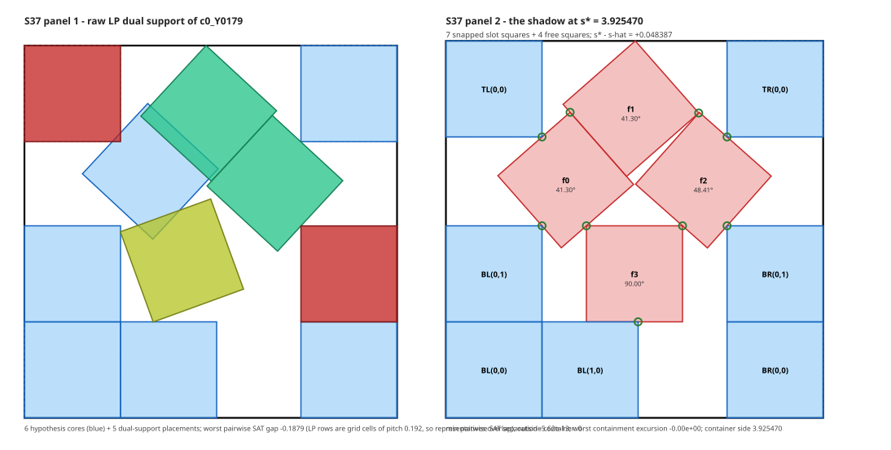

* **s\*** = 3.925470104 = s-hat +0.048386514  (s0 = 3.877084, s\* - s0 = +0.048386)
* **shadow** = 7 slot squares `BL(0,0) BL(0,1) BL(1,0) BR(0,0) BR(0,1) TL(0,0) TR(0,0)` + 4 free squares; a k11 packing.
* **explains** 1 alive-at-LP nodes: trump5 x1; levels L1:1; component 1 support.
* **load-bearing squares at this landing**: `f0` `f1` `f2` `f3` `BL(0,1)` `BL(1,0)` `BR(0,1)` `TL(0,0)` `TR(0,0)` (9 of 11); **1 distinct minimised configuration(s)** share this s*.
* **multiplicity**: 1 landings / slot-free splittings (7 slot + 4 free (1 nodes)).
* the free squares do **not** share a tilt: f0 41.301 deg, f1 41.301 deg, f2 48.408 deg, f3 90.000 deg.
* **restarts**: 69 feasible of 101; distinct minima [3.88675, 3.90267, 3.92547, 3.94281, 3.97395, 3.98547, 4.0, 4.56155].

**Free square poses at s\***

| square | cx | cy | tilt (deg) |
|---|---|---|---|
| f0 | 1.246751 | 2.476698 | 41.3010 |
| f1 | 1.924975 | 3.219836 | 41.3010 |
| f2 | 2.679079 | 2.475617 | 48.4076 |
| f3 | 1.961714 | 1.500000 | 90.0000 |

**Contact graph at s\*** (gap < 1e-7; contact force = Fritz-John multiplier, rows unit-normalised)

| contact | type | gap | force |
|---|---|---|---|
| `f0` - `f1` | vertex-on-edge | +2.4e-15 | 0.2019 |
| `f0` - `f3` | vertex-on-edge | +2.9e-14 | 0.4807 |
| `f0` - `BL(0,1)` | vertex-on-edge | -1.1e-14 | 0.1334 |
| `f0` - `TL(0,0)` | vertex-on-edge | -4.0e-15 | 0.4242 |
| `f1` - `f2` | vertex-on-edge | +8.1e-15 | 0.2050 |
| `f2` - `f3` | vertex-on-edge | +2.5e-14 | 0.4779 |
| `f2` - `BR(0,1)` | vertex-on-edge | -4.7e-15 | 0.1662 |
| `f2` - `TR(0,0)` | vertex-on-edge | -3.3e-15 | 0.5822 |
| `f3` - `BL(1,0)` | vertex-on-edge | -5.6e-13 | 0.5049 |
| `f1` - top wall | wall | 0 | 0.2459 |

**Binding** (largest Fritz-John resultant first): `f2`-`TR(0,0)` (0.582), `f3`-`BL(1,0)` (0.505), `f0`-`f3` (0.481), `f2`-`f3` (0.478), `f0`-`TL(0,0)` (0.424), `f1`-`top wall` (0.246).  KKT residual 9.4e-05.
**Convergence caveat**: KKT residual 9.4e-05 (> 1e-6).  The residual measures how far e_s is from the cone of the active CONTACT rows; it is nonzero when the landing also leans on a variable BOUND (s in [3.4, 4.6], centres in [0, 4.6]), which is not a contact and so is not in the Jacobian, or when SLSQP stopped short of a stationary point.  Either way s* = 3.925470 is an upper bound on this shadow's true value and the contact set may be mis-counted at the 1e-7 threshold.
**Rank**: 12 contact rows, 13 variables (s + 3 per free square); rank 12; at fixed s rank 12 of 12, so **0 flat direction(s)**.
  * no flat directions: the shadow is first-order rigid at fixed s.

**T2 drain hint - the load-bearing subgraph** (remove one free square and re-minimise)

| removed | s* without it | drop | role |
|---|---|---|---|
| `f0` | 3.767767 | +0.157703 | load-bearing |
| `f1` | 3.899873 | +0.025597 | load-bearing |
| `f2` | 3.767767 | +0.157703 | load-bearing |
| `f3` | 3.768120 | +0.157350 | load-bearing |

Load-bearing free squares: `f0`, `f1`, `f2`, `f3`.  Rattlers/struts (removal leaves s\* unchanged): none.

**Alive nodes explained** (1; each id is src/shard/node(level).  Their pose boxes: A57 level-1 boxes are 0.1398 x 0.1398 x 9.73 deg and halve in every coordinate per level (A106 T1); the conditioned square pose of every node below is in `attempts/A107-shadow-gallery/results/shadow_nodes.json`): 
`A60/nodes/c0_Y0179(L1)`

## S38 - a k11 packing at s* = 3.928915 on the boundary of class trump5

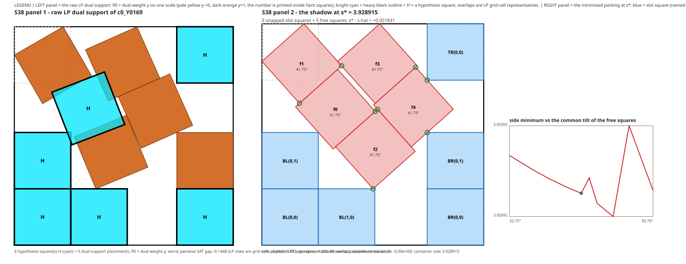

* **s\*** = 3.928914695 = s-hat +0.051831105  (s0 = 3.877084, s\* - s0 = +0.051831)
* **shadow** = 6 slot squares `BL(0,0) BL(0,1) BL(1,0) BR(0,0) BR(0,1) TR(0,0)` + 5 free squares; a k11 packing.
* **explains** 1 alive-at-LP nodes: trump5 x1; levels L1:1; integral 1 support.
* **load-bearing squares at this landing**: `f0` `f1` `f2` `f3` `f4` `BL(1,0)` `BR(0,1)` `TR(0,0)` (8 of 11); **1 distinct minimised configuration(s)** share this s*.
* **multiplicity**: 1 landings / slot-free splittings (6 slot + 5 free (1 nodes)).
* **the free squares share one tilt**: 41.7540 deg (spread 6.16e-05 deg).
* **restarts**: 75 feasible of 101; distinct minima [3.91223, 3.92891, 3.94281, 4.0, 4.07404].

**Free square poses at s\***

| square | cx | cy | tilt (deg) |
|---|---|---|---|
| f0 | 1.301356 | 2.413955 | 41.7540 |
| f1 | 0.705972 | 3.222942 | 41.7540 |
| f2 | 2.009892 | 1.705972 | 41.7540 |
| f3 | 2.046436 | 3.222942 | 41.7540 |
| f4 | 2.684421 | 2.451983 | 41.7540 |

**Contact graph at s\*** (gap < 1e-7; contact force = Fritz-John multiplier, rows unit-normalised)

| contact | type | gap | force |
|---|---|---|---|
| `f0` - `f1` | vertex-on-edge | -1.2e-08 | 0.7178 |
| `f0` - `f2` | vertex-on-edge | -4.3e-09 | 0.7189 |
| `f1` - `f3` | vertex-on-edge | +6.0e-08 | 0.0142 |
| `f2` - `f4` | vertex-on-edge | -1.4e-09 | 0.6394 |
| `f2` - `BL(1,0)` | vertex-on-edge | +2.2e-16 | 0.6677 |
| `f4` - `BR(0,1)` | vertex-on-edge | +4.8e-08 | 0.0026 |
| `f4` - `TR(0,0)` | vertex-on-edge | +3.3e-15 | 0.7659 |
| `f1` - left wall | wall | 0 | 0.3420 |
| `f1` - top wall | wall | 0 | 0.5233 |
| `f3` - top wall | wall | 0 | 0.0095 |

**Binding** (largest Fritz-John resultant first): `f4`-`TR(0,0)` (0.766), `f0`-`f2` (0.719), `f0`-`f1` (0.718), `f2`-`BL(1,0)` (0.668), `f2`-`f4` (0.639), `f1`-`top wall` (0.523).  KKT residual 2.8e-02.
**Convergence caveat**: KKT residual 2.8e-02 (> 1e-6).  The residual measures how far e_s is from the cone of the active CONTACT rows; it is nonzero when the landing also leans on a variable BOUND (s in [3.4, 4.6], centres in [0, 4.6]), which is not a contact and so is not in the Jacobian, or when SLSQP stopped short of a stationary point.  Either way s* = 3.928915 is an upper bound on this shadow's true value and the contact set may be mis-counted at the 1e-7 threshold.
**Rank**: 14 contact rows, 16 variables (s + 3 per free square); rank 14; at fixed s rank 14 of 15, so **1 flat direction(s)**.
  * flat direction 0: blocked at second order (worst active gap changes by -1.07e-13 at |t| = 1e-3 and -9.67e-13 at 3e-3 and -1.07e-11 at 1e-2, ratios 9.0 / 100.0; 9 and 100 are the quadratic signature - curvature -1.075e-07).

**T2 drain hint - the load-bearing subgraph** (remove one free square and re-minimise)

| removed | s* without it | drop | role |
|---|---|---|---|
| `f0` | 3.768118 | +0.160797 | load-bearing |
| `f1` | 3.885619 | +0.043296 | load-bearing |
| `f2` | 3.767767 | +0.161148 | load-bearing |
| `f3` | 3.787746 | +0.141169 | load-bearing |
| `f4` | 3.768118 | +0.160797 | load-bearing |

Load-bearing free squares: `f0`, `f1`, `f2`, `f3`, `f4`.  Rattlers/struts (removal leaves s\* unchanged): none.

**Common-tilt sweep** (all free squares held at one tilt, slot squares fixed, s minimised)

| tilt (deg) | 32.75 | 35.75 | 37.75 | 39.75 | 40.75 | 41.35 | 41.75 | 42.15 | 42.75 | 43.75 | 45.75 | 47.75 | 50.75 |
|---|---|---|---|---|---|---|---|---|---|---|---|---|---|
| s* | 3.941871 | 3.936840 | 3.933855 | 3.931202 | 3.930011 | 3.929342 | 3.928915 | 3.931026 | 3.934169 | 3.925423 | 3.920916 | 3.952049 | 3.929880 |

**Alive nodes explained** (1; each id is src/shard/node(level).  Their pose boxes: A57 level-1 boxes are 0.1398 x 0.1398 x 9.73 deg and halve in every coordinate per level (A106 T1); the conditioned square pose of every node below is in `attempts/A107-shadow-gallery/results/shadow_nodes.json`): 
`A60/nodes/c0_Y0169(L1)`

## S39 - a k11 packing at s* = 3.932425 on the boundary of class k5_16

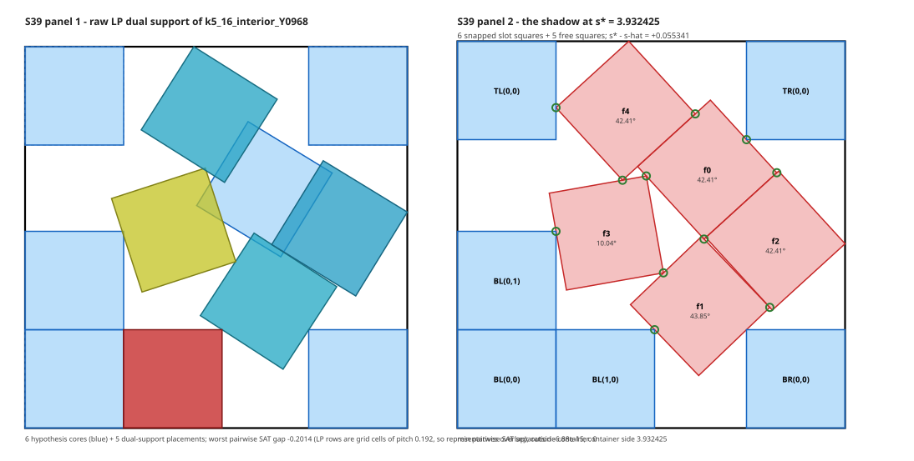

* **s\*** = 3.932424859 = s-hat +0.055341269  (s0 = 3.877084, s\* - s0 = +0.055341)
* **shadow** = 6 slot squares `BL(0,0) BL(0,1) BL(1,0) BR(0,0) TL(0,0) TR(0,0)` + 5 free squares; a k11 packing.
* **explains** 1 alive-at-LP nodes: k5_16 x1; levels L1:1; component 1 support.
* **load-bearing squares at this landing**: `f0` `f1` `f2` `f3` `f4` `BL(0,1)` `BL(1,0)` `TL(0,0)` `TR(0,0)` (9 of 11); **1 distinct minimised configuration(s)** share this s*.
* **multiplicity**: 1 landings / slot-free splittings (6 slot + 5 free (1 nodes)).
* the free squares do **not** share a tilt: f0 42.412 deg, f1 43.846 deg, f2 42.413 deg, f3 10.037 deg, f4 42.412 deg.
* **restarts**: 63 feasible of 101; distinct minima [3.92515, 3.93242, 3.94281, 3.95129, 3.95842, 3.99995, 4.0, 4.12132].

**Free square poses at s\***

| square | cx | cy | tilt (deg) |
|---|---|---|---|
| f0 | 2.533799 | 2.627454 | 42.4125 |
| f1 | 2.461668 | 1.241139 | 43.8459 |
| f2 | 3.226039 | 1.905385 | 42.4125 |
| f3 | 1.510795 | 1.982914 | 10.0370 |
| f4 | 1.706386 | 3.226039 | 42.4125 |

**Contact graph at s\*** (gap < 1e-7; contact force = Fritz-John multiplier, rows unit-normalised)

| contact | type | gap | force |
|---|---|---|---|
| `f0` - `f1` | vertex-on-edge | +4.6e-14 | 0.4009 |
| `f0` - `f2` | vertex-on-edge | +3.2e-14 | 0.2025 |
| `f0` - `f3` | vertex-on-edge | +1.3e-13 | 0.2790 |
| `f0` - `f4` | vertex-on-edge | +1.1e-16 | 0.2186 |
| `f0` - `TR(0,0)` | vertex-on-edge | +2.2e-15 | 0.8034 |
| `f1` - `f2` | vertex-on-edge | +3.4e-14 | 0.2118 |
| `f1` - `f3` | vertex-on-edge | -4.4e-15 | 0.0729 |
| `f1` - `BL(1,0)` | vertex-on-edge | -4.4e-15 | 0.3950 |
| `f3` - `f4` | vertex-on-edge | -6.9e-15 | 0.0000 |
| `f3` - `BL(0,1)` | vertex-on-edge | -2.2e-15 | 0.1917 |
| `f4` - `TL(0,0)` | vertex-on-edge | -3.1e-15 | 0.1029 |
| `f2` - right wall | wall | 0 | 0.2951 |
| `f4` - top wall | wall | 0 | 0.1756 |

**Binding** (largest Fritz-John resultant first): `f0`-`TR(0,0)` (0.803), `f0`-`f1` (0.401), `f1`-`BL(1,0)` (0.395), `f2`-`right wall` (0.295), `f0`-`f3` (0.279), `f0`-`f4` (0.219).  KKT residual 1.1e-01.
**Convergence caveat**: KKT residual 1.1e-01 (> 1e-6).  The residual measures how far e_s is from the cone of the active CONTACT rows; it is nonzero when the landing also leans on a variable BOUND (s in [3.4, 4.6], centres in [0, 4.6]), which is not a contact and so is not in the Jacobian, or when SLSQP stopped short of a stationary point.  Either way s* = 3.932425 is an upper bound on this shadow's true value and the contact set may be mis-counted at the 1e-7 threshold.
**Rank**: 15 contact rows, 16 variables (s + 3 per free square); rank 15; at fixed s rank 15 of 15, so **0 flat direction(s)**.
  * no flat directions: the shadow is first-order rigid at fixed s.

**T2 drain hint - the load-bearing subgraph** (remove one free square and re-minimise)

| removed | s* without it | drop | role |
|---|---|---|---|
| `f0` | 3.767767 | +0.164658 | load-bearing |
| `f1` | infeasible | - | load-bearing |
| `f2` | 3.822876 | +0.109549 | load-bearing |
| `f3` | 3.886756 | +0.045669 | load-bearing |
| `f4` | 3.767767 | +0.164658 | load-bearing |

**Idle contacts** (zero Fritz-John force - struts, not load paths): `f3`-`f4`.

Load-bearing free squares: `f0`, `f1`, `f2`, `f3`, `f4`.  Rattlers/struts (removal leaves s\* unchanged): none.

**Alive nodes explained** (1; each id is src/shard/node(level).  Their pose boxes: A57 level-1 boxes are 0.1398 x 0.1398 x 9.73 deg and halve in every coordinate per level (A106 T1); the conditioned square pose of every node below is in `attempts/A107-shadow-gallery/results/shadow_nodes.json`): 
`A57/k5_16_interior_G1/k5_16_interior_Y0968(L1)`

## S40 - a k10 packing at s* = 3.940518 on the boundary of class k5_16

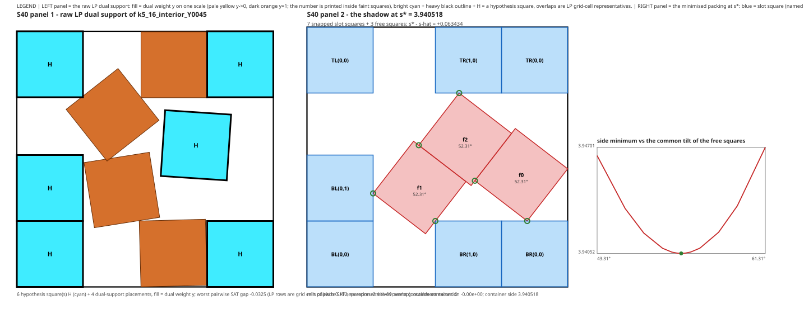

* **s\*** = 3.940517848 = s-hat +0.063434258  (s0 = 3.877084, s\* - s0 = +0.063434)
* **shadow** = 7 slot squares `BL(0,0) BL(0,1) BR(0,0) BR(1,0) TL(0,0) TR(0,0) TR(1,0)` + 3 free squares; a k10 packing.
* **explains** 1 alive-at-LP nodes: k5_16 x1; levels L1:1; integral 1 support.
* **load-bearing squares at this landing**: `f0` `f1` `f2` `BL(0,1)` `BR(0,0)` `BR(1,0)` `TR(1,0)` (7 of 10); **1 distinct minimised configuration(s)** share this s*.
* **multiplicity**: 1 landings / slot-free splittings (7 slot + 3 free (1 nodes)).
* **the free squares share one tilt**: 52.3148 deg (spread 3.71e-07 deg).
* **restarts**: 84 feasible of 101; distinct minima [3.70711, 3.72858, 3.82288, 3.82336, 3.92528, 3.94052, 3.94281, 3.97662].

**Free square poses at s\***

| square | cx | cy | tilt (deg) |
|---|---|---|---|
| f0 | 3.239166 | 1.701352 | 52.3148 |
| f1 | 1.701352 | 1.508289 | 52.3148 |
| f2 | 2.391001 | 2.239166 | 52.3148 |

**Contact graph at s\*** (gap < 1e-7; contact force = Fritz-John multiplier, rows unit-normalised)

| contact | type | gap | force |
|---|---|---|---|
| `f0` - `f2` | vertex-on-edge | -5.2e-10 | 0.3828 |
| `f0` - `BR(0,0)` | vertex-on-edge | +5.8e-15 | 0.1635 |
| `f1` - `f2` | vertex-on-edge | -2.4e-09 | 0.5015 |
| `f1` - `BL(0,1)` | vertex-on-edge | +1.6e-14 | 0.5665 |
| `f1` - `BR(1,0)` | vertex-on-edge | +4.4e-15 | 0.5807 |
| `f2` - `TR(1,0)` | vertex-on-edge | +1.3e-14 | 0.6176 |
| `f0` - right wall | wall | 0 | 0.2988 |

**Binding** (largest Fritz-John resultant first): `f2`-`TR(1,0)` (0.618), `f1`-`BR(1,0)` (0.581), `f1`-`BL(0,1)` (0.566), `f1`-`f2` (0.501), `f0`-`f2` (0.383), `f0`-`right wall` (0.299).  KKT residual 1.8e-05.
**Convergence caveat**: KKT residual 1.8e-05 (> 1e-6).  The residual measures how far e_s is from the cone of the active CONTACT rows; it is nonzero when the landing also leans on a variable BOUND (s in [3.4, 4.6], centres in [0, 4.6]), which is not a contact and so is not in the Jacobian, or when SLSQP stopped short of a stationary point.  Either way s* = 3.940518 is an upper bound on this shadow's true value and the contact set may be mis-counted at the 1e-7 threshold.
**Rank**: 9 contact rows, 10 variables (s + 3 per free square); rank 9; at fixed s rank 9 of 9, so **0 flat direction(s)**.
  * no flat directions: the shadow is first-order rigid at fixed s.

**T2 drain hint - the load-bearing subgraph** (remove one free square and re-minimise)

| removed | s* without it | drop | role |
|---|---|---|---|
| `f0` | 3.400000 | +0.540518 | load-bearing |
| `f1` | 3.400000 | +0.540518 | load-bearing |
| `f2` | 3.400000 | +0.540518 | load-bearing |

Load-bearing free squares: `f0`, `f1`, `f2`.  Rattlers/struts (removal leaves s\* unchanged): none.

**Common-tilt sweep** (all free squares held at one tilt, slot squares fixed, s minimised)

| tilt (deg) | 43.31 | 46.31 | 48.31 | 50.31 | 51.31 | 51.91 | 52.31 | 52.71 | 53.31 | 54.31 | 56.31 | 58.31 | 61.31 |
|---|---|---|---|---|---|---|---|---|---|---|---|---|---|
| s* | 3.946499 | 3.943262 | 3.941758 | 3.940832 | 3.940597 | 3.940530 | 3.940518 | 3.940531 | 3.940598 | 3.940840 | 3.941809 | 3.943423 | 3.947014 |

**Alive nodes explained** (1; each id is src/shard/node(level).  Their pose boxes: A57 level-1 boxes are 0.1398 x 0.1398 x 9.73 deg and halve in every coordinate per level (A106 T1); the conditioned square pose of every node below is in `attempts/A107-shadow-gallery/results/shadow_nodes.json`): 
`A57/k5_16_interior_G1/k5_16_interior_Y0045(L1)`

## S41 - a k11 packing at s* = 3.940838 on the boundary of class k5_16

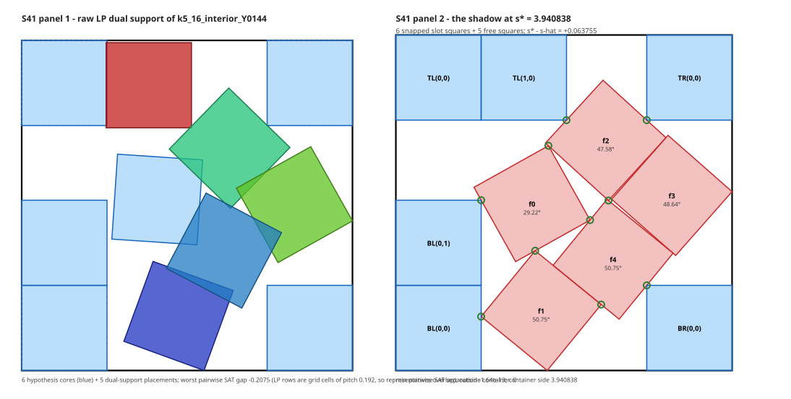

* **s\*** = 3.940838294 = s-hat +0.063754704  (s0 = 3.877084, s\* - s0 = +0.063754)
* **shadow** = 6 slot squares `BL(0,0) BL(0,1) BR(0,0) TL(0,0) TL(1,0) TR(0,0)` + 5 free squares; a k11 packing.
* **explains** 1 alive-at-LP nodes: k5_16 x1; levels L1:1; component 1 support.
* **load-bearing squares at this landing**: `f0` `f1` `f2` `f3` `f4` `BL(0,0)` `BL(0,1)` `BR(0,0)` `TL(1,0)` `TR(0,0)` (10 of 11); **1 distinct minimised configuration(s)** share this s*.
* **multiplicity**: 1 landings / slot-free splittings (6 slot + 5 free (1 nodes)).
* the free squares do **not** share a tilt: f0 29.217 deg, f1 50.750 deg, f2 47.576 deg, f3 48.644 deg, f4 50.750 deg.
* **restarts**: 74 feasible of 101; distinct minima [3.9254, 3.94084, 4.0, 4.00003].

**Free square poses at s\***

| square | cx | cy | tilt (deg) |
|---|---|---|---|
| f0 | 1.595664 | 1.959262 | 29.2165 |
| f1 | 1.703549 | 0.703549 | 50.7498 |
| f2 | 2.459955 | 2.702964 | 47.5764 |
| f3 | 3.235161 | 2.056189 | 48.6440 |
| f4 | 2.545790 | 1.306743 | 50.7498 |

**Contact graph at s\*** (gap < 1e-7; contact force = Fritz-John multiplier, rows unit-normalised)

| contact | type | gap | force |
|---|---|---|---|
| `f0` - `f1` | vertex-on-edge | +2.2e-16 | 0.0369 |
| `f0` - `f2` | vertex-on-edge | -2.2e-16 | 0.3341 |
| `f0` - `f4` | vertex-on-edge | -2.2e-16 | 0.0927 |
| `f0` - `BL(0,1)` | vertex-on-edge | -1.1e-16 | 0.2461 |
| `f1` - `f4` | vertex-on-edge | -1.6e-13 | 0.6227 |
| `f1` - `BL(0,0)` | vertex-on-edge | -3.3e-16 | 0.2563 |
| `f2` - `f4` | vertex-on-edge | +1.1e-16 | 0.6579 |
| `f2` - `TL(1,0)` | vertex-on-edge | +4.4e-16 | 0.0378 |
| `f2` - `TR(0,0)` | vertex-on-edge | +1.8e-15 | 1.1239 |
| `f4` - `BR(0,0)` | vertex-on-edge | +1.0e-15 | 0.0868 |
| `f1` - bottom wall | wall | 0 | 0.3517 |
| `f3` - right wall | wall | 0 | 0.0101 |

**Binding** (largest Fritz-John resultant first): `f2`-`TR(0,0)` (1.124), `f2`-`f4` (0.658), `f1`-`f4` (0.623), `f1`-`bottom wall` (0.352), `f0`-`f2` (0.334), `f1`-`BL(0,0)` (0.256).  KKT residual 8.4e-02.
**Convergence caveat**: KKT residual 8.4e-02 (> 1e-6).  The residual measures how far e_s is from the cone of the active CONTACT rows; it is nonzero when the landing also leans on a variable BOUND (s in [3.4, 4.6], centres in [0, 4.6]), which is not a contact and so is not in the Jacobian, or when SLSQP stopped short of a stationary point.  Either way s* = 3.940838 is an upper bound on this shadow's true value and the contact set may be mis-counted at the 1e-7 threshold.
**Rank**: 13 contact rows, 16 variables (s + 3 per free square); rank 13; at fixed s rank 13 of 15, so **2 flat direction(s)**.
  * flat direction 0: free (flex to at least third order) (worst active gap changes by +0.00e+00 at |t| = 1e-3 and +0.00e+00 at 3e-3 and +0.00e+00 at 1e-2, no change at any step - a genuine one-parameter motion).
  * flat direction 1: free (flex to at least third order) (worst active gap changes by +0.00e+00 at |t| = 1e-3 and +0.00e+00 at 3e-3 and +0.00e+00 at 1e-2, no change at any step - a genuine one-parameter motion).

**T2 drain hint - the load-bearing subgraph** (remove one free square and re-minimise)

| removed | s* without it | drop | role |
|---|---|---|---|
| `f0` | 3.828427 | +0.112411 | load-bearing |
| `f1` | 3.822876 | +0.117963 | load-bearing |
| `f2` | 3.828427 | +0.112411 | load-bearing |
| `f3` | 3.822876 | +0.117963 | load-bearing |
| `f4` | infeasible | - | load-bearing |

Load-bearing free squares: `f0`, `f1`, `f2`, `f3`, `f4`.  Rattlers/struts (removal leaves s\* unchanged): none.

**Alive nodes explained** (1; each id is src/shard/node(level).  Their pose boxes: A57 level-1 boxes are 0.1398 x 0.1398 x 9.73 deg and halve in every coordinate per level (A106 T1); the conditioned square pose of every node below is in `attempts/A107-shadow-gallery/results/shadow_nodes.json`): 
`A57/k5_16_interior_G1/k5_16_interior_Y0144(L1)`

## S42 - a k11 packing at s* = 3.952692 on the boundary of class k5_16

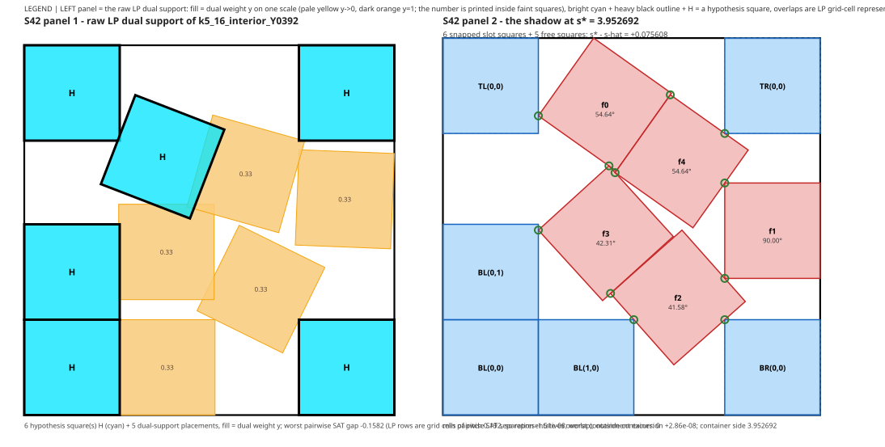

* **s\*** = 3.952691881 = s-hat +0.075608291  (s0 = 3.877084, s\* - s0 = +0.075608)
* **shadow** = 6 slot squares `BL(0,0) BL(0,1) BL(1,0) BR(0,0) TL(0,0) TR(0,0)` + 5 free squares; a k11 packing.
* **explains** 1 alive-at-LP nodes: k5_16 x1; levels L1:1; component 1 support.
* **load-bearing squares at this landing**: `f0` `f1` `f2` `f3` `f4` `BL(0,1)` `BL(1,0)` `BR(0,0)` `TL(0,0)` `TR(0,0)` (10 of 11); **1 distinct minimised configuration(s)** share this s*.
* **multiplicity**: 1 landings / slot-free splittings (6 slot + 5 free (1 nodes)).
* the free squares do **not** share a tilt: f0 54.639 deg, f1 90.000 deg, f2 41.579 deg, f3 42.313 deg, f4 54.639 deg.
* **restarts**: 65 feasible of 101; distinct minima [3.88675, 3.92892, 3.93242, 3.94281, 3.95269, 3.95271, 3.97662, 3.99993].

**Free square poses at s\***

| square | cx | cy | tilt (deg) |
|---|---|---|---|
| f0 | 1.697124 | 3.255568 | 54.6392 |
| f1 | 3.452692 | 1.932975 | 90.0000 |
| f2 | 2.461791 | 1.232894 | 41.5786 |
| f3 | 1.706330 | 1.906083 | 42.3135 |
| f4 | 2.500855 | 2.660228 | 54.6392 |

**Contact graph at s\*** (gap < 1e-7; contact force = Fritz-John multiplier, rows unit-normalised)

| contact | type | gap | force |
|---|---|---|---|
| `f0` - `f3` | vertex-on-edge | +6.2e-10 | 0.0151 |
| `f0` - `f4` | vertex-on-edge | -1.5e-08 | 0.4708 |
| `f0` - `TL(0,0)` | vertex-on-edge | -1.9e-10 | 0.2638 |
| `f1` - `f2` | vertex-on-edge | -2.2e-11 | 0.4446 |
| `f1` - `f4` | vertex-on-edge | -6.2e-11 | 0.5082 |
| `f2` - `f3` | vertex-on-edge | -2.4e-11 | 0.2102 |
| `f2` - `BL(1,0)` | vertex-on-edge | +6.0e-11 | 0.3128 |
| `f2` - `BR(0,0)` | vertex-on-edge | +5.1e-11 | 0.1656 |
| `f3` - `f4` | vertex-on-edge | +2.8e-11 | 0.2085 |
| `f3` - `BL(0,1)` | vertex-on-edge | -2.9e-11 | 0.1987 |
| `f4` - `TR(0,0)` | vertex-on-edge | +5.4e-11 | 0.2315 |
| `f0` - top wall | wall | 0 | 0.2812 |
| `f1` - right wall | wall | 0 | 0.7429 |

**Binding** (largest Fritz-John resultant first): `f1`-`right wall` (0.743), `f1`-`f4` (0.508), `f0`-`f4` (0.471), `f1`-`f2` (0.445), `f2`-`BL(1,0)` (0.313), `f0`-`top wall` (0.281).  KKT residual 1.2e-05.
**Convergence caveat**: KKT residual 1.2e-05 (> 1e-6).  The residual measures how far e_s is from the cone of the active CONTACT rows; it is nonzero when the landing also leans on a variable BOUND (s in [3.4, 4.6], centres in [0, 4.6]), which is not a contact and so is not in the Jacobian, or when SLSQP stopped short of a stationary point.  Either way s* = 3.952692 is an upper bound on this shadow's true value and the contact set may be mis-counted at the 1e-7 threshold.
**Rank**: 15 contact rows, 16 variables (s + 3 per free square); rank 15; at fixed s rank 15 of 15, so **0 flat direction(s)**.
  * no flat directions: the shadow is first-order rigid at fixed s.

**T2 drain hint - the load-bearing subgraph** (remove one free square and re-minimise)

| removed | s* without it | drop | role |
|---|---|---|---|
| `f0` | 3.707107 | +0.245585 | load-bearing |
| `f1` | 3.707107 | +0.245585 | load-bearing |
| `f2` | 3.768118 | +0.184574 | load-bearing |
| `f3` | 3.899873 | +0.052819 | load-bearing |
| `f4` | 3.707107 | +0.245585 | load-bearing |

Load-bearing free squares: `f0`, `f1`, `f2`, `f3`, `f4`.  Rattlers/struts (removal leaves s\* unchanged): none.

**Alive nodes explained** (1; each id is src/shard/node(level).  Their pose boxes: A57 level-1 boxes are 0.1398 x 0.1398 x 9.73 deg and halve in every coordinate per level (A106 T1); the conditioned square pose of every node below is in `attempts/A107-shadow-gallery/results/shadow_nodes.json`): 
`A57/k5_16_interior_G1/k5_16_interior_Y0392(L1)`

## S43 - a k11 packing at s* = 3.956360 on the boundary of class k5_11

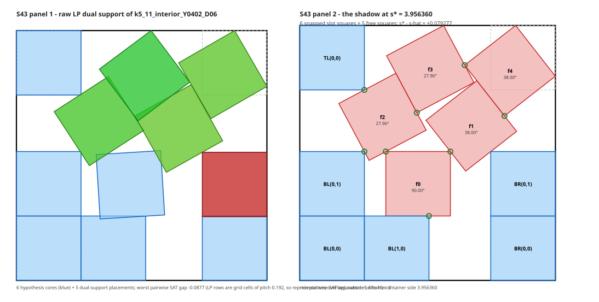

* **s\*** = 3.956360153 = s-hat +0.079276563  (s0 = 3.877084, s\* - s0 = +0.079276)
* **shadow** = 6 slot squares `BL(0,0) BL(0,1) BL(1,0) BR(0,0) BR(0,1) TL(0,0)` + 5 free squares; a k11 packing.
* **explains** 1 alive-at-LP nodes: k5_11 x1; levels L2:1; component 1 support.
* **load-bearing squares at this landing**: `f0` `f1` `f2` `f3` `f4` `BL(0,1)` `BL(1,0)` `TL(0,0)` (8 of 11); **1 distinct minimised configuration(s)** share this s*.
* **multiplicity**: 1 landings / slot-free splittings (6 slot + 5 free (1 nodes)).
* the free squares do **not** share a tilt: f0 90.000 deg, f1 38.004 deg, f2 27.960 deg, f3 27.960 deg, f4 38.004 deg.
* **restarts**: 68 feasible of 101; distinct minima [3.91421, 3.92547, 3.94281, 3.95636, 4.0, 4.41421].

**Free square poses at s\***

| square | cx | cy | tilt (deg) |
|---|---|---|---|
| f0 | 1.831168 | 1.500000 | 90.0000 |
| f1 | 2.654280 | 2.398556 | 38.0044 |
| f2 | 1.280012 | 2.538919 | 27.9596 |
| f3 | 2.019336 | 3.278969 | 27.9596 |
| f4 | 3.254517 | 3.254517 | 38.0044 |

**Contact graph at s\*** (gap < 1e-7; contact force = Fritz-John multiplier, rows unit-normalised)

| contact | type | gap | force |
|---|---|---|---|
| `f0` - `f1` | vertex-on-edge | +2.0e-13 | 0.3880 |
| `f0` - `f2` | vertex-on-edge | -1.2e-14 | 0.6625 |
| `f0` - `BL(1,0)` | vertex-on-edge | +5.0e-11 | 0.5853 |
| `f1` - `f4` | vertex-on-edge | -5.5e-10 | 0.4039 |
| `f2` - `f3` | vertex-on-edge | +2.8e-11 | 0.2243 |
| `f2` - `BL(0,1)` | vertex-on-edge | +3.7e-13 | 0.1657 |
| `f2` - `TL(0,0)` | vertex-on-edge | +1.0e-13 | 0.6125 |
| `f3` - `f4` | vertex-on-edge | +1.5e-11 | 0.2324 |
| `f4` - right wall | wall | 0 | 0.5007 |
| `f4` - top wall | wall | 0 | 0.3421 |

**Binding** (largest Fritz-John resultant first): `f0`-`f2` (0.662), `f2`-`TL(0,0)` (0.612), `f0`-`BL(1,0)` (0.585), `f4`-`right wall` (0.501), `f1`-`f4` (0.404), `f0`-`f1` (0.388).  KKT residual 4.8e-05.
**Convergence caveat**: KKT residual 4.8e-05 (> 1e-6).  The residual measures how far e_s is from the cone of the active CONTACT rows; it is nonzero when the landing also leans on a variable BOUND (s in [3.4, 4.6], centres in [0, 4.6]), which is not a contact and so is not in the Jacobian, or when SLSQP stopped short of a stationary point.  Either way s* = 3.956360 is an upper bound on this shadow's true value and the contact set may be mis-counted at the 1e-7 threshold.
**Rank**: 13 contact rows, 16 variables (s + 3 per free square); rank 13; at fixed s rank 13 of 15, so **2 flat direction(s)**.
  * flat direction 0: blocked at second order (worst active gap changes by -9.26e-13 at |t| = 1e-3 and -8.33e-12 at 3e-3 and -9.25e-11 at 1e-2, ratios 8.99 / 99.9; 9 and 100 are the quadratic signature - curvature -9.257e-07).
  * flat direction 1: blocked at second order (worst active gap changes by -8.10e-12 at |t| = 1e-3 and -7.29e-11 at 3e-3 and -8.10e-10 at 1e-2, ratios 9.0 / 100.0; 9 and 100 are the quadratic signature - curvature -8.098e-06).

**T2 drain hint - the load-bearing subgraph** (remove one free square and re-minimise)

| removed | s* without it | drop | role |
|---|---|---|---|
| `f0` | 3.897231 | +0.059129 | load-bearing |
| `f1` | 3.767767 | +0.188593 | load-bearing |
| `f2` | 3.767767 | +0.188593 | load-bearing |
| `f3` | 3.767767 | +0.188593 | load-bearing |
| `f4` | 3.885618 | +0.070742 | load-bearing |

Load-bearing free squares: `f0`, `f1`, `f2`, `f3`, `f4`.  Rattlers/struts (removal leaves s\* unchanged): none.

**Alive nodes explained** (1; each id is src/shard/node(level).  Their pose boxes: A57 level-1 boxes are 0.1398 x 0.1398 x 9.73 deg and halve in every coordinate per level (A106 T1); the conditioned square pose of every node below is in `attempts/A107-shadow-gallery/results/shadow_nodes.json`): 
`A57/k5_11_interior_G1_D2/k5_11_interior_Y0402_D06(L2)`

## S44 - a k11 packing at s* = 3.958425 on the boundary of class k5_11

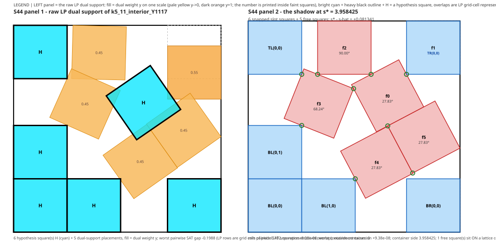

* **s\*** = 3.958424767 = s-hat +0.081341177  (s0 = 3.877084, s\* - s0 = +0.081341)
* **shadow** = 6 slot squares `BL(0,0) BL(0,1) BL(1,0) BR(0,0) TL(0,0)` `TR(0,0) (=f1)` + 5 free squares; a k11 packing.
  * **gallery v1 counted this as 5 slot + 6 free** (A121): `f1` sits on `TR(0,0)` to within 1e-3 in position and 0.05 deg of axis - snapped slot squares, not free ones.  The f-indices are kept everywhere below (contact graph, forces, flat directions, rattler table) so A121's review rows stay valid.
* **explains** 1 alive-at-LP nodes: k5_11 x1; levels L1:1; component 1 support.
* **load-bearing squares at this landing**: `f0` `f1` `f2` `f3` `f4` `f5` `BL(0,1)` `BL(1,0)` `TL(0,0)` (9 of 11); **1 distinct minimised configuration(s)** share this s*.
* **multiplicity**: 1 landings / slot-free splittings (5 slot + 6 free (1 nodes)).
* the free squares do **not** share a tilt: f0 27.827 deg, f1 90.000 deg, f2 90.000 deg, f3 68.241 deg, f4 27.827 deg, f5 27.827 deg.
* **restarts**: 59 feasible of 101; distinct minima [3.94281, 3.95636, 3.95842, 3.96427, 4.0, 4.12132, 4.6].

**Free square poses at s\***

| square | cx | cy | tilt (deg) |
|---|---|---|---|
| f0 | 2.605378 | 2.556159 | 27.8271 |
| f1 | 3.458425 | 3.458425 | 90.0000 |
| f2 | 1.796359 | 3.458425 | 90.0000 |
| f3 | 1.319752 | 2.410732 | 68.2413 |
| f4 | 2.401487 | 1.310496 | 27.8271 |
| f5 | 3.282842 | 1.782993 | 27.8271 |

**Contact graph at s\*** (gap < 1e-7; contact force = Fritz-John multiplier, rows unit-normalised)

| contact | type | gap | force |
|---|---|---|---|
| `f0` - `f1` | vertex-on-edge | +1.0e-12 | 0.0757 |
| `f0` - `f2` | vertex-on-edge | +1.4e-12 | 0.3128 |
| `f0` - `f3` | vertex-on-edge | +5.5e-10 | 0.0774 |
| `f0` - `f5` | vertex-on-edge | -5.5e-08 | 0.3145 |
| `f2` - `f3` | vertex-on-edge | +2.3e-12 | 0.4013 |
| `f3` - `BL(0,1)` | vertex-on-edge | -1.7e-12 | 0.3183 |
| `f3` - `TL(0,0)` | vertex-on-edge | -8.7e-13 | 0.0386 |
| `f4` - `f5` | vertex-on-edge | -8.1e-08 | 0.5876 |
| `f4` - `BL(1,0)` | vertex-on-edge | +1.6e-14 | 0.4154 |
| `f1` - right wall | wall | 0 | 0.0656 |
| `f1` - top wall | wall | 0 | 0.0367 |
| `f2` - top wall | wall | 0 | 0.6352 |
| `f5` - right wall | wall | 0 | 0.6689 |

**Binding** (largest Fritz-John resultant first): `f5`-`right wall` (0.669), `f2`-`top wall` (0.635), `f4`-`f5` (0.588), `f4`-`BL(1,0)` (0.415), `f2`-`f3` (0.401), `f3`-`BL(0,1)` (0.318).  KKT residual 5.5e-07.
**Rank**: 18 contact rows, 19 variables (s + 3 per free square); rank 17; at fixed s rank 17 of 18, so **1 flat direction(s)**.
  * flat direction 0: blocked at second order (worst active gap changes by -2.86e-10 at |t| = 1e-3 and -2.57e-09 at 3e-3 and -2.86e-08 at 1e-2, ratios 9.0 / 100.0; 9 and 100 are the quadratic signature - curvature -2.855e-04).

**T2 drain hint - the load-bearing subgraph** (remove one free square and re-minimise)

| removed | s* without it | drop | role |
|---|---|---|---|
| `f0` | 3.767767 | +0.190658 | load-bearing |
| `f1` | 3.707107 | +0.251318 | load-bearing |
| `f2` | 3.767767 | +0.190658 | load-bearing |
| `f3` | 3.767769 | +0.190655 | load-bearing |
| `f4` | 3.919178 | +0.039247 | load-bearing |
| `f5` | 3.925724 | +0.032700 | load-bearing |

Load-bearing free squares: `f0`, `f1`, `f2`, `f3`, `f4`, `f5`.  Rattlers/struts (removal leaves s\* unchanged): none.

**Alive nodes explained** (1; each id is src/shard/node(level).  Their pose boxes: A57 level-1 boxes are 0.1398 x 0.1398 x 9.73 deg and halve in every coordinate per level (A106 T1); the conditioned square pose of every node below is in `attempts/A107-shadow-gallery/results/shadow_nodes.json`): 
`A57/k5_11_interior_G1/k5_11_interior_Y1117(L1)`

## S45 - a k11 packing at s* = 3.985467 on the boundary of class trump5

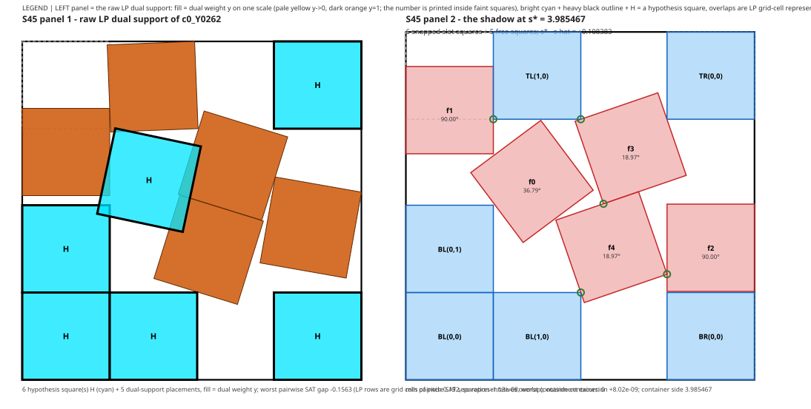

* **s\*** = 3.985466789 = s-hat +0.108383199  (s0 = 3.877084, s\* - s0 = +0.108383)
* **shadow** = 6 slot squares `BL(0,0) BL(0,1) BL(1,0) BR(0,0) TL(1,0) TR(0,0)` + 5 free squares; a k11 packing.
* **explains** 1 alive-at-LP nodes: trump5 x1; levels L1:1; integral 1 support.
* **load-bearing squares at this landing**: `f2` `f3` `f4` `BL(1,0)` `TL(1,0)` (5 of 11); **1 distinct minimised configuration(s)** share this s*.
* **multiplicity**: 1 landings / slot-free splittings (6 slot + 5 free (1 nodes)).
* the free squares do **not** share a tilt: f0 36.791 deg, f1 90.000 deg, f2 90.000 deg, f3 18.965 deg, f4 18.965 deg.
* **restarts**: 60 feasible of 101; distinct minima [3.88675, 3.98547, 4.0, 4.12132, 4.20711, 4.41421].

**Free square poses at s\***

| square | cx | cy | tilt (deg) |
|---|---|---|---|
| f0 | 1.441370 | 2.272553 | 36.7912 |
| f1 | 0.500000 | 3.089427 | 90.0000 |
| f2 | 3.485467 | 1.512931 | 90.0000 |
| f3 | 2.570092 | 2.652678 | 18.9651 |
| f4 | 2.350112 | 1.519683 | 18.9651 |

**Contact graph at s\*** (gap < 1e-7; contact force = Fritz-John multiplier, rows unit-normalised)

| contact | type | gap | force |
|---|---|---|---|
| `f1` - `TL(1,0)` | vertex-on-edge | -1.1e-08 | 0.0000 |
| `f2` - `f4` | vertex-on-edge | +1.5e-13 | 1.1315 |
| `f3` - `f4` | vertex-on-edge | -7.2e-10 | 0.3693 |
| `f3` - `TL(1,0)` | vertex-on-edge | +4.9e-13 | 0.3586 |
| `f4` - `BL(1,0)` | vertex-on-edge | +2.2e-16 | 0.7733 |
| `f1` - left wall | wall | 0 | 0.0000 |
| `f2` - right wall | wall | 0 | 1.1064 |

**Binding** (largest Fritz-John resultant first): `f2`-`f4` (1.132), `f2`-`right wall` (1.106), `f4`-`BL(1,0)` (0.773), `f3`-`f4` (0.369), `f3`-`TL(1,0)` (0.359).  KKT residual 1.9e-04.
**Convergence caveat**: KKT residual 1.9e-04 (> 1e-6).  The residual measures how far e_s is from the cone of the active CONTACT rows; it is nonzero when the landing also leans on a variable BOUND (s in [3.4, 4.6], centres in [0, 4.6]), which is not a contact and so is not in the Jacobian, or when SLSQP stopped short of a stationary point.  Either way s* = 3.985467 is an upper bound on this shadow's true value and the contact set may be mis-counted at the 1e-7 threshold.
**Rank**: 11 contact rows, 16 variables (s + 3 per free square); rank 10; at fixed s rank 10 of 15, so **5 flat direction(s)**.
  * flat direction 0: free (flex to at least third order) (worst active gap changes by -2.22e-16 at |t| = 1e-3 and -2.22e-16 at 3e-3 and -2.22e-16 at 1e-2, ratios 1.0 / 1.0; 9 and 100 are the quadratic signature - curvature -2.220e-10).
  * flat direction 1: blocked at second order (worst active gap changes by -9.75e-13 at |t| = 1e-3 and -8.77e-12 at 3e-3 and -9.75e-11 at 1e-2, ratios 9.0 / 100.0; 9 and 100 are the quadratic signature - curvature -9.751e-07).
  * flat direction 2: blocked at second order (worst active gap changes by -7.22e-13 at |t| = 1e-3 and -6.49e-12 at 3e-3 and -7.22e-11 at 1e-2, ratios 9.0 / 100.0; 9 and 100 are the quadratic signature - curvature -7.218e-07).
  * flat direction 3: blocked at second order (worst active gap changes by -1.61e-12 at |t| = 1e-3 and -1.45e-11 at 3e-3 and -1.61e-10 at 1e-2, ratios 9.0 / 100.0; 9 and 100 are the quadratic signature - curvature -1.611e-06).
  * flat direction 4: blocked at second order (worst active gap changes by -9.87e-13 at |t| = 1e-3 and -8.88e-12 at 3e-3 and -9.86e-11 at 1e-2, ratios 9.0 / 100.0; 9 and 100 are the quadratic signature - curvature -9.865e-07).

**T2 drain hint - the load-bearing subgraph** (remove one free square and re-minimise)

| removed | s* without it | drop | role |
|---|---|---|---|
| `f0` | 3.899873 | +0.085594 | load-bearing |
| `f1` | 3.914214 | +0.071253 | load-bearing |
| `f2` | 3.822876 | +0.162591 | load-bearing |
| `f3` | 3.707107 | +0.278360 | load-bearing |
| `f4` | 3.707107 | +0.278360 | load-bearing |

**Idle contacts** (zero Fritz-John force - struts, not load paths): `f1`-`TL(1,0)`, `f1`-`left wall`.

Load-bearing free squares: `f0`, `f1`, `f2`, `f3`, `f4`.  Rattlers/struts (removal leaves s\* unchanged): none.

**Alive nodes explained** (1; each id is src/shard/node(level).  Their pose boxes: A57 level-1 boxes are 0.1398 x 0.1398 x 9.73 deg and halve in every coordinate per level (A106 T1); the conditioned square pose of every node below is in `attempts/A107-shadow-gallery/results/shadow_nodes.json`): 
`A60/nodes/c0_Y0262(L1)`

## S46 - a k11 packing at s* = 3.985478 on the boundary of class k5_16

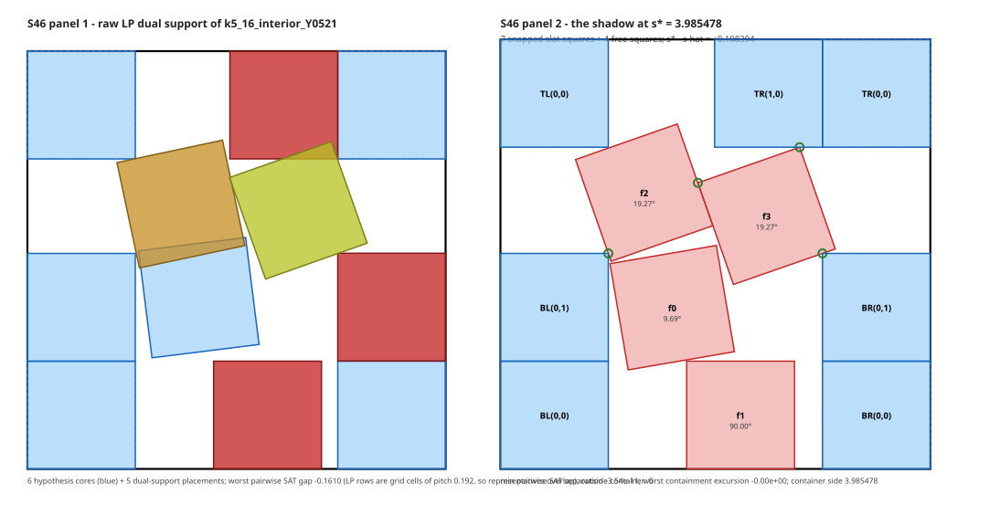

* **s\*** = 3.985477651 = s-hat +0.108394061  (s0 = 3.877084, s\* - s0 = +0.108394)
* **shadow** = 7 slot squares `BL(0,0) BL(0,1) BR(0,0) BR(0,1) TL(0,0) TR(0,0) TR(1,0)` + 4 free squares; a k11 packing.
* **explains** 1 alive-at-LP nodes: k5_16 x1; levels L1:1; component 1 support.
* **load-bearing squares at this landing**: `f2` `f3` `BL(0,1)` `BR(0,1)` `TR(1,0)` (5 of 11); **1 distinct minimised configuration(s)** share this s*.
* **multiplicity**: 1 landings / slot-free splittings (7 slot + 4 free (1 nodes)).
* the free squares do **not** share a tilt: f0 9.693 deg, f1 90.000 deg, f2 19.271 deg, f3 19.271 deg.
* **restarts**: 78 feasible of 101; distinct minima [3.94281, 3.98548, 3.99665, 4.0].

**Free square poses at s\***

| square | cx | cy | tilt (deg) |
|---|---|---|---|
| f0 | 1.592746 | 1.496768 | 9.6926 |
| f1 | 2.226250 | 0.500000 | 90.0000 |
| f2 | 1.332429 | 2.564165 | 19.2714 |
| f3 | 2.467202 | 2.348473 | 19.2714 |

**Contact graph at s\*** (gap < 1e-7; contact force = Fritz-John multiplier, rows unit-normalised)

| contact | type | gap | force |
|---|---|---|---|
| `f2` - `f3` | vertex-on-edge | -3.5e-11 | 0.3734 |
| `f2` - `BL(0,1)` | vertex-on-edge | +3.0e-12 | 0.2736 |
| `f3` - `BR(0,1)` | vertex-on-edge | -4.6e-15 | 0.8049 |
| `f3` - `TR(1,0)` | vertex-on-edge | +2.6e-15 | 1.1032 |
| `f1` - bottom wall | wall | 0 | 0.0000 |

**Binding** (largest Fritz-John resultant first): `f3`-`TR(1,0)` (1.103), `f3`-`BR(0,1)` (0.805), `f2`-`f3` (0.373), `f2`-`BL(0,1)` (0.274).  KKT residual 2.5e-03.
**Convergence caveat**: KKT residual 2.5e-03 (> 1e-6).  The residual measures how far e_s is from the cone of the active CONTACT rows; it is nonzero when the landing also leans on a variable BOUND (s in [3.4, 4.6], centres in [0, 4.6]), which is not a contact and so is not in the Jacobian, or when SLSQP stopped short of a stationary point.  Either way s* = 3.985478 is an upper bound on this shadow's true value and the contact set may be mis-counted at the 1e-7 threshold.
**Rank**: 7 contact rows, 13 variables (s + 3 per free square); rank 7; at fixed s rank 7 of 12, so **5 flat direction(s)**.
  * flat direction 0: blocked at second order (worst active gap changes by -1.12e-14 at |t| = 1e-3 and -9.98e-14 at 3e-3 and -1.11e-12 at 1e-2, ratios 8.9 / 98.7; 9 and 100 are the quadratic signature - curvature -1.121e-08).
  * flat direction 1: free (flex to at least third order) (worst active gap changes by -4.44e-16 at |t| = 1e-3 and -3.11e-15 at 3e-3 and -3.47e-14 at 1e-2, ratios 7.0 / 78.2; 9 and 100 are the quadratic signature - curvature -4.441e-10).
  * flat direction 2: free (flex to at least third order) (worst active gap changes by -3.33e-16 at |t| = 1e-3 and -3.33e-16 at 3e-3 and -2.78e-15 at 1e-2, ratios 1.0 / 8.3; 9 and 100 are the quadratic signature - curvature -3.331e-10).
  * flat direction 3: free (flex to at least third order) (worst active gap changes by -3.33e-16 at |t| = 1e-3 and -5.55e-16 at 3e-3 and -3.22e-15 at 1e-2, ratios 1.67 / 9.7; 9 and 100 are the quadratic signature - curvature -3.331e-10).
  * flat direction 4: free (flex to at least third order) (worst active gap changes by -4.44e-16 at |t| = 1e-3 and -3.11e-15 at 3e-3 and -3.46e-14 at 1e-2, ratios 7.0 / 78.0; 9 and 100 are the quadratic signature - curvature -4.441e-10).

**T2 drain hint - the load-bearing subgraph** (remove one free square and re-minimise)

| removed | s* without it | drop | role |
|---|---|---|---|
| `f0` | 3.985467 | +0.000011 | load-bearing |
| `f1` | 3.985467 | +0.000011 | load-bearing |
| `f2` | 3.914214 | +0.071264 | load-bearing |
| `f3` | 3.707107 | +0.278371 | load-bearing |

**Idle contacts** (zero Fritz-John force - struts, not load paths): `f1`-`bottom wall`.

Load-bearing free squares: `f0`, `f1`, `f2`, `f3`.  Rattlers/struts (removal leaves s\* unchanged): none.

**Alive nodes explained** (1; each id is src/shard/node(level).  Their pose boxes: A57 level-1 boxes are 0.1398 x 0.1398 x 9.73 deg and halve in every coordinate per level (A106 T1); the conditioned square pose of every node below is in `attempts/A107-shadow-gallery/results/shadow_nodes.json`): 
`A57/k5_16_interior_L1/k5_16_interior_Y0521(L1)`

## S47 - a k11 packing at s* = 3.989280 on the boundary of class k5_11

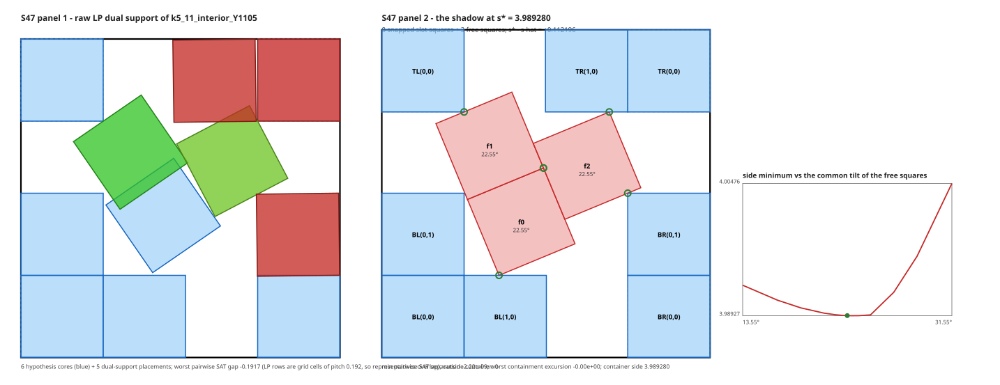

* **s\*** = 3.989279618 = s-hat +0.112196028  (s0 = 3.877084, s\* - s0 = +0.112196)
* **shadow** = 8 slot squares `BL(0,0) BL(0,1) BL(1,0) BR(0,0) BR(0,1) TL(0,0) TR(0,0) TR(1,0)` + 3 free squares; a k11 packing.
* **explains** 1 alive-at-LP nodes: k5_11 x1; levels L1:1; component 1 support.
* **load-bearing squares at this landing**: `f0` `f1` `f2` `BL(1,0)` `BR(0,1)` `TL(0,0)` `TR(1,0)` (7 of 11); **1 distinct minimised configuration(s)** share this s*.
* **multiplicity**: 1 landings / slot-free splittings (8 slot + 3 free (1 nodes)).
* **the free squares share one tilt**: 22.5510 deg (spread 2.96e-07 deg).
* **restarts**: 88 feasible of 101; distinct minima [3.94281, 3.98927, 3.98928, 3.99612, 4.0, 4.00001, 4.00013, 4.00088].

**Free square poses at s\***

| square | cx | cy | tilt (deg) |
|---|---|---|---|
| f0 | 1.694583 | 1.653522 | 22.5510 |
| f1 | 1.310902 | 2.576988 | 22.5510 |
| f2 | 2.494072 | 2.335757 | 22.5510 |

**Contact graph at s\*** (gap < 1e-7; contact force = Fritz-John multiplier, rows unit-normalised)

| contact | type | gap | force |
|---|---|---|---|
| `f0` - `f1` | vertex-on-edge | -1.1e-09 | 0.5975 |
| `f0` - `f2` | vertex-on-edge | -2.2e-09 | 0.2559 |
| `f0` - `BL(1,0)` | vertex-on-edge | +4.4e-16 | 0.4702 |
| `f1` - `TL(0,0)` | vertex-on-edge | -4.4e-16 | 0.5729 |
| `f2` - `BR(0,1)` | vertex-on-edge | +6.7e-16 | 0.4681 |
| `f2` - `TR(1,0)` | vertex-on-edge | -8.9e-16 | 0.6519 |

**Binding** (largest Fritz-John resultant first): `f2`-`TR(1,0)` (0.652), `f0`-`f1` (0.597), `f1`-`TL(0,0)` (0.573), `f0`-`BL(1,0)` (0.470), `f2`-`BR(0,1)` (0.468), `f0`-`f2` (0.256).  KKT residual 1.7e-03.
**Convergence caveat**: KKT residual 1.7e-03 (> 1e-6).  The residual measures how far e_s is from the cone of the active CONTACT rows; it is nonzero when the landing also leans on a variable BOUND (s in [3.4, 4.6], centres in [0, 4.6]), which is not a contact and so is not in the Jacobian, or when SLSQP stopped short of a stationary point.  Either way s* = 3.989280 is an upper bound on this shadow's true value and the contact set may be mis-counted at the 1e-7 threshold.
**Rank**: 8 contact rows, 10 variables (s + 3 per free square); rank 8; at fixed s rank 8 of 9, so **1 flat direction(s)**.
  * flat direction 0: blocked at second order (worst active gap changes by -2.61e-13 at |t| = 1e-3 and -2.35e-12 at 3e-3 and -2.61e-11 at 1e-2, ratios 9.0 / 100.0; 9 and 100 are the quadratic signature - curvature -2.608e-07).

**T2 drain hint - the load-bearing subgraph** (remove one free square and re-minimise)

| removed | s* without it | drop | role |
|---|---|---|---|
| `f0` | 4.000000 | -0.010720 | rattler |
| `f1` | 3.942809 | +0.046471 | load-bearing |
| `f2` | 3.707107 | +0.282173 | load-bearing |

Load-bearing free squares: `f1`, `f2`.  Rattlers/struts (removal leaves s\* unchanged): `f0`.

**Common-tilt sweep** (all free squares held at one tilt, slot squares fixed, s minimised)

| tilt (deg) | 13.55 | 16.55 | 18.55 | 20.55 | 21.55 | 22.15 | 22.55 | 22.95 | 23.55 | 24.55 | 26.55 | 28.55 | 31.55 |
|---|---|---|---|---|---|---|---|---|---|---|---|---|---|
| s* | 3.992836 | 3.991084 | 3.990185 | 3.989567 | 3.989379 | 3.989309 | 3.989280 | 3.989266 | 3.989273 | 3.989366 | 3.992013 | 3.996221 | 4.004756 |

**Alive nodes explained** (1; each id is src/shard/node(level).  Their pose boxes: A57 level-1 boxes are 0.1398 x 0.1398 x 9.73 deg and halve in every coordinate per level (A106 T1); the conditioned square pose of every node below is in `attempts/A107-shadow-gallery/results/shadow_nodes.json`): 
`A57/k5_11_interior_G1/k5_11_interior_Y1105(L1)`

## S48 - a k11 packing at s* = 3.996435 on the boundary of class k5_16

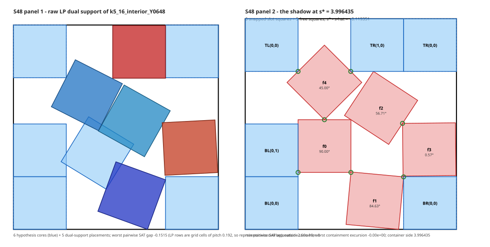

* **s\*** = 3.996434529 = s-hat +0.119350939  (s0 = 3.877084, s\* - s0 = +0.119351)
* **shadow** = 6 slot squares `BL(0,0) BL(0,1) BR(0,0) TL(0,0) TR(0,0) TR(1,0)` + 5 free squares; a k11 packing.
* **explains** 1 alive-at-LP nodes: k5_16 x1; levels L1:1; component 1 support.
* **load-bearing squares at this landing**: `f0` `f1` `f4` `BL(0,1)` `BR(0,0)` `TL(0,0)` `TR(1,0)` (7 of 11); **1 distinct minimised configuration(s)** share this s*.
* **multiplicity**: 1 landings / slot-free splittings (6 slot + 5 free (1 nodes)).
* the free squares do **not** share a tilt: f0 90.000 deg, f1 84.633 deg, f2 56.707 deg, f3 0.568 deg, f4 45.000 deg.
* **restarts**: 64 feasible of 101; distinct minima [3.94281, 3.97662, 3.98547, 3.99643, 3.99672, 3.99963, 4.0, 4.00128].

**Free square poses at s\***

| square | cx | cy | tilt (deg) |
|---|---|---|---|
| f0 | 1.500000 | 1.580438 | 90.0000 |
| f1 | 2.451860 | 0.544574 | 84.6332 |
| f2 | 2.570676 | 2.303894 | 56.7074 |
| f3 | 3.481624 | 1.516258 | 0.5682 |
| f4 | 1.498217 | 2.787545 | 45.0000 |

**Contact graph at s\*** (gap < 1e-7; contact force = Fritz-John multiplier, rows unit-normalised)

| contact | type | gap | force |
|---|---|---|---|
| `f0` - `f1` | vertex-on-edge | +5.7e-13 | 1.3765 |
| `f0` - `f4` | vertex-on-edge | -1.8e-12 | 0.1164 |
| `f0` - `BL(0,1)` | vertex-on-edge | -2.7e-10 | 0.9622 |
| `f1` - `BR(0,0)` | vertex-on-edge | -2.3e-13 | 1.3011 |
| `f4` - `TL(0,0)` | vertex-on-edge | +5.5e-12 | 0.0723 |
| `f4` - `TR(1,0)` | vertex-on-edge | +2.1e-12 | 0.1015 |
| `f1` - bottom wall | wall | 0 | 0.0903 |

**Binding** (largest Fritz-John resultant first): `f0`-`f1` (1.376), `f1`-`BR(0,0)` (1.301), `f0`-`BL(0,1)` (0.962), `f0`-`f4` (0.116), `f4`-`TR(1,0)` (0.102), `f1`-`bottom wall` (0.090).  KKT residual 5.6e-09.
**Rank**: 8 contact rows, 16 variables (s + 3 per free square); rank 8; at fixed s rank 8 of 15, so **7 flat direction(s)**.
  * flat direction 0: free (flex to at least third order) (worst active gap changes by +0.00e+00 at |t| = 1e-3 and +0.00e+00 at 3e-3 and +0.00e+00 at 1e-2, no change at any step - a genuine one-parameter motion).
  * flat direction 1: free (flex to at least third order) (worst active gap changes by +0.00e+00 at |t| = 1e-3 and +0.00e+00 at 3e-3 and +0.00e+00 at 1e-2, no change at any step - a genuine one-parameter motion).
  * flat direction 2: free (flex to at least third order) (worst active gap changes by +0.00e+00 at |t| = 1e-3 and +0.00e+00 at 3e-3 and +0.00e+00 at 1e-2, no change at any step - a genuine one-parameter motion).
  * flat direction 3: free (flex to at least third order) (worst active gap changes by +0.00e+00 at |t| = 1e-3 and +0.00e+00 at 3e-3 and +0.00e+00 at 1e-2, no change at any step - a genuine one-parameter motion).
  * flat direction 4: blocked at second order (worst active gap changes by -4.22e-08 at |t| = 1e-3 and -3.80e-07 at 3e-3 and -4.23e-06 at 1e-2, ratios 9.0 / 100.0; 9 and 100 are the quadratic signature - curvature -4.225e-02).
  * flat direction 5: blocked at second order (worst active gap changes by -3.74e-10 at |t| = 1e-3 and -3.37e-09 at 3e-3 and -3.74e-08 at 1e-2, ratios 9.0 / 100.0; 9 and 100 are the quadratic signature - curvature -3.743e-04).
  * flat direction 6: blocked at second order (worst active gap changes by -3.76e-07 at |t| = 1e-3 and -3.38e-06 at 3e-3 and -3.76e-05 at 1e-2, ratios 9.0 / 100.1; 9 and 100 are the quadratic signature - curvature -3.758e-01).

**T2 drain hint - the load-bearing subgraph** (remove one free square and re-minimise)

| removed | s* without it | drop | role |
|---|---|---|---|
| `f0` | 3.728583 | +0.267851 | load-bearing |
| `f1` | 3.822876 | +0.173559 | load-bearing |
| `f2` | 3.822876 | +0.173559 | load-bearing |
| `f3` | 3.822876 | +0.173559 | load-bearing |
| `f4` | 3.914214 | +0.082221 | load-bearing |

Load-bearing free squares: `f0`, `f1`, `f2`, `f3`, `f4`.  Rattlers/struts (removal leaves s\* unchanged): none.

**Alive nodes explained** (1; each id is src/shard/node(level).  Their pose boxes: A57 level-1 boxes are 0.1398 x 0.1398 x 9.73 deg and halve in every coordinate per level (A106 T1); the conditioned square pose of every node below is in `attempts/A107-shadow-gallery/results/shadow_nodes.json`): 
`A57/k5_16_interior_G1/k5_16_interior_Y0648(L1)`

## S49 - a k11 packing at s* = 3.996724 on the boundary of class k5_11

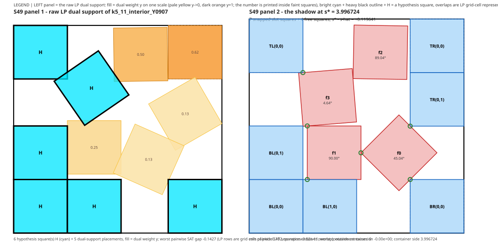

* **s\*** = 3.996724423 = s-hat +0.119640833  (s0 = 3.877084, s\* - s0 = +0.119640)
* **shadow** = 7 slot squares `BL(0,0) BL(0,1) BL(1,0) BR(0,0) TL(0,0) TR(0,0) TR(0,1)` + 4 free squares; a k11 packing.
* **explains** 1 alive-at-LP nodes: k5_11 x1; levels L1:1; component 1 support.
* **load-bearing squares at this landing**: `f0` `f1` `f3` `BL(1,0)` `BR(0,0)` `TL(0,0)` `TR(0,1)` (7 of 11); **1 distinct minimised configuration(s)** share this s*.
* **multiplicity**: 1 landings / slot-free splittings (7 slot + 4 free (1 nodes)).
* the free squares do **not** share a tilt: f0 45.044 deg, f1 90.000 deg, f2 89.041 deg, f3 4.640 deg.
* **restarts**: 71 feasible of 101; distinct minima [3.94281, 3.99672, 4.0, 4.03429, 4.12132, 4.6].

**Free square poses at s\***

| square | cx | cy | tilt (deg) |
|---|---|---|---|
| f0 | 2.787979 | 1.498584 | 45.0439 |
| f1 | 1.580873 | 1.500000 | 90.0000 |
| f2 | 2.442568 | 3.375753 | 89.0407 |
| f3 | 1.458475 | 2.532293 | 4.6403 |

**Contact graph at s\*** (gap < 1e-7; contact force = Fritz-John multiplier, rows unit-normalised)

| contact | type | gap | force |
|---|---|---|---|
| `f0` - `f1` | vertex-on-edge | +1.6e-14 | 0.1023 |
| `f0` - `BR(0,0)` | vertex-on-edge | -2.6e-14 | 0.0636 |
| `f0` - `TR(0,1)` | vertex-on-edge | -5.8e-15 | 0.0892 |
| `f1` - `f3` | vertex-on-edge | -5.1e-15 | 1.3814 |
| `f1` - `BL(1,0)` | vertex-on-edge | -3.8e-11 | 0.9810 |
| `f3` - `TL(0,0)` | vertex-on-edge | +6.4e-15 | 1.3173 |

**Binding** (largest Fritz-John resultant first): `f1`-`f3` (1.381), `f3`-`TL(0,0)` (1.317), `f1`-`BL(1,0)` (0.981), `f0`-`f1` (0.102), `f0`-`TR(0,1)` (0.089), `f0`-`BR(0,0)` (0.064).  KKT residual 3.8e-05.
**Convergence caveat**: KKT residual 3.8e-05 (> 1e-6).  The residual measures how far e_s is from the cone of the active CONTACT rows; it is nonzero when the landing also leans on a variable BOUND (s in [3.4, 4.6], centres in [0, 4.6]), which is not a contact and so is not in the Jacobian, or when SLSQP stopped short of a stationary point.  Either way s* = 3.996724 is an upper bound on this shadow's true value and the contact set may be mis-counted at the 1e-7 threshold.
**Rank**: 7 contact rows, 13 variables (s + 3 per free square); rank 7; at fixed s rank 7 of 12, so **5 flat direction(s)**.
  * flat direction 0: free (flex to at least third order) (worst active gap changes by +0.00e+00 at |t| = 1e-3 and +0.00e+00 at 3e-3 and +0.00e+00 at 1e-2, no change at any step - a genuine one-parameter motion).
  * flat direction 1: free (flex to at least third order) (worst active gap changes by +0.00e+00 at |t| = 1e-3 and +0.00e+00 at 3e-3 and +0.00e+00 at 1e-2, no change at any step - a genuine one-parameter motion).
  * flat direction 2: blocked at second order (worst active gap changes by -1.39e-08 at |t| = 1e-3 and -1.25e-07 at 3e-3 and -1.39e-06 at 1e-2, ratios 9.0 / 100.0; 9 and 100 are the quadratic signature - curvature -1.386e-02).
  * flat direction 3: blocked at second order (worst active gap changes by -2.11e-08 at |t| = 1e-3 and -1.90e-07 at 3e-3 and -2.11e-06 at 1e-2, ratios 9.0 / 100.0; 9 and 100 are the quadratic signature - curvature -2.109e-02).
  * flat direction 4: blocked at second order (worst active gap changes by -1.38e-07 at |t| = 1e-3 and -1.24e-06 at 3e-3 and -1.38e-05 at 1e-2, ratios 9.0 / 100.1; 9 and 100 are the quadratic signature - curvature -1.377e-01).

**T2 drain hint - the load-bearing subgraph** (remove one free square and re-minimise)

| removed | s* without it | drop | role |
|---|---|---|---|
| `f0` | 3.707107 | +0.289618 | load-bearing |
| `f1` | 3.707107 | +0.289618 | load-bearing |
| `f2` | 3.942809 | +0.053915 | load-bearing |
| `f3` | 3.942809 | +0.053915 | load-bearing |

Load-bearing free squares: `f0`, `f1`, `f2`, `f3`.  Rattlers/struts (removal leaves s\* unchanged): none.

**Alive nodes explained** (1; each id is src/shard/node(level).  Their pose boxes: A57 level-1 boxes are 0.1398 x 0.1398 x 9.73 deg and halve in every coordinate per level (A106 T1); the conditioned square pose of every node below is in `attempts/A107-shadow-gallery/results/shadow_nodes.json`): 
`A57/k5_11_interior_G1/k5_11_interior_Y0907(L1)`

## S50 - a k11 packing at s* = 4.000027 on the boundary of class trump5

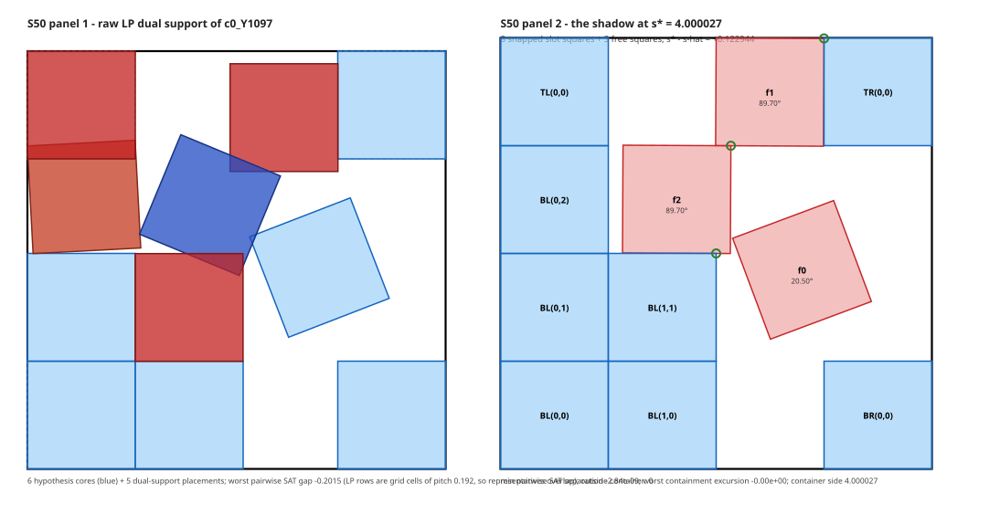

* **s\*** = 4.000027330 = s-hat +0.122943740  (s0 = 3.877084, s\* - s0 = +0.122943)
* **shadow** = 8 slot squares `BL(0,0) BL(0,1) BL(0,2) BL(1,0) BL(1,1) BR(0,0) TL(0,0) TR(0,0)` + 3 free squares; a k11 packing.
* **explains** 1 alive-at-LP nodes: trump5 x1; levels L1:1; component 1 support.
* **load-bearing squares at this landing**: `f1` `f2` `BL(1,1)` `TR(0,0)` (4 of 11); **1 distinct minimised configuration(s)** share this s*.
* **multiplicity**: 1 landings / slot-free splittings (8 slot + 3 free (1 nodes)).
* the free squares do **not** share a tilt: f0 20.500 deg, f1 89.699 deg, f2 89.699 deg.
* **restarts**: 68 feasible of 101; distinct minima [4.0, 4.00001, 4.00003, 4.00277].

**Free square poses at s\***

| square | cx | cy | tilt (deg) |
|---|---|---|---|
| f0 | 2.795681 | 1.847223 | 20.5002 |
| f1 | 2.497410 | 3.497410 | 89.6993 |
| f2 | 1.634205 | 2.501927 | 89.6993 |

**Contact graph at s\*** (gap < 1e-7; contact force = Fritz-John multiplier, rows unit-normalised)

| contact | type | gap | force |
|---|---|---|---|
| `f1` - `f2` | vertex-on-edge | -2.8e-09 | 1.5394 |
| `f1` - `TR(0,0)` | vertex-on-edge | +8.5e-14 | 0.0050 |
| `f2` - `BL(1,1)` | vertex-on-edge | +1.8e-13 | 1.0627 |
| `f1` - top wall | wall | 0 | 1.4941 |

**Binding** (largest Fritz-John resultant first): `f1`-`f2` (1.539), `f1`-`top wall` (1.494), `f2`-`BL(1,1)` (1.063), `f1`-`TR(0,0)` (0.005).  KKT residual 6.4e-03.
**Convergence caveat**: KKT residual 6.4e-03 (> 1e-6).  The residual measures how far e_s is from the cone of the active CONTACT rows; it is nonzero when the landing also leans on a variable BOUND (s in [3.4, 4.6], centres in [0, 4.6]), which is not a contact and so is not in the Jacobian, or when SLSQP stopped short of a stationary point.  Either way s* = 4.000027 is an upper bound on this shadow's true value and the contact set may be mis-counted at the 1e-7 threshold.
**Rank**: 5 contact rows, 10 variables (s + 3 per free square); rank 5; at fixed s rank 5 of 9, so **4 flat direction(s)**.
  * flat direction 0: free (flex to at least third order) (worst active gap changes by -2.22e-16 at |t| = 1e-3 and -1.11e-16 at 3e-3 and -2.22e-16 at 1e-2, ratios 0.5 / 1.0; 9 and 100 are the quadratic signature - curvature -2.220e-10).
  * flat direction 1: free (flex to at least third order) (worst active gap changes by -3.33e-16 at |t| = 1e-3 and -6.66e-16 at 3e-3 and -5.22e-15 at 1e-2, ratios 2.0 / 15.7; 9 and 100 are the quadratic signature - curvature -3.331e-10).
  * flat direction 2: free (flex to at least third order) (worst active gap changes by -2.22e-16 at |t| = 1e-3 and -2.22e-16 at 3e-3 and -2.22e-16 at 1e-2, ratios 1.0 / 1.0; 9 and 100 are the quadratic signature - curvature -2.220e-10).
  * flat direction 3: free (flex to at least third order) (worst active gap changes by -2.22e-16 at |t| = 1e-3 and +0.00e+00 at 3e-3 and -3.33e-16 at 1e-2, ratios -0.0 / 1.5; 9 and 100 are the quadratic signature - curvature -2.220e-10).

**T2 drain hint - the load-bearing subgraph** (remove one free square and re-minimise)

| removed | s* without it | drop | role |
|---|---|---|---|
| `f0` | 4.000000 | +0.000027 | load-bearing |
| `f1` | 4.000000 | +0.000027 | load-bearing |
| `f2` | 4.000000 | +0.000027 | load-bearing |

Load-bearing free squares: `f0`, `f1`, `f2`.  Rattlers/struts (removal leaves s\* unchanged): none.

**Alive nodes explained** (1; each id is src/shard/node(level).  Their pose boxes: A57 level-1 boxes are 0.1398 x 0.1398 x 9.73 deg and halve in every coordinate per level (A106 T1); the conditioned square pose of every node below is in `attempts/A107-shadow-gallery/results/shadow_nodes.json`): 
`A60/nodes/c0_Y1097(L1)`

## S51 - a k11 packing at s* = 4.000052 on the boundary of class k5_11

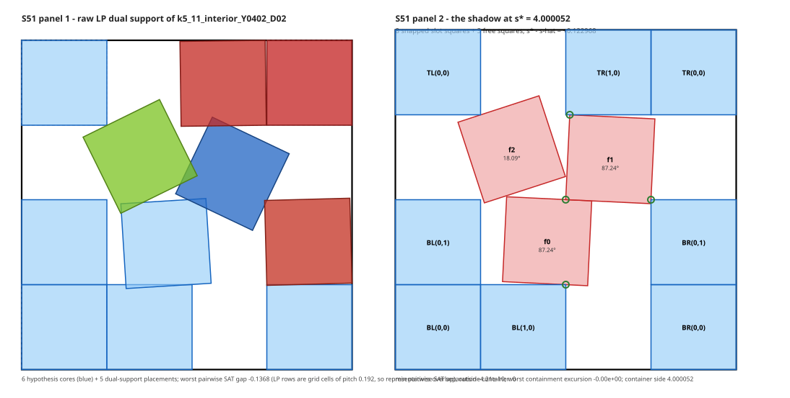

* **s\*** = 4.000051836 = s-hat +0.122968246  (s0 = 3.877084, s\* - s0 = +0.122968)
* **shadow** = 8 slot squares `BL(0,0) BL(0,1) BL(1,0) BR(0,0) BR(0,1) TL(0,0) TR(0,0) TR(1,0)` + 3 free squares; a k11 packing.
* **explains** 1 alive-at-LP nodes: k5_11 x1; levels L2:1; component 1 support.
* **load-bearing squares at this landing**: `f0` `f1` `BL(1,0)` `BR(0,1)` `TR(1,0)` (5 of 11); **1 distinct minimised configuration(s)** share this s*.
* **multiplicity**: 1 landings / slot-free splittings (8 slot + 3 free (1 nodes)).
* the free squares do **not** share a tilt: f0 87.243 deg, f1 87.243 deg, f2 18.094 deg.
* **restarts**: 86 feasible of 101; distinct minima [3.94281, 3.98926, 3.99612, 4.0, 4.00005].

**Free square poses at s\***

| square | cx | cy | tilt (deg) |
|---|---|---|---|
| f0 | 1.781182 | 1.511116 | 87.2431 |
| f1 | 2.522421 | 2.476582 | 87.2431 |
| f2 | 1.365310 | 2.592909 | 18.0940 |

**Contact graph at s\*** (gap < 1e-7; contact force = Fritz-John multiplier, rows unit-normalised)

| contact | type | gap | force |
|---|---|---|---|
| `f0` - `f1` | vertex-on-edge | -4.2e-10 | 1.4337 |
| `f0` - `BL(1,0)` | vertex-on-edge | +3.0e-12 | 0.9805 |
| `f1` - `BR(0,1)` | vertex-on-edge | -1.1e-15 | 0.0689 |
| `f1` - `TR(1,0)` | vertex-on-edge | -2.2e-16 | 1.4227 |

**Binding** (largest Fritz-John resultant first): `f0`-`f1` (1.434), `f1`-`TR(1,0)` (1.423), `f0`-`BL(1,0)` (0.981), `f1`-`BR(0,1)` (0.069).  KKT residual 2.0e-03.
**Convergence caveat**: KKT residual 2.0e-03 (> 1e-6).  The residual measures how far e_s is from the cone of the active CONTACT rows; it is nonzero when the landing also leans on a variable BOUND (s in [3.4, 4.6], centres in [0, 4.6]), which is not a contact and so is not in the Jacobian, or when SLSQP stopped short of a stationary point.  Either way s* = 4.000052 is an upper bound on this shadow's true value and the contact set may be mis-counted at the 1e-7 threshold.
**Rank**: 5 contact rows, 10 variables (s + 3 per free square); rank 5; at fixed s rank 5 of 9, so **4 flat direction(s)**.
  * flat direction 0: blocked at second order (worst active gap changes by -2.38e-13 at |t| = 1e-3 and -2.14e-12 at 3e-3 and -2.38e-11 at 1e-2, ratios 8.99 / 99.9; 9 and 100 are the quadratic signature - curvature -2.384e-07).
  * flat direction 1: free (flex to at least third order) (worst active gap changes by +0.00e+00 at |t| = 1e-3 and +0.00e+00 at 3e-3 and +0.00e+00 at 1e-2, no change at any step - a genuine one-parameter motion).
  * flat direction 2: free (flex to at least third order) (worst active gap changes by +0.00e+00 at |t| = 1e-3 and +0.00e+00 at 3e-3 and +0.00e+00 at 1e-2, no change at any step - a genuine one-parameter motion).
  * flat direction 3: free (flex to at least third order) (worst active gap changes by +0.00e+00 at |t| = 1e-3 and +0.00e+00 at 3e-3 and +0.00e+00 at 1e-2, no change at any step - a genuine one-parameter motion).

**T2 drain hint - the load-bearing subgraph** (remove one free square and re-minimise)

| removed | s* without it | drop | role |
|---|---|---|---|
| `f0` | 4.000000 | +0.000052 | load-bearing |
| `f1` | 3.707107 | +0.292945 | load-bearing |
| `f2` | 4.000000 | +0.000052 | load-bearing |

Load-bearing free squares: `f0`, `f1`, `f2`.  Rattlers/struts (removal leaves s\* unchanged): none.

**Alive nodes explained** (1; each id is src/shard/node(level).  Their pose boxes: A57 level-1 boxes are 0.1398 x 0.1398 x 9.73 deg and halve in every coordinate per level (A106 T1); the conditioned square pose of every node below is in `attempts/A107-shadow-gallery/results/shadow_nodes.json`): 
`A57/k5_11_interior_G1_D2/k5_11_interior_Y0402_D02(L2)`

## S52 - a k11 packing at s* = 4.000197 on the boundary of class trump5

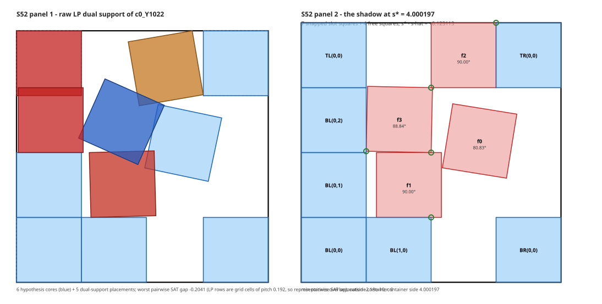

* **s\*** = 4.000196613 = s-hat +0.123113023  (s0 = 3.877084, s\* - s0 = +0.123113)
* **shadow** = 8 slot squares `BL(0,0) BL(0,1) BL(0,2) BL(1,0) BR(0,0) TL(0,0) TR(0,0)` `TR(1,0) (=f2)` + 3 free squares; a k11 packing.
  * **gallery v1 counted this as 7 slot + 4 free** (A121): `f2` sits on `TR(1,0)` to within 1e-3 in position and 0.05 deg of axis - snapped slot squares, not free ones.  The f-indices are kept everywhere below (contact graph, forces, flat directions, rattler table) so A121's review rows stay valid.
* **explains** 1 alive-at-LP nodes: trump5 x1; levels L1:1; component 1 support.
* **load-bearing squares at this landing**: `f1` `f2` `f3` `BL(0,2)` `BL(1,0)` `TR(0,0)` (6 of 11); **1 distinct minimised configuration(s)** share this s*.
* **multiplicity**: 1 landings / slot-free splittings (7 slot + 4 free (1 nodes)).
* the free squares do **not** share a tilt: f0 80.825 deg, f1 90.000 deg, f2 90.000 deg, f3 88.841 deg.
* **restarts**: 78 feasible of 101; distinct minima [4.0, 4.00001, 4.0002, 4.15738, 4.22263].

**Free square poses at s\***

| square | cx | cy | tilt (deg) |
|---|---|---|---|
| f0 | 2.746119 | 2.178295 | 80.8252 |
| f1 | 1.657244 | 1.500000 | 90.0000 |
| f2 | 2.500197 | 3.500197 | 90.0000 |
| f3 | 1.510014 | 2.510014 | 88.8407 |

**Contact graph at s\*** (gap < 1e-7; contact force = Fritz-John multiplier, rows unit-normalised)

| contact | type | gap | force |
|---|---|---|---|
| `f1` - `f3` | vertex-on-edge | +3.3e-15 | 1.4941 |
| `f1` - `BL(1,0)` | vertex-on-edge | +1.7e-15 | 1.0287 |
| `f2` - `f3` | vertex-on-edge | -2.9e-15 | 1.5398 |
| `f2` - `TR(0,0)` | exactly-opposite | -2.2e-10 | 0.0491 |
| `f3` - `BL(0,2)` | vertex-on-edge | +2.7e-13 | 0.0151 |
| `f2` - top wall | wall | 0 | 1.4394 |

**Binding** (largest Fritz-John resultant first): `f2`-`f3` (1.540), `f1`-`f3` (1.494), `f2`-`top wall` (1.439), `f1`-`BL(1,0)` (1.029), `f2`-`TR(0,0)` (0.049), `f3`-`BL(0,2)` (0.015).  KKT residual 1.6e-02.  Exactly-opposite (vertex-vertex) contacts, whose normal is a cone and whose individual multipliers are therefore ill-conditioned: `f2`-`TR(0,0)`.
**Convergence caveat**: KKT residual 1.6e-02 (> 1e-6).  The residual measures how far e_s is from the cone of the active CONTACT rows; it is nonzero when the landing also leans on a variable BOUND (s in [3.4, 4.6], centres in [0, 4.6]), which is not a contact and so is not in the Jacobian, or when SLSQP stopped short of a stationary point.  Either way s* = 4.000197 is an upper bound on this shadow's true value and the contact set may be mis-counted at the 1e-7 threshold.
**Rank**: 11 contact rows, 13 variables (s + 3 per free square); rank 8; at fixed s rank 8 of 12, so **4 flat direction(s)**.
  * flat direction 0: free (flex to at least third order) (worst active gap changes by -4.44e-16 at |t| = 1e-3 and -2.78e-15 at 3e-3 and -3.00e-14 at 1e-2, ratios 6.25 / 67.5; 9 and 100 are the quadratic signature - curvature -4.441e-10).
  * flat direction 1: blocked at second order (worst active gap changes by -4.88e-15 at |t| = 1e-3 and -4.30e-14 at 3e-3 and -4.76e-13 at 1e-2, ratios 8.8 / 97.5; 9 and 100 are the quadratic signature - curvature -4.885e-09).
  * flat direction 2: blocked at second order (worst active gap changes by -7.63e-14 at |t| = 1e-3 and -6.86e-13 at 3e-3 and -7.62e-12 at 1e-2, ratios 9.0 / 100.0; 9 and 100 are the quadratic signature - curvature -7.627e-08).
  * flat direction 3: blocked at second order (worst active gap changes by -1.02e-14 at |t| = 1e-3 and -9.19e-14 at 3e-3 and -1.02e-12 at 1e-2, ratios 9.0 / 99.8; 9 and 100 are the quadratic signature - curvature -1.021e-08).

**T2 drain hint - the load-bearing subgraph** (remove one free square and re-minimise)

| removed | s* without it | drop | role |
|---|---|---|---|
| `f0` | 4.000000 | +0.000197 | load-bearing |
| `f1` | 4.000000 | +0.000197 | load-bearing |
| `f2` | 4.000000 | +0.000197 | load-bearing |
| `f3` | 4.000000 | +0.000197 | load-bearing |

Load-bearing free squares: `f0`, `f1`, `f2`, `f3`.  Rattlers/struts (removal leaves s\* unchanged): none.

**Alive nodes explained** (1; each id is src/shard/node(level).  Their pose boxes: A57 level-1 boxes are 0.1398 x 0.1398 x 9.73 deg and halve in every coordinate per level (A106 T1); the conditioned square pose of every node below is in `attempts/A107-shadow-gallery/results/shadow_nodes.json`): 
`A60/nodes/c0_Y1022(L1)`

## S53 - a k11 packing at s* = 4.000261 on the boundary of class k5_11

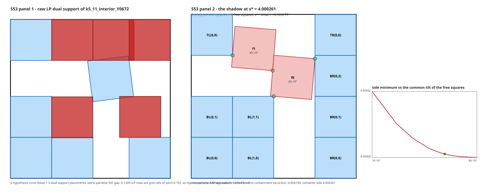

* **s\*** = 4.000260741 = s-hat +0.123177150  (s0 = 3.877084, s\* - s0 = +0.123177)
* **shadow** = 9 slot squares `BL(0,0) BL(0,1) BL(1,0) BL(1,1) BR(0,0) BR(0,1) BR(0,2) TL(0,0) TR(0,0)` + 2 free squares; a k11 packing.
* **explains** 1 alive-at-LP nodes: k5_11 x1; levels L1:1; component 1 support.
* **load-bearing squares at this landing**: `f0` `f1` `BL(1,1)` `BR(0,2)` `TL(0,0)` (5 of 11); **1 distinct minimised configuration(s)** share this s*.
* **multiplicity**: 1 landings / slot-free splittings (9 slot + 2 free (1 nodes)).
* **the free squares share one tilt**: 85.1922 deg (spread 1.74e-07 deg).
* **restarts**: 84 feasible of 101; distinct minima [4.0, 4.00026, 4.6].

**Free square poses at s\***

| square | cx | cy | tilt (deg) |
|---|---|---|---|
| f0 | 2.460113 | 2.463066 | 85.1922 |
| f1 | 1.515885 | 3.168131 | 85.1922 |

**Contact graph at s\*** (gap < 1e-7; contact force = Fritz-John multiplier, rows unit-normalised)

| contact | type | gap | force |
|---|---|---|---|
| `f0` - `f1` | vertex-on-edge | +2.4e-13 | 1.3714 |
| `f0` - `BL(1,1)` | vertex-on-edge | +1.1e-16 | 0.0856 |
| `f0` - `BR(0,2)` | vertex-on-edge | -1.7e-15 | 1.3713 |
| `f1` - `TL(0,0)` | vertex-on-edge | -6.7e-16 | 0.9437 |

**Binding** (largest Fritz-John resultant first): `f0`-`f1` (1.371), `f0`-`BR(0,2)` (1.371), `f1`-`TL(0,0)` (0.944), `f0`-`BL(1,1)` (0.086).  KKT residual 5.8e-03.
**Convergence caveat**: KKT residual 5.8e-03 (> 1e-6).  The residual measures how far e_s is from the cone of the active CONTACT rows; it is nonzero when the landing also leans on a variable BOUND (s in [3.4, 4.6], centres in [0, 4.6]), which is not a contact and so is not in the Jacobian, or when SLSQP stopped short of a stationary point.  Either way s* = 4.000261 is an upper bound on this shadow's true value and the contact set may be mis-counted at the 1e-7 threshold.
**Rank**: 5 contact rows, 7 variables (s + 3 per free square); rank 5; at fixed s rank 5 of 6, so **1 flat direction(s)**.
  * flat direction 0: blocked at second order (worst active gap changes by -6.44e-14 at |t| = 1e-3 and -5.79e-13 at 3e-3 and -6.44e-12 at 1e-2, ratios 8.99 / 99.9; 9 and 100 are the quadratic signature - curvature -6.439e-08).

**T2 drain hint - the load-bearing subgraph** (remove one free square and re-minimise)

| removed | s* without it | drop | role |
|---|---|---|---|
| `f0` | 4.000000 | +0.000261 | load-bearing |
| `f1` | 4.000000 | +0.000261 | load-bearing |

Load-bearing free squares: `f0`, `f1`.  Rattlers/struts (removal leaves s\* unchanged): none.

**Common-tilt sweep** (all free squares held at one tilt, slot squares fixed, s minimised)

| tilt (deg) | 76.19 | 79.19 | 81.19 | 83.19 | 84.19 | 84.79 | 85.19 | 85.59 | 86.19 | 87.19 | 89.19 |
|---|---|---|---|---|---|---|---|---|---|---|---|
| s* | 4.004921 | 4.002543 | 4.001448 | 4.000703 | 4.000448 | 4.000328 | 4.000261 | 4.000203 | 4.000133 | 4.000055 | 4.000001 |

**Alive nodes explained** (1; each id is src/shard/node(level).  Their pose boxes: A57 level-1 boxes are 0.1398 x 0.1398 x 9.73 deg and halve in every coordinate per level (A106 T1); the conditioned square pose of every node below is in `attempts/A107-shadow-gallery/results/shadow_nodes.json`): 
`A57/k5_11_interior_G1/k5_11_interior_Y0672(L1)`

## Alive nodes not explained by any integral shadow

306 of 1566 alive-at-LP nodes have a dual support that is fractional AND contains
no full-size integral component (no `budget` many pairwise cell-disjoint placements among those
with y > 0.02).  For these the LP is stalling on a genuinely fractional object, not on a
near-packing, so there is no drawing to hand back.

| source | class | level | count | largest independent set found (of budget) |
|---|---|---|---|---|
| A57 | k5_11 | L1 | 110 | 4/5 x108, 3/5 x2 |
| A57 | k5_11 | L2 | 35 | 4/5 x35 |
| A57 | k5_11 | L3 | 4 | 4/5 x4 |
| A57 | k5_11 | L4 | 2 | 4/5 x2 |
| A57 | k5_16 | L1 | 106 | 4/5 x105, 3/5 x1 |
| A57 | k5_16 | L2 | 7 | 4/5 x7 |
| A60 | trump5 | L1 | 42 | 4/5 x40, 3/5 x1, 2/3 x1 |

Full list: `attempts/A107-shadow-gallery/results/unexplained.json`.

# Part II - the k0_00 cells (A38 / A85 / A99)

The k0_00 class has **no pins**: a node's only hypothesis core is the conditioned square, so
the class symmetry group is the **full D4** (8 elements), not the stabiliser of a pin set, and
every de-duplication below runs over all 8.  Everything else is the Part I pipeline unchanged:
the near-simple placements of the dual support are snapped to named slot cells and fixed as
affine functions of s, the rest are free, and s is minimised.

Sources and the alive test.  A38-root-power `results/{l1,l2,l3}_nodes/*.json` (134 + 49 + 11
with an LP support), A85-k0-route `results/nodes/k0_00/*.json` (12) and A99-k0-tree-v2
`results/nodes/k0_00/*.json` (54) - 260 node jsons in the same format as Part I (tau, budget,
`hyp.cores`, `packing` with y, `rows_all`).  A node counts as alive when the LP did not certify
it (`dead == False`) **or** its LP value already reaches the budget (tau >= budget); on this
corpus the second condition is contained in the first.  **217 alive k0 cells**: A38 153, A99 53, A85 11; 43 of them sit at tau >= budget.
Budget is 10 (n = 10) on 214 of them, so a k0 shadow is a k11 packing when the support is full
and shorter otherwise.  All are at the certified side s0 = 3.877084.

**30 distinct k0 shadow values explain 161 of the 217 alive cells**; 56 are explained by no integral shadow.

| shadow | sources | k of the shadow | gallery v1 split | s* | s* - s-hat | k0 cells | #cfg | levels | free sq | common tilt | flexes | coincides with |
|---|---|---|---|---|---|---|---|---|---|---|---|---|
| **K01** | A38 x65, A99 x12, A85 x7 | k11 (6 slot + 5 free) | 6 slot + 5 free | 4.000000 | +0.122916 | 84 | 45 | L1:65, L2:15, L3:4 | 5 | no | 14 | - |
| **K02** | A38 x10 | k11 (4 slot + 7 free) | 4 slot + 7 free | 3.942809 | +0.065725 | 10 | 7 | L1:8, L2:1, L3:1 | 7 | no | 11 | - |
| **K03** | A38 x9 | k11 (5 slot + 6 free) | 4 slot + 7 free | 3.925149 | +0.048065 | 9 | 5 | L1:4, L2:4, L3:1 | 6 | no | 3 | S37 (0.57) |
| **K04** | A38 x8, A99 x1 | k11 (5 slot + 6 free) | 2 slot + 9 free | 3.914214 | +0.037130 | 9 | 8 | L1:9 | 6 | no | 5 | S32 (0.57); S05 (0.57) |
| **K05** | A38 x8 | k11 (6 slot + 5 free) | 4 slot + 7 free | 3.912232 | +0.035148 | 8 | 3 | L1:3, L2:3, L3:2 | 5 | no | 4 | S05 (0.83); S32 (0.69) |
| **K06** | A99 x3, A38 x3 | k11 (6 slot + 5 free) | 5 slot + 6 free | 3.886745 | +0.009662 | 6 | 5 | L1:4, L2:1, L3:1 | 5 | no | 5 | S29 (0.83); S02 (0.83) |
| **K07** | A99 x5 | k9 (0 slot + 9 free) | 0 slot + 9 free | 3.400000 | -0.477084 | 5 | 2 | L1:5 | 9 | no | 20 | - |
| **K08** | A38 x5 | k10 (0 slot + 10 free) | 0 slot + 10 free | 3.828427 | -0.048656 | 5 | 3 | L1:4, L2:1 | 10 | no | 18 | - |
| **K09** | A38 x3 | k10 (3 slot + 7 free) | 1 slot + 9 free | 3.788222 | -0.088862 | 3 | 1 | L1:1, L2:2 | 7 | no | 1 | - |
| **K10** | A38 x2 | k10 (2 slot + 8 free) | 2 slot + 8 free | 3.822876 | -0.054208 | 2 | 2 | L2:2 | 8 | no | 15 | - |
| **K11** | A99 x1 | k10 (3 slot + 7 free) | 1 slot + 9 free | 3.728581 | -0.148503 | 1 | 1 | L1:1 | 7 | no | 12 | S25 (0.67); S19 (0.54) |
| **K12** | A38 x1 | k10 (4 slot + 6 free) | 2 slot + 8 free | 3.768117 | -0.108966 | 1 | 1 | L1:1 | 6 | no | 11 | - |
| **K13** | A38 x1 | k10 (1 slot + 9 free) | 1 slot + 9 free | 3.803539 | -0.073544 | 1 | 1 | L1:1 | 9 | no | 5 | - |
| **K14** | A99 x1 | k10 (3 slot + 7 free) | 2 slot + 8 free | 3.804138 | -0.072946 | 1 | 1 | L1:1 | 7 | no | 6 | - |
| **K15** | A38 x1 | k10 (1 slot + 9 free) | 1 slot + 9 free | 3.828944 | -0.048139 | 1 | 1 | L2:1 | 9 | 33.811 deg | 5 | - |
| **K16** | A38 x1 | k10 (3 slot + 7 free) | 3 slot + 7 free | 3.898863 | +0.021779 | 1 | 1 | L3:1 | 7 | no | 3 | S29 (0.50); S02 (0.50) |
| **K17** | A38 x1 | k11 (5 slot + 6 free) | 4 slot + 7 free | 3.912259 | +0.035176 | 1 | 1 | L1:1 | 6 | no | 8 | S32 (0.83); S05 (0.69) |
| **K18** | A38 x1 | k11 (5 slot + 6 free) | 4 slot + 7 free | 3.915298 | +0.038214 | 1 | 1 | L2:1 | 6 | no | 2 | - |
| **K19** | A38 x1 | k11 (6 slot + 5 free) | 5 slot + 6 free | 3.916931 | +0.039847 | 1 | 1 | L1:1 | 5 | no | 1 | S33 (1.00, exact); S34 (0.83) |
| **K20** | A38 x1 | k11 (4 slot + 7 free) | 2 slot + 9 free | 3.924402 | +0.047319 | 1 | 1 | L2:1 | 7 | no | 6 | S40 (0.50) |
| **K21** | A85 x1 | k11 (6 slot + 5 free) | 5 slot + 6 free | 3.925275 | +0.048192 | 1 | 1 | L1:1 | 5 | no | 3 | S39 (0.69); S41 (0.57) |
| **K22** | A38 x1 | k11 (4 slot + 7 free) | 1 slot + 10 free | 3.943894 | +0.066811 | 1 | 1 | L1:1 | 7 | no | 8 | - |
| **K23** | A38 x1 | k11 (3 slot + 8 free) | 2 slot + 9 free | 3.948781 | +0.071698 | 1 | 1 | L1:1 | 8 | no | 13 | - |
| **K24** | A38 x1 | k11 (6 slot + 5 free) | 4 slot + 7 free | 3.967522 | +0.090438 | 1 | 1 | L1:1 | 5 | no | 6 | S49 (0.57) |
| **K25** | A38 x1 | k11 (6 slot + 5 free) | 5 slot + 6 free | 3.977041 | +0.099957 | 1 | 1 | L3:1 | 5 | no | 5 | S44 (0.57) |
| **K26** | A85 x1 | k11 (4 slot + 7 free) | 3 slot + 8 free | 3.985467 | +0.108383 | 1 | 1 | L1:1 | 7 | no | 12 | - |
| **K27** | A38 x1 | k11 (5 slot + 6 free) | 5 slot + 6 free | 3.989264 | +0.112181 | 1 | 1 | L1:1 | 6 | no | 8 | S47 (0.57) |
| **K28** | A99 x1 | k11 (4 slot + 7 free) | 4 slot + 7 free | 4.000023 | +0.122940 | 1 | 1 | L1:1 | 7 | no | 13 | - |
| **K29** | A38 x1 | k11 (4 slot + 7 free) | 4 slot + 7 free | 4.000145 | +0.123061 | 1 | 1 | L2:1 | 7 | no | 11 | - |
| **K30** | A38 x1 | k11 (3 slot + 8 free) | 2 slot + 9 free | 4.020670 | +0.143586 | 1 | 1 | L1:1 | 8 | no | 8 | - |

## Coincidences with Part I

Each k0 shadow's minimised packing was aligned against every Part I S-entry over the full D4
of the container, matching squares at 0.05 in position and 3 deg in tilt; the score is the
Jaccard index (matched / (|A| + |B| - matched)).  Two different comparisons are reported and
they do not agree, which is the point:

* **packing Jaccard** - the whole MINIMISED packing, free squares included.  This is the
  strong claim: 1.000 means the two shadows are the same 11-square configuration.
* **slot-set Jaccard** - only which named slot CELLS the LP filled, compared modulo D4.  This
  is A113's comparison (`attempts/A113-k0-manifold-distance/results/t2_supports.md`, column
  "best shadow (Jaccard @ s\*)"), and it is much coarser: one slot skeleton carries different
  free-square arrangements with different s*.  A113 read cell `l1_100` (= A38
  `l1_nodes/node_100.json`) as S38 at 1.00 on slot sets; here that cell lands in **K04** and
  minimises to 3.914214 while S38 minimises to 3.928915 - the slot skeleton is shared, the
  packing is not.  Likewise A113's `s1int_l1_043` -> S07 at 0.83 on slot sets: that cell is in
  **K01** here and minimises to 4.000000, packing Jaccard against S07 0.29.

Rows are listed when either score is high (packing Jaccard >= 0.5, or slot-set Jaccard 1.0).

| k0 shadow | s* | Part I entry | its s* | s* difference | D4 map | squares matched | packing Jaccard | slot-set Jaccard |
|---|---|---|---|---|---|---|---|---|
| K19 | 3.916931 | S33 | 3.916931 | -0.000000010 | `e` | 11 of 11 vs 11 | 1.000 | 0.833 (`e`) |
| K06 | 3.886745 | S29 | 3.886761 | -0.000015036 | `mx` | 10 of 11 vs 11 | 0.833 | 0.833 (`e`) |
| K19 | 3.916931 | S34 | 3.917360 | -0.000429197 | `e` | 10 of 11 vs 11 | 0.833 | 0.833 (`e`) |
| K19 | 3.916931 | S35 | 3.917433 | -0.000501810 | `e` | 10 of 11 vs 11 | 0.833 | 0.833 (`e`) |
| K06 | 3.886745 | S02 | 3.886746 | -0.000000545 | `e` | 10 of 11 vs 11 | 0.833 | 0.714 (`e`) |
| K17 | 3.912259 | S32 | 3.912250 | +0.000009344 | `e` | 10 of 11 vs 11 | 0.833 | 0.667 (`e`) |
| K05 | 3.912232 | S05 | 3.912232 | -0.000000002 | `e` | 10 of 11 vs 11 | 0.833 | 0.571 (`e`) |
| K21 | 3.925275 | S39 | 3.932425 | -0.007149508 | `my` | 9 of 11 vs 11 | 0.692 | 0.833 (`e`) |
| K06 | 3.886745 | S10 | 3.902674 | -0.015928489 | `e` | 9 of 11 vs 11 | 0.692 | 0.714 (`e`) |
| K05 | 3.912232 | S32 | 3.912250 | -0.000017962 | `e` | 9 of 11 vs 11 | 0.692 | 0.667 (`e`) |
| K17 | 3.912259 | S05 | 3.912232 | +0.000027304 | `e` | 9 of 11 vs 11 | 0.692 | 0.571 (`e`) |
| K11 | 3.728581 | S25 | 3.728606 | -0.000025324 | `r90` | 8 of 10 vs 10 | 0.667 | 0.200 (`e`) |
| K21 | 3.925275 | S41 | 3.940838 | -0.015562943 | `e` | 8 of 11 vs 11 | 0.571 | 0.833 (`e`) |
| K25 | 3.977041 | S44 | 3.958425 | +0.018616122 | `e` | 8 of 11 vs 11 | 0.571 | 0.667 (`e`) |
| K27 | 3.989264 | S47 | 3.989280 | -0.000015288 | `anti` | 8 of 11 vs 11 | 0.571 | 0.625 (`mx`) |
| K03 | 3.925149 | S37 | 3.925470 | -0.000321298 | `e` | 8 of 11 vs 11 | 0.571 | 0.571 (`e`) |
| K17 | 3.912259 | S10 | 3.902674 | +0.009585371 | `diag` | 8 of 11 vs 11 | 0.571 | 0.571 (`diag`) |
| K24 | 3.967522 | S49 | 3.996724 | -0.029202677 | `e` | 8 of 11 vs 11 | 0.571 | 0.571 (`e`) |
| K04 | 3.914214 | S32 | 3.912250 | +0.001963571 | `r180` | 8 of 11 vs 11 | 0.571 | 0.333 (`e`) |
| K04 | 3.914214 | S05 | 3.912232 | +0.001981530 | `r180` | 8 of 11 vs 11 | 0.571 | 0.286 (`e`) |
| K04 | 3.914214 | S10 | 3.902674 | +0.011539598 | `anti` | 8 of 11 vs 11 | 0.571 | 0.286 (`e`) |
| K11 | 3.728581 | S19 | 3.728581 | -0.000000383 | `mx` | 7 of 10 vs 10 | 0.538 | 0.200 (`e`) |
| K16 | 3.898863 | S29 | 3.886761 | +0.012102066 | `r180` | 7 of 10 vs 11 | 0.500 | 0.500 (`r180`) |
| K16 | 3.898863 | S02 | 3.886746 | +0.012116558 | `my` | 7 of 10 vs 11 | 0.500 | 0.429 (`r180`) |
| K20 | 3.924402 | S40 | 3.940518 | -0.016115364 | `my` | 7 of 11 vs 10 | 0.500 | 0.286 (`e`) |
| K21 | 3.925275 | S04 | 3.822876 | +0.102399693 | `e` | 2 of 11 vs 10 | 0.105 | 1.000 (`e`) |
| K21 | 3.925275 | S14 | 3.767767 | +0.157508408 | `e` | 2 of 11 vs 10 | 0.105 | 1.000 (`e`) |
| K25 | 3.977041 | S04 | 3.822876 | +0.154165231 | `e` | 2 of 11 vs 10 | 0.105 | 1.000 (`e`) |
| K25 | 3.977041 | S14 | 3.767767 | +0.209273946 | `e` | 2 of 11 vs 10 | 0.105 | 1.000 (`e`) |
| K25 | 3.977041 | S17 | 3.858216 | +0.118824572 | `e` | 2 of 11 vs 10 | 0.105 | 1.000 (`e`) |

1 exact coincidence(s) (Jaccard 1.000): K19 = S33.

## K01 - a k11 packing at s* = 4.000000 on the boundary of class k0_00

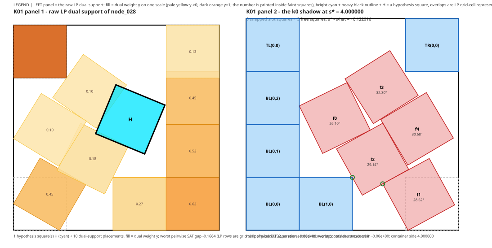

* **s\*** = 4.000000000 = s-hat +0.122916410  (s0 = 3.877084, s\* - s0 = +0.122916)
* **shadow** = 6 slot squares `BL(0,0) BL(0,1) BL(0,2) BL(1,0) TL(0,0) TR(0,0)` + 5 free squares; a k11 packing.
* **explains** 84 alive k0 cells: A38 x65, A99 x12, A85 x7; levels L1:65, L2:15, L3:4; component 75, integral 9 support; 19 at tau >= budget.
* **load-bearing squares**: `BL(0,2)` `TL(0,0)` (2 of 11); **45 distinct minimised configuration(s)** share this s*.
* **restarts**: 86 feasible of 103; distinct minima [4.0, 4.00001, 4.00003, 4.00029].

| square | cx | cy | tilt (deg) |
|---|---|---|---|
| f0 | 1.668999 | 2.121665 | 26.1032 |
| f1 | 3.249676 | 0.678407 | 28.6196 |
| f2 | 2.380673 | 1.344011 | 29.1366 |
| f3 | 2.551031 | 2.704671 | 32.2969 |
| f4 | 3.219514 | 1.916960 | 30.6772 |

**Contact graph at s\*** (gap < 1e-7; force = Fritz-John resultant, rows unit-normalised)

| contact | type | gap | force |
|---|---|---|---|
| `f2` - `BL(1,0)` | vertex-on-edge | +8.3e-08 | 0.0000 |
| `BL(0,2)` - `TL(0,0)` | exactly-opposite | +4.4e-15 | 1.0000 |

**Binding**: `BL(0,2)`-`TL(0,0)` (1.000).  KKT residual 0.0e+00.  Exactly-opposite (cone-degenerate) contacts: `BL(0,2)`-`TL(0,0)`.
**Rank**: 5 contact rows, 16 variables; rank 2; at fixed s rank 1 of 15, so **14 flat direction(s)**: free (flex to at least third order), free (flex to at least third order), free (flex to at least third order), free (flex to at least third order), free (flex to at least third order), free (flex to at least third order), blocked at second order, blocked at second order

**T2 drain hint - the load-bearing subgraph**

| removed | s* without it | drop | role |
|---|---|---|---|
| `f0` | 4.000000 | +0.000000 | rattler |
| `f1` | 4.000000 | +0.000000 | rattler |
| `f2` | 4.000000 | +0.000000 | rattler |
| `f3` | 4.000000 | +0.000000 | rattler |
| `f4` | 4.000000 | +0.000000 | rattler |

Load-bearing: none.  Rattlers: `f0`, `f1`, `f2`, `f3`, `f4`.

**k0 cells explained** (84): `A85/k0_00/s1cor_far_b595(L1)` `A85/k0_00/s1cor_near_b178(L1)` `A85/k0_00/s1int_l1_043(L1)` `A85/k0_00/s1int_l1_053(L1)` `A85/k0_00/s1int_l2_l2_p210_001(L1)` `A85/k0_00/s1int_l2_l2_p215_011(L1)` `A85/k0_00/s4_near_BL357619_BR004483_TR191404(L1)` `A99/k0_00/l1_038_plain_warm(L1)` `A99/k0_00/l1_049_sh1_warm(L1)` `A99/k0_00/l1_060_plain_warm(L1)` `A99/k0_00/l1_071_plain_warm(L1)` `A99/k0_00/l1_082_sh3_warm(L1)` `A99/k0_00/l1_148_plain_warm(L1)` `A99/k0_00/l1_148_sh3_warm(L1)` `A99/k0_00/l1_192_plain_warm(L1)` `A99/k0_00/l1_203_plain_warm(L1)` `A99/k0_00/l1_214_plain_warm(L1)` `A99/k0_00/l1_214_sh1_warm(L1)` `A99/k0_00/l1_214_sh2dia_warm(L1)` `A38/l1_nodes/node_008(L1)` `A38/l1_nodes/node_009(L1)` `A38/l1_nodes/node_020(L1)` `A38/l1_nodes/node_021(L1)` `A38/l1_nodes/node_022(L1)` `A38/l1_nodes/node_027(L1)` `A38/l1_nodes/node_028(L1)` `A38/l1_nodes/node_034(L1)` `A38/l1_nodes/node_036(L1)` `A38/l1_nodes/node_037(L1)` `A38/l1_nodes/node_038(L1)` `A38/l1_nodes/node_039(L1)` `A38/l1_nodes/node_040(L1)` `A38/l1_nodes/node_041(L1)` `A38/l1_nodes/node_045(L1)` `A38/l1_nodes/node_046(L1)` `A38/l1_nodes/node_047(L1)` `A38/l1_nodes/node_052(L1)` `A38/l1_nodes/node_055(L1)` `A38/l1_nodes/node_056(L1)` `A38/l1_nodes/node_057(L1)` `A38/l1_nodes/node_058(L1)` `A38/l1_nodes/node_059(L1)` `A38/l1_nodes/node_060(L1)` `A38/l1_nodes/node_061(L1)` `A38/l1_nodes/node_065(L1)` `A38/l1_nodes/node_066(L1)` `A38/l1_nodes/node_067(L1)` `A38/l1_nodes/node_068(L1)` `A38/l1_nodes/node_070(L1)` `A38/l1_nodes/node_071(L1)` `A38/l1_nodes/node_073(L1)` `A38/l1_nodes/node_077(L1)` `A38/l1_nodes/node_083(L1)` `A38/l1_nodes/node_086(L1)` `A38/l1_nodes/node_089(L1)` `A38/l1_nodes/node_095(L1)` `A38/l1_nodes/node_101(L1)` `A38/l1_nodes/node_104(L1)` `A38/l1_nodes/node_106(L1)` `A38/l1_nodes/node_107(L1)` `A38/l1_nodes/node_109(L1)` `A38/l1_nodes/node_113(L1)` `A38/l1_nodes/node_114(L1)` `A38/l1_nodes/node_141(L1)` `A38/l1_nodes/node_142(L1)` `A38/l2_nodes/l2_p100_010(L2)` `A38/l2_nodes/l2_p114_010(L2)` `A38/l2_nodes/l2_p210_000(L2)` `A38/l2_nodes/l2_p210_010(L2)` `A38/l2_nodes/l2_p215_000(L2)` `A38/l2_nodes/l2_p215_010(L2)` `A38/l2_nodes/l2_p215_011(L2)` `A38/l2_nodes/l2_p61_000(L2)` `A38/l2_nodes/l2_p65_010(L2)` `A38/l2_nodes/l2_p65_101(L2)` `A38/l2_nodes/l2_p65_110(L2)` `A38/l2_nodes/l2_p70_000(L2)` `A38/l2_nodes/l2_p70_011(L2)` `A38/l2_nodes/l2_p74_000(L2)` `A38/l2_nodes/l2_p95_001(L2)` `A38/l3_nodes/l3_pp215_000_000(L3)` `A38/l3_nodes/l3_pp215_000_001(L3)` `A38/l3_nodes/l3_pp215_000_011(L3)` `A38/l3_nodes/l3_pp65_111_000(L3)`

## K02 - a k11 packing at s* = 3.942809 on the boundary of class k0_00

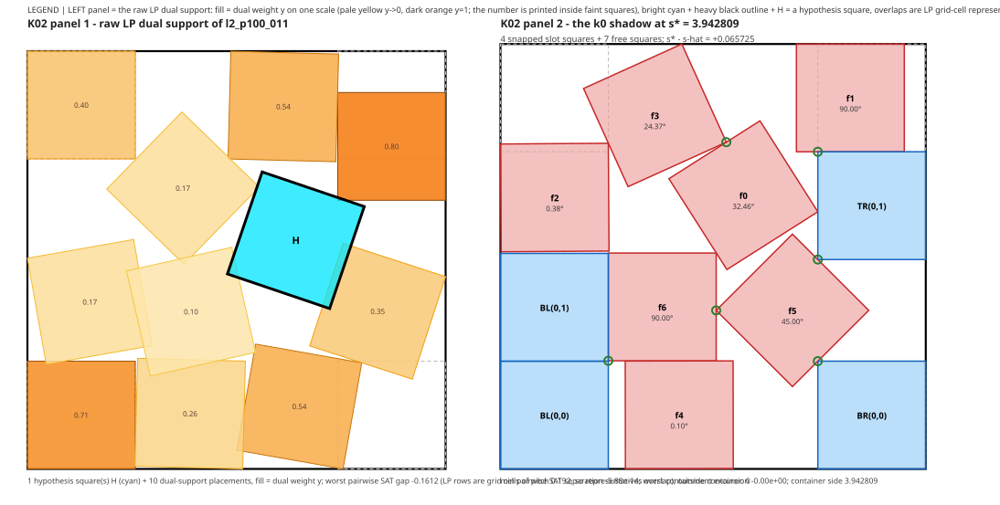

* **s\*** = 3.942809044 = s-hat +0.065725454  (s0 = 3.877084, s\* - s0 = +0.065725)
* **shadow** = 4 slot squares `BL(0,0) BL(0,1) BR(0,0) TR(0,1)` + 7 free squares; a k11 packing.
* **explains** 10 alive k0 cells: A38 x10; levels L1:8, L2:1, L3:1; component 9, integral 1 support; 5 at tau >= budget.
* **load-bearing squares**: `f5` `f6` `BL(0,1)` `BR(0,0)` `TR(0,1)` (5 of 11); **7 distinct minimised configuration(s)** share this s*.
* **restarts**: 79 feasible of 102; distinct minima [3.94281, 4.0, 4.00001, 4.00006, 4.32623].

| square | cx | cy | tilt (deg) |
|---|---|---|---|
| f0 | 2.252349 | 2.539990 | 32.4613 |
| f1 | 3.243874 | 3.442809 | 90.0000 |
| f2 | 0.503301 | 2.518485 | 0.3796 |
| f3 | 1.432347 | 3.281034 | 24.3727 |
| f4 | 1.657471 | 0.501307 | 0.1021 |
| f5 | 2.707107 | 1.471405 | 45.0000 |
| f6 | 1.500000 | 1.503588 | 90.0000 |

**Contact graph at s\*** (gap < 1e-7; force = Fritz-John resultant, rows unit-normalised)

| contact | type | gap | force |
|---|---|---|---|
| `f0` - `f3` | vertex-on-edge | +1.3e-08 | 0.0000 |
| `f1` - `TR(0,1)` | vertex-on-edge | -2.8e-14 | 0.0000 |
| `f5` - `f6` | vertex-on-edge | -5.9e-14 | 0.9431 |
| `f5` - `BR(0,0)` | vertex-on-edge | +7.1e-14 | 0.5827 |
| `f5` - `TR(0,1)` | vertex-on-edge | +7.2e-14 | 0.8203 |
| `f6` - `BL(0,1)` | vertex-on-edge | +6.4e-13 | 0.6670 |
| `f1` - top wall | wall | 0 | 0.0000 |
| `f2` - left wall | wall | 0 | 0.0000 |
| `f3` - top wall | wall | 0 | 0.0000 |

**Binding**: `f5`-`f6` (0.943), `f5`-`TR(0,1)` (0.820), `f6`-`BL(0,1)` (0.667), `f5`-`BR(0,0)` (0.583).  KKT residual 8.8e-09.
**Rank**: 12 contact rows, 22 variables; rank 10; at fixed s rank 10 of 21, so **11 flat direction(s)**: blocked at second order, blocked at second order, free (flex to at least third order), free (flex to at least third order), free (flex to at least third order), blocked at second order, blocked (order unclear), blocked at second order

**T2 drain hint - the load-bearing subgraph**

| removed | s* without it | drop | role |
|---|---|---|---|
| `f0` | 3.942809 | +0.000000 | rattler |
| `f1` | 3.942809 | +0.000000 | rattler |
| `f2` | 3.942809 | +0.000000 | rattler |
| `f3` | 3.942809 | +0.000000 | rattler |
| `f4` | 3.942809 | +0.000000 | rattler |
| `f5` | 4.000000 | -0.057191 | rattler |
| `f6` | 3.806721 | +0.136088 | load-bearing |

Load-bearing: `f6`.  Rattlers: `f0`, `f1`, `f2`, `f3`, `f4`, `f5`.

**k0 cells explained** (10): `A38/l1_nodes/node_054(L1)` `A38/l1_nodes/node_072(L1)` `A38/l1_nodes/node_076(L1)` `A38/l1_nodes/node_082(L1)` `A38/l1_nodes/node_088(L1)` `A38/l1_nodes/node_094(L1)` `A38/l1_nodes/node_108(L1)` `A38/l1_nodes/node_112(L1)` `A38/l2_nodes/l2_p100_011(L2)` `A38/l3_nodes/l3_pp65_111_011(L3)`

## K03 - a k11 packing at s* = 3.925149 on the boundary of class k0_00

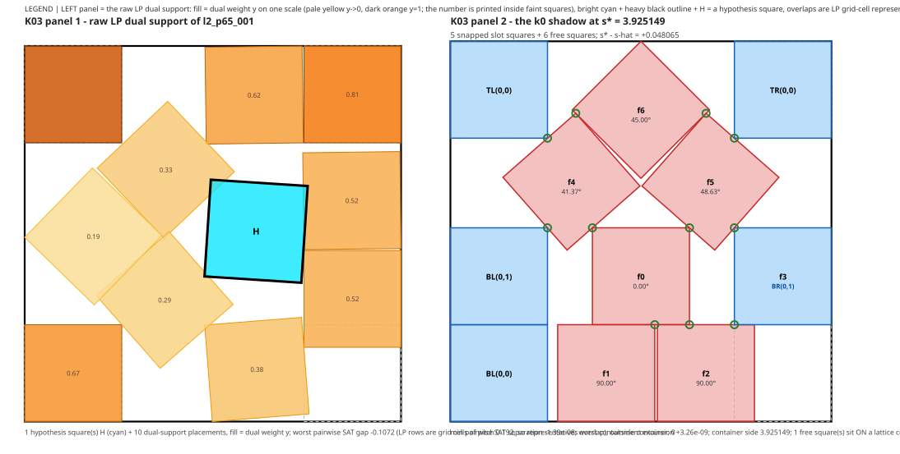

* **s\*** = 3.925148806 = s-hat +0.048065216  (s0 = 3.877084, s\* - s0 = +0.048065)
* **shadow** = 5 slot squares `BL(0,0) BL(0,1) TL(0,0) TR(0,0)` `BR(0,1) (=f3)` + 6 free squares; a k11 packing.
  * **gallery v1 counted this as 4 slot + 7 free** (A121): `f3` sits on `BR(0,1)` to within 1e-3 in position and 0.05 deg of axis.  The f-indices are unchanged everywhere below so A121's review rows stay valid.
* **explains** 9 alive k0 cells: A38 x9; levels L1:4, L2:4, L3:1; component 9 support; 2 at tau >= budget.
* **load-bearing squares**: `f0` `f1` `f2` `f3` `f4` `f5` `f6` `BL(0,1)` `TL(0,0)` `TR(0,0)` (10 of 11); **5 distinct minimised configuration(s)** share this s*.
* **coincides with Part I**: `S37` (s* 3.925470, D4 map `e`, 8 squares matched, Jaccard 0.571).
* **restarts**: 75 feasible of 104; distinct minima [3.89432, 3.90747, 3.92515, 3.92528, 3.94281, 3.95842, 4.0, 4.00484].

| square | cx | cy | tilt (deg) |
|---|---|---|---|
| f0 | 1.962577 | 1.500000 | 0.0000 |
| f1 | 1.604981 | 0.500000 | 90.0000 |
| f2 | 2.632194 | 0.500000 | 90.0000 |
| f3 | 3.425149 | 1.500000 | 90.0000 |
| f4 | 1.246819 | 2.476253 | 41.3723 |
| f5 | 2.678328 | 2.476256 | 48.6285 |
| f6 | 1.962579 | 3.218042 | 45.0011 |

**Contact graph at s\*** (gap < 1e-7; force = Fritz-John resultant, rows unit-normalised)

| contact | type | gap | force |
|---|---|---|---|
| `f0` - `f1` | vertex-on-edge | -1.4e-08 | 0.3816 |
| `f0` - `f2` | vertex-on-edge | -6.9e-09 | 0.3823 |
| `f0` - `f4` | vertex-on-edge | +1.2e-11 | 0.4803 |
| `f0` - `f5` | vertex-on-edge | +1.2e-11 | 0.4803 |
| `f2` - `f3` | vertex-on-edge | -3.3e-10 | 0.1344 |
| `f3` - `f5` | vertex-on-edge | -1.7e-11 | 0.1903 |
| `f4` - `f6` | vertex-on-edge | +5.9e-12 | 0.2076 |
| `f4` - `BL(0,1)` | vertex-on-edge | -1.7e-11 | 0.1357 |
| `f4` - `TL(0,0)` | vertex-on-edge | -2.1e-11 | 0.4130 |
| `f5` - `f6` | vertex-on-edge | +5.9e-12 | 0.2076 |
| `f5` - `TR(0,0)` | vertex-on-edge | -2.1e-11 | 0.5703 |
| `f1` - bottom wall | wall | 0 | 0.2558 |
| `f2` - bottom wall | wall | 0 | 0.3417 |
| `f3` - right wall | wall | 0 | 0.1496 |
| `f6` - top wall | wall | 0 | 0.2670 |

**Binding**: `f5`-`TR(0,0)` (0.570), `f0`-`f5` (0.480), `f0`-`f4` (0.480), `f4`-`TL(0,0)` (0.413), `f0`-`f2` (0.382), `f0`-`f1` (0.382).  KKT residual 3.9e-06.
**Convergence caveat**: KKT residual 3.9e-06 - the landing leans on a variable bound or SLSQP stopped short, so s* = 3.925149 is an upper bound.
**Rank**: 21 contact rows, 22 variables; rank 18; at fixed s rank 18 of 21, so **3 flat direction(s)**: blocked at second order, blocked at second order, blocked at second order

**T2 drain hint - the load-bearing subgraph**

| removed | s* without it | drop | role |
|---|---|---|---|
| `f0` | 3.886746 | +0.038403 | load-bearing |
| `f1` | 3.886746 | +0.038403 | load-bearing |
| `f2` | 3.822876 | +0.102273 | load-bearing |
| `f3` | 3.767767 | +0.157382 | load-bearing |
| `f4` | infeasible | - | load-bearing |
| `f5` | 3.767767 | +0.157382 | load-bearing |
| `f6` | 3.899873 | +0.025276 | load-bearing |

Load-bearing: `f0`, `f1`, `f2`, `f3`, `f4`, `f5`, `f6`.  Rattlers: none.

**k0 cells explained** (9): `A38/l1_nodes/node_043(L1)` `A38/l1_nodes/node_044(L1)` `A38/l1_nodes/node_051(L1)` `A38/l1_nodes/node_087(L1)` `A38/l2_nodes/l2_p65_000(L2)` `A38/l2_nodes/l2_p65_001(L2)` `A38/l2_nodes/l2_p65_011(L2)` `A38/l2_nodes/l2_p65_111(L2)` `A38/l3_nodes/l3_pp114_001_000(L3)`

## K04 - a k11 packing at s* = 3.914214 on the boundary of class k0_00

* **s\*** = 3.914213572 = s-hat +0.037129982  (s0 = 3.877084, s\* - s0 = +0.037130)
* **shadow** = 5 slot squares `BL(0,0) BR(0,0)` `TR(0,1) (=f1)` `TR(0,0) (=f4)` `TR(1,0) (=f5)` + 6 free squares; a k11 packing.
  * **gallery v1 counted this as 2 slot + 9 free** (A121): `f1` sits on `TR(0,1)`, `f4` sits on `TR(0,0)`, `f5` sits on `TR(1,0)` to within 1e-3 in position and 0.05 deg of axis.  The f-indices are unchanged everywhere below so A121's review rows stay valid.
* **explains** 9 alive k0 cells: A38 x8, A99 x1; levels L1:9; integral 5, component 4 support; 6 at tau >= budget.
* **load-bearing squares**: `f0` `f1` `f2` `f3` `f4` `f5` `f7` `f8` `BL(0,0)` (9 of 11); **8 distinct minimised configuration(s)** share this s*.
* **coincides with Part I**: `S32` (s* 3.912250, D4 map `r180`, 8 squares matched, Jaccard 0.571); `S05` (s* 3.912232, D4 map `r180`, 8 squares matched, Jaccard 0.571); `S10` (s* 3.902674, D4 map `anti`, 8 squares matched, Jaccard 0.571).
* **restarts**: 82 feasible of 102; distinct minima [3.88675, 3.91421, 3.92515, 3.93028, 3.93722, 3.93993, 3.94281, 3.95072].

| square | cx | cy | tilt (deg) |
|---|---|---|---|
| f0 | 1.707107 | 2.414214 | 45.0000 |
| f1 | 3.414214 | 2.414214 | 90.0000 |
| f2 | 2.414214 | 1.707107 | 45.0000 |
| f3 | 2.405090 | 0.500000 | 90.0000 |
| f4 | 3.414214 | 3.414214 | 90.0000 |
| f5 | 2.414214 | 3.414214 | 90.0000 |
| f6 | 0.837458 | 3.292251 | 0.2345 |
| f7 | 0.500000 | 2.039248 | 90.0000 |
| f8 | 1.448602 | 1.258505 | 45.0000 |

**Contact graph at s\*** (gap < 1e-7; force = Fritz-John resultant, rows unit-normalised)

| contact | type | gap | force |
|---|---|---|---|
| `f0` - `f2` | exactly-opposite | -9.1e-11 | 0.3844 |
| `f0` - `f5` | vertex-on-edge | -4.9e-15 | 0.5053 |
| `f0` - `f7` | vertex-on-edge | +3.3e-15 | 0.5030 |
| `f0` - `f8` | vertex-on-edge | -1.4e-10 | 0.1650 |
| `f1` - `f2` | vertex-on-edge | +7.8e-16 | 0.5053 |
| `f1` - `f4` | exactly-opposite | -2.7e-11 | 0.3953 |
| `f1` - `f5` | exactly-opposite | +1.4e-08 | 0.0000 |
| `f2` - `f3` | vertex-on-edge | +1.5e-14 | 0.4862 |
| `f2` - `f8` | vertex-on-edge | +9.6e-10 | 0.1637 |
| `f4` - `f5` | exactly-opposite | +1.2e-10 | 0.3953 |
| `f8` - `BL(0,0)` | vertex-on-edge | -5.6e-15 | 0.2229 |
| `f1` - right wall | wall | 0 | 0.3750 |
| `f3` - bottom wall | wall | 0 | 0.3438 |
| `f4` - right wall | wall | 0 | 0.3750 |
| `f4` - top wall | wall | 0 | 0.3750 |
| `f5` - top wall | wall | 0 | 0.3750 |
| `f7` - left wall | wall | 0 | 0.3672 |

**Binding**: `f1`-`f2` (0.505), `f0`-`f5` (0.505), `f0`-`f7` (0.503), `f2`-`f3` (0.486), `f4`-`f5` (0.395), `f1`-`f4` (0.395).  KKT residual 2.7e-09.  Exactly-opposite (cone-degenerate) contacts: `f0`-`f2`, `f1`-`f4`, `f1`-`f5`, `f4`-`f5`.
**Rank**: 35 contact rows, 28 variables; rank 23; at fixed s rank 22 of 27, so **5 flat direction(s)**: blocked at first order (rank tolerance artefact), free (flex to at least third order), free (flex to at least third order), free (flex to at least third order), free (flex to at least third order)

**T2 drain hint - the load-bearing subgraph**

| removed | s* without it | drop | role |
|---|---|---|---|
| `f0` | 3.822876 | +0.091338 | load-bearing |
| `f1` | 3.822876 | +0.091338 | load-bearing |
| `f2` | 3.822876 | +0.091338 | load-bearing |
| `f3` | 3.822876 | +0.091338 | load-bearing |
| `f4` | 3.822876 | +0.091338 | load-bearing |
| `f5` | 3.822876 | +0.091338 | load-bearing |
| `f6` | 3.912232 | +0.001982 | load-bearing |
| `f7` | 3.885094 | +0.029119 | load-bearing |
| `f8` | 3.728581 | +0.185632 | load-bearing |

Load-bearing: `f0`, `f1`, `f2`, `f3`, `f4`, `f5`, `f6`, `f7`, `f8`.  Rattlers: none.

**k0 cells explained** (9): `A99/k0_00/l1_104_plain_warm(L1)` `A38/l1_nodes/node_050(L1)` `A38/l1_nodes/node_074(L1)` `A38/l1_nodes/node_075(L1)` `A38/l1_nodes/node_078(L1)` `A38/l1_nodes/node_080(L1)` `A38/l1_nodes/node_100(L1)` `A38/l1_nodes/node_105(L1)` `A38/l1_nodes/node_110(L1)`

## K05 - a k11 packing at s* = 3.912232 on the boundary of class k0_00

* **s\*** = 3.912232040 = s-hat +0.035148450  (s0 = 3.877084, s\* - s0 = +0.035148)
* **shadow** = 6 slot squares `BL(0,0) BL(0,1) BR(0,0) TR(0,0)` `BL(1,0) (=f2)` `TL(1,0) (=f5)` + 5 free squares; a k11 packing.
  * **gallery v1 counted this as 4 slot + 7 free** (A121): `f2` sits on `BL(1,0)`, `f5` sits on `TL(1,0)` to within 1e-3 in position and 0.05 deg of axis.  The f-indices are unchanged everywhere below so A121's review rows stay valid.
* **explains** 8 alive k0 cells: A38 x8; levels L1:3, L2:3, L3:2; component 8 support; 2 at tau >= budget.
* **load-bearing squares**: `f0` `f1` `f2` `f3` `f4` `f5` `f6` `BL(0,0)` `BL(0,1)` `TR(0,0)` (10 of 11); **3 distinct minimised configuration(s)** share this s*.
* **coincides with Part I**: `S05` (s* 3.912232, D4 map `e`, 10 squares matched, Jaccard 0.833); `S32` (s* 3.912250, D4 map `e`, 9 squares matched, Jaccard 0.692).
* **restarts**: 75 feasible of 106; distinct minima [3.91223, 3.93028, 3.94518, 3.99946, 4.0, 4.00002, 4.00025, 4.05178].

| square | cx | cy | tilt (deg) |
|---|---|---|---|
| f0 | 1.552381 | 2.130013 | 41.4697 |
| f1 | 0.500000 | 2.837318 | 90.0000 |
| f2 | 1.500000 | 0.500000 | 0.0000 |
| f3 | 3.412232 | 1.909674 | 90.0000 |
| f4 | 2.456404 | 2.661240 | 44.9196 |
| f5 | 1.500000 | 3.412232 | 90.0000 |
| f6 | 2.389094 | 1.354075 | 24.1845 |

**Contact graph at s\*** (gap < 1e-7; force = Fritz-John resultant, rows unit-normalised)

| contact | type | gap | force |
|---|---|---|---|
| `f0` - `f4` | vertex-on-edge | -9.2e-10 | 0.1952 |
| `f0` - `BL(0,1)` | vertex-on-edge | -1.1e-09 | 0.1335 |
| `f1` - `f5` | vertex-on-edge | -2.8e-09 | 0.2838 |
| `f2` - `f6` | vertex-on-edge | -9.6e-11 | 0.6880 |
| `f2` - `BL(0,0)` | exactly-opposite | +5.6e-16 | 0.4854 |
| `f2` - `BL(0,1)` | exactly-opposite | +5.6e-16 | 0.0000 |
| `f3` - `f4` | vertex-on-edge | +3.4e-14 | 0.3914 |
| `f3` - `f6` | vertex-on-edge | -8.9e-11 | 0.6880 |
| `f4` - `f5` | vertex-on-edge | -8.0e-14 | 0.3804 |
| `f4` - `TR(0,0)` | vertex-on-edge | -6.0e-14 | 0.2237 |
| `f1` - left wall | wall | 0 | 0.1895 |
| `f2` - bottom wall | wall | 0 | 0.2180 |
| `f3` - right wall | wall | 0 | 0.8969 |
| `f5` - top wall | wall | 0 | 0.2842 |

**Binding**: `f3`-`right wall` (0.897), `f2`-`f6` (0.688), `f3`-`f6` (0.688), `f2`-`BL(0,0)` (0.485), `f3`-`f4` (0.391), `f4`-`f5` (0.380).  KKT residual 1.8e-06.  Exactly-opposite (cone-degenerate) contacts: `f2`-`BL(0,0)`, `f2`-`BL(0,1)`.
**Convergence caveat**: KKT residual 1.8e-06 - the landing leans on a variable bound or SLSQP stopped short, so s* = 3.912232 is an upper bound.
**Rank**: 23 contact rows, 22 variables; rank 17; at fixed s rank 17 of 21, so **4 flat direction(s)**: blocked at first order (rank tolerance artefact), blocked at second order, blocked at second order, blocked at second order

**T2 drain hint - the load-bearing subgraph**

| removed | s* without it | drop | role |
|---|---|---|---|
| `f0` | 3.899873 | +0.012359 | load-bearing |
| `f1` | 3.767767 | +0.144465 | load-bearing |
| `f2` | 3.822876 | +0.089356 | load-bearing |
| `f3` | 3.822876 | +0.089356 | load-bearing |
| `f4` | 3.728581 | +0.183651 | load-bearing |
| `f5` | 3.707107 | +0.205125 | load-bearing |
| `f6` | 3.822876 | +0.089356 | load-bearing |

Load-bearing: `f0`, `f1`, `f2`, `f3`, `f4`, `f5`, `f6`.  Rattlers: none.

**k0 cells explained** (8): `A38/l1_nodes/node_063(L1)` `A38/l1_nodes/node_085(L1)` `A38/l1_nodes/node_111(L1)` `A38/l2_nodes/l2_p114_011(L2)` `A38/l2_nodes/l2_p70_010(L2)` `A38/l2_nodes/l2_p74_001(L2)` `A38/l3_nodes/l3_pp114_001_011(L3)` `A38/l3_nodes/l3_pp65_111_010(L3)`

## K06 - a k11 packing at s* = 3.886745 on the boundary of class k0_00

* **s\*** = 3.886745485 = s-hat +0.009661895  (s0 = 3.877084, s\* - s0 = +0.009661)
* **shadow** = 6 slot squares `BL(0,0) BL(0,1) BR(0,1) TL(0,0) TR(0,0)` `BL(1,0) (=f2)` + 5 free squares; a k11 packing.
  * **gallery v1 counted this as 5 slot + 6 free** (A121): `f2` sits on `BL(1,0)` to within 1e-3 in position and 0.05 deg of axis.  The f-indices are unchanged everywhere below so A121's review rows stay valid.
* **explains** 6 alive k0 cells: A99 x3, A38 x3; levels L1:4, L2:1, L3:1; component 5, integral 1 support; 1 at tau >= budget.
* **load-bearing squares**: `f1` `f3` `f4` `f5` `BL(0,1)` `BR(0,1)` (6 of 11); **5 distinct minimised configuration(s)** share this s*.
* **coincides with Part I**: `S29` (s* 3.886761, D4 map `mx`, 10 squares matched, Jaccard 0.833); `S02` (s* 3.886746, D4 map `e`, 10 squares matched, Jaccard 0.833); `S10` (s* 3.902674, D4 map `e`, 9 squares matched, Jaccard 0.692).
* **restarts**: 77 feasible of 101; distinct minima [3.88675, 4.0, 4.00001, 4.00069, 4.10159].

| square | cx | cy | tilt (deg) |
|---|---|---|---|
| f0 | 2.173112 | 1.514760 | 48.4355 |
| f1 | 2.993069 | 0.500000 | 90.0000 |
| f2 | 1.500002 | 0.500001 | 89.9999 |
| f3 | 1.929113 | 3.180909 | 48.4355 |
| f4 | 2.621098 | 2.454042 | 48.4355 |
| f5 | 1.265648 | 2.432703 | 48.4355 |

**Contact graph at s\*** (gap < 1e-7; force = Fritz-John resultant, rows unit-normalised)

| contact | type | gap | force |
|---|---|---|---|
| `f0` - `f2` | vertex-on-edge | -1.7e-08 | 0.0000 |
| `f1` - `BR(0,1)` | vertex-on-edge | -1.7e-08 | 6486.3966 |
| `f3` - `f4` | vertex-on-edge | -4.6e-07 | 0.6436 |
| `f3` - `f5` | exactly-opposite | -1.1e-06 | 0.7105 |
| `f4` - `BR(0,1)` | vertex-on-edge | -2.1e-13 | 0.5617 |
| `f5` - `BL(0,1)` | vertex-on-edge | -9.1e-13 | 0.5017 |
| `f1` - bottom wall | wall | 0 | 6486.3966 |
| `f2` - bottom wall | wall | 0 | 0.0000 |
| `f3` - top wall | wall | 0 | 0.9417 |

**Binding**: `f1`-`BR(0,1)` (6486.397), `f1`-`bottom wall` (6486.397), `f3`-`top wall` (0.942), `f3`-`f5` (0.710), `f3`-`f4` (0.644), `f4`-`BR(0,1)` (0.562).  KKT residual 2.0e-02.  Exactly-opposite (cone-degenerate) contacts: `f3`-`f5`.
**Convergence caveat**: KKT residual 2.0e-02 - the landing leans on a variable bound or SLSQP stopped short, so s* = 3.886745 is an upper bound.
**Rank**: 15 contact rows, 19 variables; rank 13; at fixed s rank 13 of 18, so **5 flat direction(s)**: blocked at first order (rank tolerance artefact), blocked at first order (rank tolerance artefact), blocked at first order (rank tolerance artefact), blocked at first order (rank tolerance artefact), blocked at first order (rank tolerance artefact)

**T2 drain hint - the load-bearing subgraph**

| removed | s* without it | drop | role |
|---|---|---|---|
| `f0` | 3.886746 | -0.000001 | rattler |
| `f1` | 3.886746 | -0.000000 | rattler |
| `f2` | 3.886746 | -0.000001 | rattler |
| `f3` | 3.822876 | +0.063870 | load-bearing |
| `f4` | 3.767767 | +0.118979 | load-bearing |
| `f5` | 3.767767 | +0.118979 | load-bearing |

Load-bearing: `f3`, `f4`, `f5`.  Rattlers: `f0`, `f1`, `f2`.

**k0 cells explained** (6): `A99/k0_00/l1_027_plain_warm(L1)` `A99/k0_00/l1_115_plain_warm(L1)` `A99/k0_00/l1_159_plain_warm(L1)` `A38/l1_nodes/node_069(L1)` `A38/l2_nodes/l2_p70_001(L2)` `A38/l3_nodes/l3_pp114_001_010(L3)`

## K07 - a k9 packing at s* = 3.400000 on the boundary of class k0_00

* **s\*** = 3.400000000 = s-hat -0.477083590  (s0 = 3.877084, s\* - s0 = -0.477084)
* **shadow** = 0 slot squares `(none)` + 9 free squares; a k9 packing.
* **explains** 5 alive k0 cells: A99 x5; levels L1:5; integral 5 support; 0 at tau >= budget.
* **load-bearing squares**: `f1` `f2` `f7` (3 of 9); **2 distinct minimised configuration(s)** share this s*.
* **restarts**: 95 feasible of 104; distinct minima [3.4, 3.62132, 3.68199, 3.69375, 3.69905, 3.70711, 3.72858, 3.76777].

| square | cx | cy | tilt (deg) |
|---|---|---|---|
| f0 | 1.816588 | 1.807349 | 79.1609 |
| f1 | 0.765850 | 2.806490 | 77.9284 |
| f2 | 1.833731 | 2.860473 | 85.2700 |
| f3 | 0.598543 | 0.736059 | 77.1705 |
| f4 | 0.776269 | 1.761214 | 81.8288 |
| f5 | 1.669715 | 0.762468 | 72.5996 |
| f6 | 2.699300 | 0.596632 | 77.4601 |
| f7 | 2.828415 | 1.621630 | 81.0656 |
| f8 | 2.882459 | 2.732649 | 2.0151 |

**Contact graph at s\*** (gap < 1e-7; force = Fritz-John resultant, rows unit-normalised)

| contact | type | gap | force |
|---|---|---|---|
| `f0` - `f5` | vertex-on-edge | +2.1e-09 | 0.0000 |
| `f1` - `f2` | vertex-on-edge | +1.2e-08 | 0.0000 |
| `f1` - top wall | wall | 0 | 0.3596 |
| `f2` - top wall | wall | 0 | 0.3462 |
| `f3` - left wall | wall | 0 | 0.0000 |
| `f6` - bottom wall | wall | 0 | 0.0000 |
| `f7` - right wall | wall | 0 | 0.3539 |

**Binding**: `f1`-`top wall` (0.360), `f7`-`right wall` (0.354), `f2`-`top wall` (0.346).  KKT residual 5.3e-01.
**Convergence caveat**: KKT residual 5.3e-01 - the landing leans on a variable bound or SLSQP stopped short, so s* = 3.400000 is an upper bound.
**Rank**: 7 contact rows, 28 variables; rank 7; at fixed s rank 7 of 27, so **20 flat direction(s)**: free (flex to at least third order), free (flex to at least third order), blocked at second order, free (flex to at least third order), blocked at second order, free (flex to at least third order), free (flex to at least third order), free (flex to at least third order)

**T2 drain hint - the load-bearing subgraph**

| removed | s* without it | drop | role |
|---|---|---|---|
| `f0` | 3.400000 | +0.000000 | rattler |
| `f1` | 3.400000 | +0.000000 | rattler |
| `f2` | 3.400000 | +0.000000 | rattler |
| `f3` | 3.400000 | +0.000000 | rattler |
| `f4` | 3.400000 | +0.000000 | rattler |
| `f5` | 3.400000 | +0.000000 | rattler |
| `f6` | 3.400000 | +0.000000 | rattler |
| `f7` | 3.400000 | +0.000000 | rattler |
| `f8` | 3.400000 | +0.000000 | rattler |

Load-bearing: none.  Rattlers: `f0`, `f1`, `f2`, `f3`, `f4`, `f5`, `f6`, `f7`, `f8`.

**k0 cells explained** (5): `A99/k0_00/l1_005_sh2dia_warm(L1)` `A99/k0_00/l1_005_sh3_warm(L1)` `A99/k0_00/l1_203_sh3_warm(L1)` `A99/k0_00/l1_214_sh2adj_warm(L1)` `A99/k0_00/l1_214_sh3_warm(L1)`

## K08 - a k10 packing at s* = 3.828427 on the boundary of class k0_00

* **s\*** = 3.828427125 = s-hat -0.048656465  (s0 = 3.877084, s\* - s0 = -0.048657)
* **shadow** = 0 slot squares `(none)` + 10 free squares; a k10 packing.
* **explains** 5 alive k0 cells: A38 x5; levels L1:4, L2:1; integral 5 support; 0 at tau >= budget.
* **load-bearing squares**: `f0` `f5` `f6` `f7` `f9` (5 of 10); **3 distinct minimised configuration(s)** share this s*.
* **restarts**: 88 feasible of 102; distinct minima [3.70711, 3.72858, 3.76777, 3.76812, 3.77119, 3.78801, 3.80316, 3.80673].

| square | cx | cy | tilt (deg) |
|---|---|---|---|
| f0 | 2.121330 | 2.121330 | 44.6989 |
| f1 | 0.515621 | 2.215340 | 89.6456 |
| f2 | 3.299774 | 0.811164 | 0.6070 |
| f3 | 3.274447 | 3.186462 | 89.7994 |
| f4 | 2.271774 | 0.553349 | 6.4873 |
| f5 | 0.707097 | 0.707097 | 44.6989 |
| f6 | 1.419555 | 1.408815 | 44.6989 |
| f7 | 3.328427 | 1.823915 | 90.0000 |
| f8 | 0.788299 | 3.237869 | 85.0122 |
| f9 | 2.241982 | 3.328427 | 90.0000 |

**Contact graph at s\*** (gap < 1e-7; force = Fritz-John resultant, rows unit-normalised)

| contact | type | gap | force |
|---|---|---|---|
| `f0` - `f6` | vertex-on-edge | -2.1e-10 | 1.0000 |
| `f0` - `f7` | vertex-on-edge | +3.3e-13 | 0.7260 |
| `f0` - `f9` | vertex-on-edge | -2.0e-13 | 0.7058 |
| `f5` - `f6` | vertex-on-edge | -6.5e-09 | 1.0000 |
| `f5` - bottom wall | wall | 0 | 0.4974 |
| `f5` - left wall | wall | 0 | 0.5026 |
| `f7` - right wall | wall | 0 | 0.7260 |
| `f9` - top wall | wall | 0 | 0.7058 |

**Binding**: `f5`-`f6` (1.000), `f0`-`f6` (1.000), `f0`-`f7` (0.726), `f7`-`right wall` (0.726), `f0`-`f9` (0.706), `f9`-`top wall` (0.706).  KKT residual 1.2e-07.
**Rank**: 12 contact rows, 31 variables; rank 12; at fixed s rank 12 of 30, so **18 flat direction(s)**: free (flex to at least third order), free (flex to at least third order), free (flex to at least third order), free (flex to at least third order), free (flex to at least third order), blocked at second order, blocked at second order, blocked at second order

**T2 drain hint - the load-bearing subgraph**

| removed | s* without it | drop | role |
|---|---|---|---|
| `f0` | 3.707107 | +0.121320 | load-bearing |
| `f1` | 3.771189 | +0.057238 | load-bearing |
| `f2` | 3.707107 | +0.121320 | load-bearing |
| `f3` | 3.707107 | +0.121320 | load-bearing |
| `f4` | 3.400000 | +0.428427 | load-bearing |
| `f5` | 3.707107 | +0.121321 | load-bearing |
| `f6` | 3.400000 | +0.428427 | load-bearing |
| `f7` | 3.707107 | +0.121320 | load-bearing |
| `f8` | 3.400000 | +0.428427 | load-bearing |
| `f9` | 3.707107 | +0.121320 | load-bearing |

Load-bearing: `f0`, `f1`, `f2`, `f3`, `f4`, `f5`, `f6`, `f7`, `f8`, `f9`.  Rattlers: none.

**k0 cells explained** (5): `A38/l1_nodes/node_017(L1)` `A38/l1_nodes/node_030(L1)` `A38/l1_nodes/node_032(L1)` `A38/l1_nodes/node_098(L1)` `A38/l2_nodes/l2_p74_010(L2)`

## K09 - a k10 packing at s* = 3.788222 on the boundary of class k0_00

* **s\*** = 3.788221847 = s-hat -0.088861743  (s0 = 3.877084, s\* - s0 = -0.088862)
* **shadow** = 3 slot squares `BL(0,0)` `TL(2,0) (=f1)` `TL(0,0) (=f2)` + 7 free squares; a k10 packing.
  * **gallery v1 counted this as 1 slot + 9 free** (A121): `f1` sits on `TL(2,0)`, `f2` sits on `TL(0,0)` to within 1e-3 in position and 0.05 deg of axis.  The f-indices are unchanged everywhere below so A121's review rows stay valid.
* **explains** 3 alive k0 cells: A38 x3; levels L1:1, L2:2; integral 3 support; 0 at tau >= budget.
* **load-bearing squares**: `f0` `f1` `f2` `f3` `f4` `f5` `f6` `f7` `f8` `BL(0,0)` (10 of 10); **1 distinct minimised configuration(s)** share this s*.
* **restarts**: 80 feasible of 103; distinct minima [3.70711, 3.72858, 3.76777, 3.76812, 3.77226, 3.78822, 3.79249, 3.79547].

| square | cx | cy | tilt (deg) |
|---|---|---|---|
| f0 | 2.193465 | 2.189704 | 12.8256 |
| f1 | 2.500000 | 3.288222 | 0.0000 |
| f2 | 0.500000 | 3.288222 | 90.0000 |
| f3 | 1.500000 | 3.160826 | 90.0000 |
| f4 | 3.189704 | 2.318617 | 12.8256 |
| f5 | 0.677951 | 2.110271 | 28.4894 |
| f6 | 3.110271 | 1.155538 | 28.4894 |
| f7 | 2.231686 | 0.677951 | 28.4894 |
| f8 | 1.377711 | 1.352263 | 28.4894 |

**Contact graph at s\*** (gap < 1e-7; force = Fritz-John resultant, rows unit-normalised)

| contact | type | gap | force |
|---|---|---|---|
| `f0` - `f1` | vertex-on-edge | +2.5e-11 | 0.0301 |
| `f0` - `f4` | vertex-on-edge | +2.3e-10 | 0.0970 |
| `f0` - `f8` | vertex-on-edge | +9.4e-08 | 0.1081 |
| `f1` - `f3` | vertex-on-edge | +2.4e-11 | 0.0500 |
| `f1` - `f4` | vertex-on-edge | +1.3e-15 | 0.2306 |
| `f2` - `f3` | vertex-on-edge | -1.7e-09 | 0.0500 |
| `f2` - `f5` | vertex-on-edge | +2.0e-14 | 0.6953 |
| `f4` - `f6` | vertex-on-edge | -6.7e-16 | 0.2069 |
| `f5` - `f8` | vertex-on-edge | -1.0e-08 | 0.7711 |
| `f6` - `f7` | vertex-on-edge | -1.7e-08 | 0.4378 |
| `f7` - `f8` | vertex-on-edge | -1.7e-08 | 0.7910 |
| `f8` - `BL(0,0)` | vertex-on-edge | +4.5e-08 | 0.0748 |
| `f1` - top wall | wall | 0 | 0.2552 |
| `f2` - left wall | wall | 0 | 0.0391 |
| `f2` - top wall | wall | 0 | 0.6916 |
| `f4` - right wall | wall | 0 | 0.1004 |
| `f5` - left wall | wall | 0 | 0.2605 |
| `f6` - right wall | wall | 0 | 0.4098 |
| `f7` - bottom wall | wall | 0 | 0.6213 |

**Binding**: `f7`-`f8` (0.791), `f5`-`f8` (0.771), `f2`-`f5` (0.695), `f2`-`top wall` (0.692), `f7`-`bottom wall` (0.621), `f6`-`f7` (0.438).  KKT residual 1.2e-05.
**Convergence caveat**: KKT residual 1.2e-05 - the landing leans on a variable bound or SLSQP stopped short, so s* = 3.788222 is an upper bound.
**Rank**: 28 contact rows, 28 variables; rank 26; at fixed s rank 26 of 27, so **1 flat direction(s)**: blocked at first order (rank tolerance artefact)

**T2 drain hint - the load-bearing subgraph**

| removed | s* without it | drop | role |
|---|---|---|---|
| `f0` | 3.400000 | +0.388222 | load-bearing |
| `f1` | 3.621320 | +0.166901 | load-bearing |
| `f2` | 3.707107 | +0.081115 | load-bearing |
| `f3` | 3.650035 | +0.138187 | load-bearing |
| `f4` | 3.650035 | +0.138187 | load-bearing |
| `f5` | 3.707107 | +0.081115 | load-bearing |
| `f6` | 3.707107 | +0.081115 | load-bearing |
| `f7` | 3.707107 | +0.081115 | load-bearing |
| `f8` | 3.400000 | +0.388222 | load-bearing |

Load-bearing: `f0`, `f1`, `f2`, `f3`, `f4`, `f5`, `f6`, `f7`, `f8`.  Rattlers: none.

**k0 cells explained** (3): `A38/l1_nodes/node_018(L1)` `A38/l2_nodes/l2_p61_010(L2)` `A38/l2_nodes/l2_p74_011(L2)`

## K10 - a k10 packing at s* = 3.822876 on the boundary of class k0_00

* **s\*** = 3.822875659 = s-hat -0.054207931  (s0 = 3.877084, s\* - s0 = -0.054208)
* **shadow** = 2 slot squares `BL(0,0) TR(0,1)` + 8 free squares; a k10 packing.
* **explains** 2 alive k0 cells: A38 x2; levels L2:2; integral 2 support; 0 at tau >= budget.
* **load-bearing squares**: `f6` `f7` `BL(0,0)` `TR(0,1)` (4 of 10); **2 distinct minimised configuration(s)** share this s*.
* **restarts**: 72 feasible of 101; distinct minima [3.82288, 3.87029, 3.87618, 3.91421, 3.94281, 3.97662, 4.0, 4.00002].

| square | cx | cy | tilt (deg) |
|---|---|---|---|
| f0 | 1.915124 | 2.601084 | 26.9321 |
| f1 | 2.118076 | 0.502381 | 0.2731 |
| f2 | 3.185272 | 3.322876 | 90.0000 |
| f3 | 3.219199 | 0.637125 | 13.6158 |
| f4 | 0.743344 | 3.322701 | 0.0195 |
| f5 | 0.502234 | 2.321412 | 89.7531 |
| f6 | 2.343801 | 1.668898 | 24.2940 |
| f7 | 1.354233 | 1.430547 | 24.2940 |

**Contact graph at s\*** (gap < 1e-7; force = Fritz-John resultant, rows unit-normalised)

| contact | type | gap | force |
|---|---|---|---|
| `f1` - `f7` | vertex-on-edge | +6.6e-11 | 0.0000 |
| `f2` - `TR(0,1)` | vertex-on-edge | -7.8e-13 | 0.0000 |
| `f4` - `f5` | vertex-on-edge | +2.9e-10 | 0.0000 |
| `f5` - `f7` | vertex-on-edge | +2.1e-10 | 0.0000 |
| `f6` - `f7` | vertex-on-edge | +6.7e-10 | 1.0860 |
| `f6` - `TR(0,1)` | vertex-on-edge | -2.1e-15 | 1.2543 |
| `f7` - `BL(0,0)` | vertex-on-edge | -1.6e-15 | 0.7786 |
| `f2` - top wall | wall | 0 | 0.0000 |

**Binding**: `f6`-`TR(0,1)` (1.254), `f6`-`f7` (1.086), `f7`-`BL(0,0)` (0.779).  KKT residual 2.1e-05.
**Convergence caveat**: KKT residual 2.1e-05 - the landing leans on a variable bound or SLSQP stopped short, so s* = 3.822876 is an upper bound.
**Rank**: 11 contact rows, 25 variables; rank 9; at fixed s rank 9 of 24, so **15 flat direction(s)**: free (flex to at least third order), free (flex to at least third order), free (flex to at least third order), free (flex to at least third order), blocked at second order, blocked (order unclear), blocked at second order, blocked at second order

**T2 drain hint - the load-bearing subgraph**

| removed | s* without it | drop | role |
|---|---|---|---|
| `f0` | 3.707107 | +0.115769 | load-bearing |
| `f1` | 3.822876 | +0.000000 | rattler |
| `f2` | 3.822876 | +0.000000 | rattler |
| `f3` | infeasible | - | load-bearing |
| `f4` | 3.400000 | +0.422876 | load-bearing |
| `f5` | 3.400000 | +0.422876 | load-bearing |
| `f6` | 3.707107 | +0.115769 | load-bearing |
| `f7` | 3.400000 | +0.422876 | load-bearing |

Load-bearing: `f0`, `f3`, `f4`, `f5`, `f6`, `f7`.  Rattlers: `f1`, `f2`.

**k0 cells explained** (2): `A38/l2_nodes/l2_p61_111(L2)` `A38/l2_nodes/l2_p95_000(L2)`

## K11 - a k10 packing at s* = 3.728581 on the boundary of class k0_00

* **s\*** = 3.728580909 = s-hat -0.148502681  (s0 = 3.877084, s\* - s0 = -0.148503)
* **shadow** = 3 slot squares `BL(0,1)` `BL(0,2) (=f4)` `BR(0,1) (=f5)` + 7 free squares; a k10 packing.
  * **gallery v1 counted this as 1 slot + 9 free** (A121): `f4` sits on `BL(0,2)`, `f5` sits on `BR(0,1)` to within 1e-3 in position and 0.05 deg of axis.  The f-indices are unchanged everywhere below so A121's review rows stay valid.
* **explains** 1 alive k0 cells: A99 x1; levels L1:1; integral 1 support; 0 at tau >= budget.
* **load-bearing squares**: `f2` `f4` `f5` `f7` `f8` `BL(0,1)` (6 of 10); **1 distinct minimised configuration(s)** share this s*.
* **coincides with Part I**: `S25` (s* 3.728606, D4 map `r90`, 8 squares matched, Jaccard 0.667); `S19` (s* 3.728581, D4 map `mx`, 7 squares matched, Jaccard 0.538).
* **restarts**: 77 feasible of 101; distinct minima [3.70711, 3.72858, 3.76777, 3.80672, 3.82288, 3.83098, 3.88675, 3.88795].

| square | cx | cy | tilt (deg) |
|---|---|---|---|
| f0 | 1.504222 | 1.504287 | 0.4806 |
| f1 | 3.225612 | 3.221146 | 89.8782 |
| f2 | 3.214572 | 0.500000 | 90.0000 |
| f3 | 0.878226 | 0.500000 | 90.0000 |
| f4 | 0.500000 | 2.500000 | 0.0000 |
| f5 | 3.228581 | 1.500000 | 0.0000 |
| f6 | 2.042731 | 0.505073 | 0.5738 |
| f7 | 2.367275 | 2.358747 | 34.3203 |
| f8 | 1.582380 | 3.033722 | 34.3203 |

**Contact graph at s\*** (gap < 1e-7; force = Fritz-John resultant, rows unit-normalised)

| contact | type | gap | force |
|---|---|---|---|
| `f2` - `f5` | vertex-on-edge | -1.4e-07 | 0.6710 |
| `f3` - `BL(0,1)` | vertex-on-edge | -1.2e-09 | 0.0000 |
| `f4` - `f8` | vertex-on-edge | -1.4e-09 | 0.5585 |
| `f4` - `BL(0,1)` | exactly-opposite | -3.9e-07 | 0.2425 |
| `f5` - `f7` | vertex-on-edge | -1.0e-09 | 0.8022 |
| `f7` - `f8` | vertex-on-edge | -1.2e-07 | 0.8246 |
| `f2` - bottom wall | wall | 0 | 0.4739 |
| `f3` - bottom wall | wall | 0 | 0.0000 |
| `f4` - left wall | wall | 0 | 0.3552 |
| `f5` - right wall | wall | 0 | 0.4498 |
| `f8` - top wall | wall | 0 | 0.9690 |

**Binding**: `f8`-`top wall` (0.969), `f7`-`f8` (0.825), `f5`-`f7` (0.802), `f2`-`f5` (0.671), `f4`-`f8` (0.558), `f2`-`bottom wall` (0.474).  KKT residual 1.0e-06.  Exactly-opposite (cone-degenerate) contacts: `f4`-`BL(0,1)`.
**Convergence caveat**: KKT residual 1.0e-06 - the landing leans on a variable bound or SLSQP stopped short, so s* = 3.728581 is an upper bound.
**Rank**: 21 contact rows, 28 variables; rank 15; at fixed s rank 15 of 27, so **12 flat direction(s)**: blocked at first order (rank tolerance artefact), blocked at first order (rank tolerance artefact), blocked at second order, blocked at second order, blocked at second order, blocked at second order, blocked at second order, blocked at second order

**T2 drain hint - the load-bearing subgraph**

| removed | s* without it | drop | role |
|---|---|---|---|
| `f0` | 3.728581 | -0.000000 | rattler |
| `f1` | 3.400000 | +0.328581 | load-bearing |
| `f2` | 3.707107 | +0.021474 | load-bearing |
| `f3` | 3.728581 | -0.000000 | rattler |
| `f4` | 3.707107 | +0.021474 | load-bearing |
| `f5` | 3.707107 | +0.021474 | load-bearing |
| `f6` | 3.728581 | -0.000000 | rattler |
| `f7` | 3.400000 | +0.328581 | load-bearing |
| `f8` | 3.707107 | +0.021474 | load-bearing |

Load-bearing: `f1`, `f2`, `f4`, `f5`, `f7`, `f8`.  Rattlers: `f0`, `f3`, `f6`.

**k0 cells explained** (1): `A99/k0_00/l1_049_sh2adj_warm(L1)`

## K12 - a k10 packing at s* = 3.768117 on the boundary of class k0_00

* **s\*** = 3.768117120 = s-hat -0.108966470  (s0 = 3.877084, s\* - s0 = -0.108967)
* **shadow** = 4 slot squares `BL(0,0) BL(0,1)` `BR(0,0) (=f2)` `TR(0,1) (=f4)` + 6 free squares; a k10 packing.
  * **gallery v1 counted this as 2 slot + 8 free** (A121): `f2` sits on `BR(0,0)`, `f4` sits on `TR(0,1)` to within 1e-3 in position and 0.05 deg of axis.  The f-indices are unchanged everywhere below so A121's review rows stay valid.
* **explains** 1 alive k0 cells: A38 x1; levels L1:1; integral 1 support; 0 at tau >= budget.
* **load-bearing squares**: `f0` `f1` `f3` `f4` `f6` `f7` `BL(0,0)` (7 of 10); **1 distinct minimised configuration(s)** share this s*.
* **restarts**: 74 feasible of 101; distinct minima [3.70711, 3.72858, 3.76777, 3.76811, 3.76812, 3.77119, 3.79077, 3.82288].

| square | cx | cy | tilt (deg) |
|---|---|---|---|
| f0 | 2.511018 | 3.268117 | 90.0000 |
| f1 | 1.706408 | 0.706408 | 47.5473 |
| f2 | 3.268117 | 0.500000 | 90.0000 |
| f3 | 1.509122 | 3.268117 | 0.0000 |
| f4 | 3.268117 | 2.268117 | 90.0000 |
| f5 | 0.506800 | 2.599614 | 89.8425 |
| f6 | 2.444250 | 1.386737 | 47.5473 |
| f7 | 1.704040 | 2.061828 | 47.7570 |

**Contact graph at s\*** (gap < 1e-7; force = Fritz-John resultant, rows unit-normalised)

| contact | type | gap | force |
|---|---|---|---|
| `f0` - `f4` | vertex-on-edge | -6.6e-09 | 0.7946 |
| `f1` - `f6` | vertex-on-edge | -3.2e-07 | 1.0013 |
| `f1` - `f7` | vertex-on-edge | +9.8e-09 | 0.0075 |
| `f1` - `BL(0,0)` | vertex-on-edge | -2.2e-10 | 0.4811 |
| `f3` - `f7` | vertex-on-edge | +8.3e-09 | 0.0037 |
| `f4` - `f6` | vertex-on-edge | -5.4e-11 | 1.0009 |
| `f6` - `f7` | vertex-on-edge | +7.1e-08 | 0.0040 |
| `f0` - top wall | wall | 0 | 0.7507 |
| `f1` - bottom wall | wall | 0 | 0.5259 |
| `f4` - right wall | wall | 0 | 0.7165 |

**Binding**: `f1`-`f6` (1.001), `f4`-`f6` (1.001), `f0`-`f4` (0.795), `f0`-`top wall` (0.751), `f4`-`right wall` (0.717), `f1`-`bottom wall` (0.526).  KKT residual 9.7e-03.
**Convergence caveat**: KKT residual 9.7e-03 - the landing leans on a variable bound or SLSQP stopped short, so s* = 3.768117 is an upper bound.
**Rank**: 14 contact rows, 25 variables; rank 13; at fixed s rank 13 of 24, so **11 flat direction(s)**: blocked at first order (rank tolerance artefact), blocked at second order, free (flex to at least third order), free (flex to at least third order), free (flex to at least third order), blocked at second order, blocked at second order, blocked at second order

**T2 drain hint - the load-bearing subgraph**

| removed | s* without it | drop | role |
|---|---|---|---|
| `f0` | 3.400000 | +0.368117 | load-bearing |
| `f1` | 3.400000 | +0.368117 | load-bearing |
| `f2` | 3.400000 | +0.368117 | load-bearing |
| `f3` | 3.707107 | +0.061010 | load-bearing |
| `f4` | 3.400000 | +0.368117 | load-bearing |
| `f5` | 3.693750 | +0.074367 | load-bearing |
| `f6` | 3.400000 | +0.368117 | load-bearing |
| `f7` | 3.400000 | +0.368117 | load-bearing |

Load-bearing: `f0`, `f1`, `f2`, `f3`, `f4`, `f5`, `f6`, `f7`.  Rattlers: none.

**k0 cells explained** (1): `A38/l1_nodes/node_031(L1)`

## K13 - a k10 packing at s* = 3.803539 on the boundary of class k0_00

* **s\*** = 3.803539311 = s-hat -0.073544279  (s0 = 3.877084, s\* - s0 = -0.073545)
* **shadow** = 1 slot squares `BL(0,0)` + 9 free squares; a k10 packing.
* **explains** 1 alive k0 cells: A38 x1; levels L1:1; integral 1 support; 0 at tau >= budget.
* **load-bearing squares**: `f0` `f1` `f2` `f4` `f5` `f6` `f7` `f8` `BL(0,0)` (9 of 10); **1 distinct minimised configuration(s)** share this s*.
* **restarts**: 71 feasible of 101; distinct minima [3.70711, 3.72858, 3.75534, 3.76777, 3.77119, 3.79547, 3.80354, 3.82288].

| square | cx | cy | tilt (deg) |
|---|---|---|---|
| f0 | 1.500000 | 2.553541 | 90.0000 |
| f1 | 0.500000 | 3.297072 | 90.0000 |
| f2 | 2.233426 | 0.500000 | 0.0000 |
| f3 | 3.254575 | 0.825267 | 5.7154 |
| f4 | 3.141720 | 2.330581 | 24.3828 |
| f5 | 1.373769 | 1.386523 | 24.3828 |
| f6 | 2.508995 | 3.141720 | 24.3827 |
| f7 | 2.346915 | 1.661819 | 24.3828 |
| f8 | 0.500000 | 2.280432 | 0.0000 |

**Contact graph at s\*** (gap < 1e-7; force = Fritz-John resultant, rows unit-normalised)

| contact | type | gap | force |
|---|---|---|---|
| `f0` - `f1` | vertex-on-edge | +8.7e-10 | 0.0808 |
| `f0` - `f6` | vertex-on-edge | +5.6e-15 | 0.1857 |
| `f0` - `f7` | vertex-on-edge | +5.0e-15 | 0.0843 |
| `f0` - `f8` | vertex-on-edge | -2.2e-08 | 0.1338 |
| `f2` - `f7` | vertex-on-edge | +3.9e-13 | 0.0924 |
| `f4` - `f6` | vertex-on-edge | -1.1e-15 | 0.4135 |
| `f4` - `f7` | vertex-on-edge | -2.8e-11 | 0.9082 |
| `f5` - `f7` | vertex-on-edge | -1.8e-08 | 0.8576 |
| `f5` - `BL(0,0)` | vertex-on-edge | -2.3e-12 | 0.6119 |
| `f1` - left wall | wall | 0 | 0.0547 |
| `f2` - bottom wall | wall | 0 | 0.0647 |
| `f4` - right wall | wall | 0 | 0.9881 |
| `f6` - top wall | wall | 0 | 0.4479 |
| `f8` - left wall | wall | 0 | 0.0986 |

**Binding**: `f4`-`right wall` (0.988), `f4`-`f7` (0.908), `f5`-`f7` (0.858), `f5`-`BL(0,0)` (0.612), `f6`-`top wall` (0.448), `f4`-`f6` (0.413).  KKT residual 4.6e-05.
**Convergence caveat**: KKT residual 4.6e-05 - the landing leans on a variable bound or SLSQP stopped short, so s* = 3.803539 is an upper bound.
**Rank**: 22 contact rows, 28 variables; rank 22; at fixed s rank 22 of 27, so **5 flat direction(s)**: blocked at second order, blocked at second order, blocked at second order, blocked at second order, blocked at second order

**T2 drain hint - the load-bearing subgraph**

| removed | s* without it | drop | role |
|---|---|---|---|
| `f0` | 3.707107 | +0.096433 | load-bearing |
| `f1` | 3.787914 | +0.015625 | load-bearing |
| `f2` | 3.721306 | +0.082233 | load-bearing |
| `f3` | 3.803539 | +0.000000 | rattler |
| `f4` | 3.400000 | +0.403539 | load-bearing |
| `f5` | 3.400000 | +0.403539 | load-bearing |
| `f6` | 3.400000 | +0.403539 | load-bearing |
| `f7` | 3.707107 | +0.096433 | load-bearing |
| `f8` | 3.803539 | +0.000000 | rattler |

Load-bearing: `f0`, `f1`, `f2`, `f4`, `f5`, `f6`, `f7`.  Rattlers: `f3`, `f8`.

**k0 cells explained** (1): `A38/l1_nodes/node_143(L1)`

## K14 - a k10 packing at s* = 3.804138 on the boundary of class k0_00

* **s\*** = 3.804137638 = s-hat -0.072945952  (s0 = 3.877084, s\* - s0 = -0.072946)
* **shadow** = 3 slot squares `BL(0,0) BR(0,0)` `TR(0,1) (=f2)` + 7 free squares; a k10 packing.
  * **gallery v1 counted this as 2 slot + 8 free** (A121): `f2` sits on `TR(0,1)` to within 1e-3 in position and 0.05 deg of axis.  The f-indices are unchanged everywhere below so A121's review rows stay valid.
* **explains** 1 alive k0 cells: A99 x1; levels L1:1; integral 1 support; 0 at tau >= budget.
* **load-bearing squares**: `f0` `f2` `f3` `f4` `f5` `f6` `f7` `BL(0,0)` `BR(0,0)` (9 of 10); **1 distinct minimised configuration(s)** share this s*.
* **restarts**: 72 feasible of 101; distinct minima [3.70711, 3.72858, 3.76777, 3.76812, 3.76929, 3.77119, 3.78754, 3.79547].

| square | cx | cy | tilt (deg) |
|---|---|---|---|
| f0 | 1.246650 | 1.651641 | 22.1552 |
| f1 | 1.538982 | 0.527718 | 0.1382 |
| f2 | 3.304136 | 2.304137 | 0.0002 |
| f3 | 2.936007 | 3.304136 | 0.0002 |
| f4 | 1.461234 | 3.152497 | 22.1552 |
| f5 | 0.651641 | 2.489085 | 22.1552 |
| f6 | 2.433359 | 1.388886 | 22.1552 |
| f7 | 2.082233 | 2.325635 | 22.1552 |

**Contact graph at s\*** (gap < 1e-7; force = Fritz-John resultant, rows unit-normalised)

| contact | type | gap | force |
|---|---|---|---|
| `f0` - `f5` | vertex-on-edge | -7.6e-09 | 0.1701 |
| `f0` - `f6` | vertex-on-edge | -3.4e-09 | 0.0791 |
| `f0` - `BL(0,0)` | vertex-on-edge | -2.2e-16 | 0.1310 |
| `f2` - `f3` | vertex-on-edge | -5.3e-09 | 0.0270 |
| `f2` - `f6` | vertex-on-edge | +8.8e-14 | 0.0722 |
| `f4` - `f5` | vertex-on-edge | -1.2e-08 | 0.3939 |
| `f4` - `f7` | vertex-on-edge | -1.6e-08 | 0.9414 |
| `f6` - `f7` | vertex-on-edge | -3.1e-08 | 0.9145 |
| `f6` - `BR(0,0)` | vertex-on-edge | -7.8e-16 | 0.6935 |
| `f2` - right wall | wall | 0 | 0.0660 |
| `f3` - top wall | wall | 0 | 0.0255 |
| `f4` - top wall | wall | 0 | 1.0049 |
| `f5` - left wall | wall | 0 | 0.3004 |

**Binding**: `f4`-`top wall` (1.005), `f4`-`f7` (0.941), `f6`-`f7` (0.914), `f6`-`BR(0,0)` (0.694), `f4`-`f5` (0.394), `f5`-`left wall` (0.300).  KKT residual 2.8e-02.
**Convergence caveat**: KKT residual 2.8e-02 - the landing leans on a variable bound or SLSQP stopped short, so s* = 3.804138 is an upper bound.
**Rank**: 19 contact rows, 25 variables; rank 19; at fixed s rank 18 of 24, so **6 flat direction(s)**: blocked at first order (rank tolerance artefact), blocked at second order, blocked (order unclear), blocked at first order (rank tolerance artefact), blocked at first order (rank tolerance artefact), blocked at first order (rank tolerance artefact)

**T2 drain hint - the load-bearing subgraph**

| removed | s* without it | drop | role |
|---|---|---|---|
| `f0` | 3.400000 | +0.404138 | load-bearing |
| `f1` | 3.400000 | +0.404138 | load-bearing |
| `f2` | 3.650035 | +0.154103 | load-bearing |
| `f3` | 3.650065 | +0.154072 | load-bearing |
| `f4` | 3.650065 | +0.154072 | load-bearing |
| `f5` | 3.707107 | +0.097031 | load-bearing |
| `f6` | 3.400000 | +0.404138 | load-bearing |
| `f7` | 3.707107 | +0.097031 | load-bearing |

Load-bearing: `f0`, `f1`, `f2`, `f3`, `f4`, `f5`, `f6`, `f7`.  Rattlers: none.

**k0 cells explained** (1): `A99/k0_00/l1_181_plain_warm(L1)`

## K15 - a k10 packing at s* = 3.828944 on the boundary of class k0_00

* **s\*** = 3.828944345 = s-hat -0.048139245  (s0 = 3.877084, s\* - s0 = -0.048140)
* **shadow** = 1 slot squares `BL(0,0)` + 9 free squares; a k10 packing.
* **explains** 1 alive k0 cells: A38 x1; levels L2:1; integral 1 support; 0 at tau >= budget.
* **load-bearing squares**: `f0` `f2` `f4` `f5` `f6` `f7` `f8` `BL(0,0)` (8 of 10); **1 distinct minimised configuration(s)** share this s*.
* the free squares share one tilt: 33.8113 deg.
* **restarts**: 80 feasible of 101; distinct minima [3.70711, 3.72858, 3.75534, 3.76777, 3.76812, 3.77119, 3.79547, 3.79548].

| square | cx | cy | tilt (deg) |
|---|---|---|---|
| f0 | 1.933346 | 2.301660 | 33.8302 |
| f1 | 3.134691 | 0.693322 | 33.6602 |
| f2 | 2.578499 | 3.135232 | 33.8302 |
| f3 | 1.807176 | 0.693712 | 33.8300 |
| f4 | 1.375677 | 3.133747 | 33.8303 |
| f5 | 1.250446 | 1.524410 | 33.8302 |
| f6 | 3.135232 | 2.304541 | 33.8302 |
| f7 | 2.491601 | 1.468699 | 33.8302 |
| f8 | 0.693712 | 2.355100 | 33.8302 |

**Contact graph at s\*** (gap < 1e-7; force = Fritz-John resultant, rows unit-normalised)

| contact | type | gap | force |
|---|---|---|---|
| `f0` - `f2` | vertex-on-edge | -4.6e-12 | 0.2059 |
| `f0` - `f5` | vertex-on-edge | -5.4e-08 | 0.2171 |
| `f2` - `f4` | vertex-on-edge | +6.0e-11 | 0.0111 |
| `f2` - `f6` | exactly-opposite | -9.7e-08 | 0.4851 |
| `f4` - `f8` | vertex-on-edge | -1.9e-12 | 0.0095 |
| `f5` - `f7` | vertex-on-edge | -1.5e-12 | 0.8657 |
| `f5` - `f8` | exactly-opposite | +6.3e-14 | 0.0049 |
| `f5` - `BL(0,0)` | vertex-on-edge | -2.0e-13 | 0.7465 |
| `f6` - `f7` | vertex-on-edge | -1.1e-08 | 0.8191 |
| `f2` - top wall | wall | 0 | 0.5697 |
| `f3` - bottom wall | wall | 0 | 0.0000 |
| `f6` - right wall | wall | 0 | 0.8511 |
| `f8` - left wall | wall | 0 | 0.0038 |

**Binding**: `f5`-`f7` (0.866), `f6`-`right wall` (0.851), `f6`-`f7` (0.819), `f5`-`BL(0,0)` (0.747), `f2`-`top wall` (0.570), `f2`-`f6` (0.485).  KKT residual 2.3e-03.  Exactly-opposite (cone-degenerate) contacts: `f2`-`f6`, `f5`-`f8`.
**Convergence caveat**: KKT residual 2.3e-03 - the landing leans on a variable bound or SLSQP stopped short, so s* = 3.828944 is an upper bound.
**Rank**: 25 contact rows, 28 variables; rank 23; at fixed s rank 22 of 27, so **5 flat direction(s)**: free (flex to at least third order), free (flex to at least third order), free (flex to at least third order), free (flex to at least third order), free (flex to at least third order)

**T2 drain hint - the load-bearing subgraph**

| removed | s* without it | drop | role |
|---|---|---|---|
| `f0` | 3.804243 | +0.024702 | load-bearing |
| `f1` | 3.400000 | +0.428944 | load-bearing |
| `f2` | 3.800851 | +0.028094 | load-bearing |
| `f3` | 3.400000 | +0.428944 | load-bearing |
| `f4` | 3.400000 | +0.428944 | load-bearing |
| `f5` | 3.681981 | +0.146964 | load-bearing |
| `f6` | 3.621320 | +0.207624 | load-bearing |
| `f7` | 3.400000 | +0.428944 | load-bearing |
| `f8` | 3.681980 | +0.146964 | load-bearing |

Load-bearing: `f0`, `f1`, `f2`, `f3`, `f4`, `f5`, `f6`, `f7`, `f8`.  Rattlers: none.

**Common-tilt sweep**

| tilt (deg) | 24.83 | 27.83 | 29.83 | 31.83 | 32.83 | 33.43 | 33.83 | 34.23 | 34.83 | 35.83 | 37.83 | 39.83 | 42.83 |
|---|---|---|---|---|---|---|---|---|---|---|---|---|---|
| s* | 3.834093 | 3.831367 | 3.830206 | 3.829432 | 3.829158 | 3.829023 | 3.828944 | 3.833151 | 3.839183 | 3.848481 | 3.864228 | 3.876149 | 3.904350 |

**k0 cells explained** (1): `A38/l2_nodes/l2_p61_001(L2)`

## K16 - a k10 packing at s* = 3.898863 on the boundary of class k0_00

* **s\*** = 3.898862588 = s-hat +0.021778998  (s0 = 3.877084, s\* - s0 = +0.021779)
* **shadow** = 3 slot squares `BL(0,0) BR(0,0) TL(0,1)` + 7 free squares; a k10 packing.
* **explains** 1 alive k0 cells: A38 x1; levels L3:1; integral 1 support; 0 at tau >= budget.
* **load-bearing squares**: `f0` `f1` `f2` `f3` `f4` `f5` `f6` `BL(0,0)` `TL(0,1)` (9 of 10); **1 distinct minimised configuration(s)** share this s*.
* **coincides with Part I**: `S29` (s* 3.886761, D4 map `r180`, 7 squares matched, Jaccard 0.500); `S02` (s* 3.886746, D4 map `my`, 7 squares matched, Jaccard 0.500).
* **restarts**: 77 feasible of 101; distinct minima [3.88562, 3.89704, 3.94767, 3.94977, 3.97662, 3.98415, 4.0, 4.18187].

| square | cx | cy | tilt (deg) |
|---|---|---|---|
| f0 | 1.260811 | 1.463782 | 40.6491 |
| f1 | 2.601759 | 1.437080 | 40.6491 |
| f2 | 3.398863 | 2.358592 | 90.0000 |
| f3 | 2.519092 | 3.225409 | 27.2523 |
| f4 | 1.394270 | 3.225334 | 27.2523 |
| f5 | 1.934315 | 2.214450 | 40.6491 |
| f6 | 1.912236 | 0.705069 | 40.6491 |

**Contact graph at s\*** (gap < 1e-7; force = Fritz-John resultant, rows unit-normalised)

| contact | type | gap | force |
|---|---|---|---|
| `f0` - `f5` | vertex-on-edge | -1.1e-08 | 0.3085 |
| `f0` - `f6` | exactly-opposite | -5.4e-09 | 0.5095 |
| `f0` - `BL(0,0)` | vertex-on-edge | +1.7e-10 | 0.5360 |
| `f0` - `TL(0,1)` | vertex-on-edge | +7.2e-13 | 0.1123 |
| `f1` - `f2` | vertex-on-edge | -7.3e-14 | 0.6143 |
| `f1` - `f6` | vertex-on-edge | -8.4e-09 | 0.6013 |
| `f2` - `f3` | vertex-on-edge | +4.5e-14 | 0.4839 |
| `f3` - `f4` | vertex-on-edge | -1.9e-12 | 0.0323 |
| `f3` - `f5` | vertex-on-edge | -9.6e-13 | 0.2889 |
| `f4` - `TL(0,1)` | vertex-on-edge | +2.8e-10 | 0.0207 |
| `f2` - right wall | wall | 0 | 0.6959 |
| `f3` - top wall | wall | 0 | 0.6405 |
| `f6` - bottom wall | wall | 0 | 0.1358 |

**Binding**: `f2`-`right wall` (0.696), `f3`-`top wall` (0.641), `f1`-`f2` (0.614), `f1`-`f6` (0.601), `f0`-`BL(0,0)` (0.536), `f0`-`f6` (0.510).  KKT residual 7.5e-02.  Exactly-opposite (cone-degenerate) contacts: `f0`-`f6`.
**Convergence caveat**: KKT residual 7.5e-02 - the landing leans on a variable bound or SLSQP stopped short, so s* = 3.898863 is an upper bound.
**Rank**: 20 contact rows, 22 variables; rank 18; at fixed s rank 18 of 21, so **3 flat direction(s)**: blocked at second order, blocked at second order, blocked at second order

**T2 drain hint - the load-bearing subgraph**

| removed | s* without it | drop | role |
|---|---|---|---|
| `f0` | 3.776106 | +0.122757 | load-bearing |
| `f1` | 3.767792 | +0.131071 | load-bearing |
| `f2` | 3.773447 | +0.125415 | load-bearing |
| `f3` | 3.773447 | +0.125415 | load-bearing |
| `f4` | 3.820075 | +0.078788 | load-bearing |
| `f5` | 3.883357 | +0.015506 | load-bearing |
| `f6` | 3.822876 | +0.075987 | load-bearing |

Load-bearing: `f0`, `f1`, `f2`, `f3`, `f4`, `f5`, `f6`.  Rattlers: none.

**k0 cells explained** (1): `A38/l3_nodes/l3_pp114_001_001(L3)`

## K17 - a k11 packing at s* = 3.912259 on the boundary of class k0_00

* **s\*** = 3.912259346 = s-hat +0.035175756  (s0 = 3.877084, s\* - s0 = +0.035175)
* **shadow** = 5 slot squares `BL(0,0) BL(0,1) TL(1,0) TR(0,0)` `BL(1,0) (=f5)` + 6 free squares; a k11 packing.
  * **gallery v1 counted this as 4 slot + 7 free** (A121): `f5` sits on `BL(1,0)` to within 1e-3 in position and 0.05 deg of axis.  The f-indices are unchanged everywhere below so A121's review rows stay valid.
* **explains** 1 alive k0 cells: A38 x1; levels L1:1; integral 1 support; 1 at tau >= budget.
* **load-bearing squares**: `f0` `f3` `f4` `f5` `f6` `BL(0,0)` `BL(0,1)` `TL(1,0)` `TR(0,0)` (9 of 11); **1 distinct minimised configuration(s)** share this s*.
* **coincides with Part I**: `S32` (s* 3.912250, D4 map `e`, 10 squares matched, Jaccard 0.833); `S05` (s* 3.912232, D4 map `e`, 9 squares matched, Jaccard 0.692); `S10` (s* 3.902674, D4 map `diag`, 8 squares matched, Jaccard 0.571).
* **restarts**: 78 feasible of 101; distinct minima [3.91226, 4.0, 4.08342].

| square | cx | cy | tilt (deg) |
|---|---|---|---|
| f0 | 2.395758 | 1.339403 | 24.1804 |
| f1 | 0.500000 | 3.185273 | 90.0000 |
| f2 | 3.389124 | 0.510459 | 89.7582 |
| f3 | 3.412259 | 1.909753 | 90.0000 |
| f4 | 2.456405 | 2.661281 | 44.9230 |
| f5 | 1.500070 | 0.500070 | 0.0080 |
| f6 | 1.496270 | 2.193507 | 41.4706 |

**Contact graph at s\*** (gap < 1e-7; force = Fritz-John resultant, rows unit-normalised)

| contact | type | gap | force |
|---|---|---|---|
| `f0` - `f3` | vertex-on-edge | -2.6e-12 | 0.6872 |
| `f0` - `f5` | vertex-on-edge | +2.2e-12 | 0.6872 |
| `f1` - `TL(1,0)` | vertex-on-edge | -1.6e-10 | 0.0000 |
| `f3` - `f4` | vertex-on-edge | +1.0e-13 | 0.3914 |
| `f4` - `f6` | vertex-on-edge | +3.9e-12 | 0.1935 |
| `f4` - `TL(1,0)` | vertex-on-edge | -4.4e-14 | 0.3302 |
| `f4` - `TR(0,0)` | vertex-on-edge | +5.0e-13 | 0.2236 |
| `f5` - `BL(0,0)` | exactly-opposite | +6.5e-13 | 0.2675 |
| `f5` - `BL(0,1)` | exactly-opposite | +9.8e-09 | 1555.1622 |
| `f6` - `BL(0,1)` | vertex-on-edge | -4.5e-12 | 0.1311 |
| `f1` - left wall | wall | 0 | 0.0000 |
| `f3` - right wall | wall | 0 | 0.8970 |
| `f5` - bottom wall | wall | 0 | 1555.3365 |

**Binding**: `f5`-`bottom wall` (1555.337), `f5`-`BL(0,1)` (1555.162), `f3`-`right wall` (0.897), `f0`-`f5` (0.687), `f0`-`f3` (0.687), `f3`-`f4` (0.391).  KKT residual 1.0e-06.  Exactly-opposite (cone-degenerate) contacts: `f5`-`BL(0,0)`, `f5`-`BL(0,1)`.
**Convergence caveat**: KKT residual 1.0e-06 - the landing leans on a variable bound or SLSQP stopped short, so s* = 3.912259 is an upper bound.
**Rank**: 18 contact rows, 22 variables; rank 14; at fixed s rank 13 of 21, so **8 flat direction(s)**: blocked at second order, blocked at first order (rank tolerance artefact), blocked at second order, blocked at second order, blocked at second order, blocked at second order, blocked at second order, blocked at second order

**T2 drain hint - the load-bearing subgraph**

| removed | s* without it | drop | role |
|---|---|---|---|
| `f0` | 3.822876 | +0.089384 | load-bearing |
| `f1` | 3.912232 | +0.000027 | load-bearing |
| `f2` | 3.912232 | +0.000027 | load-bearing |
| `f3` | 3.822876 | +0.089384 | load-bearing |
| `f4` | 3.707107 | +0.205153 | load-bearing |
| `f5` | 3.822876 | +0.089384 | load-bearing |
| `f6` | 3.899873 | +0.012386 | load-bearing |

Load-bearing: `f0`, `f1`, `f2`, `f3`, `f4`, `f5`, `f6`.  Rattlers: none.

**k0 cells explained** (1): `A38/l1_nodes/node_079(L1)`

## K18 - a k11 packing at s* = 3.915298 on the boundary of class k0_00

* **s\*** = 3.915297623 = s-hat +0.038214033  (s0 = 3.877084, s\* - s0 = +0.038214)
* **shadow** = 5 slot squares `BL(0,0) BL(0,1) BR(0,0) TR(0,0)` `BL(1,0) (=f2)` + 6 free squares; a k11 packing.
  * **gallery v1 counted this as 4 slot + 7 free** (A121): `f2` sits on `BL(1,0)` to within 1e-3 in position and 0.05 deg of axis.  The f-indices are unchanged everywhere below so A121's review rows stay valid.
* **explains** 1 alive k0 cells: A38 x1; levels L2:1; component 1 support; 0 at tau >= budget.
* **load-bearing squares**: `f0` `f1` `f2` `f3` `f4` `f5` `BL(0,0)` `BL(0,1)` `BR(0,0)` (9 of 11); **1 distinct minimised configuration(s)** share this s*.
* **restarts**: 73 feasible of 101; distinct minima [3.91223, 3.91421, 3.9153, 3.99885, 4.0, 4.00001, 4.00148].

| square | cx | cy | tilt (deg) |
|---|---|---|---|
| f0 | 2.450782 | 2.596311 | 50.7865 |
| f1 | 3.211794 | 1.947206 | 50.7865 |
| f2 | 1.500000 | 0.500000 | 90.0000 |
| f3 | 1.662337 | 3.211794 | 50.7865 |
| f4 | 2.478167 | 1.255158 | 50.7859 |
| f5 | 1.703504 | 1.887533 | 50.7859 |
| f6 | 0.703504 | 2.703505 | 50.7861 |

**Contact graph at s\*** (gap < 1e-7; force = Fritz-John resultant, rows unit-normalised)

| contact | type | gap | force |
|---|---|---|---|
| `f0` - `f1` | vertex-on-edge | +8.9e-13 | 0.3930 |
| `f0` - `f3` | vertex-on-edge | -1.9e-07 | 0.3675 |
| `f1` - `f4` | vertex-on-edge | +9.1e-14 | 0.3713 |
| `f2` - `f4` | vertex-on-edge | +2.2e-13 | 0.3881 |
| `f2` - `BL(0,0)` | exactly-opposite | +5.3e-09 | 0.1916 |
| `f3` - `f5` | vertex-on-edge | -8.5e-12 | 0.3699 |
| `f4` - `f5` | vertex-on-edge | +8.3e-11 | 0.4555 |
| `f4` - `BR(0,0)` | vertex-on-edge | +1.2e-12 | 0.3959 |
| `f5` - `BL(0,1)` | vertex-on-edge | +5.3e-15 | 0.3857 |
| `f1` - right wall | wall | 0 | 0.5527 |
| `f2` - bottom wall | wall | 0 | 0.2349 |
| `f3` - top wall | wall | 0 | 0.5012 |
| `f6` - left wall | wall | 0 | 0.0000 |

**Binding**: `f1`-`right wall` (0.553), `f3`-`top wall` (0.501), `f4`-`f5` (0.455), `f4`-`BR(0,0)` (0.396), `f0`-`f1` (0.393), `f2`-`f4` (0.388).  KKT residual 1.2e-01.  Exactly-opposite (cone-degenerate) contacts: `f2`-`BL(0,0)`.
**Convergence caveat**: KKT residual 1.2e-01 - the landing leans on a variable bound or SLSQP stopped short, so s* = 3.915298 is an upper bound.
**Rank**: 21 contact rows, 22 variables; rank 19; at fixed s rank 19 of 21, so **2 flat direction(s)**: free (flex to at least third order), free (flex to at least third order)

**T2 drain hint - the load-bearing subgraph**

| removed | s* without it | drop | role |
|---|---|---|---|
| `f0` | 3.767768 | +0.147529 | load-bearing |
| `f1` | 3.822876 | +0.092422 | load-bearing |
| `f2` | 3.787987 | +0.127311 | load-bearing |
| `f3` | 3.885621 | +0.029677 | load-bearing |
| `f4` | 3.795474 | +0.119823 | load-bearing |
| `f5` | 3.903986 | +0.011312 | load-bearing |
| `f6` | 3.885629 | +0.029669 | load-bearing |

Load-bearing: `f0`, `f1`, `f2`, `f3`, `f4`, `f5`, `f6`.  Rattlers: none.

**k0 cells explained** (1): `A38/l2_nodes/l2_p114_000(L2)`

## K19 - a k11 packing at s* = 3.916931 on the boundary of class k0_00

* **s\*** = 3.916930857 = s-hat +0.039847267  (s0 = 3.877084, s\* - s0 = +0.039847)
* **shadow** = 6 slot squares `BL(0,0) BL(0,1) BL(0,2) BR(0,0) TR(0,0)` `BL(1,0) (=f3)` + 5 free squares; a k11 packing.
  * **gallery v1 counted this as 5 slot + 6 free** (A121): `f3` sits on `BL(1,0)` to within 1e-3 in position and 0.05 deg of axis.  The f-indices are unchanged everywhere below so A121's review rows stay valid.
* **explains** 1 alive k0 cells: A38 x1; levels L1:1; component 1 support; 0 at tau >= budget.
* **load-bearing squares**: `f0` `f1` `f2` `f3` `f4` `f5` `BL(0,0)` `BL(0,1)` `BL(0,2)` `BR(0,0)` `TR(0,0)` (11 of 11); **1 distinct minimised configuration(s)** share this s*.
* **coincides with Part I**: `S33` (s* 3.916931, D4 map `e`, 11 squares matched, Jaccard 1.000); `S34` (s* 3.917360, D4 map `e`, 10 squares matched, Jaccard 0.833); `S35` (s* 3.917433, D4 map `e`, 10 squares matched, Jaccard 0.833).
* **restarts**: 81 feasible of 101; distinct minima [3.90924, 3.91693, 3.92731, 3.94281, 3.96236, 3.99968, 4.0, 4.03429].

| square | cx | cy | tilt (deg) |
|---|---|---|---|
| f0 | 1.500000 | 1.953982 | 90.0000 |
| f1 | 3.210293 | 1.993346 | 47.0877 |
| f2 | 2.481367 | 1.255725 | 51.4448 |
| f3 | 1.500000 | 0.500000 | 90.0000 |
| f4 | 2.435137 | 2.713261 | 39.9969 |
| f5 | 1.474370 | 3.212518 | 39.9969 |

**Contact graph at s\*** (gap < 1e-7; force = Fritz-John resultant, rows unit-normalised)

| contact | type | gap | force |
|---|---|---|---|
| `f0` - `f2` | vertex-on-edge | +6.7e-15 | 0.4782 |
| `f0` - `f4` | vertex-on-edge | +8.9e-15 | 0.4617 |
| `f0` - `BL(0,1)` | vertex-on-edge | +8.7e-10 | 0.2936 |
| `f0` - `BL(0,2)` | vertex-on-edge | +2.0e-09 | 0.2789 |
| `f1` - `f2` | vertex-on-edge | -2.4e-10 | 0.1649 |
| `f1` - `f4` | vertex-on-edge | -2.4e-10 | 0.1766 |
| `f2` - `f3` | vertex-on-edge | -6.0e-15 | 0.1522 |
| `f2` - `BR(0,0)` | vertex-on-edge | -1.5e-14 | 0.4167 |
| `f3` - `BL(0,0)` | exactly-opposite | +1.6e-09 | 0.0740 |
| `f3` - `BL(0,1)` | exactly-opposite | +7.8e-09 | 0.0000 |
| `f4` - `f5` | vertex-on-edge | -9.5e-08 | 0.1642 |
| `f4` - `TR(0,0)` | vertex-on-edge | -9.8e-15 | 0.5403 |
| `f5` - `BL(0,2)` | vertex-on-edge | -7.8e-15 | 0.0964 |
| `f1` - right wall | wall | 0 | 0.2213 |
| `f3` - bottom wall | wall | 0 | 0.0929 |
| `f5` - top wall | wall | 0 | 0.2101 |

**Binding**: `f4`-`TR(0,0)` (0.540), `f0`-`f2` (0.478), `f0`-`f4` (0.462), `f2`-`BR(0,0)` (0.417), `f0`-`BL(0,1)` (0.294), `f0`-`BL(0,2)` (0.279).  KKT residual 1.2e-05.  Exactly-opposite (cone-degenerate) contacts: `f3`-`BL(0,0)`, `f3`-`BL(0,1)`.
**Convergence caveat**: KKT residual 1.2e-05 - the landing leans on a variable bound or SLSQP stopped short, so s* = 3.916931 is an upper bound.
**Rank**: 24 contact rows, 19 variables; rank 17; at fixed s rank 17 of 18, so **1 flat direction(s)**: blocked at second order

**T2 drain hint - the load-bearing subgraph**

| removed | s* without it | drop | role |
|---|---|---|---|
| `f0` | 3.870287 | +0.046643 | load-bearing |
| `f1` | 3.895284 | +0.021647 | load-bearing |
| `f2` | 3.771189 | +0.145742 | load-bearing |
| `f3` | 3.894427 | +0.022504 | load-bearing |
| `f4` | 3.707107 | +0.209824 | load-bearing |
| `f5` | 3.707107 | +0.209824 | load-bearing |

Load-bearing: `f0`, `f1`, `f2`, `f3`, `f4`, `f5`.  Rattlers: none.

**k0 cells explained** (1): `A38/l1_nodes/node_053(L1)`

## K20 - a k11 packing at s* = 3.924402 on the boundary of class k0_00

* **s\*** = 3.924402484 = s-hat +0.047318894  (s0 = 3.877084, s\* - s0 = +0.047318)
* **shadow** = 4 slot squares `BL(0,0) TR(0,0)` `TR(1,0) (=f1)` `BR(1,0) (=f4)` + 7 free squares; a k11 packing.
  * **gallery v1 counted this as 2 slot + 9 free** (A121): `f1` sits on `TR(1,0)`, `f4` sits on `BR(1,0)` to within 1e-3 in position and 0.05 deg of axis.  The f-indices are unchanged everywhere below so A121's review rows stay valid.
* **explains** 1 alive k0 cells: A38 x1; levels L2:1; component 1 support; 1 at tau >= budget.
* **load-bearing squares**: `f0` `f1` `f2` `f4` `f5` `f6` `f7` `f8` `BL(0,0)` `TR(0,0)` (10 of 11); **1 distinct minimised configuration(s)** share this s*.
* **coincides with Part I**: `S40` (s* 3.940518, D4 map `my`, 7 squares matched, Jaccard 0.500).
* **restarts**: 74 feasible of 101; distinct minima [3.88675, 3.90267, 3.91223, 3.91728, 3.9244, 3.92862, 3.92891, 3.93794].

| square | cx | cy | tilt (deg) |
|---|---|---|---|
| f0 | 1.549711 | 2.521606 | 22.4216 |
| f1 | 2.424402 | 3.424402 | 90.0000 |
| f2 | 3.424402 | 0.873655 | 90.0000 |
| f3 | 0.509690 | 3.396864 | 0.4592 |
| f4 | 2.424402 | 0.500000 | 90.0000 |
| f5 | 0.500000 | 2.042984 | 90.0000 |
| f6 | 2.356587 | 1.703633 | 38.4409 |
| f7 | 3.221924 | 2.221924 | 38.4409 |
| f8 | 1.438071 | 1.252339 | 38.4409 |

**Contact graph at s\*** (gap < 1e-7; force = Fritz-John resultant, rows unit-normalised)

| contact | type | gap | force |
|---|---|---|---|
| `f0` - `f1` | vertex-on-edge | +2.2e-15 | 0.2774 |
| `f0` - `f5` | vertex-on-edge | -5.6e-16 | 0.2970 |
| `f1` - `TR(0,0)` | exactly-opposite | -5.5e-10 | 0.2388 |
| `f2` - `f4` | vertex-on-edge | -2.4e-10 | 0.1840 |
| `f4` - `f8` | vertex-on-edge | -6.7e-16 | 0.2409 |
| `f5` - `f8` | vertex-on-edge | +8.9e-16 | 0.2089 |
| `f6` - `f7` | vertex-on-edge | -3.1e-10 | 0.5358 |
| `f6` - `f8` | vertex-on-edge | +8.9e-15 | 0.5207 |
| `f7` - `TR(0,0)` | vertex-on-edge | +1.1e-15 | 0.3522 |
| `f8` - `BL(0,0)` | vertex-on-edge | +2.2e-16 | 0.3612 |
| `f1` - top wall | wall | 0 | 0.1872 |
| `f2` - right wall | wall | 0 | 0.2073 |
| `f4` - bottom wall | wall | 0 | 0.1316 |
| `f5` - left wall | wall | 0 | 0.2873 |
| `f7` - right wall | wall | 0 | 0.4385 |

**Binding**: `f6`-`f7` (0.536), `f6`-`f8` (0.521), `f7`-`right wall` (0.438), `f8`-`BL(0,0)` (0.361), `f7`-`TR(0,0)` (0.352), `f0`-`f5` (0.297).  KKT residual 1.3e-01.  Exactly-opposite (cone-degenerate) contacts: `f1`-`TR(0,0)`.
**Convergence caveat**: KKT residual 1.3e-01 - the landing leans on a variable bound or SLSQP stopped short, so s* = 3.924402 is an upper bound.
**Rank**: 25 contact rows, 28 variables; rank 21; at fixed s rank 21 of 27, so **6 flat direction(s)**: blocked at first order (rank tolerance artefact), blocked at second order, blocked at second order, blocked at second order, blocked at second order, blocked at second order

**T2 drain hint - the load-bearing subgraph**

| removed | s* without it | drop | role |
|---|---|---|---|
| `f0` | 3.822876 | +0.101527 | load-bearing |
| `f1` | 3.858216 | +0.066186 | load-bearing |
| `f2` | 3.707107 | +0.217296 | load-bearing |
| `f3` | 3.924402 | +0.000000 | rattler |
| `f4` | 3.707107 | +0.217296 | load-bearing |
| `f5` | 3.858216 | +0.066186 | load-bearing |
| `f6` | 3.822876 | +0.101527 | load-bearing |
| `f7` | 3.899873 | +0.024530 | load-bearing |
| `f8` | 3.728581 | +0.195821 | load-bearing |

Load-bearing: `f0`, `f1`, `f2`, `f4`, `f5`, `f6`, `f7`, `f8`.  Rattlers: `f3`.

**k0 cells explained** (1): `A38/l2_nodes/l2_p114_001(L2)`

## K21 - a k11 packing at s* = 3.925275 on the boundary of class k0_00

* **s\*** = 3.925275351 = s-hat +0.048191761  (s0 = 3.877084, s\* - s0 = +0.048191)
* **shadow** = 6 slot squares `BL(0,0) BL(0,1) BR(0,0) TL(0,0) TR(0,0)` `TL(1,0) (=f2)` + 5 free squares; a k11 packing.
  * **gallery v1 counted this as 5 slot + 6 free** (A121): `f2` sits on `TL(1,0)` to within 1e-3 in position and 0.05 deg of axis.  The f-indices are unchanged everywhere below so A121's review rows stay valid.
* **explains** 1 alive k0 cells: A85 x1; levels L1:1; component 1 support; 0 at tau >= budget.
* **load-bearing squares**: `f0` `f2` `f3` `f4` `f5` `BL(0,0)` `BR(0,0)` `TL(0,0)` (8 of 11); **1 distinct minimised configuration(s)** share this s*.
* **coincides with Part I**: `S39` (s* 3.932425, D4 map `my`, 9 squares matched, Jaccard 0.692); `S41` (s* 3.940838, D4 map `e`, 8 squares matched, Jaccard 0.571); `S04` (s* 3.822876, D4 map `e`, 2 squares matched, Jaccard 0.105); `S14` (s* 3.767767, D4 map `e`, 2 squares matched, Jaccard 0.105).
* **restarts**: 81 feasible of 101; distinct minima [3.89723, 3.91223, 3.92529, 3.95842, 3.96583, 4.0, 4.00001, 4.12132].

| square | cx | cy | tilt (deg) |
|---|---|---|---|
| f0 | 2.526567 | 1.306583 | 46.2301 |
| f1 | 1.625965 | 2.030828 | 39.7254 |
| f2 | 1.500000 | 3.425275 | 90.0000 |
| f3 | 2.457105 | 2.679651 | 46.2300 |
| f4 | 1.706944 | 0.706944 | 46.2301 |
| f5 | 3.218332 | 2.028707 | 46.2300 |

**Contact graph at s\*** (gap < 1e-7; force = Fritz-John resultant, rows unit-normalised)

| contact | type | gap | force |
|---|---|---|---|
| `f0` - `f3` | vertex-on-edge | -1.1e-08 | 0.0637 |
| `f0` - `f4` | vertex-on-edge | -1.7e-08 | 0.6186 |
| `f0` - `f5` | exactly-opposite | -1.5e-07 | 0.6267 |
| `f0` - `BR(0,0)` | vertex-on-edge | +6.4e-15 | 0.0503 |
| `f2` - `f3` | vertex-on-edge | -5.1e-11 | 0.7028 |
| `f2` - `TL(0,0)` | exactly-opposite | -6.6e-09 | 0.3928 |
| `f3` - `f5` | vertex-on-edge | -2.4e-07 | 0.6483 |
| `f4` - `BL(0,0)` | vertex-on-edge | +1.4e-15 | 0.3008 |
| `f2` - top wall | wall | 0 | 0.5132 |
| `f4` - bottom wall | wall | 0 | 0.3140 |
| `f5` - right wall | wall | 0 | 0.8888 |

**Binding**: `f5`-`right wall` (0.889), `f2`-`f3` (0.703), `f3`-`f5` (0.648), `f0`-`f5` (0.627), `f0`-`f4` (0.619), `f2`-`top wall` (0.513).  KKT residual 1.1e-08.  Exactly-opposite (cone-degenerate) contacts: `f0`-`f5`, `f2`-`TL(0,0)`.
**Rank**: 21 contact rows, 19 variables; rank 16; at fixed s rank 15 of 18, so **3 flat direction(s)**: free (flex to at least third order), free (flex to at least third order), free (flex to at least third order)

**T2 drain hint - the load-bearing subgraph**

| removed | s* without it | drop | role |
|---|---|---|---|
| `f0` | 3.767767 | +0.157508 | load-bearing |
| `f1` | 3.924003 | +0.001272 | load-bearing |
| `f2` | 3.828427 | +0.096848 | load-bearing |
| `f3` | infeasible | - | load-bearing |
| `f4` | 3.822876 | +0.102400 | load-bearing |
| `f5` | 3.767774 | +0.157501 | load-bearing |

Load-bearing: `f0`, `f1`, `f2`, `f3`, `f4`, `f5`.  Rattlers: none.

**k0 cells explained** (1): `A85/k0_00/s1int_l1_008(L1)`

## K22 - a k11 packing at s* = 3.943894 on the boundary of class k0_00

* **s\*** = 3.943894303 = s-hat +0.066810713  (s0 = 3.877084, s\* - s0 = +0.066810)
* **shadow** = 4 slot squares `BL(0,0)` `TR(0,0) (=f4)` `TL(0,1) (=f6)` `TR(0,1) (=f7)` + 7 free squares; a k11 packing.
  * **gallery v1 counted this as 1 slot + 10 free** (A121): `f4` sits on `TR(0,0)`, `f6` sits on `TL(0,1)`, `f7` sits on `TR(0,1)` to within 1e-3 in position and 0.05 deg of axis.  The f-indices are unchanged everywhere below so A121's review rows stay valid.
* **explains** 1 alive k0 cells: A38 x1; levels L1:1; component 1 support; 1 at tau >= budget.
* **load-bearing squares**: `f0` `f1` `f3` `f4` `f6` `f7` `f8` `f9` `BL(0,0)` (9 of 11); **1 distinct minimised configuration(s)** share this s*.
* **restarts**: 69 feasible of 101; distinct minima [3.90267, 3.91223, 3.92471, 3.92627, 3.94281, 3.94389, 3.95636, 3.97117].

| square | cx | cy | tilt (deg) |
|---|---|---|---|
| f0 | 1.705540 | 2.375800 | 48.8146 |
| f1 | 2.388556 | 0.500000 | 90.0000 |
| f2 | 0.777076 | 3.443894 | 90.0000 |
| f3 | 2.238354 | 3.238354 | 48.8146 |
| f4 | 3.443894 | 3.443894 | 90.0000 |
| f5 | 3.435814 | 0.756134 | 89.3951 |
| f6 | 0.500000 | 2.443893 | 90.0000 |
| f7 | 3.443894 | 2.443894 | 90.0000 |
| f8 | 2.462500 | 1.706379 | 47.5999 |
| f9 | 1.237772 | 1.456332 | 48.8146 |

**Contact graph at s\*** (gap < 1e-7; force = Fritz-John resultant, rows unit-normalised)

| contact | type | gap | force |
|---|---|---|---|
| `f0` - `f3` | vertex-on-edge | -6.2e-09 | 0.4863 |
| `f0` - `f6` | vertex-on-edge | +1.1e-14 | 0.3793 |
| `f0` - `f8` | vertex-on-edge | -2.3e-14 | 0.3169 |
| `f0` - `f9` | vertex-on-edge | -4.2e-08 | 0.2330 |
| `f1` - `f8` | vertex-on-edge | +3.7e-14 | 0.4229 |
| `f3` - `f4` | vertex-on-edge | +2.0e-13 | 0.3178 |
| `f4` - `f7` | exactly-opposite | -1.3e-11 | 0.4116 |
| `f7` - `f8` | vertex-on-edge | +1.8e-14 | 0.5273 |
| `f8` - `f9` | vertex-on-edge | +2.5e-09 | 0.2197 |
| `f9` - `BL(0,0)` | vertex-on-edge | -7.0e-14 | 0.3100 |
| `f1` - bottom wall | wall | 0 | 0.2998 |
| `f3` - top wall | wall | 0 | 0.3609 |
| `f4` - right wall | wall | 0 | 0.4291 |
| `f4` - top wall | wall | 0 | 0.4091 |
| `f6` - left wall | wall | 0 | 0.2689 |
| `f7` - right wall | wall | 0 | 0.2792 |

**Binding**: `f7`-`f8` (0.527), `f0`-`f3` (0.486), `f4`-`right wall` (0.429), `f1`-`f8` (0.423), `f4`-`f7` (0.412), `f4`-`top wall` (0.409).  KKT residual 3.1e-03.  Exactly-opposite (cone-degenerate) contacts: `f4`-`f7`.
**Convergence caveat**: KKT residual 3.1e-03 - the landing leans on a variable bound or SLSQP stopped short, so s* = 3.943894 is an upper bound.
**Rank**: 26 contact rows, 31 variables; rank 22; at fixed s rank 22 of 30, so **8 flat direction(s)**: free (flex to at least third order), free (flex to at least third order), free (flex to at least third order), free (flex to at least third order), free (flex to at least third order), free (flex to at least third order), free (flex to at least third order), free (flex to at least third order)

**T2 drain hint - the load-bearing subgraph**

| removed | s* without it | drop | role |
|---|---|---|---|
| `f0` | 3.886746 | +0.057148 | load-bearing |
| `f1` | 3.902411 | +0.041483 | load-bearing |
| `f2` | 3.828427 | +0.115467 | load-bearing |
| `f3` | 3.822876 | +0.121019 | load-bearing |
| `f4` | 3.834314 | +0.109580 | load-bearing |
| `f5` | 3.943894 | -0.000000 | rattler |
| `f6` | 3.858216 | +0.085678 | load-bearing |
| `f7` | 3.822876 | +0.121019 | load-bearing |
| `f8` | 3.707107 | +0.236788 | load-bearing |
| `f9` | 3.940518 | +0.003377 | load-bearing |

Load-bearing: `f0`, `f1`, `f2`, `f3`, `f4`, `f6`, `f7`, `f8`, `f9`.  Rattlers: `f5`.

**k0 cells explained** (1): `A38/l1_nodes/node_081(L1)`

## K23 - a k11 packing at s* = 3.948781 on the boundary of class k0_00

* **s\*** = 3.948781318 = s-hat +0.071697728  (s0 = 3.877084, s\* - s0 = +0.071697)
* **shadow** = 3 slot squares `BL(0,0) TR(0,0)` `BR(1,0) (=f6)` + 8 free squares; a k11 packing.
  * **gallery v1 counted this as 2 slot + 9 free** (A121): `f6` sits on `BR(1,0)` to within 1e-3 in position and 0.05 deg of axis.  The f-indices are unchanged everywhere below so A121's review rows stay valid.
* **explains** 1 alive k0 cells: A38 x1; levels L1:1; component 1 support; 1 at tau >= budget.
* **load-bearing squares**: `f0` `f2` `f3` `f6` `f7` `f8` `TR(0,0)` (7 of 11); **1 distinct minimised configuration(s)** share this s*.
* **restarts**: 73 feasible of 101; distinct minima [3.88675, 3.90267, 3.91223, 3.91748, 3.9244, 3.94281, 3.94444, 3.94878].

| square | cx | cy | tilt (deg) |
|---|---|---|---|
| f0 | 1.518190 | 2.518903 | 14.2635 |
| f1 | 0.515986 | 3.410772 | 89.4431 |
| f2 | 0.607777 | 2.041380 | 14.2635 |
| f3 | 2.341004 | 3.341004 | 14.2635 |
| f4 | 3.440343 | 2.440300 | 0.3525 |
| f5 | 2.447641 | 1.772461 | 35.1195 |
| f6 | 2.448781 | 0.500000 | 90.0000 |
| f7 | 1.486913 | 1.237292 | 47.1538 |
| f8 | 3.448781 | 1.013508 | 90.0000 |

**Contact graph at s\*** (gap < 1e-7; force = Fritz-John resultant, rows unit-normalised)

| contact | type | gap | force |
|---|---|---|---|
| `f0` - `f2` | vertex-on-edge | -7.4e-10 | 0.9963 |
| `f0` - `f3` | vertex-on-edge | -9.9e-10 | 1.0051 |
| `f2` - `f7` | vertex-on-edge | -1.6e-08 | 0.3495 |
| `f3` - `TR(0,0)` | vertex-on-edge | +9.0e-15 | 0.9550 |
| `f6` - `f7` | vertex-on-edge | -1.4e-08 | 0.3477 |
| `f6` - `f8` | vertex-on-edge | -5.3e-08 | 0.2690 |
| `f2` - left wall | wall | 0 | 0.8864 |
| `f3` - top wall | wall | 0 | 0.2428 |
| `f6` - bottom wall | wall | 0 | 0.1860 |
| `f8` - right wall | wall | 0 | 0.2536 |

**Binding**: `f0`-`f3` (1.005), `f0`-`f2` (0.996), `f3`-`TR(0,0)` (0.955), `f2`-`left wall` (0.886), `f2`-`f7` (0.350), `f6`-`f7` (0.348).  KKT residual 2.6e-04.
**Convergence caveat**: KKT residual 2.6e-04 - the landing leans on a variable bound or SLSQP stopped short, so s* = 3.948781 is an upper bound.
**Rank**: 15 contact rows, 28 variables; rank 14; at fixed s rank 14 of 27, so **13 flat direction(s)**: blocked at first order (rank tolerance artefact), free (flex to at least third order), free (flex to at least third order), free (flex to at least third order), blocked at second order, blocked at second order, blocked at second order, blocked at second order

**T2 drain hint - the load-bearing subgraph**

| removed | s* without it | drop | role |
|---|---|---|---|
| `f0` | 3.822876 | +0.125906 | load-bearing |
| `f1` | 3.885619 | +0.063162 | load-bearing |
| `f2` | 3.822876 | +0.125906 | load-bearing |
| `f3` | 3.822876 | +0.125906 | load-bearing |
| `f4` | 3.886746 | +0.062035 | load-bearing |
| `f5` | 3.899873 | +0.048908 | load-bearing |
| `f6` | 3.707107 | +0.241675 | load-bearing |
| `f7` | 3.728581 | +0.220200 | load-bearing |
| `f8` | 3.767767 | +0.181014 | load-bearing |

Load-bearing: `f0`, `f1`, `f2`, `f3`, `f4`, `f5`, `f6`, `f7`, `f8`.  Rattlers: none.

**k0 cells explained** (1): `A38/l1_nodes/node_115(L1)`

## K24 - a k11 packing at s* = 3.967522 on the boundary of class k0_00

* **s\*** = 3.967521745 = s-hat +0.090438155  (s0 = 3.877084, s\* - s0 = +0.090438)
* **shadow** = 6 slot squares `BL(0,0) BL(0,1) BR(0,0) TR(0,0)` `TL(0,0) (=f2)` `TR(0,1) (=f3)` + 5 free squares; a k11 packing.
  * **gallery v1 counted this as 4 slot + 7 free** (A121): `f2` sits on `TL(0,0)`, `f3` sits on `TR(0,1)` to within 1e-3 in position and 0.05 deg of axis.  The f-indices are unchanged everywhere below so A121's review rows stay valid.
* **explains** 1 alive k0 cells: A38 x1; levels L1:1; component 1 support; 1 at tau >= budget.
* **load-bearing squares**: `f0` `f1` `f2` `f3` `f5` `f6` `BL(0,1)` `BR(0,0)` `TR(0,0)` (9 of 11); **1 distinct minimised configuration(s)** share this s*.
* **coincides with Part I**: `S49` (s* 3.996724, D4 map `e`, 8 squares matched, Jaccard 0.571).
* **restarts**: 82 feasible of 101; distinct minima [3.9061, 3.91223, 3.93794, 3.96752, 4.0, 4.00011, 4.00023, 4.01596].

| square | cx | cy | tilt (deg) |
|---|---|---|---|
| f0 | 1.533298 | 1.500814 | 3.9553 |
| f1 | 2.038799 | 0.500000 | 89.9999 |
| f2 | 0.500005 | 3.467517 | 0.0006 |
| f3 | 3.467522 | 2.467522 | 0.0000 |
| f4 | 2.462047 | 3.325267 | 0.3501 |
| f5 | 2.743427 | 1.492837 | 47.0018 |
| f6 | 1.477782 | 2.499363 | 3.9553 |

**Contact graph at s\*** (gap < 1e-7; force = Fritz-John resultant, rows unit-normalised)

| contact | type | gap | force |
|---|---|---|---|
| `f0` - `f1` | vertex-on-edge | -1.2e-09 | 0.1293 |
| `f0` - `f5` | vertex-on-edge | +8.9e-09 | 0.4862 |
| `f0` - `f6` | vertex-on-edge | +1.9e-09 | 0.2296 |
| `f0` - `BL(0,1)` | vertex-on-edge | +5.6e-11 | 0.3261 |
| `f1` - `f5` | vertex-on-edge | +7.9e-09 | 0.0766 |
| `f2` - `f6` | vertex-on-edge | -1.2e-08 | 0.2750 |
| `f3` - `f5` | vertex-on-edge | -1.1e-08 | 0.5040 |
| `f3` - `TR(0,0)` | exactly-opposite | -1.7e-07 | 0.7000 |
| `f5` - `BR(0,0)` | vertex-on-edge | -9.5e-09 | 0.3281 |
| `f1` - bottom wall | wall | 0 | 0.0952 |
| `f2` - left wall | wall | 0 | 0.0025 |
| `f2` - top wall | wall | 0 | 0.3031 |
| `f3` - right wall | wall | 0 | 0.0000 |

**Binding**: `f3`-`TR(0,0)` (0.700), `f3`-`f5` (0.504), `f0`-`f5` (0.486), `f5`-`BR(0,0)` (0.328), `f0`-`BL(0,1)` (0.326), `f2`-`top wall` (0.303).  KKT residual 1.9e-01.  Exactly-opposite (cone-degenerate) contacts: `f3`-`TR(0,0)`.
**Convergence caveat**: KKT residual 1.9e-01 - the landing leans on a variable bound or SLSQP stopped short, so s* = 3.967522 is an upper bound.
**Rank**: 17 contact rows, 22 variables; rank 15; at fixed s rank 15 of 21, so **6 flat direction(s)**: blocked at first order (rank tolerance artefact), blocked at first order (rank tolerance artefact), blocked at first order (rank tolerance artefact), blocked at first order (rank tolerance artefact), blocked at first order (rank tolerance artefact), blocked at first order (rank tolerance artefact)

**T2 drain hint - the load-bearing subgraph**

| removed | s* without it | drop | role |
|---|---|---|---|
| `f0` | 3.707107 | +0.260415 | load-bearing |
| `f1` | 3.942809 | +0.024713 | load-bearing |
| `f2` | 3.942809 | +0.024713 | load-bearing |
| `f3` | 3.822876 | +0.144646 | load-bearing |
| `f4` | 3.942809 | +0.024713 | load-bearing |
| `f5` | 3.822876 | +0.144646 | load-bearing |
| `f6` | 3.942809 | +0.024713 | load-bearing |

Load-bearing: `f0`, `f1`, `f2`, `f3`, `f4`, `f5`, `f6`.  Rattlers: none.

**k0 cells explained** (1): `A38/l1_nodes/node_084(L1)`

## K25 - a k11 packing at s* = 3.977041 on the boundary of class k0_00

* **s\*** = 3.977040890 = s-hat +0.099957300  (s0 = 3.877084, s\* - s0 = +0.099957)
* **shadow** = 6 slot squares `BL(0,0) BL(0,1) BR(0,0) TL(0,0) TR(0,0)` `BL(1,0) (=f5)` + 5 free squares; a k11 packing.
  * **gallery v1 counted this as 5 slot + 6 free** (A121): `f5` sits on `BL(1,0)` to within 1e-3 in position and 0.05 deg of axis.  The f-indices are unchanged everywhere below so A121's review rows stay valid.
* **explains** 1 alive k0 cells: A38 x1; levels L3:1; component 1 support; 0 at tau >= budget.
* **load-bearing squares**: `f1` `f2` `f3` `f4` `f5` `BL(0,0)` `TL(0,0)` `TR(0,0)` (8 of 11); **1 distinct minimised configuration(s)** share this s*.
* **coincides with Part I**: `S44` (s* 3.958425, D4 map `e`, 8 squares matched, Jaccard 0.571); `S04` (s* 3.822876, D4 map `e`, 2 squares matched, Jaccard 0.105); `S14` (s* 3.767767, D4 map `e`, 2 squares matched, Jaccard 0.105); `S17` (s* 3.858216, D4 map `e`, 2 squares matched, Jaccard 0.105).
* **restarts**: 83 feasible of 101; distinct minima [3.88675, 3.91421, 3.924, 3.97662, 3.97704, 4.0].

| square | cx | cy | tilt (deg) |
|---|---|---|---|
| f0 | 1.496000 | 2.111008 | 2.4294 |
| f1 | 1.584266 | 3.239811 | 75.5195 |
| f2 | 2.650376 | 2.540768 | 29.7248 |
| f3 | 2.426498 | 1.261421 | 29.7248 |
| f4 | 3.294915 | 1.757256 | 29.7248 |
| f5 | 1.500000 | 0.500000 | 90.0000 |

**Contact graph at s\*** (gap < 1e-7; force = Fritz-John resultant, rows unit-normalised)

| contact | type | gap | force |
|---|---|---|---|
| `f1` - `f2` | vertex-on-edge | -8.2e-10 | 0.5585 |
| `f1` - `TL(0,0)` | vertex-on-edge | +6.9e-10 | 0.4202 |
| `f2` - `f3` | vertex-on-edge | +2.8e-08 | 0.2851 |
| `f2` - `f4` | vertex-on-edge | -1.7e-08 | 0.1225 |
| `f2` - `TR(0,0)` | vertex-on-edge | -4.0e-15 | 0.4637 |
| `f3` - `f4` | exactly-opposite | -2.4e-08 | 0.7193 |
| `f3` - `f5` | vertex-on-edge | -2.2e-16 | 0.6614 |
| `f5` - `BL(0,0)` | exactly-opposite | -6.8e-10 | 0.4502 |
| `f5` - `BL(0,1)` | exactly-opposite | +8.8e-10 | 0.0000 |
| `f4` - right wall | wall | 0 | 0.7617 |
| `f5` - bottom wall | wall | 0 | 0.2570 |

**Binding**: `f4`-`right wall` (0.762), `f3`-`f4` (0.719), `f3`-`f5` (0.661), `f1`-`f2` (0.559), `f2`-`TR(0,0)` (0.464), `f5`-`BL(0,0)` (0.450).  KKT residual 4.4e-03.  Exactly-opposite (cone-degenerate) contacts: `f3`-`f4`, `f5`-`BL(0,0)`, `f5`-`BL(0,1)`.
**Convergence caveat**: KKT residual 4.4e-03 - the landing leans on a variable bound or SLSQP stopped short, so s* = 3.977041 is an upper bound.
**Rank**: 21 contact rows, 19 variables; rank 13; at fixed s rank 13 of 18, so **5 flat direction(s)**: blocked at second order, blocked at second order, blocked at second order, blocked at second order, free (flex to at least third order)

**T2 drain hint - the load-bearing subgraph**

| removed | s* without it | drop | role |
|---|---|---|---|
| `f0` | 3.886746 | +0.090295 | load-bearing |
| `f1` | 3.767768 | +0.209273 | load-bearing |
| `f2` | 3.707107 | +0.269934 | load-bearing |
| `f3` | 3.822876 | +0.154165 | load-bearing |
| `f4` | 3.822876 | +0.154165 | load-bearing |
| `f5` | 3.822876 | +0.154165 | load-bearing |

Load-bearing: `f0`, `f1`, `f2`, `f3`, `f4`, `f5`.  Rattlers: none.

**k0 cells explained** (1): `A38/l3_nodes/l3_pp65_111_001(L3)`

## K26 - a k11 packing at s* = 3.985467 on the boundary of class k0_00

* **s\*** = 3.985466708 = s-hat +0.108383118  (s0 = 3.877084, s\* - s0 = +0.108383)
* **shadow** = 4 slot squares `BL(0,0) BL(0,1) TL(1,0)` `BR(0,1) (=f4)` + 7 free squares; a k11 packing.
  * **gallery v1 counted this as 3 slot + 8 free** (A121): `f4` sits on `BR(0,1)` to within 1e-3 in position and 0.05 deg of axis.  The f-indices are unchanged everywhere below so A121's review rows stay valid.
* **explains** 1 alive k0 cells: A85 x1; levels L1:1; integral 1 support; 1 at tau >= budget.
* **load-bearing squares**: `f1` `f2` `f4` `f7` `BL(0,1)` `TL(1,0)` (6 of 11); **1 distinct minimised configuration(s)** share this s*.
* **restarts**: 73 feasible of 101; distinct minima [3.98547, 4.0, 4.00001, 4.00002].

| square | cx | cy | tilt (deg) |
|---|---|---|---|
| f0 | 0.500000 | 3.289624 | 90.0000 |
| f1 | 1.519798 | 2.350250 | 71.0602 |
| f2 | 3.289429 | 0.500000 | 90.0000 |
| f3 | 2.335833 | 1.470017 | 75.2091 |
| f4 | 3.485467 | 1.500000 | 90.0000 |
| f5 | 1.586189 | 0.511484 | 0.8427 |
| f6 | 3.340810 | 3.336928 | 69.8634 |
| f7 | 2.621807 | 2.480719 | 71.0602 |

**Contact graph at s\*** (gap < 1e-7; force = Fritz-John resultant, rows unit-normalised)

| contact | type | gap | force |
|---|---|---|---|
| `f0` - `TL(1,0)` | vertex-on-edge | -7.5e-11 | 0.0000 |
| `f1` - `f7` | vertex-on-edge | -6.0e-08 | 0.3628 |
| `f1` - `BL(0,1)` | vertex-on-edge | +2.2e-10 | 0.7737 |
| `f1` - `TL(1,0)` | vertex-on-edge | +1.5e-14 | 1.1078 |
| `f2` - `f4` | vertex-on-edge | +7.2e-09 | 0.1234 |
| `f4` - `f7` | vertex-on-edge | +1.3e-14 | 0.3692 |
| `f0` - left wall | wall | 0 | 0.0000 |
| `f2` - bottom wall | wall | 0 | 0.0842 |
| `f4` - right wall | wall | 0 | 0.3523 |

**Binding**: `f1`-`TL(1,0)` (1.108), `f1`-`BL(0,1)` (0.774), `f4`-`f7` (0.369), `f1`-`f7` (0.363), `f4`-`right wall` (0.352), `f2`-`f4` (0.123).  KKT residual 5.5e-06.
**Convergence caveat**: KKT residual 5.5e-06 - the landing leans on a variable bound or SLSQP stopped short, so s* = 3.985467 is an upper bound.
**Rank**: 15 contact rows, 25 variables; rank 12; at fixed s rank 12 of 24, so **12 flat direction(s)**: blocked at first order (rank tolerance artefact), blocked at first order (rank tolerance artefact), blocked at second order, free (flex to at least third order), free (flex to at least third order), free (flex to at least third order), free (flex to at least third order), free (flex to at least third order)

**T2 drain hint - the load-bearing subgraph**

| removed | s* without it | drop | role |
|---|---|---|---|
| `f0` | 3.941299 | +0.044167 | load-bearing |
| `f1` | 3.822876 | +0.162591 | load-bearing |
| `f2` | 3.728581 | +0.256885 | load-bearing |
| `f3` | 3.942809 | +0.042658 | load-bearing |
| `f4` | 3.707107 | +0.278360 | load-bearing |
| `f5` | 3.822876 | +0.162591 | load-bearing |
| `f6` | infeasible | - | load-bearing |
| `f7` | 3.771189 | +0.214278 | load-bearing |

Load-bearing: `f0`, `f1`, `f2`, `f3`, `f4`, `f5`, `f6`, `f7`.  Rattlers: none.

**k0 cells explained** (1): `A85/k0_00/s3_far_BL389484_TR018470(L1)`

## K27 - a k11 packing at s* = 3.989264 on the boundary of class k0_00

* **s\*** = 3.989264329 = s-hat +0.112180739  (s0 = 3.877084, s\* - s0 = +0.112180)
* **shadow** = 5 slot squares `BL(0,0) BL(0,1) BR(0,0) BR(1,0) TL(0,0)` + 6 free squares; a k11 packing.
* **explains** 1 alive k0 cells: A38 x1; levels L1:1; component 1 support; 0 at tau >= budget.
* **load-bearing squares**: `f0` `f2` `f3` `f5` `BL(0,1)` `BR(1,0)` `TL(0,0)` (7 of 11); **1 distinct minimised configuration(s)** share this s*.
* **coincides with Part I**: `S47` (s* 3.989280, D4 map `anti`, 8 squares matched, Jaccard 0.571).
* **restarts**: 88 feasible of 101; distinct minima [3.89723, 3.89725, 3.93535, 3.94281, 3.98547, 3.98926, 4.0, 4.00003].

| square | cx | cy | tilt (deg) |
|---|---|---|---|
| f0 | 2.333144 | 2.291582 | 66.8912 |
| f1 | 2.518951 | 3.346898 | 71.3627 |
| f2 | 1.414044 | 2.685609 | 66.8912 |
| f3 | 3.489264 | 2.604192 | 90.0000 |
| f4 | 3.376239 | 1.592331 | 89.8649 |
| f5 | 1.656120 | 1.493241 | 66.8912 |

**Contact graph at s\*** (gap < 1e-7; force = Fritz-John resultant, rows unit-normalised)

| contact | type | gap | force |
|---|---|---|---|
| `f0` - `f2` | vertex-on-edge | -1.6e-11 | 0.5935 |
| `f0` - `f3` | vertex-on-edge | +1.1e-15 | 0.6522 |
| `f0` - `f5` | vertex-on-edge | +2.4e-11 | 0.2615 |
| `f2` - `TL(0,0)` | vertex-on-edge | +4.4e-16 | 0.4504 |
| `f5` - `BL(0,1)` | vertex-on-edge | +2.0e-15 | 0.4686 |
| `f5` - `BR(1,0)` | vertex-on-edge | +4.4e-16 | 0.5820 |
| `f3` - right wall | wall | 0 | 0.6412 |

**Binding**: `f0`-`f3` (0.652), `f3`-`right wall` (0.641), `f0`-`f2` (0.593), `f5`-`BR(1,0)` (0.582), `f5`-`BL(0,1)` (0.469), `f2`-`TL(0,0)` (0.450).  KKT residual 2.6e-05.
**Convergence caveat**: KKT residual 2.6e-05 - the landing leans on a variable bound or SLSQP stopped short, so s* = 3.989264 is an upper bound.
**Rank**: 10 contact rows, 19 variables; rank 10; at fixed s rank 10 of 18, so **8 flat direction(s)**: blocked at second order, blocked at second order, free (flex to at least third order), free (flex to at least third order), free (flex to at least third order), blocked at second order, blocked at second order, blocked at second order

**T2 drain hint - the load-bearing subgraph**

| removed | s* without it | drop | role |
|---|---|---|---|
| `f0` | 3.968230 | +0.021035 | load-bearing |
| `f1` | 3.989264 | +0.000000 | rattler |
| `f2` | 3.942809 | +0.046455 | load-bearing |
| `f3` | 3.787780 | +0.201485 | load-bearing |
| `f4` | 3.989265 | -0.000001 | rattler |
| `f5` | 3.707107 | +0.282158 | load-bearing |

Load-bearing: `f0`, `f2`, `f3`, `f5`.  Rattlers: `f1`, `f4`.

**k0 cells explained** (1): `A38/l1_nodes/node_064(L1)`

## K28 - a k11 packing at s* = 4.000023 on the boundary of class k0_00

* **s\*** = 4.000023424 = s-hat +0.122939834  (s0 = 3.877084, s\* - s0 = +0.122939)
* **shadow** = 4 slot squares `BL(0,0) BL(0,1) BR(0,0) TR(0,0)` + 7 free squares; a k11 packing.
* **explains** 1 alive k0 cells: A99 x1; levels L1:1; component 1 support; 1 at tau >= budget.
* **load-bearing squares**: `f0` `f1` `f2` `f5` `BL(0,1)` (5 of 11); **1 distinct minimised configuration(s)** share this s*.
* **restarts**: 77 feasible of 101; distinct minima [3.88675, 3.98071, 3.99202, 4.0, 4.00002, 4.47487].

| square | cx | cy | tilt (deg) |
|---|---|---|---|
| f0 | 2.495360 | 2.502164 | 0.5369 |
| f1 | 1.764612 | 3.500022 | 0.0001 |
| f2 | 3.500023 | 2.246154 | 90.0000 |
| f3 | 0.595724 | 3.372650 | 12.1125 |
| f4 | 1.609030 | 0.648333 | 14.4620 |
| f5 | 1.496934 | 2.329536 | 0.5369 |
| f6 | 2.481317 | 1.416994 | 11.3557 |

**Contact graph at s\*** (gap < 1e-7; force = Fritz-John resultant, rows unit-normalised)

| contact | type | gap | force |
|---|---|---|---|
| `f0` - `f1` | vertex-on-edge | +3.8e-14 | 0.0148 |
| `f0` - `f2` | vertex-on-edge | -3.1e-14 | 1.5026 |
| `f0` - `f5` | vertex-on-edge | -1.1e-10 | 1.5187 |
| `f5` - `BL(0,1)` | vertex-on-edge | -1.7e-14 | 1.0429 |
| `f1` - top wall | wall | 0 | 0.0146 |
| `f2` - right wall | wall | 0 | 1.4203 |

**Binding**: `f0`-`f5` (1.519), `f0`-`f2` (1.503), `f2`-`right wall` (1.420), `f5`-`BL(0,1)` (1.043), `f0`-`f1` (0.015), `f1`-`top wall` (0.015).  KKT residual 3.2e-03.
**Convergence caveat**: KKT residual 3.2e-03 - the landing leans on a variable bound or SLSQP stopped short, so s* = 4.000023 is an upper bound.
**Rank**: 8 contact rows, 22 variables; rank 8; at fixed s rank 8 of 21, so **13 flat direction(s)**: blocked at first order (rank tolerance artefact), free (flex to at least third order), free (flex to at least third order), free (flex to at least third order), free (flex to at least third order), free (flex to at least third order), free (flex to at least third order), blocked at first order (rank tolerance artefact)

**T2 drain hint - the load-bearing subgraph**

| removed | s* without it | drop | role |
|---|---|---|---|
| `f0` | 3.707107 | +0.292917 | load-bearing |
| `f1` | 3.707107 | +0.292917 | load-bearing |
| `f2` | 3.822876 | +0.177148 | load-bearing |
| `f3` | 4.000000 | +0.000023 | load-bearing |
| `f4` | 4.000000 | +0.000023 | load-bearing |
| `f5` | 3.728581 | +0.271442 | load-bearing |
| `f6` | 4.000000 | +0.000023 | load-bearing |

Load-bearing: `f0`, `f1`, `f2`, `f3`, `f4`, `f5`, `f6`.  Rattlers: none.

**k0 cells explained** (1): `A99/k0_00/l1_082_plain_warm(L1)`

## K29 - a k11 packing at s* = 4.000145 on the boundary of class k0_00

* **s\*** = 4.000144630 = s-hat +0.123061040  (s0 = 3.877084, s\* - s0 = +0.123061)
* **shadow** = 4 slot squares `BL(0,0) BL(0,1) BR(0,0) TL(1,0)` + 7 free squares; a k11 packing.
* **explains** 1 alive k0 cells: A38 x1; levels L2:1; component 1 support; 0 at tau >= budget.
* **load-bearing squares**: `f0` `f4` `f5` `BL(0,1)` `TL(1,0)` (5 of 11); **1 distinct minimised configuration(s)** share this s*.
* **restarts**: 67 feasible of 101; distinct minima [4.0, 4.00001, 4.00002, 4.00014, 4.03295, 4.07193, 4.41421].

| square | cx | cy | tilt (deg) |
|---|---|---|---|
| f0 | 1.498446 | 2.039793 | 3.9203 |
| f1 | 0.500000 | 3.185214 | 90.0000 |
| f2 | 3.453595 | 3.459897 | 4.6504 |
| f3 | 2.512469 | 1.294768 | 34.7070 |
| f4 | 3.500145 | 2.420963 | 90.0000 |
| f5 | 2.467130 | 2.530984 | 3.9203 |
| f6 | 1.597849 | 0.512291 | 89.2762 |

**Contact graph at s\*** (gap < 1e-7; force = Fritz-John resultant, rows unit-normalised)

| contact | type | gap | force |
|---|---|---|---|
| `f0` - `f5` | vertex-on-edge | -1.5e-09 | 1.3812 |
| `f0` - `BL(0,1)` | vertex-on-edge | +2.6e-12 | 0.9340 |
| `f1` - `TL(1,0)` | vertex-on-edge | -3.3e-08 | 0.0000 |
| `f4` - `f5` | vertex-on-edge | +7.2e-12 | 1.4309 |
| `f5` - `TL(1,0)` | vertex-on-edge | -7.5e-15 | 0.0961 |
| `f1` - left wall | wall | 0 | 0.0000 |
| `f4` - right wall | wall | 0 | 1.3633 |

**Binding**: `f4`-`f5` (1.431), `f0`-`f5` (1.381), `f4`-`right wall` (1.363), `f0`-`BL(0,1)` (0.934), `f5`-`TL(1,0)` (0.096).  KKT residual 4.0e-03.
**Convergence caveat**: KKT residual 4.0e-03 - the landing leans on a variable bound or SLSQP stopped short, so s* = 4.000145 is an upper bound.
**Rank**: 11 contact rows, 22 variables; rank 10; at fixed s rank 10 of 21, so **11 flat direction(s)**: free (flex to at least third order), free (flex to at least third order), free (flex to at least third order), free (flex to at least third order), free (flex to at least third order), blocked at second order, free (flex to at least third order), blocked at second order

**T2 drain hint - the load-bearing subgraph**

| removed | s* without it | drop | role |
|---|---|---|---|
| `f0` | 3.822876 | +0.177269 | load-bearing |
| `f1` | 4.000000 | +0.000144 | load-bearing |
| `f2` | 4.000000 | +0.000145 | load-bearing |
| `f3` | 4.000000 | +0.000145 | load-bearing |
| `f4` | 3.822876 | +0.177269 | load-bearing |
| `f5` | 3.707107 | +0.293038 | load-bearing |
| `f6` | 4.000000 | +0.000145 | load-bearing |

Load-bearing: `f0`, `f1`, `f2`, `f3`, `f4`, `f5`, `f6`.  Rattlers: none.

**k0 cells explained** (1): `A38/l2_nodes/l2_p65_100(L2)`

## K30 - a k11 packing at s* = 4.020670 on the boundary of class k0_00

* **s\*** = 4.020669624 = s-hat +0.143586034  (s0 = 3.877084, s\* - s0 = +0.143586)
* **shadow** = 3 slot squares `BL(0,0) BL(0,1)` `BL(0,2) (=f6)` + 8 free squares; a k11 packing.
  * **gallery v1 counted this as 2 slot + 9 free** (A121): `f6` sits on `BL(0,2)` to within 1e-3 in position and 0.05 deg of axis.  The f-indices are unchanged everywhere below so A121's review rows stay valid.
* **explains** 1 alive k0 cells: A38 x1; levels L1:1; component 1 support; 0 at tau >= budget.
* **load-bearing squares**: `f0` `f1` `f4` `f5` `f6` `f7` `f8` `BL(0,1)` (8 of 11); **1 distinct minimised configuration(s)** share this s*.
* **restarts**: 80 feasible of 101; distinct minima [3.924, 3.93354, 3.94281, 3.96752, 3.97662, 4.0, 4.00001, 4.00003].

| square | cx | cy | tilt (deg) |
|---|---|---|---|
| f0 | 2.587836 | 1.984155 | 31.0087 |
| f1 | 2.477452 | 3.334541 | 31.0087 |
| f2 | 3.235168 | 1.199460 | 31.5856 |
| f3 | 0.538518 | 3.516108 | 89.9737 |
| f4 | 3.334541 | 2.682969 | 31.0087 |
| f5 | 2.201297 | 0.686129 | 31.0087 |
| f6 | 0.500000 | 2.500124 | 0.0000 |
| f7 | 1.686129 | 1.543218 | 31.0087 |
| f8 | 1.686129 | 2.709958 | 31.0087 |

**Contact graph at s\*** (gap < 1e-7; force = Fritz-John resultant, rows unit-normalised)

| contact | type | gap | force |
|---|---|---|---|
| `f0` - `f4` | vertex-on-edge | -4.5e-09 | 0.7628 |
| `f0` - `f5` | vertex-on-edge | -4.1e-15 | 0.2977 |
| `f0` - `f7` | vertex-on-edge | -6.4e-15 | 0.5121 |
| `f1` - `f4` | vertex-on-edge | +2.9e-15 | 0.4646 |
| `f1` - `f8` | vertex-on-edge | -1.9e-08 | 0.2740 |
| `f5` - `f7` | exactly-opposite | -5.4e-09 | 0.4542 |
| `f6` - `f8` | vertex-on-edge | +6.7e-16 | 0.3219 |
| `f7` - `f8` | vertex-on-edge | -7.3e-12 | 0.1693 |
| `f7` - `BL(0,1)` | vertex-on-edge | +2.2e-16 | 0.4082 |
| `f1` - top wall | wall | 0 | 0.5324 |
| `f4` - right wall | wall | 0 | 0.8913 |
| `f5` - bottom wall | wall | 0 | 0.3780 |
| `f6` - left wall | wall | 0 | 0.2324 |

**Binding**: `f4`-`right wall` (0.891), `f0`-`f4` (0.763), `f1`-`top wall` (0.532), `f0`-`f7` (0.512), `f1`-`f4` (0.465), `f5`-`f7` (0.454).  KKT residual 2.4e-02.  Exactly-opposite (cone-degenerate) contacts: `f5`-`f7`.
**Convergence caveat**: KKT residual 2.4e-02 - the landing leans on a variable bound or SLSQP stopped short, so s* = 4.020670 is an upper bound.
**Rank**: 22 contact rows, 28 variables; rank 19; at fixed s rank 19 of 27, so **8 flat direction(s)**: blocked at first order (rank tolerance artefact), free (flex to at least third order), free (flex to at least third order), free (flex to at least third order), free (flex to at least third order), free (flex to at least third order), free (flex to at least third order), free (flex to at least third order)

**T2 drain hint - the load-bearing subgraph**

| removed | s* without it | drop | role |
|---|---|---|---|
| `f0` | 4.000000 | +0.020670 | load-bearing |
| `f1` | 4.000000 | +0.020670 | load-bearing |
| `f2` | 4.000000 | +0.020670 | load-bearing |
| `f3` | 3.966373 | +0.054297 | load-bearing |
| `f4` | 4.000000 | +0.020670 | load-bearing |
| `f5` | 4.000000 | +0.020670 | load-bearing |
| `f6` | 3.828427 | +0.192242 | load-bearing |
| `f7` | 4.000000 | +0.020670 | load-bearing |
| `f8` | 4.000000 | +0.020670 | load-bearing |

Load-bearing: `f0`, `f1`, `f2`, `f3`, `f4`, `f5`, `f6`, `f7`, `f8`.  Rattlers: none.

**k0 cells explained** (1): `A38/l1_nodes/node_062(L1)`

## k0 cells not explained by any integral shadow

56 of 217.  Their dual supports are fractional and contain no budget-many
pairwise cell-disjoint placements among those with y > 0.02.

| source | level | count | largest independent set found (of budget) |
|---|---|---|---|
| A38 | L1 | 9 | 9/10 x9 |
| A38 | L2 | 16 | 9/10 x15, 8/10 x1 |
| A85 | L1 | 2 | 9/10 x1, 8/9 x1 |
| A99 | L1 | 29 | 9/10 x16, 8/10 x13 |

Full list: `attempts/A107-shadow-gallery/results/unexplained_k0.json`.

# Part III - the k0 residue gallery v3 (A140)

Part II above is the A107 K-gallery of the k0_00 class, built from the A38/A85/A99 records BEFORE A115's last pass.  A115 T6 has since reduced the k0_00 residue to **exactly twelve converged-alive cells** (tau = budget, minmass 1.000, converged - no LP time kills them):
`l1_071`, `l1_104`, `l1_124`, `l1_148`, `l1_153` (a Trump image, must stay alive), `l1_158`, `l1_159`, `l2_p114_001`, `l2_p65_101`, `l2_p65_111`, `l2_p74_001`, `s3_far_BL389484_TR018470`.

**[docs/shadows/k0v3/](shadows/k0v3/README.md)** is one page per cell in the reviewed two-panel form, redrawn with the 2026-09-07 drawing rules and carrying the polygon core K'(B) and the cell's candidate cover.  A fresh review sheet is `docs/shadows/k0v3/review_k0v3.csv`.

| cell | level | s* of the right panel | Part II family | in-vitro LP under K' | candidate cover |
|---|---|---|---|---|---|
| [`l1_071`](shadows/k0v3/l1_071.svg) | 1 | 4.000000 | K01 | kill candidate (tau 9.8402, unconverged) | re-branch on the occupied slot (A113) on BL(0,1) |
| [`l1_104`](shadows/k0v3/l1_104.svg) | 1 | 3.914214 | K04 | kill candidate (tau 9.6143, unconverged) | re-branch on the occupied slot (A113) on BR(0,0) |
| [`l1_124`](shadows/k0v3/l1_124.svg) | 1 | 3.942810 | none | no kill (tau 10.0000) | two-meeter (A118 T4) on TR(0,0) |
| [`l1_148`](shadows/k0v3/l1_148.svg) | 1 | 4.000000 | K01 | kill candidate (tau 9.6825, unconverged) | re-branch on the occupied slot (A113) on BL(0,0) |
| [`l1_153`](shadows/k0v3/l1_153.svg) | 1 | s0 (raw support) | none | no kill (tau 10.0000) | two-meeter (A118 T4) on TR(0,0) |
| [`l1_158`](shadows/k0v3/l1_158.svg) | 1 | 3.902674 | none | no kill (tau 10.0000) | two-meeter (A118 T4) on TR(0,0) |
| [`l1_159`](shadows/k0v3/l1_159.svg) | 1 | 3.886745 | K06 | no kill (tau 10.0000) | two-meeter (A118 T4) on TR(0,0) |
| [`l2_p114_001`](shadows/k0v3/l2_p114_001.svg) | 2 | 3.924402 | K20 | kill candidate (tau 9.9659, unconverged) | re-branch on the occupied slot (A113) on BR(0,0) |
| [`l2_p65_101`](shadows/k0v3/l2_p65_101.svg) | 2 | 4.000000 | K01 | kill candidate (tau 8.7763, unconverged) | re-branch on the occupied slot (A113) on BL(0,0) |
| [`l2_p65_111`](shadows/k0v3/l2_p65_111.svg) | 2 | 3.925149 | K03 | kill candidate (tau 8.8410, unconverged) | re-branch on the occupied slot (A113) on BL(0,1) |
| [`l2_p74_001`](shadows/k0v3/l2_p74_001.svg) | 2 | 3.912232 | K05 | kill candidate (tau 9.9592, unconverged) | re-branch on the occupied slot (A113) on BR(0,0) |
| [`s3_far_BL389484_TR018470`](shadows/k0v3/s3_far_BL389484_TR018470.svg) | 4 | 3.985467 | K26 | **dead (converged), cert pending** (tau 6.0000) | two-meeter (A118 T4) on BL(0,0) |

The polygon core K'(B) meets dual-support columns the axis core K(a) misses on **all twelve** cells (A132's measurement, run on k0 for the first time); one in-vitro re-solve per cell (240 s cap) with the column pool pruned by K' drops tau below budget on **8 of 12**.  On **1** of those the LP also CONVERGED there, which is LP-dead under the polygon core with the certificate pending (the frozen verifier knows only K(a)); the other 7 are A57's `dead_unconverged` -- kill candidates a warm continuation would settle.  The measurement, per cell and per box, is `attempts/A140-k0-residue-gallery/results/t1_polycore.json`; the same scan over all 166 OPEN k0 cells A115 lists finds K'-excluded dual weight on every one (median 2.02).

**The one result here that is certifiable TODAY.**  A135's EXACT axis core (`exactcore.exact_a`) is still a square at the box's own tilt, so the frozen certificate schema `{kx, ky, tm, a}` is unchanged and `verify_case.py` reads `a` verbatim.  One re-solve per cell with the exact cores as the row filter (240 s, then 900 s warm where tau was below budget but unconverged), 1.54 CPU-h: **1 certified dead, 0 cert-FAIL, 3 kill candidates, 8 alive** -- the converged-alive k0_00 residue drops from 12 to 11 cells. `s3_far_BL389484_TR018470` passed the FROZEN verifier (total 6.983004 < 7, 4.3 s); certificates in `attempts/A140-k0-residue-gallery/certs/`. Kill candidates: `l1_148`, `l2_p65_101`, `l2_p65_111` -- below budget, LP not converged at 240 + 900 s.

Second result, independent of the LP: A118's lane count was never run on `l1_124`, `l1_153` or `l1_158` (A38 has no node json for them, so they were not in A118's corpus).  Re-running A118's own `lane.run_cell` unchanged gives **TR(0,0) LANE <= 1** on all three; with `l1_159`'s TR(0,0) and `s3_far`'s BL(0,0), **5 of 12** cells now carry a two-meeter cover whose geometric half is already certified.  None is a kill on its own (the conditioned square can itself reach the cell, so the meeter count is <= 2 and K0-FREE does not fire directly) -- each is a two-child cover: the conditioned square meets the cell (shrink its box, re-solve) or it does not (the cell is met by <= 1 square and K0-FREE teleports into k1).  Per-cell verdicts: `attempts/A140-k0-residue-gallery/results/lane140.json`.

# Part V - the v4 galleries (A148): pages built around the geometric shortcut question

Part III above is the k0 residue gallery v3 (A140) and `docs/shadows/a57v3/README.md` is the A57/A60
review gallery v3 (A142).  Reading them on 2026-09-07 the PI found **five** geometric kills the code
did not have (the Y0036 pin pinch, the Y0186 support columns, the s3_far corner reachable only by
h2, the Y0147 four-chord line, the Y0241 pockets and the Y0460 singly-met slot) and asked for pages
that are **less busy, say what each plot IS, and put first the question a shortcut answers**:

> *can the remaining squares fit in the white space?*

**[docs/shadows/k0v4/](shadows/k0v4/README.md)** is the answer for the eleven converged-alive `k0_00`
cells (A140's twelve minus `s3_far_BL389484_TR018470`, killed by A141's K' lane leaf on BL).  Three
panels, fixed:

* **PANEL G - "GEOMETRY: what is still free"** (the large one, and the only one that is not an LP).
  The container at s0; the hypothesis squares cyan with their **polygon cores K'(B)** filled (the
  stock and exact AXIS cores are captioned, never drawn - one style per object); the pins as
  light-blue squares with their A135 exact cores as a thin inner outline; the **feasible-centre
  region** shaded green - the set of centres `c` such that SOME tilt gives a unit square `Q(c,t)`
  inside the container and interior-disjoint from every certified core; pockets narrower than 1
  hatched grey with the width printed; A144's guard lines thin with the chord sum and rhs at the
  margin; each corner/slot tagged with A141's K' lane verdict; A131's exact pin-clip inside the
  original centre box.
* **PANEL S - the LP support** (medium), captioned *"what the relaxation puts where; overlaps are
  the relaxation's slack, not a packing"*, with every column that meets a certified core drawn red
  dashed and counted.
* **PANEL N - nearest real packing** (small), at its own `s*` with s0 overlaid and the banner
  `s* = ... > s0: NOT realisable at s0`.

plus a header carrying the id/class/level, tau/budget/eta, the A107 family, A142's subtree cost, a
generated **WHAT TO LOOK FOR** line and the verdict of **every geometric leaf already run** on the
node (clip, T5'''', lane, conditional lane, guard line), and a fixed footer saying what the three
panels ARE.

**The green region is certified, not sampled.**  It is computed on a grid of pitch <= 0.02 x 36
tilts, and both verdicts carry the Lipschitz margin `m = pitch*sqrt2/2 + (sqrt2/2)*(dtheta/2)` (SAT
depth between convex sets is 1-Lipschitz in the centre and (sqrt2/2)-Lipschitz in the tilt), so
GREEN is a certified INNER approximation of the feasible-centre set and WHITE a certified OUTER one;
the pale band between them is what the resolution cannot decide.  Sampled confirmation per page:
10^4 centres drawn uniformly in the green cells and 10^4 in the blocked cells, tested at 360 tilts
with an independent SAT - **0 hits on either side across all eleven pages**.

**The new shortcut the pages carry: the DISK BOUND.**  A unit square contains the disk of radius 1/2
about its centre, so the centres of the `budget` remaining squares carry pairwise disjoint half-unit
disks inside the container, and every such centre lies in (green u undecided).  Hence

    budget  <=  area( (green u undecided) (+) B(1/2)  n  [0,s0]^2 )  /  (pi/4),

a sound upper bound on how many more unit squares the node can hold, **read straight off the drawing
with no LP**.  `n_max < budget` is a geometric kill.  On the eleven k0 cells `n_max` is 17-18 against
a budget of 10, so the bound does not bite there - a single conditioned square leaves far too much
room - but it is one number per page and it is the number to look at first on the pin-heavy A57/A60
nodes, where five pins and a conditioned square eat most of the container.

What the eleven pages do say, uniformly: **on ten of the eleven the conditioned square's K' comes
within 1 of the right wall** (`H->wall x=s` between 0.723 and 0.967) - so no further square can sit
flush against that wall beside it - and on five of them the K' lane test leaves `TR(0,0)` a
NEAR-MISS (LANE <= 1 with M = 1: the conditioned square itself is the only other meeter).  Those two
readings together are exactly the shape of the s3_far kill.  Full table, per-node "what to look for"
and the review sheet: `docs/shadows/k0v4/README.md` and `docs/shadows/k0v4/review_k0v4.csv`.

## Part V addendum - the A57 / A60 v4 set (A148 T2, records read 2026-09-08 06:35)

**[docs/shadows/a57v4/](shadows/a57v4/README.md)** is the same three-panel v4 page on the surviving
alive nodes of the two pin campaigns: the **top 40 A57 nodes and the top 20 A60 nodes** by A142's
subtree cost, from the night's records AS THEY STOOD at 06:35 (A137 was still running and pauses at
07:00, so the read timestamp is printed on every page).

### The population, and one bookkeeping hole worth knowing about

Base: A142's ranking (`population142.json`).  On top of it A148 removes every node killed SINCE A142
built that file - **1 950 ids** and their descendants (a geometric kill is inherited):

| source | ids |
|---|---|
| A137's night records (`emit_lp*`, `exact_reemit*`, `clipkills137`) | 798 |
| A57 tree rows now recorded KILL-BY-LOGIC / CERTIFIED | 515 |
| A145's and A137's exact-core re-solves certified dead (`result` PASS-V3 / PASS-FROZEN) | 196 |
| **pin-clip kill CERTIFICATES on disk, with no jsonl row anywhere** | **150** |
| A141's K' lane and slot-lane leaves | 291 |

That fourth row is the hole.  **A142's own A60 clip sweep recorded its kills as certificates only** -
`attempts/A142-a57-review-gallery/certs/a60/<id>.clipkill.json` - and wrote no result line to any
`.jsonl`.  A kill list assembled from `results/*.jsonl` (which is what every downstream consumer has
been doing) therefore misses them.  The first draft of this gallery drew three such nodes as ALIVE -
`c0_Y0254`, `c0_Y0168` and `c0_Y0878` - and the drawing itself flagged all three: two had the T5''''
verdict firing (the exact pin core at (0.5, 1.5) overlapping K'(B) by +0.015346 and +0.002429, which
is the same kill by a second route) and the third had the tightest guard row ever measured (chord sum
3.868359 against s0 = 3.877084, rhs 0.008725).  All three were already dead.  **The fix, for anyone
building a kill list: `*.clipkill.json` under `attempts/*/certs/**` IS a kill record and must be
read.**  Note the contrast with `*__exall.json`, which is NOT: an exact-core certificate file exists
even when the run ended `LOST-KILL-ON-RESOLVE` / `TOO-TIGHT` / `FAIL`, and only its jsonl row says
whether it verified - nine nodes of this set have such a file and are correctly still alive.
`data148.night_kills()` now reads both correctly; the frozen population is
`attempts/A148-gallery-v4/results/population148_a57v4.json`.

### What the sixty pages say

* **No node in the set is killed by the drawing.**  T5'''' alive everywhere, no lane KILL, no guard
  line with rhs <= 0.15, and the disk bound gives n_max in {7, 9, 10, 11} against budgets of 4-5.
* The **free centre region is small**, as expected with five pins and a conditioned square: green
  area 0.004 to 2.502, median 1.145 (against 4.27-5.01 on the k0 cells).  The extreme is
  `k5_11_interior_Y0130`, whose certified-free set is **0.0044** - four thousandths of a unit square.
  Its undecided band is still 0.96, which is exactly why the disk bound stays loose there:
  **tightening the bound means shrinking the UNDECIDED band** (a finer grid, or an interval rather
  than sampled tilt sweep), and that is the cheapest next step this gallery points at.
* The tightest guard row that survives is `k5_11_interior_Y0738`'s `grid v 2/8`: chord sum 3.5960
  against s0 = 3.877084, rhs 0.2811.
* **Pockets bite everywhere**: every one of the sixty has at least two clearances below 1, and the
  narrowest are pin-core-to-K' pinches of 0.05-0.11 (`c0_Y0076` P2-H 0.052, `c0_Y0952` P4-H 0.062,
  `c0_Y0169` P2-H 0.069, `c0_Y1033` P4-H 0.079, `c0_Y0215` P0-H 0.084).  This is the Y0036-style
  pinch the PI read by eye, now measured and printed on every page.
* A141's K' lane test has **no row for a single one of these sixty** (its slot run covered 145 A57
  nodes, none of which survives in this ranking), so every lane tag reads `n/a`.  That gap is
  precisely what the tags exist to show, and it is the other obvious next run.

**Verification** (`code/verify148.py`, the second implementation - edge crossing and strict
point-in-polygon, no separating axis anywhere in it): 60 pages; **12 000** points drawn inside GREEN
cells and **12 000** inside BLOCKED cells (200 per page, 360 tilts each) - every green point admits a
feasible tilt and no blocked point admits any; **~21 000** poses checking K'(B) inside the
conditioned square and **~9 900** checking each exact pin core inside its pinned square; **~1 700**
pocket separations; every red-dashed column plus its controls; **180** guard rows x 10^4 chord draws
per box.  **0 failures**, and 0 hits in the generator's own 10^4 + 10^4 per-page region sampling
(1 200 000 draws over the set).
